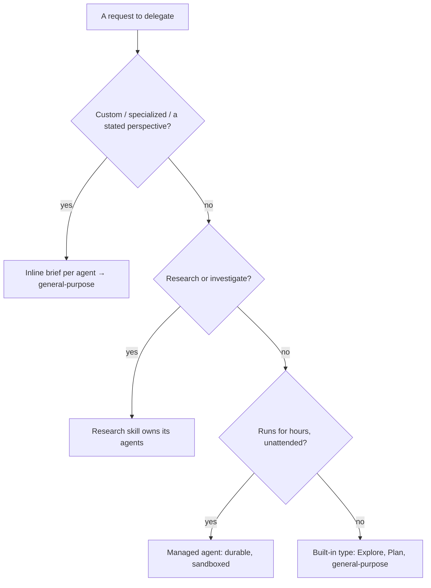

# LifeOS Agent System

> Agents are how the LifeOS parallelizes the hill-climb. One DA fronts the system (thesis: `../LifeOs/LifeOsThesis.md`), but closing a current→ideal-state gap often takes many hands — research fanned out, code written, work audited cross-vendor. The routing rules below exist so that fan-out stays deterministic and the right kind of worker handles each leg of the climb.

**Authoritative reference for agent routing in LifeOS. Three distinct systems exist—never confuse them.**

---

## 🚨 THREE AGENT SYSTEMS — CRITICAL DISTINCTION

LifeOS has three agent systems that serve different purposes. Confusing them causes routing failures.

| System | What It Is | When to Use | Has Unique Voice? |
|--------|-----------|-------------|-------------------|
| **Agent Tool Subagent Types** | Built-in types plus file-backed agents in `agents/` (Explore, Plan, general-purpose, Astra, Opus, Fable, the researchers) | Internal workflow use ONLY | No |
| **Named Agents** | Persistent identities with backstories and voices (your own personas) | Recurring work, voice output, relationships | Yes |
| **Custom Agents** | Agents composed as inline briefs (role/perspective/voice written into the prompt), launched with `general-purpose` | When user says "custom agents" | Yes (described in the brief) |

---

## 🚫 FORBIDDEN PATTERNS

> **Note:** `Architect`, `Designer`, and `Engineer` were retired as agent types, and so was the old `Agents` composition skill (`ComposeAgent`/`Traits.yaml`). Don't reach for a bare static built-in `subagent_type` when the user asks for custom agents — write a distinct inline brief per agent and launch with `general-purpose`.

**When user says "custom agents":**

```typescript
// ❌ WRONG - a bare static built-in subagent_type is NOT a custom agent
Agent({ subagent_type: "<static built-in type>", prompt: "..." })

// ✅ RIGHT - one distinct inline brief per agent, launched with general-purpose
//   (role, perspective, and voice written straight into the prompt)
Agent({ subagent_type: "general-purpose", prompt: "You are a <role> arguing from a <perspective> angle. …" })

// ❌ WRONG - "specialized agents to brainstorm", you reach for bare static types
Agent({ subagent_type: "<static built-in type>", prompt: "Brainstorm UI ideas..." })

// ✅ RIGHT - a topic-specific brief per perspective (as Council and RedTeam do)
Agent({ subagent_type: "general-purpose", prompt: "You are a skeptical UX critic. Brainstorm UI ideas, then attack your own. …" })
```

---

## Routing Rules

### The Word "Custom" Is the Trigger

| User Says | Action | Implementation |
|-----------|--------|----------------|
| "**custom agents**", "spin up **custom** agents" | Inline brief per agent | Write each brief, launch with `Agent({ subagent_type: "general-purpose", prompt: "<brief>" })` |
| "agents", "**specialized agents**", "launch agents", "parallel agents" | Inline briefs, one per perspective | `Agent({ subagent_type: "general-purpose", prompt: "<brief>" })` — batch in one message |
| "research X", "investigate Y" | Research skill | `Skill("Research")` → appropriate researcher agents |
| "use Remy", "get Ava to" | Named agent | Use appropriate researcher subagent_type |
| (Code implementation, standard) | `general-purpose` + senior-engineer/TDD brief | `Agent({ subagent_type: "general-purpose", prompt: "Senior engineer, TDD. …" })` |
| (Production-grade code, top intellectual work, a "no shortcuts" directive, OR named "Opus") | Opus build mode (Anthropic `opus`, in-process, high by default), the default when unsure (Algorithm § Routing); the max-rung case runs at xhigh | `Agent({ subagent_type: "Opus" })` (high); `Agent({ subagent_type: "Opus", effort: "xhigh" })` when the router says Opus at xhigh |
| (Exhaustive-coverage sweeps and the fixes out of them, needle-in-a-haystack hunts, OR named "Sol") | Sol (OpenAI worker via `codex exec`): `MODE: audit` for the sweep, build mode for the fix. Astra left automatic routing on 2026-10-12 and runs only when the principal names it | `Agent({ subagent_type: "Sol", prompt: "MODE: audit\n…" })` |
| (Cross-vendor audit, OPTIONAL — Algorithm's discretion) | Sol in audit mode (read-only, OpenAI lineage) | `Agent({ subagent_type: "Sol", prompt: "MODE: audit\n…" })` |
| (Deep analysis on a hard problem from outside the Claude family, OR named "Sol") | Sol in audit mode (OpenAI via `codex exec`, read-only at two layers) | `Agent({ subagent_type: "Sol", prompt: "MODE: audit\n…" })` |
| (Named "Fable", or the principal asks for the in-family top-rung read. The default second opinion on publish-bound, security and irreversible work is Sol in audit mode; Fable is picked only for the hardest judgment while the Fable budget is open, else on the principal's word, RouterSystem § Fable budget, 2026-10-16) | Fable (Anthropic top rung via the `fable` alias, xhigh, read-only) | `Agent({ subagent_type: "Fable" })` |
| (Execution that does not need this session's context: refactors, migrations, feature slices, renames, boilerplate) | Haiku at high effort (low rung, in-process Claude agent) for near-mechanical work; Sonnet at medium effort (`Agent({ subagent_type: "Sonnet", effort: "medium" })`) or Sol (OpenAI worker via `codex exec`, workspace-write) for the medium rung — pick the cheapest the task will survive | `Agent({ subagent_type: "Haiku", prompt: "…" })` |
| (Architecture/design) | `general-purpose` + system-design brief | `Agent({ subagent_type: "general-purpose", prompt: "System design / distributed systems. …" })` |
| (Claude Code hooks, settings, commands, MCP, agents, API) | Claude Code Guide | `Agent({ subagent_type: "claude-code-guide" })` — verify latest features before implementing |

### Custom Agent Creation Flow

When the user requests custom agents, compose each one as an **inline brief** — role, stance, and voice written straight into the prompt — and launch with `general-purpose`. There is no composition tool; Council and RedTeam build members this way (topic-specific briefs, never bare built-in types).

1. **Write a distinct brief per agent** — role, perspective, and the specific angle it argues from, directly in the prompt text
2. **Launch each** with `Agent({ subagent_type: "general-purpose", prompt: "<brief>" })`, batched in one message for parallelism
3. **Name siblings in every brief when tasks overlap.** Give each agent a `name`, list the other names in its brief, and say: message a sibling with `SendMessage` when your task overlaps theirs or you need a fact they hold, instead of guessing or returning early. The tool exists; agents only use it when the brief names who to reach. (Harvested 2026-09-17, Noam Brown: coordinator-children scaffolds fail because children cannot talk to each other and a stuck child either stalls or guesses.)
4. **Voice results** in the brief's described voice if voice output is wanted

```ts
// Example: 3 custom research agents, each a different inline brief
Agent({ subagent_type: "general-purpose", prompt: "You are an enthusiastic, exploratory researcher. …" })
Agent({ subagent_type: "general-purpose", prompt: "You are a skeptical, systematic researcher. …" })
Agent({ subagent_type: "general-purpose", prompt: "You are an analytical, synthesizing researcher. …" })
```

---

## ⚠️ Agent Tool Subagent Types — INTERNAL WORKFLOW USE ONLY

**These are NOT for user-requested custom/specialized agents.** When the user asks for specialized agents, custom agents, or agents with unique perspectives, write an inline brief and launch with `general-purpose` (as Council and RedTeam do). See Routing Rules above.

These are the types available to the **Agent** tool — built-ins plus the file-backed agents in `~/.claude/agents/`. The dispatch tool is `Agent(...)`; the older `Task(...)` call is retired and blocked by the `/ic` `retired-tokens` gate.

| Subagent Type | Purpose | When Used |
|---------------|---------|-----------|
| `general-purpose` | Custom agents via inline brief; code/design/architecture work with a role brief in the prompt | Parallel work with task-specific prompts (the `Architect`/`Designer`/`Engineer` types were retired — use this with a brief) |
| `Explore` | Codebase exploration | Finding files, understanding structure |
| `Plan` | Implementation planning | Plan mode |
| `Opus` | Anthropic-lineage coder + auditor (the `opus` alias, in-process) — `MODE: build` writes production code, `MODE: audit` is a read-only second look. The Anthropic counterpart to Astra; stood up 2026-09-10 when the Forge agent folded into Astra | Production-grade code on our own lineage; an engineering-shaped second look |
| `Astra` | OpenAI-family coder + deep-analysis agent (named Max until 2026-09-10 — agents carry the name of the model they run; "max intelligence" is a level, `INTELLIGENCE_AGENT` in `models.ts`, that resolves to Fable today; Astra left automatic routing on 2026-10-12, when Sol took over the OpenAI lane) (flagship at MEDIUM reasoning via `codex exec`, lane `CROSS_VENDOR.astra`, isolated codex home). `MODE: audit` (default) is read-only at two layers — the codex child's `--sandbox read-only` plus Astra's contract; `MODE: build` (workspace-write) writes production code, absorbing the Forge agent 2026-09-10. Shares one personality with Opus and Fable — inlined byte-identically in the three agent files, held there by the `/ic` `agent-shared-blocks` gate | Runs only when the principal names it; Sol carries the OpenAI lane, audits and exhaustive sweeps included. Never reviews its own or a worker's build (that goes to Opus, or Fable on the principal's word) |
| `Fable` | Anthropic-family deep-analysis agent (top rung via the `fable` alias at xhigh; Edit/Write denied at the permission layer). Same shared personality block | The in-family second look, and the scrutiny pass on super-sensitive work (public LifeOS releases, security boundaries, irreversible actions — Lane B of the shadow-release cut). On public-or-permanent work, run alongside Sol in audit mode: Fable brings the in-family depth, Sol brings a different vendor's distribution |
| `Sonnet` | Anthropic-family executor on the `sonnet` alias, in-process, no codex. Carries execution once the approach is set (Algorithm § Routing, rule 5) and the routine checker at medium effort; the file runs at high, and the router's medium or xhigh pick is passed as the Agent tool's `effort` parameter | Building to a brief, bug fixes, documents, slides, UI polish. Not for open design or taste calls, and never audits its own build |
| `Haiku` | Anthropic-family cheap worker on the `haiku` alias (`CURRENT.haiku`), in-process on the subscription, no codex. Haiku runs at high effort and carries the low rung (2026-10-07, in place of the retired Terra and Luna codex workers); a routed medium effort is passed as the Agent tool's `effort` parameter and sits on no rung | Near-mechanical work with a clear brief — renames, reformatting, boilerplate, one-file fixes, small scripts. Not for open judgment, design or production-critical paths |
| `Sol` | Codex worker on OpenAI's GPT-6.1 Sol (lane `sol`; isolated codex home; wrapper pinned to `sonnet`). `MODE: build` (default, workspace-write) returns a `WORKER REPORT` with the co-author trailer the commit carries. `MODE: audit` is read-only and is the OpenAI eye Astra carried until 2026-10-12 | Build: execution that must run on OpenAI (scheduled jobs, the Codex door) or on the principal's word; refactors and migrations too big for Haiku. Audit: exhaustive coverage of a giant corpus or codebase, needle-in-a-haystack hunts, security reads, the cross-vendor second opinion. Never audits work Sol built |
| Effort on a Claude agent | The Agent tool's `effort` parameter (`low`, `medium`, `high`, `xhigh`, `max`; Claude Code 2.1.292) runs a subagent at the effort you ask for. It overrides the agent file's frontmatter `effort:` and survives resume. A route is the base agent plus an effort: `Agent({ subagent_type: "Opus", effort: "xhigh" })`. The six generated variant files (`OpusMedium`, `OpusXHigh`, `SonnetMedium`, `SonnetXHigh`, `FableHigh`, `HaikuMedium`) and their generator `AgentVariants.ts` were retired 2026-10-15. Their names survive only in old transcripts and logs, where `baseAgentOf` (`LIFEOS/TOOLS/models.ts`) maps each to its base agent, and an installed copy has the files moved aside on upgrade (`RETIREMENTS.json`) | Pass `effort` when the router names an effort other than the file's own (`effort: "xhigh"` for a binding max route). The effort range rule still holds: never below medium, never `max` (RouterSystem.md § effort) |
| `Argon` / `Grok` / `Muse` | Cross-vendor agents for a third, fourth and fifth vendor's read. `Argon` runs Gemini 4 Argon, Google's top model, through `LIFEOS/TOOLS/GeminiSearch.ts --pro` (Google is a trusted vendor for private data). `Grok` runs xAI's model through `LIFEOS/TOOLS/GrokQuery.ts` and takes non-sensitive work only. `Muse` runs Meta's model through `LIFEOS/TOOLS/Muse.ts` on public data only and is never routed automatically | Vendor panels and bake-offs, grounded or public-material takes. Never the reasoning, audit or second-look lanes (Grok, Muse); which lane runs second opinions is Algorithm § Routing |
| `claude-code-guide` | Claude Code knowledge (hooks, settings, slash commands, MCP, agent types, keybindings, IDE, Agent SDK, Claude API) | Any task involving Claude Code internals — freshness check before implementing |
| `ClaudeResearcher` | Ava Sterling — academic/scholarly research via Claude WebSearch; query decomposition, strategic framing | Research skill intents |
| `GeminiResearcher` | Alex Rivera — multi-perspective research via `GeminiSearch.ts` (REST + Search grounding; the `gemini` CLI cannot auth non-interactively here); 3–10 angles, stress-tested conclusions. Research lane only (trusted-vendor rule keeps reasoning/audit on Anthropic + OpenAI) | Research skill intents |
| `PerplexityResearcher` | Ava Chen — investigative research via `LIFEOS/TOOLS/PerplexitySearch.ts`; source credibility, evidence trail | Research skill intents |
| `CodexResearcher` | Remy — technical/code research via `codex exec`, read-only sandbox + `tools.web_search=true` (model from `CROSS_VENDOR` in models.ts) | Routed by the technical signal in Research/SourceRoutingProtocol.md, or named |
| `Socrates` | Socratic tutor for students — teaches by asking, never gives the answer or writes the deliverable; Edit/Write/Bash/Web denied in frontmatter. Public copy with install steps on the LifeOS website's `/agents` page. Not the standing-question ledger of the same name (`LIFEOS/SOCRATES/`, Pulse `/socrates`) — that is a subsystem; this is an Agent-tool type | Named by a parent or student ("help me with my homework without doing it"), or run as a whole session via `claude --agent Socrates` |

Subagents, whether launched through the Agent tool or as a Claude Code workflow lane, are held by native enforcement since 2026-10-24: the `SubagentShipGuard` hook and its release probe were retired, and `Hooks/HookSystem.md` § Native enforcement has the mapping. The shared `permissions.deny` and `ask` rules apply to them exactly as to the main session, and cover deploy commands, raw provider writes, purchases and inline legacy scripting. A Seatbelt profile around subagent Bash (`hooks/SubagentGitSandbox.hook.ts`) refuses writes to the private trees' `.git`, which covers `.git/hooks`, `.git/config` and commits in those trees. A subagent may push to a private remote only as far as the tree's `pre-push` allows. The main session still lands, ticks the ISA, pushes and deploys; that division is a rule for agent briefs, not a hook.

**The built-in types above do NOT have unique voices. The file-backed agents (`agents/*.md`) do** — persona + voice settings live in their frontmatter.

---

## Named Agents (Persistent Identities)

Named agents have rich backstories, personality traits, and mapped voices. They provide relationship continuity across sessions. **Compose your own named-agent roster** — the examples below are illustrative; every LifeOS user defines their own personas.

| Agent (example) | Role | Voice | Use For |
|-----------------|------|-------|---------|
| Architecture Lead | Architecture lead | Premium voice preset | Long-term architecture decisions |
| Senior Engineer | Senior engineer | Premium voice preset | Strategic technical leadership |
| Security Specialist | Offensive security | Enhanced voice preset | Red-team review, vulnerability hunting |
| Primary Researcher | Strategic research lead | Premium voice preset | Deep research + synthesis |
| Secondary Researcher | Multi-perspective research | Alternate voice preset | Comparative analysis |

**Full backstories and voice settings:** Individual `agents/*.md` files (persona frontmatter + body) — define your own.

---

## Custom Agents (Inline Briefs)

Custom agents are composed on the fly by writing an **inline brief** into the prompt — no tool, no registry. The trait vocabulary below is a menu to draw from when writing a brief: state the expertise, personality, and approach in prose, then launch with `general-purpose`.

### Trait Vocabulary

**Expertise** (domain knowledge):
`security`, `legal`, `finance`, `medical`, `technical`, `research`, `creative`, `business`, `data`, `communications`

**Personality** (behavior style):
`skeptical`, `enthusiastic`, `cautious`, `bold`, `analytical`, `creative`, `empathetic`, `contrarian`, `pragmatic`, `meticulous`

**Approach** (work style):
`thorough`, `rapid`, `systematic`, `exploratory`, `comparative`, `synthesizing`, `adversarial`, `consultative`

**Traits and voice** are described in prose inside each agent's brief — there is no separate trait registry or voice-mapping table.

---

## Model Selection

**The default is inheritance — omit `model` and the dispatch runs the session model.** The old rule ("always specify a model on every dispatch") was RETIRED 2026-07-26: naming a model is the thing that goes stale, and inheritance already produces the intended carrier. Set `model` only when the work genuinely belongs on a different rung than the session.

When you do set it, pass a **tier ALIAS**, never a pinned ID — the harness resolves an alias to the latest model in that tier, which is the system's auto-update mechanism. The rung→tier binding lives in `LIFEOS/TOOLS/models.ts` (`EFFORT_MODEL`); the role-based rubric for *which* rung a class of work earns lives in one place, `OPERATIONAL_PREFERENCES § Model selection`. Never restate either here. On an install whose work ladder (`WORK_LADDER` in the same file) puts the OpenAI workers below the top rung, a leg goes down by dispatching Haiku, Sonnet at medium effort or Sol, and the tier alias is left for the exceptions that rubric names.

```typescript
// Default — inherits the session model. This is correct almost always.
Agent({ subagent_type: "general-purpose", prompt: agentPrompt })

// Long mechanical execution belongs on the Sol work lane
Agent({ subagent_type: "Sol", prompt: agentPrompt })
```

An agent file may also pin its own rung in frontmatter (`model: fable` in `Fable.md`; the codex-backed agents pin a cheap alias for their Claude-side wrapper — `sonnet` on Astra and Sol — because the thinking happens in the codex child, resolved from `CROSS_VENDOR` by the agent's lane), which the dispatch inherits unless overridden. `hooks/AgentInvocation.hook.ts` observes and logs the resolved model for every dispatch; the status line lights the rung that actually ran.

---

## Spotcheck Pattern

After a parallel fan-out, a cheap consistency pass across the outputs catches the contradictions no single agent can see. Elect it by judgment — it is one item on the capability menu, not a mandate — and note that a spotcheck is **not** an independent second look under Algorithm criterion 11: it checks agreement between outputs, not whether they are right.

```typescript
Agent({
  prompt: "Verify consistency across all agent outputs: [results]. Name every contradiction; do not resolve them silently.",
  subagent_type: "Haiku", effort: "medium"  // light comparison; escalate if the contradictions require deeper judgment
})
```

---

## Knowledge Archive Access

Agents can query the **Knowledge Archive** (`~/.claude/LIFEOS/MEMORY/KNOWLEDGE/`) for accumulated knowledge organized by 4 entity types: People (human beings), Companies (organizations), Ideas (insights/theses/analyses), Research (longer-form research notes). Topic is a tag, not a domain. Managed by Algorithm LEARN phase (direct writes), `LIFEOS/TOOLS/KnowledgeHarvester.ts` (validation/maintenance), and the Cortex skill. Particularly useful for research agents and custom agents composed with specialized traits.

---

## Managed Agents (Cloud API)

Anthropic's hosted agent service for long-horizon, unattended work. **Separate from Claude Code** — runs on Anthropic's cloud infrastructure with durable sessions and sandboxed execution.

**Status:** Beta. All API accounts have access. Beta header: `anthropic-beta: managed-agents-2026-04-01` (SDK handles automatically).
**Pricing:** Standard token costs + $0.08/active session-hour (pro-rated).
**Docs:** https://www.anthropic.com/engineering/managed-agents

### Architecture

Three decoupled components:
- **Brain** (Claude + harness) — stateless inference, restarts without data loss
- **Hands** (execution environments) — sandboxed containers, provisioned on-demand
- **Session** (durable event log) — append-only, survives crashes, resumes via `wake(sessionId)`

### API Surface

| Endpoint | Purpose |
|----------|---------|
| `POST /v1/agents` | Create reusable agent blueprint (model, system, tools) |
| `POST /v1/environments` | Create container config (packages, networking, secrets) |
| `POST /v1/sessions` | Start a running instance from agent + environment |
| `POST /v1/sessions/{id}/events` | Send messages/tool results |
| `GET /v1/sessions/{id}/stream` | SSE event stream |

### When to Use

- Task runs for **hours unattended** (overnight security scans, content processing)
- Needs to **survive disconnects** (durable event log, not session-scoped)
- Requires **sandboxed execution** (untrusted code, credential isolation via vaults)
- Triggered by **CI/external event** (webhook-initiated, not interactive)

### When NOT to Use

- Interactive work (use Agent Teams or Custom Agents)
- Tasks under 30 minutes (coordination overhead exceeds benefit)
- Tasks needing LifeOS context (managed agents don't load CLAUDE.md or LifeOS skills)

### Example (TypeScript)

```typescript
import Anthropic from "@anthropic-ai/sdk";
const client = new Anthropic();

const agent = await client.beta.agents.create({
  name: "Security Scanner",
  model: "claude-sonnet-5-5",   // pinned IDs rot — check LIFEOS/TOOLS/models.ts for current
  system: "You are a security auditor...",
  tools: [{ type: "agent_toolset_20260401" }],
});

const env = await client.beta.environments.create({
  name: "scanner-env",
  config: { type: "cloud", networking: { type: "unrestricted" } },
});

const session = await client.beta.sessions.create({
  agent: agent.id,
  environment_id: env.id,
});

// Stream results
const stream = await client.beta.sessions.events.stream(session.id);
await client.beta.sessions.events.send(session.id, {
  events: [{ type: "user.message", content: [{ type: "text", text: "Audit the auth module" }] }],
});
```

---

## Agent System Preference Order

When the Algorithm needs to delegate work, use this priority:

| Priority | System | Trigger | Key Trait |
|----------|--------|---------|-----------|
| **1. DEFAULT** | Agent Teams | Any parallel work, task dependencies, coordination needed | Persistent, peer messaging, shared task list |
| **2. EXPLICIT** | Custom Agents | The principal says "custom agents" | Unique personalities, voices, one-shot |
| **3. UNATTENDED** | Managed Agents | Overnight, CI, survives disconnects | Durable, sandboxed, cloud |
| **4. INTERNAL** | Built-in types | Algorithm routing, specific subagent type needed | Explore, Plan, general-purpose, etc. |

---

## Stray Processes

Claude Code draws the running work itself: `/tasks`, `/workflows`, the subagent panel and `claude agents` show every agent, fork and workflow with its status. Nothing in LifeOS draws agents, workflows or running shells (2026-10-11). What Claude Code lacks is reaping: nothing kills a background subagent's Bash after the turn, terminal sessions put no time limit on background commands, and commands survive the session's process. `LIFEOS/TOOLS/SessionTree.ts` fills that gap and nothing else. The LifeOSHooks plugin runs it every 10 s, handing it the feed's own agent statuses and stop times (never inferred) and its record of which subagent ran each Bash command.

- **Kinds.** Only work-shaped processes (bun, node, codex, workerd, vite, headless Chrome) ever qualify, never an app, a terminal, a VM or a daemon launched from a session. `orphaned`: a session process launchd adopted, older than the 30-minute agent budget. `agent-stopped`: a process an agent started before it stopped, still running five minutes after (an agent may hand a process to its caller; five minutes is the window to take it over). `over-deadline`: a process the live session's own shell started, with no agent owning it, older than 30 minutes; flagged, never reaped. `hung-hook`: a hook past 10 minutes; flagged only. `dead-session`: a work process launchd adopted after its Claude session died, older than ten minutes.
- **Reaping.** The plugin kills this session's `orphaned` and `agent-stopped` processes within seconds of finding them; OrphanReaper kills `dead-session` ones on its 15-minute clock. Kills log to `MEMORY/OBSERVABILITY/session-tree-reaps.jsonl` and `orphan-reaper.jsonl`. Each pass writes `MEMORY/STATE/session-tree/<session>.json`, and Vigil's `running` adapter reads the verdicts from every live session, so stray work reaches the principal even when nobody is looking at the terminal that started it. **A process meant to outlive its call declares it**: spawn it with `LIFEOS_DETACH_OK=<reason>` in its environment (ManageDevServer, Tome and Bunker's code sweep do); nothing carrying it is ever selected. (Fable audit, 2026-09-29: the first version killed at 60 s by tag alone and took an interceptor-daemon.)
- **Ownership** is ancestry under the session's claude pid, or the `CLAUDE_CODE_SESSION_ID` every Bash child inherits, which `ps -E` still reads after the parent dies. macOS hides the environment of system binaries (`zsh`, `sleep`), so neither signal alone is enough. A tag alone proves only launched-from: a terminal opened from a session hands the tag to everything typed in it. So a straggler must also have been started by the session: it shares the claude process's terminal identity (`KITTY_PID`, `KITTY_WINDOW_ID`, `HERDR_PANE_ID` and the like, kept in the state file for after the session dies), and a dead session's leftover must have started before that session's last transcript write. When either is unknown, nothing is selected.
- **By hand:** `bun LIFEOS/TOOLS/SessionTree.ts show` (inside a session, or `--session <id>`) lists the session's stragglers and work processes, `--json` for the raw result, `reap` for a dry run, `reap --apply` to kill. A hand-run reap selects only `orphaned`: `agent-stopped` needs the plugin's agent stop times, so it is the plugin's job.

## Agent Watchdog (Background Agent Monitoring)

Background agents can hang or go silent with no visibility. The Pulse agent-guard hook used to inject a Monitor watchdog reminder when `run_in_background: true` agents were spawned; it was retired 2026-10-01 (mods redesign F7): its watchdog text asked the model to arm and re-arm a polling Monitor, which the standing no-polling rule forbids, and Workflows now own agent deadlines (the AgentBudget hook was retired 2026-10-24). The watchdog, run by hand, (`LIFEOS/TOOLS/AgentWatchdog.ts`) monitors `tool-activity.jsonl` for silence — if no tool calls for 90 seconds while agents are active, it alerts via the Monitor tool's stdout notification mechanism. One persistent watchdog covers all background agents per session.

---

## Examples

### One request, routed three ways

A developer building a recipe app fires off three requests in a row. Each lands in a different agent system — and telling them apart is the whole skill.

- **"Spin up three custom agents to critique my signup screen."** The word *custom* is the trigger. This is three inline briefs — role, stance, and voice written straight into each prompt — launched with `general-purpose`, batched in one message. Reaching for a bare built-in `subagent_type` here is the classic miss: a built-in type is not a custom agent.
- **"Go find where the checkout total is calculated."** No persona, no perspective — just a codebase search. That routes to the built-in `Explore` type, internal-workflow machinery with no voice and no backstory. Composing a custom brief for this would be ceremony the task never asked for.
- **"Research the best way to store currency amounts."** The verb *research* routes to the Research skill, which owns its own researcher agents. The developer never hand-spawns anything.

Same developer, same minute, three systems — because the shape of the request, not a default, decides.

### When a custom agent is the wrong call

The tell is whether the work needs a *point of view*. A skeptical critic, a bold contrarian, a cautious reviewer — those are inline briefs, because the perspective is the product. Finding a file, planning an implementation, or running an overnight job needs a capability, not a personality, so it routes to a built-in type or a managed agent instead. "Give me agents" alone is ambiguous; the angle each one argues from is what makes them custom.

### The routing decision as a picture



The diagram is the routing table collapsed to the one question that matters at each fork: does the work need a voice, does it need the web, does it need to survive a disconnect? Answer those in order and every request lands in exactly one system — which is what keeps fan-out deterministic instead of a guess.

---

## References

- **Master Architecture:** `~/.claude/LIFEOS/DOCUMENTATION/LifeosSystemArchitecture.md` — authoritative system-of-systems reference
- **Agent Personalities:** Individual `agents/*.md` files — Named agent backstories and voice settings
- **Managed Agents:** https://www.anthropic.com/engineering/managed-agents — Anthropic cloud agent API

---

*Last updated: 2026-10-13*
