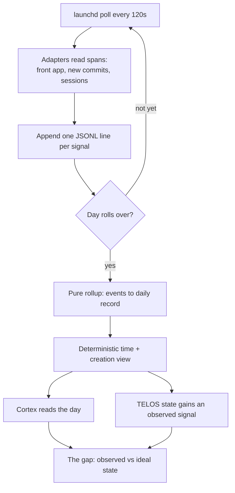

# Conduit — LifeOS's Sensory Layer

> **Conduit is the "current-state" pole of the current→ideal loop.** LifeOS has always
> known your ideal state (TELOS) but not your actual state — what you do day to day. So
> it could not answer "are we working on the right stuff?" Conduit gives LifeOS eyes: a
> local, continuous, opt-in capture layer that records where attention actually goes,
> rolls it into a daily record, and feeds that record to Cortex (the memory system) and TELOS.
> In the sensory stack, Conduit is the **internal sense** — Feed is the external one, and
> Synapse (`Synapse/SynapseSystem.md`) is the router that grades and routes captured signal.

**Current-state split:** Atlas (`../Atlas/AtlasSystem.md`) is the state of owned assets, Conduit is the principal's observed activity, and Vigil (`../Vigil/VigilSystem.md`) carries events.

**Component version:** Conduit v1.2.0 (`CONDUIT_VERSION` in `LIFEOS/PULSE/Conduit/version.ts`) · first shipped in LifeOS 6.1.0.

## Design principles

- **A mirror you pull, not a watcher that pushes.** Conduit hands you your own attention
  back; it never volunteers a verdict and never produces a single alignment "score"
  (that would just invite gaming — Meadows LP3). Distribution + record, you judge.
- **Perception feeds the existing loop.** Conduit is one new input that makes memory
  curation, WorkSweep, TELOS state, and Pulse smarter — not a second dashboard.
- **Highest signal tier per source; watch the account, not the window.** Where a source
  has an API (Gmail, Calendar, GitHub), read the account, not the app's pixels.
- **Stable by construction.** Capture and rollup are deterministic — no model, no
  long-lived daemon. Stateless launchd polls, fault-isolated adapters, a pure rollup.
  The one model call is the separate insight job, described below.
- **Capture and storage are local; one bounded summary goes to the model.** Raw
  events and daily records live under `USER/CONDUIT/` on this machine. The insight
  job (`com.lifeos.conduit.insight`, installed and on by default with the capture
  job) sends a metadata-only summary of the day to the configured model provider
  through Inference: foreground app names with minutes, LifeOS session slugs, git
  commit subjects, and pull-request titles. Never file contents, keystrokes,
  screenshots, or diffs. Data sent for inference is subject to the provider's
  data-handling terms. To keep everything on the machine, unload
  `com.lifeos.conduit.insight` (`bun LIFEOS/TOOLS/Services.ts uninstall --only com.lifeos.conduit.insight`)
  and the Insight tab reads its last cached file only. (public issue #2054, @ForgottenFates7)

## Where things live (the hard boundary)

| Kind | Location |
|------|----------|
| **Code** (system area) | `LIFEOS/PULSE/Conduit/` + Pulse module `LIFEOS/PULSE/modules/conduit.ts` |
| **Data** (USER) | `LIFEOS/USER/CONDUIT/` — `config.json`, `state.json`, `events/<date>.jsonl`, `daily/<date>.{md,json}`, `logs/` |

Only code lives in the code area; every byte Conduit captures lives under `USER/`.

## Architecture

```
launchd (com.lifeos.conduit, every 120s)
      │  conduit capture
      ▼
┌─────────────── adapters (fault-isolated) ───────────────┐
│ appFocus (osascript front app)                          │
│ git (new commits across configured repos)               │
│ claudeSession (reads MEMORY/STATE/work-events.jsonl)    │
│ github (opt-in: your commits and PRs through gh)        │
└──────────────────────┬──────────────────────────────────┘
                       ▼
        USER/CONDUIT/events/<date>.jsonl  (append-only raw)
                       │  (day rolls over)
                       ▼
        rollup.ts  →  deterministic DailyRecord
                       ▼
        USER/CONDUIT/daily/<date>.{md,json}
                       │
        ┌──────────────┼───────────────┬──────────────┐
        ▼              ▼               ▼              ▼
   Pulse module   Cortex (memory)  TELOS/LIFEOS_STATE  WorkSweep
   (/api/conduit) (daily context) (observed vs ideal) (untracked work)
```

### The Cortex leg (v1.2, 2026-08-27)

Every daily record mirrors into Cortex as a typed Knowledge note the moment it persists:
`KNOWLEDGE/Research/conduit-day-<date>.md`, carrying the deterministic record, the hourly
content-type read's narrative when one exists, and `source_conduit_date:` pointing back.
The daily JSON carries the forward `cortexRef` — the same bidirectional-link contract the
Synapse amber ledger uses (`routed_refs` ⟷ `source_amber_id`). Deterministic, idempotent,
best-effort: a Cortex write failure never blocks the daily record, and the next rollup
retries. Code: `Conduit/cortexNote.ts`, wired in `rollup.ts writeDailyRecord`.

### Event schema

One JSONL line per captured signal. Spans + metadata only — never keystrokes or content.

```ts
interface ConduitEvent {
  ts: string;                    // ISO-8601 UTC
  type: "app-focus" | "git-commit" | "claude-session" | "github-pr";
  source: string;                // adapter id
  app?: string; repo?: string;   // dimension keys
  detail?: Record<string, unknown>;
}
```

### Deterministic rollup

`buildDailyRecord` is pure (input events → record, no side effects, no model). Each
app-focus event contributes one poll interval to its app's time; a sleep gap never
inflates time because launchd fires no polls while asleep. The classifier (`classify.ts`)
splits apps into creation / consumption / neutral by a static, editable map — the honest
v1 proxy for challenge C1. `narrative` and `telosTags` are reserved seams, null/empty in v1.

## Integration with TELOS (current → ideal)

- **Join key = TELOS IDs.** The v2 scoring layer tags each block with a goal/dimension/
  challenge ID; that tag is the foreign key between observed and ideal.
- **Read side (not built):** the rollup does not read TELOS yet; `telosTags` is still `{}` in `rollup.ts` and the v2 scoring layer is gated on the D-11 spike. Today TELOS-side code reads Conduit instead (see the write side).
- **Write side:** Conduit writes the daily record under `USER/CONDUIT/daily/`. `LIFEOS/TOOLS/StateEvidence.ts` (`gatherActivity`) reads those files as the activity evidence (creation ratio, weekly computer time) that the TELOS renderer writes into TELOS Current State and `InterviewDue.ts` uses for staleness. `UpdateLifeosState.ts` does not read Conduit.
- **Invariant:** TELOS owns ideal state, Conduit owns observed state; **neither writes
  the other's file.** They meet only at the gap computation (`LIFEOS_STATE` and `IdealState.ts gap`).
  Conduit may never edit a goal.
- **Update mechanism:** two clocks. The launchd capture job polls continuously and rolls any past day that has raw events but no record; the insight job runs hourly. The TELOS evidence readers pull the daily records when they run. `DerivedSync.ts` does not watch `USER/CONDUIT/`, so a daily-record write does not trigger a LIFEOS_STATE recompute.

## CLI

```
bun LIFEOS/PULSE/Conduit/conduit.ts <command>
  capture         run enabled adapters once, append events, lazy-roll the prior day
  rollup [date]   build + persist the daily record (default: today)
  today           print today's live distribution (not persisted)
  status          config + today's event count
  init            write default config under USER
  version         print Conduit version
```

## Install (launchd)

```
bun LIFEOS/PULSE/Conduit/InstallConduit.ts             # install + load (polls every 120s)
bun LIFEOS/PULSE/Conduit/InstallConduit.ts --status    # launchd state
bun LIFEOS/PULSE/Conduit/InstallConduit.ts --uninstall # unload + remove
```

## Pulse surfaces (data/code separated)

1. **Dashboard tab** (`/conduit`) — the primary surface, a Next.js client component at
   `Observability/src/app/conduit/page.tsx` (static-exported to `out/`, served by `pulse.ts`).
   It holds **ZERO data**: it fetches everything live from `/api/conduit/*` and renders. Three
   panels answer the three questions the sensory layer exists to answer — **what's flowing in**
   (the hourly content-type read), **sources & cadence** (per-source status), and the deterministic
   time/creation view — plus an honest empty-state when no read exists yet.
2. **JSON API** (`PULSE/modules/conduit.ts`, loaded in `pulse.ts` `loadModules()`; read-only over `USER/CONDUIT`):
   - `GET /api/conduit/today` — today's live deterministic record
   - `GET /api/conduit/recent?days=N` — last N daily records
   - `GET /api/conduit/sources` — **per-source status**: id, label, one-line "what it captures",
     enabled, `pollIntervalSec`, `eventsToday`, `lastEventTs`. Deterministic — from config + events, no model.
   - `GET /api/conduit/insight` — the latest **content-type read** (falls back to the most recent
     day when today's is absent, `stale: true`; a failed/empty read serves `available: false`).
   - `POST /api/conduit/insight/build` — run the insight job now; answers 202 and `GET /insight` then reports `building` (POST only, 405 otherwise).
   - `GET /api/conduit/status` — module health.

All hold zero data in code — they render/serve the contents of USER data.

## Content-type read (the hourly cheap-inference layer)

The "what kind of stuff is coming in?" question is the one genuinely non-deterministic part, so it —
and only it — uses a model. `Conduit/BuildInsight.ts` runs **hourly** under launchd
(`com.lifeos.conduit.insight`, `InstallConduitInsight.ts`), reads the day's events, builds a
**metadata-only, bounded** summary (top-15 apps + minutes, git commit subjects, session slugs, PR titles — never content),
and calls the vendor-configurable `LIFEOS/TOOLS/Inference.ts --level low` lane, using that vendor's
configured billing path. It writes `USER/CONDUIT/insights/<date>.json`
(`narrative` + weighted `contentTypes[]`). **Cheap & sustainable by construction:** cheapest rung, one
call per hour, **idempotent** — a `since` watermark skips the call entirely on an idle hour, and a
failed read never clobbers a good one. The tab reads the cached file; it never calls a model on load.

> launchd gives jobs a minimal PATH that lacks `claude`, so the installer bakes the installer's PATH
> into the plist (`EnvironmentVariables`) — otherwise the scheduled job `spawn ENOENT`s and falls back
> forever. On Linux both installers write a `systemd --user` unit instead (`LIFEOS/TOOLS/lib/SystemdUser.ts`, same installer-PATH bake). The app-focus adapter is macOS-only (`osascript`); elsewhere rollup falls back to time derived from session cadence and labels it as derived.

## Configuration (`USER/CONDUIT/config.json`)

```json
{
  "enabled": true,
  "pollIntervalSec": 120,
  "sources": { "appFocus": true, "git": true, "claudeSession": true, "github": false },
  "repos": [],
  "retentionDays": 30
}
```

Per-source opt-in is first-class; `github` is off by default. When on, it reads your own commits and pull requests from GitHub's per-user event feed through the `gh` CLI (resolved from PATH, never from config). `githubUser` (default: the `gh`-authenticated login) and `githubConfigDir` (a `GH_CONFIG_DIR` for `gh`) are optional. `repos` is the list of absolute paths watched for
commits. Raw event logs older than `retentionDays` are pruned after rollup; daily
records are kept.

## Privacy contract

- Capture and storage are local: all data under `USER/CONDUIT/`. The insight job is the
  one outbound path — a bounded metadata summary (app names + minutes, session slugs,
  git commit subjects, PR titles) to the model provider, hourly, on by default. Opt out by
  unloading `com.lifeos.conduit.insight`; the only other outbound path is the opt-in `github` source (off by default), which reads your own activity from GitHub through `gh`.
  (public issue #2054, @ForgottenFates7)
- Per-source opt-in; disable any source in config.
- Tiered retention: raw discarded after `retentionDays`; daily record kept.
- Kill switch: `enabled: false`, or `InstallConduit.ts --uninstall`.
- No screenshots, no window titles, no message content in v1.

## Versioning

`CONDUIT_VERSION` (`version.ts`) tracks the component; bump on any change to the event
schema, adapter contract, or rollup format. Conduit v1.0.0 first shipped in LifeOS 6.1.0; the current version is 1.2.0.

## Roadmap

- **v1 (shipped):** deterministic capture (appFocus + git + claudeSession) → daily record; launchd; Pulse module; retention.
- **v1.1 (shipped 2026-07-05):** intuitive tab — sources & cadence panel (`/api/conduit/sources`), the hourly cheap-inference **content-type read** (`BuildInsight.ts` → `insights/<date>.json` → `/api/conduit/insight`), honest empty/stale states. Subscription inference, `--level low`, idempotent skip-on-idle. This is the pragmatic realization of the `narrative` seam via subscription inference (vs the Ollama-class local model originally sketched for v2).
- **v2 — TELOS scoring:** activity→TELOS-goal tagging, filling the `telosTags` seam. **Gated by the D-11 validation spike** (can a cheap model reliably tag a synthetic day against TELOS?).
- **v3 — reach adapters:** wire the inbox and calendar skills as tier-1 account readers.
- **v1.5 — browser adapter:** Chrome extension → active URL (makes in-browser C1 visible).
- **later:** iMessage metadata; optional screenshot/vision fallback.

## Examples

### A day, handed back to you

The whole idea at its smallest: **you think you spent the day writing, and the mirror says otherwise.**

A writer sits down meaning to work on a book chapter. At day's end Conduit's daily record shows where attention actually went — three hours in a chat app, ninety minutes in email, forty minutes in the editor. Nothing accuses; the record just lays the day out. The writer reads it and decides for themselves: the morning got eaten, the afternoon was real.

That is the entire contract. Conduit captured spans (which app was in front, for how long) and never a keystroke of what was typed. It rolled them into one deterministic record. It offered no score, no "you were 40% aligned" verdict — because a single number would just invite gaming. Distribution plus record; you judge.

### When the mirror is honestly blank

The reinforcing case is what Conduit *doesn't* see. v1 watches the front app, new commits, and coding sessions — it has no browser adapter. So a day spent entirely on in-browser research reads as near-empty.

That is honest incompleteness, not a false verdict:

- **A source it can read** (the editor, a git repo) shows up as real time.
- **A source it can't** (an active browser tab) is absent — and the tab says "no browser adapter yet," not "you did nothing."
- **A source you switched off** in config is absent by your own choice.

The blank is a boundary of perception, surfaced plainly, never dressed up as a judgment.

### One day, capture to gap



The diagram is the sensory loop in one frame: cheap polls accrete raw spans all day, a pure function folds them into one record at rollover, and that record meets TELOS only at the gap — where observed state is compared to ideal state, and neither side ever writes the other's file.

---

## Cross-references

- Pulse: `LIFEOS/DOCUMENTATION/Pulse/PulseSystem.md`
- Cortex (memory): `LIFEOS/DOCUMENTATION/Memory/MemorySystem.md`
- TELOS derived-state: `LIFEOS/TOOLS/UpdateLifeosState.ts`, `DerivedSync.ts`
