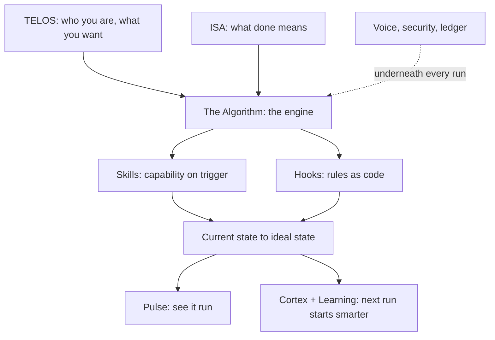

# LifeOS Core Components

LifeOS is the AI harness that moves you from where you are now to where you want to be — an intent engineering platform. Every task — shipping code, writing an essay, making a decision — is the same move, from **current state to ideal state**, pursued through verifiable iteration, with your ultimate intent conveyed into every run.

That one loop is built from a set of components — the **unique features** that make LifeOS what it is. You won't find this combination anywhere else. Anything a good harness already provides on its own (built-in subagents, for example) isn't listed here; this map is only the parts LifeOS adds.

This doc is the canonical map. Each component links to its full reference.

---

## The Unique Features

The twenty-seven things that make LifeOS LifeOS.

### 1. Current State → Ideal State

The whole philosophy in one line: name where you are, name where you want to be, then close the gap with steps you can check. Ideal state is written down as testable criteria, so "done" can't drift — you either meet the criteria or you don't. Everything else in the system serves this move.

→ `LifeOs/LifeOsThesis.md`

### 2. Intent Engineering

The platform's defining job: capture what you ultimately want — TELOS for your life, ISAs per task — and convey that intent to your AI on every run, then verify the output against it. Direction, not execution, is AI's bottleneck; this component is the fix. And it's still prompting: the WHAT layer of it, productized.

→ `LifeOs/LifeOsThesis.md`

### 3. General Hill Climbing

The loop under everything. Your ideal state is the top of the hill, broken into testable criteria that tell up from down. On every task the system picks the next move that reduces the gap, checks it against those criteria, and keeps what moves uphill. It's general because the same climb works for any goal — code, writing, health, a hard decision — not just one kind of work. No check means no gradient, so verification is what makes the climb real.

→ `LifeOs/LifeOsThesis.md`

### 4. Euphoric Surprise

The metric the whole climb aims at: a response so good you say it out loud, "OMG, this is brilliant," rated a 9 or 10. Naming Euphoric Surprise as the target keeps the bar higher than merely good enough, and it holds across everything you do, code, writing, a decision, a design, because every task climbs toward an ideal state, and this is what reaching it feels like. It is the meta-ideal-state of every ISA: each ISA names the specific ideal state of one piece of work, and above every one sits this same universal goal, so every climb is toward both at once.

→ `LifeOs/LifeOsThesis.md`

### 5. TELOS

Where you write down who you are and what you're trying to do: your mission, goals, problems, strategies, beliefs, and challenges. You don't start from a blank file — LifeOS interviews you to draw it out, asking what you're building, who matters to you, and where you want to go, then writes it down for you. From then on every recommendation is framed against it, so the system works toward your actual life, not a generic answer.

→ `LifeOs/LifeOsThesis.md`

### 6. The Algorithm

The centerpiece. The unified thinking system that takes a vague request, turns it into a hard-to-vary ISA, and climbs toward it with verified iteration, closing each criterion only on real evidence. It scales its own effort to the work — a fast lane for simple asks, full depth for hard ones — discovered from the task rather than a fixed set of phases. This is where current-state-to-ideal-state actually happens.

It also decides who does the work. Every request is routed first: its words and difficulty pick the level of intelligence it needs, from a light worker model up to the strongest one available, and hard or depth-flagged work goes to the top. Every agent is named for the model it runs, lanes live in one registry, and the trail shows what actually ran beside what was asked for.

→ `Algorithm/AlgorithmSystem.md` · routing engine: `Router/RouterSystem.md`

### 7. Workflows

The execution layer for work that follows known steps. A workflow is a typed graph: each step is done by code, a model, a judgment-layer question, an agent, or a human, and data passes between steps only through JSON Schema contracts that are checked before anything runs. Actions are the small Unix-like units underneath, each doing one thing. The same definition runs on your machine or on Cloudflare Workers, every run leaves one ledger record, and one inventory shows every piece of work LifeOS runs, wherever it runs. Useful work you can trigger, schedule, inspect, and improve, with models held to the bounded judgments they are asked to make.

→ `Workflows/WorkflowsSystem.md`

### 8. ISA System

The Ideal State Artifact — one document that captures what "done" looks like as verifiable criteria. It works like a product spec, but general, for any task from code to art to strategy. It breaks the ideal state into discrete Ideal State Criteria (ISCs) that double as the test harness, so every Algorithm run reads, extends, and checks against one living document.

→ `ISA/ISASystem.md`

### 9. Bunker

The universal application harness — a typed chassis every app sits inside. The app owns the experience (design, content, domain logic); Bunker owns the invisible layer: data and backups, deploys and rollback, health and uptime, identity, and an always-on security plane that probes the deployed surface hourly from the outside. Each app's ISA doubles as its component manifest and executable test suite — every ISC carries an executable assert row that Assay resolves at the cheapest honest tier, and `bunker test` is the row engine that executes those rows for a registered app (Development Test and the post-deploy probes call it): deterministic rows run, `eval` rows dispatch to the Assay runner, `manual` rows report as named exceptions — and every public deployment registers in both the health and security planes as part of the same motion as the deploy. The public release ships the concept doc; the reference implementation is private infrastructure you build your own harness against.
> The Bunker CLI is maintainer-private and not in the public release; run code rows with `bun test ./<path>` and suite rows with `bun skills/Assay/Tools/EvalRunner.ts`.

→ `Bunker/BunkerSystem.md`

### 10. Cortex

The memory system — everything LifeOS knows, as a product of its own. Named for where the brain stores long-term memory: hooks and an autonomic reviewer consolidate what each session taught, and the tiered store keeps it — hot-layer facts, a typed knowledge graph, learnings, and work history — so every session starts smarter than the last.

→ `Memory/MemorySystem.md`

### 11. Synapse

The input router. Anything that crosses your attention — a link, a video, a PDF, a spoken thought — enters through one capture contract, is preserved instantly in the amber ledger (the write-ahead journal), graded against what you're actually trying to do, and routed where it belongs. Nothing interesting gets away, and you can find it years later.

→ `Synapse/SynapseSystem.md`

### 12. Atlas

The current state of everything you own. Domains, servers, apps, accounts, keys, and devices held as one graph rather than a list, so you can ask what you have, what depends on what, and what a single compromise would reach.

→ `Atlas/AtlasSystem.md`

### 13. STATVS

The one record of state, said "status". Everything that happens in LifeOS and in every app it runs is written once to one append-only record, and every other piece of state is a view computed from it that can be deleted and rebuilt. The standing test is to delete all of STATE, rebuild it from STATVS, and lose nothing; a daily drill measures exactly that. Each writer appends to its own hash-chained segments under its own lock, so writers never wait on one another, privacy classes never share a file, secret values are masked and customer information never enters, and product data stays in each app's own database with only operational facts and pointers in the record. Vigil reads STATVS to decide what to tell you, Cortex curates memory from it, and Assay can rewind any past turn from it to prove a fix. It is a record, not a state machine: a state machine structures work and refuses moves that are not allowed, while STATVS rules on no move and keeps every move that was made, so any situation you are troubleshooting can be rebuilt from it, then replayed with a fix to prove the fix works.

→ `Statvs/StatvsSystem.md`

### 14. Vigil

The always-on monitoring layer. Every subsystem and scheduled job writes what happened to one event log in one schema, through a local outbox, so an emitter never waits on Vigil or breaks when it is down. A reader checks the log every five minutes and routes each event by severity under an interruption ceiling: a text for critical and high, the next digest for medium, the dashboard for the rest. Silence is the default. Restricted data never enters an event, only the fact that something happened and a pointer to it, and every notification is logged back as an event, so Vigil watches itself. It is not Synapse: Synapse routes what you chose to capture, Vigil watches what happened. As STATVS lands, Vigil reads that record instead of collecting its own copy of what happened.

→ `Vigil/VigilSystem.md`

### 15. Ledger

The change-tracking system. Every change gets the right version and leaves a queryable record — system edits classified and bumped (Major.Feature.Patch across the OS and every component), an append-only update registry, integrity-gated shipping, drift nagging, and a deploy event for everything that ships anywhere. One place answers "what changed, when, at what version, verified how."

→ `Ledger/LedgerSystem.md`

### 16. The Skill System

Self-activating, composable units of domain expertise. A skill is deterministic code wrapped in a natural-language trigger, so the right capability fires the moment you describe the task — no menu, no command to remember. There are over a hundred of them, and they compose.

→ `Skills/SkillSystem.md`

### 17. The Hook System

Deterministic lifecycle interception. Hooks run at fixed points across a session — before a tool call, after output, at session start and stop — and enforce the rules a model can't be trusted to remember every time. This is how the system stays honest: the guardrails are code, not good intentions.

→ `Hooks/HookSystem.md`

### 18. Pulse

The Life Dashboard — the live surface onto the whole system. Pulse shows your current-to-ideal progress, what the system is working on right now, your memory and freshness state, and the health of every subsystem. It's how you *see* LifeOS run.

→ `Pulse/PulseSystem.md`

### 19. Observability

The agents dashboard — a live kanban of every run and every agent working. Each run is a card that moves through the states of a climb (Traverse, Marking, Ascending, Anchoring, Camped, Cairn) carrying its ISA criterion count, and a spotlight follows the active run: altitude over time, activity, and every criterion as it opens and closes on evidence. Progress shows as verified criteria, not log lines.

→ `Observability/ObservabilitySystem.md`

### 20. Voice

Spoken notifications. The system talks to you — work milestones, completions, alerts — in a voice you choose, so you can stay in flow without watching the terminal.

→ `Notifications/NotificationSystem.md`

### 21. Learning

Every run reflects on itself. What worked, what didn't, and what a smarter version would have done gets captured and fed back into how the system behaves next time.

→ `Memory/MemorySystem.md`

### 22. Security

Privacy and safety are enforced, not assumed. Deterministic gates keep private data private, treat outside content as read-only, and block anything unsafe before it runs.

→ `Security/README.md`

### 23. Hermes Sidecar

An optional second front door. Talk to your LifeOS from another channel — as an agent, not a fresh chatbot — with the same memory, identity, and security rules as a terminal session. One brain, reachable from more places.

→ `Hermes/HermesSidecar.md`

### 24. Custom Spinner Verbs

The small touch that makes the system feel alive. While LifeOS works, the statusline shows a custom animated working-verb — your own vocabulary, colors, and animation — alongside rotating tips about the system. A distinctive, personal detail most tools never bother with.

→ `Spinner/SpinnerSystem.md`

### 25. Custom Tooltips

Context where you need it. The dashboard's tooltips and freshness indicators explain what each number, chart, and badge means the moment you hover — so the surface teaches itself instead of sending you to a manual.

→ `Pulse/Tooltips.md`

### 26. Integrated Evals

Assay is the one eval system: every eval and every judge in LifeOS runs through it (`LIFEOS/DOCUMENTATION/Assay/AssaySystem.md` § One eval system).

Measurement built into the system. Every skill names how it is verified when it is created or updated: a judged suite, deterministic commands, a manual reviewer with a falsifier, or `pending` while real evidence is prepared (which never counts as coverage) — a judge is never forced onto work that deterministic evidence or a human already settles. Assay is also the eval system for every ISA: each Test Strategy row resolves here at the cheapest honest tier (code assert, then the judgment layer, then a model judge, then the principal), and an `eval` row dispatches to the Assay runner when the `bunker test` row engine or Development Test executes it, so ISC coverage and eval suites are one system. Suites are assertion-first (deterministic checks preferred, judges calibrated against your own labels and treated as debt to pay down), scores ship with real statistics instead of bare averages, and comparisons run paired so you can trust a verdict that one prompt or model beats another. Skill invocations are logged deterministically, failures seed new test cases, and coverage shows up in the system's own integrity check — so what the system can measure keeps growing, and what it measures it can improve.

→ the Assay skill (`skills/Assay/SKILL.md`) · climbing a target against these measurements: the HillClimb skill (`skills/HillClimb/SKILL.md`)

Progressive execution keeps routine checks token-free: the `bunker test` row engine selects fast asserts, `--deep --asserts` adds slower deterministic checks, and `--deep --stage N` admits the selected judge stages after prerequisites pass. Skill declarations use the same runner through `--skill <Name>`. Calibration selects judge capability; tournaments select candidates, with separate acceptance evidence. Historical, stale and unavailable results remain distinct. Full-context skill evaluation requires actual harness receipts; shared tooling alone does not certify a Codex or Claude Code session. The canonical contract is `skills/Assay/References/Progressive.md`.

### 27. Helm

The optional LifeOS terminal, and the one LifeOS was built in. kitty is the window, with the theme, fonts and the remote-control socket; herdr runs inside it as the workspace for sessions, tabs and panes. LifeOS hooks paint each session's live state onto the kitty tabs and herdr's sidebar, so you can see every run at a glance. It is a configuration layer, not a fork: kitty installs from brew and is never patched, and Helm installs from the LifeOS tree with nothing extra to clone. LifeOS works in any terminal; Helm is the reference setup.

→ `Terminal/Helm.md`

---

## How they fit together

Current-state-to-ideal-state is the **why**, intent engineering is the **job**, and Euphoric Surprise is the **bar** it aims for. The Algorithm is the **engine** that runs it, starting by routing each piece to the model and agent that should carry it, and Workflows **carries** bounded pieces of the work beyond the session, on triggers and schedules. Bunker is the **chassis** everything shipped runs inside. Skills and hooks are the **machinery** that make each run capable and safe. Cortex, Synapse, and Atlas are what it **knows** — what you've learned, what you've caught, what you own — STATVS is the **ground truth**, one record of everything that happened that every other piece of state is rebuilt from, and Ledger is the **record** of every change it makes. Pulse, spinner verbs, and tooltips are how you **see and feel** it, and voice is how it **speaks** to you. Learning is how every run **feeds** the next, Vigil is the **watch** that decides when something that happened is worth interrupting you, security is the **gate** under all of it, Hermes is the **second door** into the same brain, and Helm is the **room** you can watch it all from. Together they're the whole of what makes LifeOS work.

---

## Examples

### One task, through the components

The map is easier to hold once you watch a single task cross it. Take **turning a rough idea into a published blog post.**

- **TELOS** frames it — the system already knows this person is trying to build an audience, so the post isn't judged in a vacuum.
- **The ISA** writes down what "done" means as checkable criteria: the draft makes its argument, it's in the writer's voice, it has a header image, links resolve.
- **The Algorithm** runs the climb — draft, check against the criteria, keep what moves uphill — spending little on the easy parts and more on the argument.
- **A skill** fires the moment the task is described — a blogging skill, triggered by the words, not chosen from a menu.
- **A hook** enforces what can't be left to memory — the writing passes an AI-tell audit before the writer ever sees it.
- **Pulse** shows the run happening, and **Cortex** keeps what the run learned, so the next post starts smarter.

Six components, one move from current state (a rough idea) to ideal state (a published post that meets its criteria). None of them is optional ceremony; each does a distinct job in the same climb.

### Spend matches the task

The reinforcing point is that the map isn't a checklist every task must complete:

- **"What's 12% of 340?"** touches almost nothing — the Algorithm answers it in one step. No ISA, no skill, no agents. Lighting up the whole map here would be waste.
- **"Migrate the whole site to a new framework"** lights up most of it — an ISA with many criteria, parallel agents, security gates, memory of every decision.

Same components, wildly different depth, because effort is read off the task, not fixed in advance. The map shows what's *available*; the work decides what's *used*.

### The components, working together

The diagram sorts the components by role: TELOS and the ISA aim the engine, skills and hooks make each run capable and safe, Pulse and Cortex are how you see it and how it compounds, and voice, security, and the ledger sit underneath the whole climb.

### One owner per job

Several components touch the same jobs. Each job has exactly one owner; the others feed it or read from it.

| Job | Owner | Everyone else |
|---|---|---|
| The record of what happened | STATVS | Hooks, tools, workflows, subsystems and ecosystem apps write rows; every STATE file is a view rebuilt from it; product data stays in each app's own database |
| What exists, and each thing's current state | CENSVS | Every noun is one RES of a kind in GENERA, computed from its STATVS rows; Atlas collects the owned estate and answers graph queries; no subsystem builds its own noun store |
| Deciding what interrupts the principal | Vigil | Systems emit events to Vigil (moving onto reading STATVS); Relay is the texting bridge; voice speaks only in live sessions |
| Work that runs on a schedule | Workflows | Agent jobs, older launchd services and Pulse crons are legacy runtimes being moved into Workflows |
| Measuring an output against its ideal state | Assay | Bunker runs ISA rows against live apps; Assay's judgment layer answers the fuzzy questions |
| Fuzzy judgments in code | Assay (judgment layer) | Callers ask `LIFEOS/ASSAY/Assay.ts`; none sets its own threshold |
| Which model and lane runs the work | Router (Algorithm § Routing) | Agents and docs point at the rules, never restate them |
| What may happen without asking | System prompt § Permission Boundaries | Skills and channels may tighten a row, never loosen one |
| Where a learned rule lives | `LIFEOS/RULES/SelfHealing.md` routing table | The memory reviewer only proposes; nothing writes doctrine without the principal's yes |
| Who a person is | People | Contact lists and profiles key on People records |
| Who may reach the DA, and what each person gets | Security Rings | Ring files list members by People record id; Relay's chat-only allowlist is rebuilt from Ring 1, and channels build their answer rules from each ring's policy; anyone in no ring is Ring 3 |
| Current state | Split by kind: Atlas (owned assets), Conduit (the principal's activity), STATVS (everything that happened) | TELOS holds the ideal state and reads all three |
| Knowledge | Cortex | Ingest tools write into Cortex; nothing keeps a second knowledge store |
| What to work on next | One ranker shown on Pulse | Other recommendation generators feed it under one shared budget (consolidation tracked in the Upgrades queue) |
