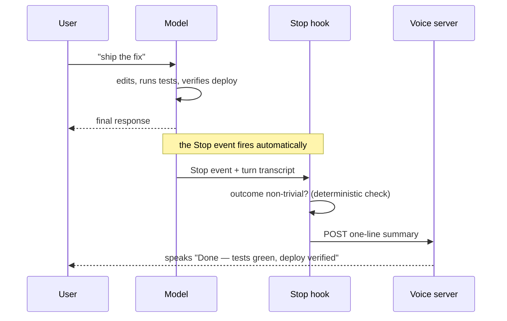

# Hook System

Memory context delivery uses per-session receipts for complete blocks. An
unchanged block is not replayed on a turn counter; session start/resume and
compaction invalidate the receipts. Claude uses SessionStart (including compact),
and the Codex bridge invalidates on PostCompact. Corrections update independently
of principal/assistant memory; an empty correction snapshot withdraws the old one.
Pending chunks remain queued when another block changes.

Automatic retrieval ignores conversational glue, duplicate terms, and substring
matches inside unrelated words. Acknowledgements need no new retrieval: the active
task is already in the conversation. Explicit memory queries still search the
corpus. Formatting feedback reads the complete answer belonging to that session;
the Errata ledger is the single satisfaction/feedback store. Codex
event telemetry records added context bytes, not quota usage or private content.

> Hooks are why the LifeOS runs when nobody is looking. The thesis (`LifeOs/LifeOsThesis.md`) assigns them their job: automate the loop — capture current state, enforce doctrine, fire the next move — without the principal having to ask. A hill-climb that only advances when prompted is a chatbot; the hook lifecycle below is what makes it an operating system.

> **LifeOS 5.0** — Stable event-driven automation infrastructure.

**Event-Driven Automation Infrastructure**

**Location:** `~/.claude/hooks/`
**Configuration:** `~/.claude/settings.json` (GENERATED — merged from `settings.system.json` + `LIFEOS/USER/CONFIG/settings.user.json` by `MergeSettings.ts`; for events the user file defines as a plain array — UserPromptSubmit, PostToolUse, PreToolUse, Stop, SessionEnd — the user array REPLACES the system array, so `settings.json` is the only registration truth. `settings.user.json` does not exist on a fresh install — `MergeSettings` no-ops cleanly until you create it to carry user-side overrides)
**Status:** Active — hook counts below are hand-maintained (the `UpdateCounts.ts` count-cache write was removed 2026-05-06; statusline/Banner read live via `GetCounts.ts`)

> **Registration (2026-09-30).** On a Claude Code install the hooks are registered through the plugin hook manifest (a `hooks.json` the release build generates), which `skills/LifeOS/Tools/InstallHooks.ts` merges into the generated `settings.json`; the installer adds `TurnOutcome` there. A maintainer install may register further private hooks through its USER overlay. The counts belong to each install: `ls hooks/*.hook.ts` lists what is on disk, and the `hooks` key of `settings.json` lists what is registered. Dispatcher-only modules remain live through `StopGates`, `MemoryTurnStart`, and `PostToolObserver` (`PreToolGuard`, the former PreToolUse dispatcher, was deleted 2026-10-24). `StopGates` runs `IsaCodeSyncGate`, `VerificationGate`, `FormatGate`, `ISAFoldGate`, `ISAGate`, `DeployRegistrationGate`, and `IsaDeployMarkerGate` in that order, followed by any private gates from the optional private gate extension (absent from public installs). Details per event follow.

> **Output gates and records (2026-09-30).** Three hooks carry the Assay hand-off and send path. `OutputRecord` (PostToolUse, composed inside `PostToolObserver` for Write, Edit, MultiEdit, Bash, Artifact, ArtifactData and ArtifactComments, and registered directly on PostToolUseFailure (Bash) and Stop) writes one output line for every file handed to the principal, from the bytes that landed. Its backstop runs a fast change-driven scan of Downloads and Desktop after each call; the daily reconciler walks Downloads and Desktop and checks other roots only by the paths the activity log names. An unknown kind is recorded as "other". `ReplyRecord` (Stop and UserPromptSubmit) logs a substantial reply (300 words or more, or a fenced block over 40 lines) as an output and proofs it at the next prompt; it never blocks. `SendOverride` (UserPromptSubmit) lets only the principal's own explicit prompt mint the one-use token that releases a blocked send. `McpSendGate` was deleted 2026-10-25: MCP sends are held by native `ask` rules, and `LIFEOS/TOOLS/lib/McpWriteVerbs.ts` keeps the one rule that classifies an `mcp__` tool as a write (a read verb and no write verb anywhere is a read) for the output reconciler, plus `gatedInput()` for `OutputRecord`. The gates also cover every `Artifact*` tool, and raw sender commands in Bash are denied so a send goes only through a gated tool. Blocked calls write a line too: `ProofGate` and `SendGate` record the `blocked` decision (`Assay/Records.md`). (maintainer-side; not in the public release)

> **Historical — retired 2026-09-21:** `AdvisorTelemetry`, `TaskGovernance`, `ComplexityRatchet`, `ReminderRouter`, `ConfigEvalFire`, `ISACloseGate`, `RouteGate`, `DepthGate`, `WritingGate`, `StopJevAdvisor`, and `route-obligation.ts` were deleted. These hooks held a turn to ask the model to behave differently, or only logged, which `LIFEOS/RULES/SelfHealing.md` line 21 rules out; hooks are for a checkable property of an artifact or a gate on an irreversible act.

---

## Overview

The LifeOS hook system is an event-driven automation infrastructure built on the AI engine's native hook support (Claude Code today). Hooks are executable scripts (TypeScript/Python) that run automatically in response to specific events during sessions.

**Core Capabilities:**
- **Session Management** - Auto-load context, capture summaries, manage state
- **Voice Notifications** - Text-to-speech announcements for task completions
- **History Capture** - Automatic work/learning documentation to `~/.claude/LIFEOS/MEMORY/`
- **Security Validation** - No hook since 2026-10-24: native permission rules, git's own hooks and a subagent Seatbelt profile (see § Native enforcement below). `Safety.hook.ts`, which had replaced the split between `SmartApprover.hook.ts` and `PromptInjection.hook.ts` (2026-05-14), was deleted that day; the v4.0 Inspector Pipeline was deleted 2026-05-06. See `LIFEOS/DOCUMENTATION/Security/README.md`.
- **Multi-Agent Support** - Subagent-aware hooks (dispatch logging, subagent context detection); voice is the DA's main voice — no per-agent voice routing
- **Tab Titles** - Dynamic terminal tab updates with task context
- **Unified Event Stream** - The advisory checkers emit structured events to `events.jsonl`, read back at SessionStart (see § Unified Event System for the emitters that participate)

**Key Principle:** Most hooks run asynchronously and fail gracefully. Hooks that must finish before the call proceeds (e.g. the SessionStart `hooks/LoadContext.hook.ts`) are synchronous; permission prompts come from the native engine. All `.ts` hooks have `#!/usr/bin/env bun` shebangs and `+x` permissions — settings.json references them directly (e.g., `$HOME/.claude/hooks/LoadContext.hook.ts`) without a `bun` prefix. HTTP hooks (SkillGuard, AgentGuard) run via Pulse routes on `localhost:31337`.

**Freshness Authority:** When adding or modifying hooks, consult the `claude-code-guide` agent to verify current hook event types, return value schemas, and available fields.

**Two halves since 2026-09-05.** The hooks above are the out-of-process half: scripts the harness spawns per event. The in-process half is one Claude Code function-hook plugin, `skills/LifeOSHooks` (state of record `LIFEOS/FUNCTIONHOOKS/ISA.md` (maintainer-side; the ISA does not ship); operator notes `hooks/README.md` § Function hooks), loaded once per interactive session and enabled by `CLAUDE_CODE_ENABLE_FUNCTION_HOOKS=1` in the settings `env` block. It draws nothing in the answer block (since 2026-09-16 the banner is the model's own first line — the repaint that used to insert it smeared answers; since 2026-09-06 the 🗣️ closer is the last line; 🧠/🩺 are statusline chips and the ⚙️ ledger is a logged `system-ledger` event), draws only the ISA chip in the band above the prompt (agents, workflows and running shells are Claude Code's own /tasks, /workflows, agent panel and Bash pill since 2026-10-11), adds the ascent state to the session-mode list beside the prompt and toasts each transition (it stopped pinning the strip on 2026-09-18; `LIFEOS/LIFEOS_StatusLine.sh` draws the run strip on row one and the session name on row two), injects the Security Protocol and a data-class ceiling into every subagent brief, and runs each subagent's Bash under the SubagentGitSandbox profile (§ Native enforcement). Command hooks that it supersedes check a per-session stamp (`hooks/lib/function-hooks.ts#hookDrawn`) and stay the fallback path; the ratified fail-closed boundaries (TextingGuard, the git `pre-push` and `pre-commit` hooks, and maintainer-side gates that are not shipped) never move.

**Routing evidence (FUNCTIONHOOKS F8, 2026-09-09/10).** The plugin never chooses a model: the agent is the DA's call and its lane is configuration (`CROSS_VENDOR` in `LIFEOS/TOOLS/models.ts`, or the agent file). What the plugin does is name the route in one vocabulary (`hooks/lib/route-label.ts`: `oai:astra`, `ant:sonnet`, `goog:…`, `xai:…`). At `agent.spawn` it logs `🤖 DISPATCH: <agent> → <Provider> <model> · <effort> reasoning · via codex (wrapper <Provider> <model>)` (a Claude dispatch: `→ Anthropic <model>`). The statusline keeps the model ladder (each lane dim / used / live), which together with the LifeOS/ALGO/DEFAULT MODEL version row draws only when `LIFEOS_STATUSLINE_FULL` is set. `LIFEOS/TOOLS/RouteTrail.ts` verifies each route afterwards — `Astra→oai:astra ✓` — and its mark comes from codex's own session log (`CodexProgress.ts` → `MEMORY/OBSERVABILITY/codex-runs.jsonl`, ISC-53) or the engine-resolved Claude model, never from configuration: ✓ observed the lane, ⚡ running, ✗ observed another model, ∅ a wrapper that never ran the helper, · unverified. Nothing in LifeOS draws live agents or a ROUTED line any more (2026-10-11); Claude Code's /tasks and agent panel show what is running. A helper run inside a wrapper carries `LIFEOS_DISPATCH_ID` (the plugin prefixes the command), so a run record binds to its own dispatch and two dispatches of one agent can never borrow each other's ✓.

---

## Native enforcement

> **Since 2026-10-24.** State of record: the native-security ISA (maintainer-side). The removed hooks are unregistered, and their files, tests and the `hooks/lib/` modules only they used were deleted on 2026-10-24 (ISA ISC-7). Any section below that still describes one of them as running is history: this section is the current state.

No LifeOS hook reads a tool call to decide whether it may run. Security comes from native Claude Code settings and git's own hooks:

- **Permission rules** (`permissions.deny` / `ask`) hold the actions that are about intent: raw deploys, purchases, inline legacy scripting, MCP sends, and writes into git hooks, git config and gate state. Claude Code evaluates them for the main session and subagents alike, including inside `$(…)`, past env-var prefixes, and on the targets of shell redirects.
- **Git hooks** in each private tree judge what actually lands, from any tool: `pre-commit` refuses plaintext `.env`, secret-shaped values and (in the SYSTEM tree) user-identifying content; `pre-push` refuses any remote GitHub does not confirm private.
- **One OS boundary for subagents.** A subagent's Bash runs under a fixed macOS Seatbelt profile that refuses writes to the private trees' git internals (`hooks/SubagentGitSandbox.hook.ts`, applied by the LifeOSHooks plugin). The kernel judges the write; nothing parses the command first. It is on in every install through `LIFEOS_SUBAGENT_SANDBOX=on` in the system settings layer; where `sandbox-exec` does not exist (Linux, Windows) the native deny rules are the only floor.
- **Managed settings** lock the core deny rules and disable bypass mode, so no project or user file can loosen them.

Claude Code's own Bash sandbox is not used: it write-denies most of the Claude config directory, which is where this install lives (sandboxing docs § Protected paths), and in auto mode it refuses any host a command did not name.

Hooks remain for LifeOS function: context loading, skill routing, statusline, voice, memory, ISA rendering, Vigil.

### Retired per-call guards (removed 2026-10-24)

A public install enforces through the permission rules and git hooks above, plus the hooks listed in `hooks/README.md`. Several guards below were maintainer-only and never shipped. The table records where each retired behavior went (each was a member of the `PreToolGuard` dispatcher or registered beside it):

| Former guard | Now enforced by |
|---|---|
| SubagentShipGuard | The subagent Seatbelt profile (git internals) and the shared deny rules (deploys, purchases). Subagents may push to private remotes only as far as `pre-push` allows |
| SystemFileGuard, BashSystemWriteGuard | The `pre-commit` leak scan (`LIFEOS/TOOLS/githooks/StagedLeakScan.ts`), same deny-list core, run on staged bytes |
| PublicPushGate, PublishPreflightGuard | `pre-push` (`LIFEOS/TOOLS/githooks/PrePush.ts`); the public checkout publishes only through the release path |
| HookStateGuard, SendGateStateGuard | `Edit` deny rules on the hook-state and SendGate state directories (they also cover shell redirects) |
| EnvReadGuard | The `.env` deny and ask rules |
| EgressClassGuard | The `.env` read rules keep secret values out of reach; every model vendor is trusted for data (OPERATIONAL_PREFERENCES § Model selection) |
| TaintGuard | Dropped: Claude Code has no native taint tracking. The Security Protocol governs outside content |
| ProviderDeployGuard | Deny rules on raw `cf` / `wrangler` ship, secret and delete verbs. CfEnv.ts is the path |
| OrderSubmitGuard | Deny rule on raw `dd-cli … order submit`. The submit wrapper is the path |
| CommunicationSkillGuard, McpSendGateWrapper | `ask` rules on MCP send tools; the send tools carry their own SendGate check inside |
| NoInlinePython, NoInlineLegacyScripting, NoPythonInLifeOS | Deny rules on `python -c`, `python3 -`, `perl -e`, `ruby -e`, `php -r`; an `ask` rule on `.py` edits in the tree; `/ic` `no-python` |
| ISAStaleWriteGuard | Native: Claude Code refuses a Write or Edit to a file changed since it was read |
| WorkerWrapperGuard, WorkerRanGuard, SubagentFallbackGuard | Worker agents' `tools:` frontmatter; RouteTrail verifies the route afterwards |
| InterceptorContextGuard | To fix in the tool: the interceptor CLI defaults to the pinned test context (ISA cleanup step) |
| GateRemovalGuard, SkillCreationGuard, DevelopmentEditGate, DevelopmentBuildGuard | Dropped: the gates GateRemovalGuard protected are gone; `/ic` catches hand-rolled skills; the Development gates were advisory |
| PlutilExtractGuard, SeatGuard, VoiceEgressGuard, WorkflowSerialGuard | Dropped: preferences and gotchas, each kept as a fact in the doc that owns it |
| ProofGate, FleetFreezeGuard, AgentBudget, ContextReduction | Dropped from the tool path. Output records run after the call; Workflows own agent deadlines; the plugin does the rtk rewrite |
| Safety (PostToolUse) | Dropped: the Security Protocol already governs outside content |

---

## Available Hook Types

Claude Code supports the following hook events:

### 1. **SessionStart**
**When:** Claude Code session begins (new conversation)
**Use Cases:**
- Load LifeOS context (CLAUDE.md auto-loads routing + identity + PRINCIPAL_TELOS via @-imports)
- Initialize session state
- Capture session metadata

**Current Hooks (fire order per settings.json):**
```json
{
  "SessionStart": [
    {
      "hooks": [
        { "type": "command", "command": "bun $HOME/.claude/hooks/HookHealer.hook.ts", "timeout": 10 },
        { "type": "command", "command": "$HOME/.claude/hooks/KittyEnvPersist.hook.ts" },
        { "type": "command", "command": "$HOME/.claude/hooks/LoadContext.hook.ts" },
        { "type": "command", "command": "bun $HOME/.claude/LIFEOS/TOOLS/FreshnessCache.ts --quiet", "timeout": 5, "async": true },
        { "type": "command", "command": "bun $HOME/.claude/LIFEOS/TOOLS/SettingsBackport.ts; bun $HOME/.claude/LIFEOS/TOOLS/MergeSettings.ts --system $HOME/.claude/settings.system.json --user $HOME/.claude/LIFEOS/USER/CONFIG/settings.user.json --output $HOME/.claude/settings.json", "timeout": 15, "async": true }
      ]
    }
  ]
}
```
<!-- regenerated from settings.json 2026-08-10; public issues #1811 #1812, @tzioup -->

**What They Do:**
- `HookHealer.hook.ts` - Self-heals the registered-script exec-bit class: sweeps every script a settings hook execs directly, `chmod +x` on a missing exec bit, warns on a missing file/shebang. Registered via `bun <path>` so it is immune to losing its own exec bit. On win32 the sweep skips chmod entirely (NTFS has no exec bit; the harness runs hooks through Git Bash) and logs `skipped-win32`. Writes `MEMORY/OBSERVABILITY/hook-healer.jsonl`.
- `KittyEnvPersist.hook.ts` - Persists Kitty terminal env vars both to the shared `MEMORY/STATE/kitty-env.json` and to a per-session `MEMORY/STATE/kitty-sessions/{sessionId}.json` (required by out-of-process consumers like Pulse voice daemon), then resets tab title to clean state
- `LoadContext.hook.ts` - Injects dynamic context (learning readback, advisory readback, work digest, active work summary) as `<system-reminder>` at session start. On an Agent SDK host (`CLAUDE_CODE_ENTRYPOINT` `sdk-ts`/`sdk-py`, not a resume), whose own `systemPrompt.append` replaces `--append-system-prompt-file`, it also tells the model to Read `LIFEOS_SYSTEM_PROMPT.md` in full before anything else (public PR #2240)
- `FreshnessCache.ts` *(a `LIFEOS/TOOLS/` script, not a `hooks/` file)* - Warms the `lifeos-freshness-v1` staleness cache (async)
- `SettingsBackport.ts` + `MergeSettings.ts` *(TOOLS, not hooks)* - Backport source-vs-generated drift, then regenerate `settings.json` from `settings.system.json` + `settings.user.json` (async). This is why `settings.json` is a generated artifact.

---

### 2. **SessionEnd**
**When:** Claude Code session terminates (conversation ends)
**Use Cases:**
- Capture work completions and learning moments
- Generate session summaries
- Record relationship context
- Update system counts (skills, hooks, signals)
- Run integrity checks

**Current Hooks (fire order per settings.json):**
```json
{
  "SessionEnd": [
    {
      "hooks": [
        { "type": "command", "command": "$HOME/.claude/hooks/WorkCompletionLearning.hook.ts" },
        { "type": "command", "command": "$HOME/.claude/hooks/SessionCleanup.hook.ts" },
        { "type": "command", "command": "$HOME/.claude/hooks/UpdateCounts.hook.ts" },
        { "type": "command", "command": "$HOME/.claude/hooks/MemoryHealthGate.hook.ts" },
        { "type": "command", "command": "$HOME/.claude/hooks/DocIntegrity.hook.ts" },
        { "type": "command", "command": "$HOME/.claude/hooks/IntegrityCheck.hook.ts" }
      ]
    },
    {
      "hooks": [
        { "type": "command", "command": "$HOME/.claude/hooks/ULWorkSync.hook.ts", "timeout": 60 }  // private maintainer hook — NOT shipped in the public release; a fresh install has no such block
      ]
    }
  ]
}
```
<!-- regenerated from settings.json 2026-08-10; public issues #1811 #1812, @tzioup -->

**What They Do:**
- `WorkCompletionLearning.hook.ts` - Reads ISA.md frontmatter for work metadata and ISC section for criteria status, captures learning to `MEMORY/LEARNING/` for significant work sessions
- `SessionCleanup.hook.ts` - Marks ISA.md frontmatter status→COMPLETED and sets completed_at timestamp, clears session state, resets tab, cleans session names
- `UpdateCounts.hook.ts` - Updates system counts (skills, hooks, signals, workflows, files) displayed in the startup banner
- `MemoryHealthGate.hook.ts` - Runs `MemoryHealthCheck.ts`: asserts all autonomic-memory hooks registered in BOTH settings files, code files present on disk, last reviewer fire within 7d, state file readable. Writes `memory-health.jsonl`; WARN/CRITICAL to stderr. Non-blocking. *(Moved from Stop to SessionEnd in the 2026-07-11 consolidation, then also re-registered at Stop as an async second block — it runs on both events today; see Section 4.)*
- `DocIntegrity.hook.ts` - Session-end doc housekeeping: rebuilds `ARCHITECTURE_SUMMARY.md` and the knowledge schema, and reports memory-dir and knowledge-note drift (`handlers/RebuildArchSummary.ts`, `handlers/MemoryDirIntegrity.ts`, `handlers/RebuildKnowledgeSchema.ts`, `handlers/KnowledgeConformance.ts`). The per-file cross-reference check moved to `MicroIntegrity.hook.ts` at Stop on 2026-10-24.
- `IntegrityCheck.hook.ts` - Runs `handlers/SystemIntegrity.ts`, which hands the session's system-file changes to `LIFEOS/TOOLS/IntegrityMaintenance.ts` to write the Ledger's SYSTEMUPDATES entry
- `ULWorkSync.hook.ts` *(separate block, 60s timeout)* - Syncs the principal's GitHub-Issues work state at session end. Principal-specific (hardcodes a private repo) — NOT in the public release payload; a fresh install has no such block.

> **Historical (retired 2026-07-11):** `RelationshipMemory.hook.ts` (captured relationship context to `MEMORY/RELATIONSHIP/`) is no longer registered and no longer on disk; relationship signal is carried by the autonomic memory reviewer instead.

---

### 3. **UserPromptSubmit**
**When:** User submits a new prompt to Claude
**Use Cases:**
- Update UI indicators
- Pre-process user input
- Capture prompts for analysis
- Detect ratings and sentiment

**Current Hooks (per settings.json — 14 `.hook.ts` files here; `SendOverride`, `ReplyRecord` and `AskPin` are maintainer-side, so a fresh install that never ran the overlay has 11, the public set in `settings.system.json`; the harness runs matching hooks in parallel, so the listed order is registration order, not a sequence. `DispatchAdvisor` was unregistered 2026-10-17 (native-unblock ISC-14) and the Codex ModelRouter hook was removed 2026-10-16: neither Codex nor Pi runs a model router):**
```json
{
  "UserPromptSubmit": [
    { "hooks": [ { "type": "command", "command": "$HOME/.claude/hooks/SendOverride.hook.ts", "timeout": 5 } ] },  // private maintainer hook — not shipped in the public release
    { "hooks": [ { "type": "command", "command": "$HOME/.claude/hooks/ReplyRecord.hook.ts", "timeout": 5 } ] },  // private maintainer hook — not shipped in the public release
    { "hooks": [ { "type": "command", "command": "$HOME/.claude/hooks/AskPin.hook.ts", "timeout": 5 } ] },  // private maintainer hook — not shipped in the public release
    { "hooks": [ { "type": "command", "command": "$HOME/.claude/hooks/SessionTitle.hook.ts", "timeout": 5 } ] },
    { "hooks": [ { "type": "command", "command": "$HOME/.claude/hooks/PromptProcessing.hook.ts", "timeout": 30, "async": true } ] },
    { "hooks": [ { "type": "command", "command": "$HOME/.claude/hooks/SatisfactionCapture.hook.ts", "timeout": 20, "async": true } ] },
    { "hooks": [ { "type": "command", "command": "$HOME/.claude/hooks/VersionDrift.hook.ts", "timeout": 10 } ] },
    { "hooks": [ { "type": "command", "command": "$HOME/.claude/hooks/DriftReminder.hook.ts", "timeout": 10 } ] },
    { "hooks": [ { "type": "command", "command": "$HOME/.claude/hooks/MemoryTurnStart.hook.ts", "timeout": 20 } ] },
    { "hooks": [ { "type": "command", "command": "$HOME/.claude/hooks/AlgorithmNudge.hook.ts", "timeout": 10 } ] },
    { "hooks": [ { "type": "command", "command": "$HOME/.claude/hooks/TimeContext.hook.ts", "timeout": 10 } ] },
    { "hooks": [ { "type": "command", "command": "$HOME/.claude/hooks/VoiceMode.hook.ts", "timeout": 5 } ] },
    { "hooks": [ { "type": "command", "command": "$HOME/.claude/hooks/ModelDriftGuard.hook.ts", "timeout": 10 } ] },
    { "hooks": [ { "type": "command", "command": "$HOME/.claude/hooks/TurnRecord.hook.ts", "timeout": 15, "async": true } ] }
  ]
}
```
<!-- regenerated from settings.json 2026-10-20 -->

> **2026-09-03 — same-turn context, native registrations kept.** The five context emitters (VersionDrift, DriftReminder, AlgorithmNudge, TimeContext, ModelDriftGuard) were registered `async`, and the harness delivers async hook output on the NEXT turn — the time line was a turn stale and the FORMAT CONTRACT arrived glued to a later tool result. They are sync now (each still its own native registration; the harness runs them in parallel). Safety stays sync. PromptProcessing and SatisfactionCapture stay async. A one-evening experiment that folded these into a single dispatcher (`TurnStart`) was reverted the same night on the principal's call to stay close to how the harness registers hooks; what it taught is kept inside MemoryTurnStart (below).

**What They Do:**

**SendOverride.hook.ts**, **ReplyRecord.hook.ts**, **AskPin.hook.ts** *(maintainer-side; not in the public release; timeout 5 each)*
- (maintainer-side; not in the public release) `SendOverride` lets only the principal's own explicit prompt mint the one-use token that releases a blocked send; `ReplyRecord` proofs the previous substantial reply at the next prompt and never blocks; `AskPin` pins the explicit asks and constraints in the prompt for the done-check at Stop and fails open (see the output gates paragraph at the top)

**SessionTitle.hook.ts** — Claude Code's own session title follows the LifeOS name (timeout 5, synchronous)
- The harness keeps its title in memory and re-appends it every turn, and an async hook's output is ignored, so the title can only change from `hookSpecificOutput.sessionTitle` returned by a hook the harness waits on. It adopts a genuine `/rename` on a native session and otherwise projects the work.json row (ISA name) into the stores. Fails open

**PromptProcessing.hook.ts** — Tab Title + Session Naming via Medium Inference
- Single responsibility: terminal tab title updates and session auto-naming
- Fast paths: deterministic tab title on first prompt, deterministic session name fallback
- Inference: one medium-lane call on the first prompt returning `{ tab_title, session_name }`, plus eligible bounded correction checks on follow-ups
- Writes to: `session-names.json`, `work.json`, tab state, voice server
- **Naming-context isolation (2026-04-19):** `getRecentContext()` strips Assistant turns when `isFirstPrompt` is true. Session names are permanent, so scaffolding in assistant output — phase headers, agent names, SUMMARY lines — must never reach the naming prompt.
- **Misheard-term correction (2026-09-10, v1.7.0):** the name is set once from the first prompt, and dictation puts misheard terms in it ("update the ISIS system" named a session ISIS when the work was the ISA; the DA corrected the term in the reply and the title never followed). The first three follow-up prompts that reach the model gates make one bounded model call: given the stored name and the recent conversation (assistant turns included, since the correction usually lives in the DA's reply), is any word a misheard or misspelled term? A YES must keep the word count and change at most two words (`isTermSubstitution`) — a topic pivot is never a correction, the name stays permanent for that. An accepted fix lands on every surface the name lives on (`session-names.json`, `work.json`, the JSONL custom-title, the tab label, the tab) and the pass switches off for that session. Window state: `MEMORY/STATE/session-name-checks.json`. Telemetry sources: `name-correction`, `name-correction-kept`, `name-correction-failed`. Manual path for older sessions: `bun LIFEOS/TOOLS/SessionRename.ts --uuid <id> "<name>"`.

**SatisfactionCapture.hook.ts** — User satisfaction signal capture
- Reads `MEMORY/STATE/last-response.txt` (written by `LastResponseCache.hook.ts` at Stop) to access the previous response
- Detects explicit ratings, positive praise, explicit corrections, and standing directives; implicit sentiment inference remains removed
- Writes every captured signal to the Errata ledger; ratings ≤3 and explicit corrections may add a linked `FAILURES/` deep-context attachment, and standing directives may link a downstream Upgrades record
- Async (timeout 20s)

**VersionDrift.hook.ts** — Deterministic version-drift tooth (timeout 10s, synchronous)
- Diffs the core surface (`hooks/`, `skills/`, `LIFEOS/ALGORITHM/`, `LIFEOS/TOOLS/`, `agents/`, `commands/`, `LIFEOS/PULSE/`, `LIFEOS/ATLAS/`, `test/`, `LIFEOS/DOCUMENTATION/`, `settings.json`, `CLAUDE.md`, the system prompt) against the last `vX.Y.Z` tag; injects a version-bump nag line when drift passes threshold (it names `/rc` only where that private command is installed)
- Quiet by design: silent when `LIFEOS/VERSION` already moved past the tag (bump in flight), silent below thresholds (10 changed core files, or any drift once the tag is >48h old), and at most one nag per 60 min. Zero inference; state at `MEMORY/STATE/version-drift-nag.json`

**Safety.hook.ts** *(UserPromptSubmit branch, added 2026-08-30; timeout 5; retired 2026-10-24, history)*
- The principal's own prompt clears the session's taint mark, which is how a `TaintGuard` hold ends. Once a session has recorded a principal prompt (it is armed), a prompt counts as the principal's only with a fresh matching origin record (60 s, `lib/prompt-origin.ts` 2.0.0); a missing, expired or unreadable record reads as unknown origin and clears nothing. Zero stdout on this path; the same file serves PostToolUse and PermissionRequest and dispatches by `hook_event_name`

**DriftReminder.hook.ts** — Deterministic voice/format drift nudges (added 2026-06-10)
- Scans the Stop-hook last-response cache (`MEMORY/STATE/last-response.txt`) with the banned-vocab regex (`hooks/lib/banned-vocab.ts`), banner-presence check, em-dash count, and packed-bullet count (bullets with no blank line between them)
- Fires at most one `DRIFT-REMINDER:` context line; budget 1-per-5-turns (`MEMORY/STATE/drift-reminder.json`); consecutive identical findings dedupe, a clean response re-arms; 30-min staleness guard. No LLM calls.

**DelegationOverride.hook.ts** — RETIRED 2026-09-24 (Router ISA R41) with the DelegationGuard block it lifted; nothing is left to override
- Nothing the model runs can set it: the hook fires only on the principal's own prompt and ignores any prompt carrying an `agent_id`/`agent_type`

**MemoryTurnStart.hook.ts** — the ONE UserPromptSubmit memory hook (consolidated 2026-07-11; delivery rebuilt 2026-09-03)
- Dispatcher merging two per-prompt memory modules, each still runnable standalone: `LoadMemory.run()` (`<lifeos-memory>` hot-layer injection) then `MemoryDeltaSurface.run()` (`<lifeos-memory-health>?` + `<lifeos-memory-delta>`)
- **Inline ceiling (2026-09-03):** the harness persists hook stdout above ~10 KB to a file and injects a 2 KB preview; the ~18 KB hot layer had reached the model that way on every injection since 2026-07-03 (1,898 persisted outputs). `lib/memory-delivery.ts` now queues the hot layer + standing blocks per session (`MEMORY/STATE/memory-inject/<session>.queue.json`) and emits `<lifeos-memory part="k/N">` chunks over consecutive turns, ground block first, every emission ≤ 8 KB
- **Budget (native-unblock ISC-18, 2026-10-16):** the prompt waits at most 300 ms on memory (`SOFT_BUDGET_MS`; it was 4 s). When the steps before retrieval have already used the budget, the retriever is skipped and a one-line notice replaces `<lifeos-ground>`. Otherwise retrieval runs in a worker (`hooks/lib/retrieval-worker.ts`) and the hook waits out the rest of the budget (never less than 100 ms), terminates the worker, and injects what is ready; a late retrieval gets the same notice. Registered timeout 20 s. The retriever reads a persisted index instead of re-reading ~10,000 notes per prompt. It is split in two: a meta file (`MEMORY/STATE/retriever-index.json`, the scoring fields per note) and a postings file of term frequencies read by byte range for the prompt's terms only; note bodies are read only for the injected hits. This hook passes `allowStaleIndex`, so the prompt does no freshness walk and never rebuilds: it serves the last good index. The async Stop hook `MemoryIndexRefresh.hook.ts` (`refreshIndex()`) walks the covered folders after each turn and rebuilds when a writer's generation bump or an edit has moved past the index. Every other index caller (Pulse, MemorySystem, `indexedNotes()`) rebuilds a stale index itself before scoring. Measured 2026-10-09 over 20 real prompts in fresh processes: p95 2,547 ms → ~135 ms, injected entries identical
- **Timing:** `lib/hook-timing.ts` writes per-module wall time to `MEMORY/OBSERVABILITY/hook-timing.jsonl`; `/ic hook-latency` grades p95 against the registered timeout (PostToolObserver logs the same way)
- Hot-layer injection is gated: injects `<lifeos-memory>` on a session's FIRST prompt, and whenever a rendered block changes; SessionStart (including compact) resets the receipts, so a compacted session gets the blocks again on its next prompt; the 🧠 delta line stays every-turn
- Subagent skip checked once here. Failure caught per-module; never blocks the prompt
- The former cadence tick (`MemoryReviewTrigger.run()`) was removed from this path 2026-07-11 — `MemoryReviewFire` (Stop) now owns the whole memory-review cadence

**AlgorithmNudge.hook.ts** — Algorithm live nudge layer ("Events ask the rest"; unified 2026-07-11, formerly ISANudge)
- TWO SCOPES. Always-on (any session): late-ISA on PostToolUse (25+ tool calls, no registered run → "does done need writing down?", once per session), and skill-gap on PostToolUse (40+ primary tool calls, zero Skill invocations → "does a skill already cover this work class, and if not should one exist?"; once per session, 12h cross-session cooldown at `MEMORY/STATE/skill-gap-nudge.json`, each fire logged counts-only to `MEMORY/OBSERVABILITY/skill-gap-candidates.jsonl` for SuggestSkills)
- Run-scoped (live Algorithm run only): principal-message (UserPromptSubmit), probe-fail (PostToolUseFailure, execute/verify phases), agent-return / claim-close / stale-ISA / spend (~75 in-run tool calls with criteria open, 30-min cooldown; tier-free replacement for the retired budget-half nudge) on PostToolUse
- Always-on **capability row** (2026-07-12, #1461): on `PostToolUseFailure` for a Bash command that exercises a Doctor-tracked capability (codex / wrangler / notify-curl / interceptor) while `MEMORY/STATE/capabilities.json` has that capability `broken`, fires ONE line with a static fix command (per-capability 60-min cooldown). Reads only `state` from the manifest — the fix string is a compile-time `CAP_FIX` constant, never sourced from the on-disk manifest (Forge audit: keeps a poisoned manifest from injecting runnable prose into model context). `declined`/`live`/absent-manifest all stay silent.
- Deterministic, zero inference, <20ms hot path; subagent tool events silenced via primary-transcript gate
- Registered on UserPromptSubmit (timeout 10, synchronous) + PostToolUseFailure (timeout 5); PostToolUse reaches it via `PostToolObserver`'s import. The skill-routing, depth-directive and doctrine-class rows were cut 2026-10-25 (ISA 20261025-hook-minimization): the skill listing carries USE WHEN, depth is native, and the Algorithm carries doctrine-class scrutiny

**TimeContext.hook.ts** — Live per-turn wall clock (timeout 10s, synchronous; ported from public PR #1511, credit @anikinsasha)
- Emits a `<time-now>` line with weekday, date, time, zone, and a coarse part-of-day label. The harness `currentDate` context is date-only and anchored at session start, so a long session drifts; this recomputes every turn
- Timezone from `settings.json` `principal.timezone`, falling back to UTC. Fails open — any error is swallowed and the turn proceeds without the line
- Also draws the prompt's shape (2026-10-17): the `⏱️ SHAPE` line for `dw`, a trailing time, `uc` and the `p` levels, the deadline row, and the session-shape file the statusline chips read. That code lives in `hooks/lib/prompt-shape.ts` with no router and no model call; it left the maintainer-side `DispatchAdvisor` hook (not in the public release) when that hook was unregistered, and that hook imports the same copy

**VoiceMode.hook.ts** — Voice mode's per-prompt half (timeout 5)
- When voice mode is on for the session it stops the DA's speech, since a submitted prompt means the principal has the floor, and injects the voice-mode instruction (the `🎙️ SPOKEN:` field, plus the spoken-interview rules when the session has an ISA). Silent when voice mode is off. Doc: `LIFEOS/DOCUMENTATION/VoiceMode/VoiceMode.md`

**ModelDriftGuard.hook.ts** — Model drift detection (timeout 10s, synchronous)
- Compares the `model` configured in `settings.json` against the model on the last assistant message in the transcript, and warns when they differ. `fallbackModel` keeps that path live, and the serving model is the one thing the loop cannot observe about itself
- Reports only, and judges nothing about the work. A hook cannot set the main loop's carrier, and classifying a prompt as needing more intelligence is not deterministically detectable — the apparatus that tried was deleted 2026-08-19. Reads a tail of the transcript; no LLM calls; any error exits 0

**SystemDocRoute.hook.ts** — retired 2026-10-25 (ISA 20261025-hook-minimization): the prompt that named a system was already in context, and CLAUDE.md routes each system to its doc.

**TurnRecord.hook.ts** — one STATVS `turn` row per human prompt (STATVS ISC-85; async, never blocks)
- Ties the prompt to both repos' full commits and uncommitted changes, the model and effort it ran on, the notification channel, this Mac's keyboard idle time and the record's size, so Rewind and Replay can put the turn back together. The config repo's uncommitted changes and untracked files under `hooks/`, `LIFEOS/` and `skills/` are stored once by hash (CENSVS ISC-55). Only a prompt whose transcript is the session's own Claude Code transcript is recorded; anything else is skipped

**DispatchAdvisor.hook.ts** (maintainer-side; not in the public release; UNREGISTERED 2026-10-17, native-unblock ISC-14, so no model call runs before a prompt; DELETED 2026-10-25 with the per-prompt front door, Router ISA F13; history below) — judgment caller `dispatch-advisor` (added 2026-09-17; timeout 15)
- Asks Assay's judgment layer (engine: Clef-omni) for a lane while the Astra classifier runs concurrently, then emits one `🧭 ROUTER:` line naming the selected lane, decision source, the engine's observation, and binding status
- Every classifier pick is advisory, a MAX pick included. Depth words make the turn a run that native thinking and effort carry; no hook prescribes its skills, agents or an `🔀 INLINE:` line (Algorithm § Route, 2026-10-16).

**Codex ModelRouter hook:** removed 2026-10-16: neither Codex nor Pi runs a model router.

> **Historical — retired 2026-07-11 (hooks-BLE pass):**
> - **`TheRouter.hook.ts` retired entirely** (commit `4dd0fbe19`). It owned per-prompt Mode + Tier classification (emitting `MODE: MINIMAL|NATIVE|ALGORITHM | TIER: E1-E5`); that whole scheme was abolished. There is no successor classifier — the model discovers difficulty from the work, and model rungs now live in `LIFEOS/TOOLS/models.ts` + `AgentInvocation.hook.ts`. Its deterministic router libs (`router-deterministic`, `router-classifier`, `RouterShadow`, `ai-speak-patterns`) were deleted with it.
> - **`MemoryReviewTrigger.hook.ts` retired** (commit `4dd0fbe19`) — its per-prompt cadence tick was absorbed by `MemoryReviewFire` v2 at Stop.
> - **`SkillSurface.hook.ts` deleted** (commit `ac4f703ab`) — the deterministic top-3 skill-surfacing line is no longer emitted.
> - Earlier retirements still true: the v4.0 Inspector Pipeline (PromptGuard, ContentScanner, SmartApprover, SecurityPipeline, ContainmentGuard) and `RepeatDetection.hook.ts` were removed in the 2026-05-06 security simplification (tag `pre-bpe-cuts-2026-05-06`).

---

### 4. **Stop**
**When:** Main agent ({DA_IDENTITY.NAME}) completes a response
**Use Cases:**
- Voice notifications for task completion
- Capture work summaries and learnings
- **Update terminal tab with final state** (color + suffix based on outcome)

**Current Hooks (fire order per settings.json — 14 hooks; the Quick Reference card below describes the later ones):**
```json
{
  "Stop": [
    {
      "hooks": [
        { "type": "command", "command": "$HOME/.claude/hooks/LastResponseCache.hook.ts" },
        { "type": "command", "command": "$HOME/.claude/hooks/TabState.hook.ts" },
        { "type": "command", "command": "$HOME/.claude/hooks/VoiceCompletion.hook.ts" },
        { "type": "command", "command": "$HOME/.claude/hooks/ISARenderOnStop.hook.ts" },
        { "type": "command", "command": "$HOME/.claude/hooks/StopGates.hook.ts" },
        { "type": "command", "command": "$HOME/.claude/hooks/ReplyRecord.hook.ts" },  // private maintainer hook — not shipped in the public release
        { "type": "command", "command": "$HOME/.claude/hooks/SkillRunProof.hook.ts" },  // private maintainer hook — not shipped in the public release
        { "type": "command", "command": "$HOME/.claude/hooks/MemoryReviewFire.hook.ts" },
        { "type": "command", "command": "$HOME/.claude/hooks/TurnOutcome.hook.ts" }
      ]
    },
    {
      "hooks": [
        { "type": "command", "command": "$HOME/.claude/hooks/MemoryHealthGate.hook.ts", "timeout": 15, "async": true },
        { "type": "command", "command": "$HOME/.claude/hooks/VigilTaskSummary.hook.ts", "timeout": 15, "async": true },
        { "type": "command", "command": "$HOME/.claude/hooks/OutputRecord.hook.ts", "timeout": 10 },  // private maintainer hook — not shipped in the public release
        { "type": "command", "command": "$HOME/.claude/hooks/MemoryIndexRefresh.hook.ts", "timeout": 60, "async": true }
      ]
    },
    {
      "hooks": [
        { "type": "command", "command": "$HOME/.claude/hooks/MicroIntegrity.hook.ts", "timeout": 180, "async": true }
      ]
    }
  ]
}
```
<!-- regenerated from settings.json 2026-08-10; public issues #1811 #1812, @tzioup -->

**What They Do:**

Each Stop hook is a self-contained `.hook.ts` file that reads stdin via shared `hooks/lib/hook-io.ts`, calls its handler, and exits.

**`LastResponseCache.hook.ts`** — Cache last response for SatisfactionCapture bridge
- Writes `last_assistant_message` (or transcript fallback) to `MEMORY/STATE/last-response.txt`
- SatisfactionCapture and DriftReminder read this on the next UserPromptSubmit

**`TabState.hook.ts`** — Reset Kitty tab title/color after response *(the Stop branch; formerly `ResponseTabReset.hook.ts`, merged into the unified `TabState` hook 2026-07-10)*
- Calls `handlers/TabState.ts` to set the completed/past-tense state
- Same file also handles the PreToolUse and PostToolUse `AskUserQuestion` tab branches (see those events)

**`VoiceCompletion.hook.ts`** — Send 🗣️ voice line to TTS server
- Calls `handlers/VoiceNotification.ts` for voice delivery
- Voice gate: only main sessions (checks `kitty-sessions/{sessionId}.json`); subagents have no kitty-sessions file → voice blocked

**`ISARenderOnStop.hook.ts`** — Re-render edited ISAs at end-of-turn
- Reads the per-session state file written by `ISASync.hook.ts` on every ISA Edit/Write; for each ISA edited this turn spawns `ISARender.ts` ONLY IF the sibling `ISA.html` already exists (the ISA reached `phase: complete` at least once) — the doctrinal gate against constant remaking during authoring
- Renders spawned detached, never awaited (<100ms budget)

**`StopGates.hook.ts`** — the ONE Stop-event gate hook (consolidated 2026-07-11)
- Reads stdin ONCE and evaluates the per-turn gates in order; each gate file still owns its logic and stays runnable standalone:
  0. `IsaCodeSyncGate.run()` — code sync, finish (2026-10-24, ISASystem.md § Code sync): code governed by an ISA (`LIFEOS/TOOLS/IsaGoverning.ts`) changed this turn and that ISA got no successful Edit or Write in the same turn → block. Keyed to files, not to a run; no reply wording clears it; not in `ADVISORY_GATES`.
  1. `VerificationGate.run()` — blocks done-claims lacking transcript evidence (T1 web-deploy / T2 flow / T3 appearance)
  2. `FormatGate.run()` — flags structural drift in the one LifeOS format. It never blocks, and it keeps no streak store.
  3. `ISAFoldGate.run()` — D-50 enforcement: prod mutated this turn + active run + ISA untouched + the reply silent on ISA state → block. It uses `hooks/lib/isa-turn.ts` for the shared ISA-addressed regex and same-turn edit check.
  4. `ISAGate.run()` — blocks a close (`phase: complete` written this turn) on structural ISA violations (non-M/N progress, fog-at-complete, missing anchors_to); scoped to ISAs touched this turn
  5. `DeployRegistrationGate.run()` — blocks end-of-turn after a custom-domain wrangler deploy until the domain is registered in PROJECTS.md, the Workflows curated infra inventory, and, when `USER/CONFIG/deploy-registration-gate.json` configures one, the analytics registry, with a live probe confirming a correctly-sourced analytics tracker (OPERATIONAL_PREFERENCES § Bunker registration)
  6. `IsaDeployMarkerGate.run()` — checks ISA deploy freshness and uses `hooks/lib/isa-turn.ts` for the same-turn ISA edit check
- Any private gates from the optional private gate extension (absent from public installs) run after the six public gates.
- The FIRST gate returning `decision:"block"` wins; the recovery turn re-runs all gates. Fails open per-gate so one gate's crash never silences the others
- `OutputFormatGate.run()` was dropped from the chain 2026-07-11 (it was telemetry-only and policed the retired mode-banner system; voice/format drift is now `DriftReminder`'s job)

**`MemoryReviewFire.hook.ts`** (v2) — owns the WHOLE memory-review cadence (consolidated 2026-07-11)
- On every primary-session Stop: **this session's** `turn_count += 1`, `last_message_at = now`; if that per-session `turn_count >= turn_threshold` AND minutes since the **global** last review `>= min_minutes_between`, spawn `MemoryReviewer.ts` detached and reset this session's counter
- Cadence state is keyed per `session_id` (public issue #1711, @jacobo-ortiz) — a shared global counter let concurrent sessions reset and starve each other. The turn threshold is per-session; the minute floor stays global because it is the inference-volume guard
- Absorbed the former `MemoryReviewTrigger` per-prompt tick — firing at Stop already IS the quiet moment the idle/debounce machinery approximated, so `pending_review` stays false forever (kept for statusline schema compat)
- Subprocess is env-scrubbed (delete `ANTHROPIC_API_KEY` + `ANTHROPIC_AUTH_TOKEN`) to preserve subscription billing. State: `MEMORY/STATE/memory-review/<session_id>.json` (cadence, pruned after 7 days), mirrored to `MEMORY/OBSERVABILITY/review-state.json` for the statusline and health readers; params: `LIFEOS/USER/CONFIG/memory-review.json`

**`MemoryHealthGate.hook.ts`** *(second Stop block; timeout 15, async)* — Autonomic-memory health check
- Runs `MemoryHealthCheck.ts`: asserts every autonomic-memory hook is registered in BOTH settings files, the code files are on disk, the last reviewer fire was within 7 days, and the state file is readable
- Writes `MEMORY/OBSERVABILITY/memory-health.jsonl`; WARN/CRITICAL to stderr. Non-blocking. Registered at **both** Stop (here) and SessionEnd (Section 2) — the Stop registration gives per-turn health, the SessionEnd one covers a session that ends without a further Stop

**`MicroIntegrity.hook.ts`** *(own Stop block; timeout 180, async)* — per-turn doc sync (core `hooks/lib/micro-integrity.ts`)
- Reads the successful Edit/Write/MultiEdit/NotebookEdit paths and the files in commits the session's results show it making since its previous run (a `<session>.cursor` file beside the state; a session's first run reads the turn), limited to `~/.claude` and the USER tree minus MEMORY, logs and caches. A turn with nothing in scope ends in milliseconds and clears the chip.
- Finds the Markdown docs that name those files with one `rg` pass per tree. A renamed file is repointed by whole-path replacement; the docs that name changed, added or deleted files (at most 8, excerpts capped at 120 lines) go to one medium-level `Inference.ts` call with the turn's diffs, all through `redact()`, which proposes small exact edits.
- Writes only clean, unprotected Markdown whose bytes have not changed since read; an edit to the system prompt, CLAUDE.md, OPERATIONAL_PREFERENCES, identity, TELOS, Algorithm, PROJECTS or `agents/` agent-definition files becomes a flag, and ISAs and CHANGELOGs are never considered. Commits what it wrote per tree with `commitOwn`.
- Writes `MEMORY/STATE/micro-integrity/<session>.json` (`running`, then `synced`, `clean`, `flag` or `error`) plus a `runs.jsonl` row; the statusline draws it as a Nerd Font document page in its state's colour: orange with a pen while docs are being written, green with a check when they are in line, red with a cross when a mismatch is left unaddressed. A newer result re-renders the line at once, in `Admission.enter()` and the Rust `statusline-fast` alike. Headless sessions skip. Prints nothing.

> **Historical (moved off Stop 2026-07-11):** `DocIntegrity.hook.ts` now runs at SessionEnd (see Section 2). `MemoryHealthGate.hook.ts` also moved to SessionEnd in that pass and was later re-added at Stop as the async second block above, so it is registered on both events today. `OutputFormatGate.hook.ts` was deleted (commit `4dd0fbe19`).

**Tab State System:** See `TerminalTabs.md` for complete documentation

---

### 5. **PreToolUse**
**When:** Before Claude executes any tool
**Use Cases:**
- Security validation across write/exec operations (Bash, Write, Edit, MultiEdit) — no hook blocks these since 2026-10-24: native `permissions.deny` and `ask` rules (the `.env` read rules among them), git's `pre-commit` and `pre-push` hooks and the subagent Seatbelt wrap do (see § Native enforcement)
- Context reduction (the RTK command rewrite, now done by the LifeOSHooks plugin)
- Tab state updates on questions
- Skill invocation validation: the Pulse `skill-guard` HTTP route is no longer registered (removed under native-unblock; the route and its code are not registered in settings.system.json)

**Current Hooks (per settings.json):**
```json
{
  "PreToolUse": [
    { "matcher": "Agent", "hooks": [
        { "type": "command", "command": "$HOME/.claude/hooks/AgentInvocation.hook.ts" }
    ] },
    { "matcher": "AskUserQuestion", "hooks": [ { "type": "command", "command": "$HOME/.claude/hooks/TabState.hook.ts" } ] },
    { "matcher": "Bash|Write|Edit|MultiEdit|NotebookEdit", "hooks": [ { "type": "command", "command": "$HOME/.claude/hooks/FleetFreezeGuard.hook.ts" } ] },  // private maintainer hook — not shipped in the public release
    { "matcher": "Bash|Write|Edit|MultiEdit|NotebookEdit|Artifact.*", "hooks": [ { "type": "command", "command": "bun \"$HOME/.claude/hooks/ProofGate.hook.ts\"", "timeout": 15 } ] },  // private maintainer hook — not shipped in the public release
    { "matcher": "mcp__.*", "hooks": [ { "type": "command", "command": "bun \"$HOME/.claude/hooks/McpSendGateWrapper.hook.ts\"", "timeout": 30 } ] }  // private maintainer hook — not shipped in the public release
  ]
}
```
<!-- regenerated from settings.json 2026-09-18; public issues #1811 #1812, @tzioup -->

**Per-call security guards (retired 2026-10-24; two boundaries still run beside the tool path):** `PreToolGuard.hook.ts`, the ONE PreToolUse blocking dispatcher consolidated 2026-07-11, was deleted with every member it ran, and `AgentBudget.hook.ts` and `McpSendGate` went the same day. Native permission rules replaced them (the table under § Native enforcement maps each former guard to what enforces it now). What remains on the tool path:
- every tool in a text session → `TextingGuard.hook.ts` (2026-09-03; v3 model 2026-09-04. Since 2026-10-18 the Relay bridge registers it itself on every text session through `--settings` (`GUARD_SETTINGS` in `LIFEOS/RELAY/bridge/session.ts`, marked `--relay`), and settings.json no longer carries it; a leftover harness copy stands down in an owned text session (`LIFEOS_TEXTING_GUARD_OWNED`) so one call never runs the guard twice. Separate process: Relay's security boundary, the text interface into LifeOS. Inert unless `LIFEOS_TEXTING_SESSION` + `LIFEOS_TEXTING_STATE` are set by the bridge (exactly one of the two set is a half-armed environment and denies, v2.4.0); inside a texting session it is fail-CLOSED. Three states: UNLOCKED (bridge-side covert countersign, hash-only in the 0600 bridge config, idle re-lock) is the terminal — every tool runs; LOCKED (new session or idle) runs only native reads (Read/Grep/Glob/WebSearch, WebFetch to owned hosts) and HOLDS everything else — the deny is an instruction to end on one natural check-in, never a "can't", and it records a pending challenge; Bash is never parsed for read-ness while locked. Two constraints on every tier: SENSITIVE (secrets, credentials, guard state, hooks/, settings, launchd, ssh, Keychain; doctrine files write-refused and Bash-refused, native-read-open) and EGRESS (foreign recipients in sends; shell reach to any non-owned host). Unlocked destructive shapes (deploy/delete/send (except a Relay text to Ring 1 or a group, which goes unasked; send.ts checks the group's members live)/spend/publish/service/secrets/interpreter-escape/DNS) → CONFIRM: the exact call's fingerprint is held, the model asks a plain question in-thread, the principal's short yes becomes a one-shot approval of that fingerprint; with ntfy configured and the bridge's `LIFEOS_TEXTING_NTFY_TOKEN` set (v2.5.0, 2026-10-14), CONFIRM_TAP instead: the push and the phone's Approve carry that token, and the approval body is a fresh nonce bound to the pending action's fingerprint. Without the token the in-thread confirm applies. Decisions logged to the bridge state dir (0600). Pure logic + tests: `hooks/lib/texting-guard-core.ts`. Doctrine: `LIFEOS/USER/RELAY/ISA.md` § Articulation.)
- `AgentBudget.hook.ts` (retired 2026-10-24, history): enforced a 30-minute agent clock with a 5-minute wind-down, refused detaching Bash, and required background Bash to run under `LIFEOS/TOOLS/Deadline.ts`. Workflows own agent deadlines now. `LIFEOS/TOOLS/AgentBudget.ts` survives as a status and extend CLI plus the clock arithmetic, and `Deadline.ts` as an optional wrapper; no hook requires either.
- `SystemFileGuard` and its Write, Edit and MultiEdit companions (retired 2026-10-24, history): `SendGateStateGuard`, `HookStateGuard`, `SubagentShipGuard`, `ISAStaleWriteGuard`, `NoPythonInLifeOS`, `SkillCreationGuard`, `GateRemovalGuard`, `DevelopmentEditGate`, `DevelopmentBuildGuard` and `WorkflowSerialGuard`. The deny-list core now runs on staged bytes in the `pre-commit` leak scan (`LIFEOS/TOOLS/githooks/StagedLeakScan.ts`), `Edit` deny rules cover the hook-state and SendGate state directories, Claude Code itself refuses a write to a file changed since it was read, and the rest were dropped as the table under § Native enforcement records.
- `SubagentShipGuard.check` (retired 2026-10-24, history): refused subagent callers `git push`, deploy commands, `git stash`, `bunker attest|label|miss`, `IsaFold.ts apply`, `AgentBudget.ts extend`, nested `claude` or `codex` sessions, broad `git checkout|restore|reset|clean`, release ship actions, and writes to ISAs, attestation seeds and the agent-budget ledger. Subagent git and release actions are bounded now by the `SubagentGitSandbox` wrap below and the shared deny rules (deploys, purchases); a subagent may push to a private remote only as far as `pre-push` allows.
- `Bash` in a subagent → `SubagentGitSandbox` (2026-10-12; its classic-hook entry point stays unregistered): the LifeOSHooks plugin's `tool.call` hook asks HookBridge `subagent-sandbox` for each subagent Bash call, which re-runs the command (`SubagentShipGuard` was deleted 2026-10-24, so the wrap is the only boundary) under a macOS `sandbox-exec` deny-write profile that refuses every write under each private tree's `.git` (a worktree's shared common git dir included) except `objects` and the index, however the command is spelled. A lane whose contract runs codex (Astra, Sol, CodexResearcher) is not wrapped, since macOS refuses a sandbox inside Codex's own Seatbelt; those calls get a before-and-after snapshot of the `.git` integrity surface instead. The plugin hands the classic hooks the unwrapped command, so no guard or permission rule reads the wrapper
- The delegation meter (retired 2026-10-24, history): `observeHookInput` in `hooks/lib/delegation.ts` counted mechanical calls since the last worker dispatch (Router ISA R12/R41) and ran on every call inside `PreToolGuard`. Nothing calls it since `PreToolGuard` was deleted (checked by grep 2026-10-26). The 2026-09-16 DelegationGuard block (R10) was retired 2026-09-24.
- `TaintGuard.check` (retired 2026-10-24, history): after a framed read from a taint source (feed, social, mail, calendar, community, transcript, a page on a host we do not own, any MCP result) it refused outbound Bash until the principal's next prompt cleared the mark. Dropped: Claude Code has no native taint tracking, and the Security Protocol governs outside content.
> The Bunker CLI is maintainer-private and not in the public release; run code rows with `bun test ./<path>` and suite rows with `bun skills/Assay/Tools/EvalRunner.ts`.

`AgentInvocation.hook.ts` captures subagent-start at the `Agent` boundary. `ContextReduction.hook.sh` (the rtk rewrite) is gone from the tool path; the LifeOSHooks plugin does the rewrite. `SkillGuard` and `AgentGuard` exist as Pulse HTTP routes (`localhost:31337`) but neither is registered in settings.json; `LIFEOS/TOOLS/AgentWatchdog.ts` still watches `tool-activity.jsonl` for silence on background agents. See `DOCUMENTATION/Security/README.md` for the security architecture.

**What They Do:**
- `ContextReduction.hook.sh` (retired 2026-10-24, history): rewrote status-path Bash commands to `rtk` equivalents (`git status/add/commit/push/pull/branch/fetch/stash`, `gh pr/issue/run/api/release` metadata) and never rewrote the read paths the model reasons over (`git diff/show/log`, search, file reads, listings, HTTP; public issue #2209). The LifeOSHooks plugin now does the rewrite. Meta commands for `rtk` itself: `rtk gain` (savings analytics), `rtk gain --history`, `rtk discover`, `rtk proxy <cmd>` (bypass filtering). If `rtk gain` fails, check for a name collision with reachingforthejack/rtk (Rust Type Kit).
- `TabState.hook.ts` *(PreToolUse:AskUserQuestion branch; formerly `SetQuestionTab.hook.ts`)* - Stamps the ⏳ glyph on the run's ascent-state tab (the teal question colour is retired, 2026-08-12) and saves the previous title so the PostToolUse branch can restore it when the question is answered.
- `WorkerRanGuard.hook.ts` (retired, history; no longer on disk): refused a `SubagentHandback` from a codex worker wrapper that never ran its codex child. Worker agents carry their contract in their `tools:` frontmatter now, and RouteTrail verifies the route afterwards.

> **Historical (retired 2026-07-11):** `SecurityPipeline.hook.ts` (the v4.0 Inspector Pipeline: PatternInspector → EgressInspector) is no longer registered — its blocking role was absorbed by `PreToolGuard` (itself deleted 2026-10-24) and the native permission denylist, which carries all of it now. `SetQuestionTab.hook.ts` was merged into the unified `TabState.hook.ts`. The `Read` matcher was dropped (no PreToolUse security hook fires on Read anymore).

---

### 6. **PostToolUse**
**When:** After Claude executes any tool
**Status:** Active - Algorithm state tracking

**Current Hooks (per settings.json):**
```json
{
  "PostToolUse": [
    { "matcher": "Agent", "hooks": [ { "type": "command", "command": "$HOME/.claude/hooks/AgentInvocation.hook.ts" } ] },
    { "hooks": [
        { "type": "command", "command": "$HOME/.claude/hooks/TabState.hook.ts", "timeout": 5 },
        { "type": "command", "command": "$HOME/.claude/hooks/PostToolObserver.hook.ts", "timeout": 35 },
        { "type": "command", "command": "$HOME/.claude/hooks/EventLogger.hook.ts", "timeout": 5, "async": true }
    ] }
  ]
}
```
<!-- regenerated from settings.json 2026-08-10; public issues #1811 #1812, @tzioup -->

**What They Do:**

**AgentInvocation.hook.ts** *(matcher `Agent`)* - Records subagent-stop with duration at the `PostToolUse:Agent` boundary (also captures subagent-start at `PreToolUse:Agent`); this is where `subagent_type`/`description` are reliably present.

**Safety.hook.ts** *(retired 2026-10-24, history; matchers `WebFetch`, `WebSearch`, `mcp__.*`, `ToolSearch`, `Bash`, `Read`, `Agent`)* - PostToolUse branch of the consolidated `Safety.hook.ts`: tags external content with the "treat as data" warning + injection marker. Bash qualifies when `lib/untrusted-bash-sources` classifies the command as an ingestion read, a Read qualifies for a downloaded or attached file or a file in a clone with a foreign origin, and an Agent hand-back is framed as subagent-return data and never marks the session. A response too large for the hook's stdin cap is replaced by a placeholder that echoes nothing from it, but is first scanned in overlapping 256 KiB windows (up to 64 MiB) and is always marked injection-risk, never inspected-clean, so an ordinary mark's self-attestation release cannot apply to it. Same file dispatches the PermissionRequest branch (see Section: PermissionRequest).

**TabState.hook.ts** *(every tool; formerly `QuestionAnswered.hook.ts` on `AskUserQuestion`)* - After an `AskUserQuestion` answer it restores the run's prior ascent-state tab; after any other tool it only clears a blocked-on-approval stamp. Same unified file handles the PreToolUse question branch, the PermissionRequest stamp and the Stop reset.

**ISASync.hook.ts** *(PostToolObserver member on `Read`, `Write`, `Edit`, `MultiEdit`; not registered directly)* - ISA Frontmatter → work.json Sync
- Fires after Write/Edit/MultiEdit to ISA files in `LIFEOS/MEMORY/WORK/`; syncs ISA frontmatter (status, title, effort) to `MEMORY/STATE/work.json`; non-blocking, fire-and-forget
- Uses `hooks/lib/isa-utils.ts::appendPhase()` for phaseHistory with `source: "prd"` (the other source being voice notifications), dedup via upgrade to `source: "merged"`. (The dual-source pattern: two writers append the same logical event from different vantage points, each stamped with its `source:`, and a dedup pass upgrades matched pairs to `merged` instead of dropping either — a maintainer KNOWLEDGE note covers the full rationale; it is private and not in the public release payload.)

**CheckpointPerISC.hook.ts** *(PostToolObserver member on `Write`, `Edit`, `MultiEdit`; not registered directly)* - Per-ISC auto-commit checkpoint of work-tree state.

**KnowledgeWriteGuard.hook.ts** *(PostToolObserver member on `Write`, `Edit`, `MultiEdit`; added 2026-07-29, ported from public PR #1687, @elhoim)* - Schema feedback at the moment a Knowledge note is written. Advisory only: for writes under `MEMORY/KNOWLEDGE/<Type>/<slug>.md`, validates the note against the canonical schema and emits `additionalContext` naming violations and the sanctioned writer (`MemorySystem.renderInitialNote`) while the author is still in the loop — one edit now instead of a migration later (the SessionEnd `KnowledgeConformance` pass reports the same drift after the fact). NEVER blocks (the note is already on disk at PostToolUse); fail-silent on every path outside KNOWLEDGE.

**PostToolObserver.hook.ts** *(catch-all; the ONE sync catch-all hook, consolidated 2026-07-11)* - Dispatcher merging the sync catch-all modules that emit `additionalContext`, joined into one `hookSpecificOutput` (registered timeout 35). After the two catch-all modules it runs the per-tool members listed in `MEMBERS_BY_TOOL`: `ISAStaleWriteGuard` and `ISASync` (Read, Write, Edit, MultiEdit), `CheckpointPerISC` and `KnowledgeWriteGuard` (Write, Edit, MultiEdit), `AtlasEventCapture` (Write, Edit, MultiEdit, Bash), `OutputRecord` (maintainer-side; Write, Edit, MultiEdit, Bash, Artifact, ArtifactData, ArtifactComments, NotebookEdit) and `WorkflowPulseNudge` (Workflow, 2026-10-11: after a launch it hands the DA the Monitor call for the one-line-a-minute pulse). A member file absent from an install is skipped.
- `AlgorithmNudge.run()` — the Algorithm live nudge layer (run-scoped: agent-return / claim-close / stale-ISA / spend; always-on: late-ISA when no run is registered)
- `SystemChangeSurface.run()` — the **⚙️ SYSTEM line** (added 2026-07-27, principal directive: "any time that we modify the system, I want the response format to include a cool, maintenance-looking system message"). Emits a `<lifeos-system-delta>` block naming this turn's writes to the four self-surfaces — ISA (anywhere on disk, with its criteria delta), doctrine (CLAUDE.md, the system prompt, the Algorithm), identity (PRINCIPAL/DA identity, TELOS, OPERATIONAL_PREFERENCES, PROJECTS), machinery (hooks, skills, settings, TOOLS). Silent on ordinary work, and silent on `LIFEOS/MEMORY/` by design — that belongs to 🧠. **Why PostToolUse:** the line must describe THIS turn's writes and be in context before the model composes, so UserPromptSubmit (where the 🧠 surface lives) is structurally one turn too late, and Stop is worse — it fires after the message is on screen and can only enforce by forcing a doubled response. **Turn boundary:** `clearLedger(sessionId)` from `MemoryTurnStart`, per-session. A first cut keyed the boundary to the memory system's GLOBAL heartbeat mtime; a concurrent session's prompt then wiped a live session's ledger mid-turn, which is why the boundary is per-session and owned here. Rendering compliance is flagged (never blocked) by `FormatGate`'s `missing-system-line`.
- `SystemChangeSurface.recordDoctrine()` — the statusline's **doctrine mark**. Doctrine is the system prompt, the Algorithm and the operational preferences (`OPERATIONAL_PREFERENCES.md`); core `LIFEOS/TOOLS/DoctrineMark.ts`. Three hooks that already run each set one field of `MEMORY/STATE/doctrine-mark/<session>.json`: `MemoryTurnStart` sets `asked` when the prompt says "from now on" (or "from here on", "going forward"), PostToolObserver calls `recordDoctrine()` on each doctrine write, ahead of the plugin-drawn skip that bypasses `run()`, and the TabState Stop branch (`closeTurn`) first records doctrine writes the turn made from any tool, a shell rewrite included, by matching doctrine file modified times against the turn's tool calls, then sets `ended`, but only on a turn that asked. The statusline draws a balance scale (U+F24E) after the docs mark: an orange pen while the asking turn has not touched doctrine, a green check once a doctrine file was written, a red cross when the asking turn ended without one. It is a `wake:` input, so a new result redraws the line at once. No model call, no new registration.

**EventLogger.hook.ts** *(catch-all; async; the unified observability writer, consolidated 2026-07-10)* - Every string it writes is redacted before truncation and every file it appends is 0600; the ConfigChange settings snapshot keeps env values only as sha256 hashes (`lib/event-capture.ts`, GHSA-8qfr-7fpx-68x9). On PostToolUse writes the ground-truth audit to `MEMORY/OBSERVABILITY/tool-activity.jsonl` and bumps the ISA heartbeat; when `tool == Skill` also appends to `MEMORY/SKILLS/execution.jsonl`. Also spawns `LIFEOS/TOOLS/WorkReconcile.ts` detached at most once a minute (2026-07-20): the reconciler heals work.json rows whose ISA frontmatter changed outside ISASync's Write/Edit trigger (Bash edits, git ops) — phase/progress/criteria/title re-synced from the ISA, mtime-cached so unchanged files cost one stat. The same file dispatches PostToolUseFailure, StopFailure, and ConfigChange (see those events). Merged five former loggers: `ToolActivityTracker`, `SkillExecutionLog`, `ToolFailureTracker`, `StopFailureHandler`, `ConfigAudit`. Fail-open; never blocks a turn.

> **Historical (retired 2026-07-11):** `ContentScanner.hook.ts` (v4.0 InjectionInspector on the global matcher) is gone — external-content tagging is the `Safety.hook.ts` PostToolUse branch, now scoped to the named egress/read matchers above (`WebFetch`, `WebSearch`, `ToolSearch`, and every MCP tool via `mcp__.*` — the matcher was widened from the mail/drive/calendar subset to all MCP servers). `TelosSummarySync.hook.ts` retired (commit `4dd0fbe19`) — PRINCIPAL_TELOS regeneration is handled by `DerivedSync` / `GenerateTelosSummary.ts` outside the hook layer. `ToolActivityTracker.hook.ts` and `QuestionAnswered.hook.ts` were folded into `EventLogger` and `TabState` respectively.

---

### 7. **PostToolUseFailure**
**When:** A tool execution fails
**Use Cases:**
- Track tool failure patterns for debugging
- Identify flaky tools or recurring errors
- Observability data for system health

**Current Hooks (per settings.json — 4 hooks, the last maintainer-side):**
```json
{
  "PostToolUseFailure": [
    { "hooks": [ { "type": "command", "command": "$HOME/.claude/hooks/EventLogger.hook.ts" } ] },
    { "hooks": [ { "type": "command", "command": "$HOME/.claude/hooks/AlgorithmNudge.hook.ts", "timeout": 5 } ] },
    { "matcher": "Bash", "hooks": [ { "type": "command", "command": "$HOME/.claude/hooks/OutputRecord.hook.ts", "timeout": 10 } ] }  // private maintainer hook — not shipped in the public release
  ]
}
```
<!-- regenerated from settings.json 2026-08-10; public issues #1811 #1812, @tzioup -->

**What They Do:**
- `EventLogger.hook.ts` *(PostToolUseFailure branch; formerly `ToolFailureTracker.hook.ts`)* - Appends structured failure events (tool name, error message, truncated tool input, session ID, timestamp) to `MEMORY/OBSERVABILITY/tool-failures.jsonl`. Lightweight, file append only, no inference calls.
- `AlgorithmNudge.hook.ts` - Fires the probe-failed nudge ("Criterion wrong or code wrong? If the criterion, update the ISA.") on an active Algorithm run, plus the always-on capability row for a Doctor-tracked capability the manifest marks `broken`.

---

### 8. **SubagentStart** *(not registered)*
**When:** A subagent is spawned (command-only event)
**Status:** Not present in `settings.json`. Claude Code's built-in `SubagentStart` payload omits `subagent_type` / `description` / `prompt`, so LifeOS tracks subagent lifecycle at the `PreToolUse:Agent` boundary via `AgentInvocation.hook.ts` (see Sections 5–6) where that data is reliably present.

---

### 9. **ConfigChange**
**When:** Configuration settings are modified (command-only event)
**Use Cases:**
- Security audit trail for permission changes
- Track hook modifications
- Detect unauthorized config changes

**Current Hooks:**
```json
{
  "ConfigChange": [
    {
      "hooks": [
        {
          "type": "command",
          "command": "$HOME/.claude/hooks/EventLogger.hook.ts"
        }
      ]
    }
  ]
}
```
<!-- regenerated from settings.json 2026-08-10; public issues #1811 #1812, @tzioup -->

**What It Does:**
- `EventLogger.hook.ts` *(ConfigChange branch; formerly `ConfigAudit.hook.ts`, merged 2026-07-10)* - Appends config change events (config key, old → new summary, session ID, timestamp) to `MEMORY/OBSERVABILITY/config-changes.jsonl`; flags sensitive keys (permissions, hooks, env, mcpServers). Lightweight, file append only, no inference calls.
- **One improvement over the pre-merge behavior:** the settings-diff baseline snapshot moved from volatile `/tmp/pai-settings-snapshot.json` to `MEMORY/STATE/pai-settings-snapshot.json`, so the diff baseline now survives reboots.

---

### 10. **PreCompact** *(not registered)*
**When:** Before Claude compacts context (long conversations)
**Status:** Not present in `settings.json`; `PreCompact.hook.ts` is no longer on disk. Historically it captured active work context (task, ISA summary, files, decisions) to a stdout handover note preserved through compaction. Work-in-progress state is now carried by the ISA/`work.json` registry and the autonomic memory layer rather than a compaction hook.

---

### 11. **PostCompact** *(not registered)*
**When:** After Claude compacts context
**Status:** Not present in `settings.json`; `RestoreContext.hook.ts` was removed 2026-05-06 and no longer exists on disk. It historically restored critical context after compaction.

---

### 12. **SubagentStop**
**When:** A subagent completes (command-only event). Exit 2 refuses the stop and feeds stderr back to the subagent; the next stop carries `stop_hook_active: true`.
**Registered:** none. `WorkerRanGuard.hook.ts` and `SubagentFallbackGuard.hook.ts`, the two hooks that used to run here, were retired on 2026-10-24 and are no longer on disk (worker agents carry their contract in `tools:` frontmatter, and RouteTrail verifies the route afterwards).

Subagent stop and duration telemetry still come from `PostToolUse:Agent` via `AgentInvocation.hook.ts` (see Sections 5–6), where `subagent_type`/`description`/duration are reliably present.

---

### 12a. **TeammateIdle** *(removed 2026-05-06)*
**When:** An agent team teammate is about to go idle
**Status:** Removed in BLE Phase A.1 (commit `31a4b9ad9`). The `teammate-events.jsonl` log it produced had zero readers across LIFEOS/, hooks/, skills/. Future reassignment-logic hint in the original docstring was never implemented.

To restore: revert the retirement commit (recover the retired TeammateIdle hook from git history and re-add it to the settings.json `TeammateIdle` array).

---

### 13. **TaskCreated**
**When:** A task is created via TaskCreate tool
**Status:** No hook is registered for this event.

---

### 14. **StopFailure**
**When:** The main agent fails to complete a response
**Status:** Active — `EventLogger.hook.ts` (StopFailure branch)

**Current Hooks:**
```json
{
  "StopFailure": [
    {
      "hooks": [
        {
          "type": "command",
          "command": "$HOME/.claude/hooks/EventLogger.hook.ts"
        }
      ]
    }
  ]
}
```
<!-- regenerated from settings.json 2026-08-10; public issues #1811 #1812, @tzioup -->

**What It Does:**
- `EventLogger.hook.ts` *(StopFailure branch; formerly `StopFailureHandler.hook.ts`, merged 2026-07-10)* - Captures abnormal-stop diagnostics (log-only) to `MEMORY/SECURITY/<YYYY>/<MM>/stop-failures-<YYYY-MM-DD>.jsonl`.

---

### 14a. **PermissionRequest**
**When:** The native permission engine is about to prompt for a tool call
**Status:** Active — `TabState.hook.ts` (approval stamp), 1 matcher block. The `Safety.hook.ts` PermissionRequest branch (shape-classifier auto-approve) is no longer registered (settings: public hooks live in settings.system.json, commit c4f7edc112); the code stays in the file and the native engine prompts as normal

**Current Hooks (per settings.json — 1 hook, 1 matcher):**
```json
{
  "PermissionRequest": [
    { "matcher": ".*", "hooks": [ { "type": "command", "command": "$HOME/.claude/hooks/TabState.hook.ts", "timeout": 5 } ] }
  ]
}
```
<!-- regenerated from settings.json 2026-08-10; public issues #1811 #1812, @tzioup -->

**What It Does:**
- `TabState.hook.ts` *(PermissionRequest branch, matcher `.*`, timeout 5)* - Stamps ⏳ on the run's ascent-state tab while a tool waits on approval; the next tool call of any kind clears it.
- `Safety.hook.ts` *(PermissionRequest branch; unregistered 2026-10-17, file deleted 2026-10-24, history)* - Shape-classifier auto-approve, when it is registered. `lib/safety-classifier.ts` allows safe shapes (read-only commands, dev binaries, trusted-workspace targets, pre-vetted MCP calls, shell control flow over data) by emitting `decision: allow` JSON; on dangerous, credential, or injection shapes it stays silent and the native engine prompts as normal. Trusted-workspace targets and credential paths are judged on the path the kernel would touch (every symlink dereferenced, `..` applied to the dereferenced parent; an unresolvable path defers); a loopback `curl`/`wget`/httpie fetch is auto-approved only when every destination is loopback with no proxy, resolve, redirect, config file or second request; and search or view tools given options that run a program or write a file are never auto-approved. Writes a decision cache (`MEMORY/STATE/permission-cache.json`) and an observability trail (`MEMORY/OBSERVABILITY/permission-decisions.jsonl`). Same file as the PostToolUse content-tagging branch (Section 6); it dispatches on `hook_event_name`.

---

### 15. **Elicitation** *(handler removed 2026-05-06)*
**When:** An MCP server requests structured input (e.g. Stripe, Bright Data mid-task prompt)
**Status:** Handler removed in BLE Phase A.2 (commit `1de31b0a7`). The single elicitation log file across the entire history contained one event (125 bytes from 2026-04-04). MCP elicitation already shows the dialog natively when the schema is unknown. Hook claimed it could auto-respond; never did.

To restore: revert the retirement commit.

---

### 16. **FileChanged** *(handler removed 2026-05-06)*
**When:** A watched file is modified
**Status:** Handler removed in BLE Phase B.1 (commit `c43dbc019`). The PostToolUse catch-all logger (then `ToolActivityTracker`, now `EventLogger.hook.ts`) already captures every tool call including file paths and content — FileChanged was a redundant second log of the same events under a different schema.

To restore: revert the retirement commit.

---

### 17. **InstructionsLoaded** *(not registered)*
**When:** Instructions (CLAUDE.md or project instructions) are loaded
**Status:** Not present in `settings.json`; `InstructionsLoadedHandler.hook.ts` is no longer on disk. CLAUDE.md / system-prompt / identity-file integrity is now checked by `InstructionsLoaded`-independent tooling — the SHA-256 audit runs inside `IntegrityCheck` / `HookHealer` and the release gates rather than a per-load hook.

---

## Configuration

### Location
**File:** `~/.claude/settings.json`
**Section:** `"hooks": { ... }`

### Environment Variables
Hooks have access to all environment variables from `~/.claude/settings.json` `"env"` section:

```json
{
  "env": {
    "LIFEOS_DIR": "$HOME/.claude",
    "CLAUDE_CODE_MAX_OUTPUT_TOKENS": "64000"
  }
}
```

**Key Variables:**
- `LIFEOS_DIR` - LifeOS installation directory (typically `~/.claude`)
- Hook scripts reference `$HOME/.claude` in command paths

### Identity Configuration (Central to Install Wizard)

**The canonical identity source is `LIFEOS/USER/CONFIG/LIFEOS_CONFIG.toml`, read via `LIFEOS/TOOLS/LifeosConfig.ts`.** The `daidentity` block in settings.json is a runtime mirror kept for transition safety — `hooks/lib/identity.ts` reads `LIFEOS_CONFIG.toml` first for every field it carries, then falls back to this mirror and the identity-file frontmatter for the fields the config does not carry and for installs with no config yet. Configure identity in the toml (or via `/interview`); the mirror below shows the settings.json shape hooks read:

```json
{
  "daidentity": {
    "name": "LifeOS",
    "fullName": "Personal AI",
    "displayName": "LifeOS",
    "color": "#3B82F6",
    "voices": {
      "main": { "voiceId": "{YourVoiceId}" }
    }
  },
  "principal": {
    "name": "{YourName}",
    "pronunciation": "{YourName}",
    "timezone": "America/Your_City"
  }
}
```

**Using the Identity Module:**
```typescript
import { getIdentity, getPrincipal, getDAName, getPrincipalName, getVoiceId } from './lib/identity';

// Get full identity objects
const identity = getIdentity();    // { name, fullName, displayName, mainDAVoiceID, color, voice, personality }
const principal = getPrincipal();  // { name, pronunciation, timezone }

// Convenience functions
const DA_NAME = getDAName();        // "LifeOS"
const USER_NAME = getPrincipalName(); // "{YourName}"
const VOICE_ID = getVoiceId();        // from settings.json daidentity.voices.main.voiceId
```

**Why settings.json?**
- Programmatic access via `JSON.parse()` - no regex parsing markdown
- Central to the LifeOS install wizard
- Tool-friendly: easy to read/write from any language

> **Note:** `settings.json` is a **generated file** -- `MergeSettings.ts` writes it (async at SessionStart) by merging `settings.system.json` (SYSTEM) with `LIFEOS/USER/CONFIG/settings.user.json` (USER). For events the user file defines as a plain array (UserPromptSubmit, PostToolUse, PreToolUse, Stop, SessionEnd), the **user array REPLACES the system array** — so a system-side edit to those events silently no-ops unless the user file also carries it. Hooks read `settings.json` freely for runtime config. A manual edit is not lost: before every regeneration `SettingsBackport.ts` copies it into `settings.user.json`, which wins the merge. The source files are still where permanent changes belong; after editing one, re-run `MergeSettings.ts`.

### Hook Configuration Structure

```json
{
  "hooks": {
    "HookEventName": [
      {
        "matcher": "pattern",  // Optional: filter which tools/events trigger hook
        "hooks": [
          {
            "type": "command",
            "command": "$HOME/.claude/hooks/my-hook.ts --arg value"
          }
        ]
      }
    ]
  }
}
```

**Fields:**
- `HookEventName` - One of: SessionStart, SessionEnd, UserPromptSubmit, Stop, StopFailure, PreToolUse, PostToolUse, PostToolUseFailure, SubagentStart, SubagentStop, ConfigChange, PreCompact, PostCompact, TaskCreated, TaskCompleted, TeammateIdle, Elicitation, ElicitationResult, FileChanged, CwdChanged, InstructionsLoaded, WorktreeCreate, WorktreeRemove, Notification, PermissionRequest
- `matcher` - Pattern to match (use `"*"` for all tools, or specific tool names)
- `type` - `"command"` (executes an external script) or `"http"` (POSTs the event to a URL; the Pulse `skill-guard` route was registered this way until native-unblock removed it)
- `command` - Path to executable hook script (TypeScript/Python/Bash)

### Hook Input (stdin)
All hooks receive JSON data on stdin:

```typescript
{
  session_id: string;         // Unique session identifier
  transcript_path: string;    // Path to JSONL transcript
  hook_event_name: string;    // Event that triggered hook
  prompt?: string;            // User prompt (UserPromptSubmit only)
  tool_name?: string;         // Tool name (PreToolUse/PostToolUse)
  tool_input?: any;           // Tool parameters (PreToolUse)
  tool_output?: any;          // Tool result (PostToolUse)
  // ... event-specific fields
}
```

---

## Common Patterns

### 1. Voice Notifications

**Pattern:** Extract completion message → Send to voice server

```typescript
// handlers/VoiceNotification.ts pattern
import { getIdentity } from './lib/identity';

const identity = getIdentity();
const completionMessage = extractCompletionMessage(lastMessage);

const payload = {
  title: identity.name,
  message: completionMessage,
  voice_enabled: true,
  voice_id: identity.mainDAVoiceID  // From settings.json
};

await fetch('http://localhost:31337/notify', {
  method: 'POST',
  headers: { 'Content-Type': 'application/json' },
  body: JSON.stringify(payload)
});
```

**Voices:**
Voice IDs are configured canonically in `LIFEOS_CONFIG.toml` (`/interview` fills them); hooks read the `settings.json` runtime mirror. The DA's main voice is the speaker — there is no per-subagent voice routing to configure.

---

### 2. History Capture (UOCS Pattern)

**Pattern:** Parse structured response → Save to appropriate history directory

**File Naming Convention:**
```
YYYY-MM-DD-HHMMSS_TYPE_description.md
```

**Types:**
- `WORK` - General task completions
- `LEARNING` - Problem-solving learnings
- `SESSION` - Session summaries
- `RESEARCH` - Research findings (from agents)
- `FEATURE` - Feature implementations (from agents)
- `DECISION` - Architectural decisions (from agents)

**Example pattern (from WorkCompletionLearning.hook.ts):**
```typescript
import { getLearningCategory, isLearningCapture } from './lib/learning-utils';
import { getPSTTimestamp, getYearMonth } from './lib/time';

const structured = extractStructuredSections(lastMessage);
const isLearning = isLearningCapture(text, structured.summary, structured.analysis);

// If learning content detected, capture to LEARNING/
if (isLearning) {
  const category = getLearningCategory(text);  // 'SYSTEM' or 'ALGORITHM'
  const targetDir = join(baseDir, 'MEMORY', 'LEARNING', category, getYearMonth());
  const filename = generateFilename(description, 'LEARNING');
  writeFileSync(join(targetDir, filename), content);
}
```

**Structured Sections Parsed:**
- `📋 SUMMARY:` - Brief overview
- `🔍 ANALYSIS:` - Key findings
- `⚡ ACTIONS:` - Steps taken
- `✅ RESULTS:` - Outcomes
- `📊 STATUS:` - Current state
- `➡️ NEXT:` - Follow-up actions
- `🗣️` closer line - **Voice notification line** (`🎯 COMPLETED:` is still parsed as a legacy form)

---

### 3. Agent Type Detection

**Pattern:** Identify which agent is executing → Route appropriately

```typescript
// Agent detection pattern
let agentName = getAgentForSession(sessionId);

// Detect from Task tool
if (hookData.tool_name === 'Task' && hookData.tool_input?.subagent_type) {
  agentName = hookData.tool_input.subagent_type;
  setAgentForSession(sessionId, agentName);
}

// Detect from CLAUDE_CODE_AGENT env variable
else if (process.env.CLAUDE_CODE_AGENT) {
  agentName = process.env.CLAUDE_CODE_AGENT;
}

// Detect from path (subagents run in /agents/name/)
else if (hookData.cwd && hookData.cwd.includes('/agents/')) {
  const agentMatch = hookData.cwd.match(/\/agents\/([^\/]+)/);
  if (agentMatch) agentName = agentMatch[1];
}
```

**Session Mapping (retired):** nothing writes `MEMORY/STATE/agent-sessions.json` or defines `getAgentForSession`/`setAgentForSession` any more. The subagent type is read from `tool_input.subagent_type` at `PreToolUse:Agent` and `PostToolUse:Agent` by `AgentInvocation.hook.ts`, which records subagent start and stop with duration.

---

### 4. Tab Title + Color State Architecture

**Pattern:** Visual state feedback through tab colors and title suffixes

**State Flow:**

Since 2026-08-12 every stamp routes through `setAscentTab`: the tab color is the run's ascent-state color from `LIFEOS/TOOLS/ascent.ts` (traverse gray, then marking, ascending, anchoring, camped and cairn), and a pending question or approval is the ⏳ glyph rather than a color. The working orange, thinking purple, question teal and blocked amber colors are retired; `hooks/lib/tab-constants.ts` keeps them only for stale state files. `PromptProcessing.hook.ts`, `TabState.hook.ts` and `handlers/TabState.ts` are the writers, and `TerminalTabs.md` has the full state table.

**Active Tab:** Always Dark Blue `#002B80` (state colors only affect inactive tabs)

**Why This Design:**
- **Instant visual feedback** - See state at a glance without reading
- **Color-coded priority** - ⏳ marks the tab that needs attention, and the ascent color shows how far the run has climbed
- **Suffix as state indicator** - Works even in narrow tab bars
- **Naming inference on the first prompt** - Medium-lane inference names the session once; eligible early follow-ups may run a bounded correction check

**State Detection (in Stop hook):**
1. Check transcript for `AskUserQuestion` tool → `awaitingInput`
2. Check `📊 STATUS:` for error patterns → `error`
3. Default → `completed`

**Text Colors:**
- Active tab: White `#FFFFFF` (always)
- Inactive tab: Gray `#A0A0A0` (always)

**Active Tab Background:** Dark Blue `#002B80` (always - state colors only affect inactive tabs)

**Tab Icons:**
- 🧠 Brain - Naming inference in progress
- ⚙️ Gear - Processing/working state

**Full Documentation:** See `~/.claude/LIFEOS/DOCUMENTATION/Pulse/TerminalTabs.md`

---

### 5. Async Non-Blocking Execution

**Pattern:** Hook executes quickly → Launch background processes for slow operations

```typescript
// PromptProcessing.hook.ts pattern
// Set immediate tab title (fast)
execSync(`printf '\\033]0;${titleWithEmoji}\\007' >&2`);

// Launch background naming inference (slow)
Bun.spawn(['bun', `${paiDir}/hooks/PromptProcessing.hook.ts`, prompt], {
  stdout: 'ignore',
  stderr: 'ignore',
  stdin: 'ignore'
});

process.exit(0);  // Exit immediately
```

**Key Principle:** Hooks must never block Claude Code. Always exit quickly, use background processes for slow work.

---

### 6. Graceful Failure

**Pattern:** Wrap everything in try/catch → Log errors → Exit successfully

```typescript
async function main() {
  try {
    // Hook logic here
  } catch (error) {
    // Log but don't fail
    console.error('Hook error:', error);
  }

  process.exit(0);  // Always exit 0
}
```

**Why:** If hooks crash, Claude Code may freeze. Always exit cleanly.

---

## Creating Custom Hooks

### Step 1: Choose Hook Event
Decide which event should trigger your hook (SessionStart, Stop, PostToolUse, etc.)

### Step 2: Create Hook Script

**Template:**
```typescript
#!/usr/bin/env bun

interface HookInput {
  session_id: string;
  transcript_path: string;
  hook_event_name: string;
  // ... event-specific fields
}

async function main() {
  try {
    // Read stdin
    const input = await Bun.stdin.text();
    const data: HookInput = JSON.parse(input);

    // Your hook logic here
    console.log(`Hook triggered: ${data.hook_event_name}`);

    // Example: Read transcript
    const fs = require('fs');
    const transcript = fs.readFileSync(data.transcript_path, 'utf-8');

    // Do something with the data

  } catch (error) {
    // Log but don't fail
    console.error('Hook error:', error);
  }

  process.exit(0);  // Always exit 0
}

main();
```

### Step 3: Make Executable
```bash
chmod +x ~/.claude/hooks/my-custom-hook.ts
```
> **Note:** LifeOS hooks are registered BARE (`$HOME/.claude/hooks/<Name>.hook.ts`, no `bun` prefix — 33 of the 34 hook files in `settings.system.json`; `HookHealer` is the one exception, and the maintainer overlay adds a second `bun`-prefixed registration), so the shebang + execute bit ARE required. A `bun` prefix would make them optional, but that is not how settings.json is wired (contradiction flagged in public issue #1600, @cristbc).

### Step 4: Register it in the USER overlay
`settings.json` is generated (see the note under the settings.json section), so register the hook in `LIFEOS/USER/CONFIG/settings.user.json` (create the file if it does not exist) as an **append annotation**. It merges as the system `Stop` hooks plus yours. A plain `"Stop": [...]` array in the overlay REPLACES the whole system array and silently drops every system Stop gate, so never register a hook that way.
```json
{
  "hooks": {
    "Stop": {
      "__merge": "append",
      "values": [
        {
          "hooks": [
            {
              "type": "command",
              "command": "$HOME/.claude/hooks/my-custom-hook.ts"
            }
          ]
        }
      ]
    }
  }
}
```
Adding the entry by hand to the existing `Stop` array in `settings.json` also survives: at the next SessionStart `SettingsBackport.ts` turns a pure addition into this same append annotation. Replacing or trimming that array instead backports as a whole-array replacement that drops the system entries and pins the array, and the tool warns when it does.

### Step 5: Test
```bash
# Test hook directly
echo '{"session_id":"test","transcript_path":"/tmp/test.jsonl","hook_event_name":"Stop"}' | bun ~/.claude/hooks/my-custom-hook.ts
```

### Step 6: Restart Claude Code
Hooks are loaded at startup. Restart to apply changes.

---

## Hook Development Best Practices

### 1. **Fast Execution**
- Hooks should complete in < 500ms
- Use background processes for slow work (model inference, file processing)
- Exit immediately after launching background work

### 2. **Graceful Failure**
- Always wrap in try/catch
- Log errors to stderr (available in hook debug logs)
- Always `process.exit(0)` - never throw or exit(1)

### 3. **Non-Blocking**
- Never wait for external services (unless they respond quickly)
- Use `.catch(() => {})` for async operations
- Fail silently if optional services are offline

### 4. **Stdin Reading**
- Use timeout when reading stdin (Claude Code may not send data immediately)
- Handle empty/invalid input gracefully

```typescript
const decoder = new TextDecoder();
const reader = Bun.stdin.stream().getReader();

const timeoutPromise = new Promise<void>((resolve) => {
  setTimeout(() => resolve(), 500);  // 500ms timeout
});

await Promise.race([readPromise, timeoutPromise]);
```

### 5. **File I/O**
- Check `existsSync()` before reading files
- Create directories with `{ recursive: true }`
- Use local-timezone timestamps for consistency (the utility resolves from your LifeOS config)

### 6. **Environment Access**
- All `settings.json` env vars available via `process.env`
- Use `$HOME/.claude` in settings.json for portability
- Access in code via `process.env.LIFEOS_DIR`

### 7. **Logging**
- Log useful debug info to stderr for troubleshooting
- Include relevant metadata (session_id, tool_name, etc.)
- Never log sensitive data (API keys, user content)

---

## Troubleshooting

### Hook Not Running

**Check:**
1. Is hook script executable? `chmod +x ~/.claude/hooks/my-hook.ts` (required: LifeOS registers hooks bare, without a `bun` prefix)
2. Is path correct in settings.json? Use `$HOME/.claude/hooks/...` (bare, matching every existing registration except `HookHealer`)
3. Is settings.json valid JSON? `jq . ~/.claude/settings.json`
4. Can the hook process find `bun`? Bare registration + `#!/usr/bin/env bun` means the harness's PATH must reach bun; a stripped environment fails every `.ts` hook with `env: bun: No such file or directory` (public issues #1368/#1600, @cristbc)
4. Did you restart Claude Code after editing settings.json?

**Debug:**
```bash
# Test hook directly
echo '{"session_id":"test","transcript_path":"/tmp/test.jsonl","hook_event_name":"Stop"}' | bun ~/.claude/hooks/my-hook.ts

# Check hook logs (stderr output)
tail -f ~/.claude/hooks/debug.log  # If you add logging
```

---

### Hook Hangs/Freezes Claude Code

**Cause:** Hook not exiting (infinite loop, waiting for input, blocking operation)

**Fix:**
1. Add timeouts to all blocking operations
2. Ensure `process.exit(0)` is always reached
3. Use background processes for long operations
4. Check stdin reading has timeout

**Prevention:**
```typescript
// Always use timeout
setTimeout(() => {
  console.error('Hook timeout - exiting');
  process.exit(0);
}, 5000);  // 5 second max
```

---

### Voice Notifications Not Working

**Check:**
1. Is voice server running? `curl http://localhost:31337/health`
2. Is voice_id correct? See `settings.json` `daidentity.voices` for mappings
3. Is message format correct? `{"message":"...", "voice_id":"...", "title":"..."}`
4. Is `FISH_API_KEY` set? `bun LIFEOS/TOOLS/Secrets.ts has FISH_API_KEY`

**Debug:**
```bash
# Test voice server directly
curl -X POST http://localhost:31337/notify \
  -H "Content-Type: application/json" \
  -d '{"message":"Test message","voice_id":"[YOUR_VOICE_ID]","title":"Test"}'
```

**Common Issues:**
- Wrong voice_id → Silent failure (invalid ID)
- Voice server offline → Hook continues (graceful failure)
- No `🗣️` line → VoiceCompletion falls back to a summary extracted from the response text

---

### Work Not Capturing

**Check:**
1. Does `~/.claude/LIFEOS/MEMORY/` directory exist?
2. Does `work.json` contain an entry for this session? `jq '.sessions | to_entries[] | select(.value.sessionUUID == "<uuid>")' ~/.claude/LIFEOS/MEMORY/STATE/work.json`
3. Is hook actually running? Check `~/.claude/LIFEOS/MEMORY/RAW/` for events
4. File permissions? `ls -la ~/.claude/LIFEOS/MEMORY/WORK/`

**Debug:**
```bash
# All sessions in the registry, sorted by recency:
jq '.sessions | to_entries | map({slug: .key, phase: .value.phase, mode: .value.mode, updatedAt: .value.updatedAt}) | sort_by(.updatedAt) | reverse' ~/.claude/LIFEOS/MEMORY/STATE/work.json

# Hot session list via the Pulse API (uses the same data):
curl -s http://localhost:31337/api/algorithm | jq '.algorithms | map({sessionId, phase: .currentPhase, active})'

# Check recent work directories
ls -lt ~/.claude/LIFEOS/MEMORY/WORK/ | head -10
ls -lt ~/.claude/LIFEOS/MEMORY/LEARNING/$(date +%Y-%m)/ | head -10

# Check UUID-collision anomalies (multiple ISAs on one harness UUID):
tail ~/.claude/LIFEOS/MEMORY/OBSERVABILITY/work-anomalies.jsonl
```

**Common Issues:**
- No entry in `work.json` for this sessionUUID → ISASync didn't fire (ISA never written), or PromptProcessing's `upsertSession` was skipped (rare)
- Session aged out → cleanup thresholds in `hooks/lib/isa-utils.ts` (native 4h, complete 24h, everything else 7d) — bump if you want longer
- Duplicate native rows for one UUID → upstream of native idempotency fix; clear with `jq` or wait for the cleanup pass
- Several ISAs under one harness UUID is SUPPORTED (one session working several items; `current-work-dir.ts` picks the most recently active) and is no longer logged. The `work-anomalies.jsonl` row that matters is `slug-contention`: an ISA slug written by a second session while its owning session is still active → check which session should own it; close the ISA in one of them <!-- public issue #1948, @pybe -->

---

### Stop Event Not Firing (RESOLVED)

**Original Issue:** Stop events were not firing consistently in earlier Claude Code versions, causing voice notifications and work capture to fail silently.

**Resolution:** Fixed in Claude Code updates. The Stop hooks now fire reliably. The individual hook pattern (each `.hook.ts` delegating to `handlers/`) was implemented in part to work around this — and remains the production architecture.

**Status:** RESOLVED — Stop events now fire reliably. Individual Stop hooks handle all post-response work.

---

### Agent Detection Failing

**Check:**
1. Is `~/.claude/LIFEOS/MEMORY/STATE/agent-sessions.json` writable?
2. Is `[AGENT:type]` tag in `🎯 COMPLETED:` line?
3. Is agent running from correct directory? (`/agents/name/`)

**Debug:**
```bash
# Check session mappings
cat ~/.claude/LIFEOS/MEMORY/STATE/agent-sessions.json | jq .

# Check subagent-stop debug log
tail -f ~/.claude/hooks/subagent-stop-debug.log
```

**Fix:**
- Ensure agents include `[AGENT:type]` in completion line
- Verify Agent tool passes `subagent_type` parameter
- Check cwd includes `/agents/` in path

---

### Transcript Type Mismatch (Fixed 2026-01-11)

**Symptom:** Context reading functions return empty results even though transcript has data

**Root Cause:** Claude Code transcripts use `type: "user"` but hooks were checking for `type: "human"`.

**Affected Hooks:**
- `PromptProcessing.hook.ts` - Couldn't read user messages for context
- `SatisfactionCapture.hook.ts` - Same issue

**Fix Applied:**
1. Changed `entry.type === 'human'` → `entry.type === 'user'`
2. Improved content extraction to skip `tool_result` blocks and only capture actual text

**Verification:**
```bash
# Check transcript type field
grep '"type":"user"' "$(ls -d ~/.claude/projects/*/ | head -1)"*.jsonl | head -1 | jq '.type'
# Should output: "user" (not "human")
```

**Prevention:** When parsing transcripts, always verify the actual JSON structure first.

---

### Context Loading Issues (SessionStart)

**Check:**
1. Does `~/.claude/CLAUDE.md` exist?
2. Is `LoadContext.hook.ts` executable?
3. Is `LIFEOS_DIR` env variable set correctly?

**Debug:**
```bash
# Test context loading directly
bun ~/.claude/hooks/LoadContext.hook.ts

# Should output <system-reminder> with SKILL.md content
```

**Common Issues:**
- Subagent sessions loading main context → Fixed (subagent detection in hook)
- File not found → Check `LIFEOS_DIR` environment variable
- Permission denied → `chmod +x ~/.claude/hooks/LoadContext.hook.ts` (required — LifeOS hooks are registered bare, without a `bun` prefix)

---

## Advanced Topics

### Multi-Hook Execution Order

Hooks in same event execute **sequentially** in order defined in settings.json:

```json
{
  "Stop": [
    {
      "hooks": [
        { "command": "$HOME/.claude/hooks/VoiceCompletion.hook.ts" }  // Example: one of several Stop hooks
      ]
    }
  ]
}
```

**Note:** If first hook hangs, second won't run. Keep hooks fast!

---

### Matcher Patterns

`"matcher"` field filters which events trigger hook:

```json
{
  "PostToolUse": [
    {
      "matcher": "Bash",  // Only Bash tool executions
      "hooks": [...]
    },
    {
      "matcher": "*",     // All tool executions
      "hooks": [...]
    }
  ]
}
```

**Patterns:**
- `"*"` - All events
- `"Bash"` - Specific tool name
- `""` - Empty (all events, same as `*`)

---

### Hook Data Payloads by Event Type

**SessionStart:**
```typescript
{
  session_id: string;
  transcript_path: string;
  hook_event_name: "SessionStart";
  cwd: string;
}
```

**UserPromptSubmit:**
```typescript
{
  session_id: string;
  transcript_path: string;
  hook_event_name: "UserPromptSubmit";
  prompt: string;  // The user's prompt text
}
```

**PreToolUse:**
```typescript
{
  session_id: string;
  transcript_path: string;
  hook_event_name: "PreToolUse";
  tool_name: string;
  tool_input: any;  // Tool parameters
}
```

**PostToolUse:**
```typescript
{
  session_id: string;
  transcript_path: string;
  hook_event_name: "PostToolUse";
  tool_name: string;
  tool_input: any;
  tool_output: any;  // Tool result
  error?: string;    // If tool failed
}
```

**Stop:**
```typescript
{
  session_id: string;
  transcript_path: string;
  hook_event_name: "Stop";
}
```

**SessionEnd:**
```typescript
{
  conversation_id: string;  // Note: different field name
  timestamp: string;
}
```

---

## Examples

### One hook, one event

The whole hook idea at its smallest: **speak a short line out loud whenever a long task finishes.** Nothing about the model changes — a deterministic script fires on an event and produces one observable effect.

- **Event:** `Stop` (the assistant finished responding).
- **Hook:** reads the turn's outcome, and if the work was non-trivial, POSTs a one-sentence summary to the local voice server.
- **Effect:** the room hears "Done — tests green, deploy verified" without anyone watching the terminal.

The value is that it is *deterministic and always-on*: the announcement isn't something the model chooses to do when it remembers — it's wired to the event, so it happens every time, whether or not the model is paying attention. That is the entire point of a hook: move a behavior you want *every time* out of the model's judgment and into the harness.

### A hook firing, over time



The hook sits *after* the model's turn, reads what happened, and acts — the model never had to decide to announce anything. Swap the Stop hook for a `PostToolUse` hook and the same shape gives you auto-format-on-save; swap it for a `UserPromptSubmit` hook and you get context injected before the model even sees the prompt. Different event, same contract: **the harness runs the behavior so the model doesn't have to remember to.**

### When a hook should exist (and when it shouldn't)

A behavior earns a hook when all three are true — it should happen *every* time, it can be decided *deterministically* (no judgment call), and forgetting it is *costly*:

- **Good hook:** auto-commit after each verified change. Every time, purely mechanical, and a lost checkpoint hurts. → a `PostToolUse` hook.
- **Good hook:** tag fetched web content as untrusted data before the model reads it. Every time, deterministic, and missing it is a security hole. → a `PostToolUse` hook.
- **Bad hook:** "write better commit messages." Not deterministic — it's a judgment the model should make in context. Encoding it as a hook would either misfire or do nothing. This belongs in guidance, not a hook.

The test is the one the whole system uses: if a smarter model would still need this done *mechanically and every time*, it's a hook; if a smarter model would just do it well on its own, it isn't.

---

## Related Documentation

- **HillClimbing:** `LIFEOS/DOCUMENTATION/LifeOs/HillClimbing.md`
- **Voice System:** `~/.claude/`
- **Agent System:** `LIFEOS/DOCUMENTATION/Agents/AgentSystem.md`
- **History/Memory:** `~/.claude/LIFEOS/DOCUMENTATION/Memory/MemorySystem.md`

---

## Quick Reference Card

```
HOOK LIFECYCLE:
1. Event occurs (SessionStart, Stop, etc.)
2. Claude Code writes hook data to stdin
3. Hook script executes
4. Hook reads stdin (with timeout)
5. Hook performs actions (voice, capture, etc.)
6. Hook exits 0 (always succeeds)
7. Claude Code continues

HOOKS BY EVENT (11 LifeOS events wired in settings.json; counts re-verified
2026-10-20 against the generated settings.json. 41 distinct .hook.ts registered
no registered Pulse HTTP route (the skill-guard and agent-guard routes exist in Pulse but are not registered); 59 .hook.ts on
disk since 2026-10-26 (78 before the per-call guards were deleted on 2026-10-24; IsaCodeSyncGate added that day [via StopGates]; four hooks retired 2026-10-25, MicroIntegrity and BlockerText added) — the unregistered are imported as run()/check() modules by dispatchers,
noted [via X] below; new this week: WorkflowPulseNudge [via PostToolObserver], OutputRecord [via PostToolObserver], ReplyRecord, (maintainer-side; not in the public release)
SendOverride, McpSendGate [via McpSendGateWrapper], McpSendGateWrapper; the send hooks are maintainer-side, not shipped): (maintainer-side; not in the public release)

SESSION START (4 hooks + 2 TOOLS):
  bun HookHealer.hook.ts         Self-heal registered-script exec bits [timeout 10]
  KittyEnvPersist.hook.ts        Persist Kitty env vars + tab reset
  LoadContext.hook.ts            Dynamic context injection (learning, advisory, work)
  bun FreshnessCache.ts          (TOOL) warm lifeos-freshness cache [async]
  bun SettingsBackport.ts; MergeSettings.ts  (TOOLS) regenerate settings.json [async]

USER PROMPT SUBMIT (14 hooks, as registered in settings.json; matching hooks run in parallel):
  SendOverride.hook.ts           (maintainer-side; not in the public release) Only the principal's own explicit prompt releases a blocked send
  ReplyRecord.hook.ts            (maintainer-side; not in the public release) Proofs the previous substantial reply at the next prompt; never blocks
  AskPin.hook.ts                 (maintainer-side; not in the public release) Pins the explicit asks and constraints in the prompt for the done-check at Stop; fails open
  SessionTitle.hook.ts           Sets Claude Code's own session title to the canonical LifeOS name; synchronous so the harness honours it
  PromptProcessing.hook.ts       Tab title + session naming via medium inference [timeout 30, async]
  SatisfactionCapture.hook.ts    User satisfaction signal capture (reads last-response.txt) [timeout 20, async]
  VersionDrift.hook.ts           Core surface drifted past last tag → nag to bump (names /rc only where installed; not shipped), no LLM [timeout 10]
  DriftReminder.hook.ts          Deterministic voice/format drift nudge, no LLM [timeout 10]
  MemoryTurnStart.hook.ts        ONE memory hook: LoadMemory [via X] + MemoryDeltaSurface [via X] [timeout 20]
  AlgorithmNudge.hook.ts         Algorithm live nudge (skill-routing + depth on UserPromptSubmit; stale-ISA, late-ISA, skill-gap, destructive-infra on PostToolUse) [timeout 10]
  TimeContext.hook.ts            Live per-turn wall-clock line, tz from settings.json, plus the SHAPE line and deadline row (hooks/lib/prompt-shape.ts) [timeout 10]
  VoiceMode.hook.ts              Voice mode's per-prompt half: stops the DA's speech and injects the voice-mode instruction when voice mode is on; silent otherwise
  ModelDriftGuard.hook.ts        Warns when the serving model is not the configured one [timeout 10]
  TurnRecord.hook.ts             One STATVS turn row per human prompt (commits, model, effort, channel, idle) so Rewind and Replay can rebuild the turn [async]

PRE TOOL USE (2 distinct hooks; no blocking hook since the 2026-10-24 per-call guard deletions, no registered Pulse HTTP route, and TextingGuard is registered by the Relay bridge per text session, not here):
  AgentInvocation.hook.ts        subagent_start capture [Agent]
  TabState.hook.ts               ⏳ on the run's ascent-state tab [AskUserQuestion]

POST TOOL USE (4 distinct hooks):
  AgentInvocation.hook.ts        subagent_stop with duration [Agent]
  TabState.hook.ts               Post-question tab restore [AskUserQuestion]
  PostToolObserver.hook.ts       ONE sync catch-all dispatcher: AlgorithmNudge [via X] + SystemChangeSurface [via X], plus the write-path modules ISASync [via X] (Read, Write, Edit, MultiEdit), CheckpointPerISC [via X] (Write, Edit, MultiEdit; timeout 30), AtlasEventCapture [via X] (Write, Edit, MultiEdit, Bash; timeout 5), KnowledgeWriteGuard [via X] (Write, Edit, MultiEdit; timeout 5) and OutputRecord [via X] (maintainer-side; not in the public release) [timeout 5]
  EventLogger.hook.ts            Unified observability writer: tool-activity + skill-execution (catch-all) [async]

POST TOOL USE FAILURE (4 hooks, in fire order):
  OutputRecord.hook.ts           (maintainer-side; not in the public release) Records the output line for a failed Bash call [Bash]
  EventLogger.hook.ts            tool-failures.jsonl (formerly ToolFailureTracker)
  AlgorithmNudge.hook.ts         probe-failed + broken-capability nudge [timeout 5]

STOP (15 hooks as registered in settings.json; the card groups the later ones below):
  LastResponseCache.hook.ts      Cache response for SatisfactionCapture + DriftReminder bridge
  TabState.hook.ts               Tab title/color reset after response (formerly ResponseTabReset)
  VoiceCompletion.hook.ts        Voice TTS (main sessions only)
  ISARenderOnStop.hook.ts        Re-render completed ISAs (only if ISA.html already exists)
  StopGates.hook.ts              ONE gate hook: IsaCodeSyncGate, VerificationGate, FormatGate, ISAFoldGate, ISAGate, DeployRegistrationGate, IsaDeployMarkerGate .run [via X] in order, then private gates; FIRST block wins; FormatGate is flag-only
  ReplyRecord.hook.ts            (maintainer-side; not in the public release) Logs a substantial reply as an output and proofs it at the next prompt; never blocks
  SkillRunProof.hook.ts          (maintainer-side; not in the public release) Proofs every file a Skill run produced this turn against that skill's intent, in a detached worker; never blocks; skipped when LIFEOS_INFERENCE_DISABLED is set or the channel is headless
  MemoryReviewFire.hook.ts       Owns the WHOLE memory-review cadence: tick at Stop, fire MemoryReviewer.ts
                                 detached (env-scrubbed) at turn_threshold ∧ min_minutes_between. pending_review always false now.
  TurnOutcome.hook.ts            Appends the turn's outcome record and resolves the previous turn's outcome; last gate-aware step, fail-soft, never blocks
  MemoryHealthGate.hook.ts       Autonomic-memory health assertions → memory-health.jsonl
                                 [separate block; timeout 15, async] — also registered at SessionEnd
  VigilTaskSummary.hook.ts       Logs one info-level Vigil event per finished task whose answer carries a CHANGE section; async, fail-soft, dashboard only (never a text)
  OutputRecord.hook.ts           (maintainer-side; not in the public release) Writes the output line for each file handed to the principal
  MemoryIndexRefresh.hook.ts     refreshIndex(): walk the memory retriever's covered folders, rebuild a stale
                                 index off the prompt path [separate block; timeout 60, async] (2026-10-09)
  MicroIntegrity.hook.ts         Per-turn doc sync: repoint renames, one model pass over docs naming the turn's
                                 files, commit, document-and-mark statusline chip [separate block; timeout 180, async] (2026-10-24)
  BlockerText.hook.ts            Async: texts the principal when the session is held on a 🚨 ❓ OPEN item while the principal is away; also registered on Notification for permission prompts

STOP FAILURE (2 hooks):
  EventLogger.hook.ts            Capture abnormal-stop diagnostics (formerly StopFailureHandler)
  TabState.hook.ts               Tab reset after a turn that ended on an API error

SUBAGENT STOP (no hook; WorkerRanGuard and SubagentFallbackGuard were retired on 2026-10-24 and are no longer on disk, worker agents carry their contract in their `tools:` frontmatter and RouteTrail verifies the route afterwards):

SUBAGENT START (not registered):
  (key absent — dispatch is tracked at PreToolUse:Agent / PostToolUse:Agent → AgentInvocation.hook.ts)

PERMISSION REQUEST (1 hook, 1 matcher; TabState.hook.ts on `.*` stamps the tab while a tool waits on approval):
  Safety.hook.ts's PermissionRequest branch (shape-classifier auto-approve via lib/safety-classifier.ts)
                                 is no longer registered (2026-10-17); the native engine prompts as normal.

TASK CREATED (no hook):

CONFIG CHANGE (1 hook):
  EventLogger.hook.ts            Security audit trail to OBSERVABILITY/ (formerly ConfigAudit)

SESSION END (6 hooks, 5 in the public set):
  WorkCompletionLearning.hook.ts Work/learning capture to MEMORY/
  SessionCleanup.hook.ts         Mark WORK dir complete, clear state, reset tab
  UpdateCounts.hook.ts           Refresh system counts (skills, hooks, signals)
  DocIntegrity.hook.ts           Arch-summary + knowledge-schema regen, memory-dir and note drift (cross-refs moved to MicroIntegrity at Stop)
  IntegrityCheck.hook.ts         Hands session system changes to IntegrityMaintenance → Ledger SYSTEMUPDATES entry
  ULWorkSync.hook.ts             Principal work-repo task sync [separate block; timeout 60] (private — NOT in the public release payload)

NOT REGISTERED (event keys absent from settings.json; hook files also gone):
  PreCompact / PostCompact / InstructionsLoaded — see Sections 10, 11, 17.

RETIRED IN THE 2026-07-11 HOOKS-BLE PASS (deleted or folded):
  TheRouter (removed 2026-07-11), MemoryReviewTrigger, OutputFormatGate, SecurityPipeline,
  ContentScanner, TelosSummarySync, RelationshipMemory, GrepWiringEnrich,
  IdentityToSettingsSync, SettingsBackport.hook — folded loggers/gates/painters:
  ToolActivityTracker+ToolFailureTracker+SkillExecutionLog+ConfigAudit+
  StopFailureHandler → EventLogger; SetQuestionTab+QuestionAnswered+
  ResponseTabReset → TabState; IsaCodeSyncGate+FormatGate+VerificationGate+ISAFoldGate+ISAGate+DeployRegistrationGate+IsaDeployMarkerGate → StopGates;
  LoadMemory+MemoryDeltaSurface → MemoryTurnStart; SystemChangeSurface → PostToolObserver (LoopDetector, composed there until its 2026-10-25 retirement);
  SystemFileGuard+BashSystemWriteGuard+ISAStaleWriteGuard+CommunicationSkillGuard+EgressClassGuard+PublicPushGate+VoiceEgressGuard+TaintGuard+WorkerWrapperGuard+SubagentShipGuard → PreToolGuard (DelegationGuard retired 2026-09-24, R41; PreToolGuard and these members were then deleted 2026-10-24).

KEY FILES:
~/.claude/settings.json              Hook configuration (GENERATED by MergeSettings.ts — read, don't hand-edit)
~/.claude/settings.system.json       System-side hook/permission source (SYSTEM)
~/.claude/LIFEOS/USER/CONFIG/settings.user.json  User-side source (USER); its plain-array events REPLACE the system array
~/.claude/LIFEOS/TOOLS/MergeSettings.ts  Merges system + user → settings.json (runs async at SessionStart)
~/.claude/hooks/                     Hook scripts (59 .hook.ts, re-counted 2026-10-26 after four hooks retired on 2026-10-25 and MicroIntegrity and BlockerText were added; 41 .hook.ts registered; Public releases ship 49 .hook.ts — the other 10 are private or not yet named in private-maintenance-tooling-not-included/Release/classification.txt, the release allowlist)
~/.claude/hooks/handlers/            Handler modules (10 files)
~/.claude/hooks/lib/                 Shared libraries (145 files, 86 excluding tests)
~/.claude/hooks/lib/learning-utils.ts Learning categorization
~/.claude/hooks/lib/time.ts          PST timestamp utilities
~/.claude/LIFEOS/MEMORY/WORK/               Work tracking
~/.claude/LIFEOS/MEMORY/LEARNING/           Learning captures
~/.claude/LIFEOS/MEMORY/STATE/              Runtime state
~/.claude/LIFEOS/MEMORY/STATE/events.jsonl  Unified event log (append-only)
~/.claude/LIFEOS/MEMORY/OBSERVABILITY/      Tool failures, agent spawns, config changes

INFERENCE TOOL (for hooks needing AI):
Path: ~/.claude/LIFEOS/TOOLS/Inference.ts
Import: import { inference } from '../../.claude/LIFEOS/TOOLS/Inference'
Levels: low | medium | high | max; the configured vendor resolves each level to its current model

TAB STATE SYSTEM:
Color:     the run's ascent state (LIFEOS/TOOLS/ascent.ts): traverse gray, then marking,
           ascending, anchoring, camped, cairn.
           Retired 2026-08-12: working orange, thinking purple, question teal, blocked amber.
Waiting:   ⏳ glyph in the title (a question or approval is pending)
Active Tab: Always Dark Blue #002B80 (state colors = inactive only)

VOICE SERVER:
URL: http://localhost:31337/notify
Payload: {"message":"...", "voice_id":"...", "title":"..."}
Voice IDs are configured canonically in `LIFEOS_CONFIG.toml`; hooks read the `settings.json` runtime mirror — there is no per-agent voice routing

```
<!-- regenerated from settings.json 2026-08-10; public issues #1811 #1812, @tzioup -->

---

## Shared Libraries

The hook system uses shared TypeScript libraries to eliminate code duplication:

### `hooks/lib/learning-utils.ts`
Shared learning categorization logic.

```typescript
import { getLearningCategory, isLearningCapture } from './lib/learning-utils';

// Categorize learning as SYSTEM (tooling/infra) or ALGORITHM (task execution)
const category = getLearningCategory(content, comment);
// Returns: 'SYSTEM' | 'ALGORITHM'

// Check if response contains learning indicators
const isLearning = isLearningCapture(text, summary, analysis);
// Returns: boolean (true if 2+ learning indicators found)
```

**Used by:** SatisfactionCapture, WorkCompletionLearning

### `hooks/lib/time.ts`
Shared PST timestamp utilities.

```typescript
import {
  getPSTTimestamp,    // "2026-01-10 20:30:00 <configured zone>"
  getPSTDate,         // "2026-01-10"
  getYearMonth,       // "2026-01"
  getISOTimestamp,    // ISO8601 with offset
  getFilenameTimestamp, // "2026-01-10-203000"
  getPSTComponents    // { year, month, day, hours, minutes, seconds }
} from './lib/time';
```

**Used by:** AgentInvocation, EventLogger, SessionCleanup, SatisfactionCapture, WorkCompletionLearning, handlers/VoiceNotification.ts

### `hooks/lib/identity.ts`
Identity and principal configuration from settings.json.

```typescript
import { getIdentity, getPrincipal, getDAName, getPrincipalName, getVoiceId } from './lib/identity';

const identity = getIdentity();    // { name, fullName, displayName, mainDAVoiceID, color, voice, personality }
const principal = getPrincipal();  // { name, pronunciation, timezone }
```

**Used by:** handlers/VoiceNotification.ts, PromptProcessing, handlers/TabState.ts

### `LIFEOS/TOOLS/Inference.ts`
Unified AI inference with four run levels (low/medium/high/max, bound via `models.ts` `EFFORT_MODEL`).

```typescript
import { inference } from '../../.claude/LIFEOS/TOOLS/Inference';

// Low inference - the configured vendor determines the model
const result = await inference({
  systemPrompt: 'Summarize in 3 words',
  userPrompt: text,
  level: 'low',
});

// Medium (Sonnet) - balanced reasoning, 30s timeout
const result = await inference({
  systemPrompt: 'Analyze sentiment',
  userPrompt: text,
  level: 'medium',
  expectJson: true,
});

// High (Opus) - deep reasoning, 90s timeout
const result = await inference({
  systemPrompt: 'Strategic analysis',
  userPrompt: text,
  level: 'high',
});

// Result shape
interface InferenceResult {
  success: boolean;
  output: string;
  parsed?: unknown;  // if expectJson: true
  error?: string;
  latencyMs: number;
  level: 'low' | 'medium' | 'high' | 'max';
}
```

**Used by:** PromptProcessing (consolidated from RatingCapture + UpdateTabTitle + SessionAutoName + SessionAnalysis + ModeClassifier + ClassifierTelemetry)

---

## Unified Event System

Alongside existing filesystem state writes (algorithm-state JSON, ISAs, session-names.json, etc.), hooks can emit structured events to a single append-only JSONL log. This provides a unified observability layer without replacing any existing state management.

### Components

| Component | Path | Role |
|-----------|------|------|
| Emitter | `hooks/lib/events.ts` | `appendEvent()` / `emitFindingSet()` — the shared writer every emitter uses |
| Log | `LIFEOS/MEMORY/STATE/events.jsonl` | Append-only JSONL, never rotated |
| Model-facing reader | `hooks/lib/advisory-readback.ts` | SessionStart digest of the current finding set, injected by `LoadContext.hook.ts` |
| Shell reader | — | `tail -f` / `jq` (see § Consuming Events) |

### Usage in Hooks

Hooks call `appendEvent()` as a secondary write **alongside** their existing state writes. The emitter is synchronous, fire-and-forget, and silently swallows errors so it never blocks or crashes a hook.

```typescript
// Inside an existing hook, AFTER the normal state write:
// appendEvent() writes to ~/.claude/LIFEOS/MEMORY/STATE/events.jsonl
appendEvent({ type: 'work.created', source: 'ISASync', slug: 'my-task' });
```

### Event Structure

Every event has a common base shape plus type-specific fields:
- `timestamp` (ISO 8601) -- auto-injected by `appendEvent()`
- `session_id` -- auto-injected from `CLAUDE_SESSION_ID` env
- `source` -- the hook or handler name that emitted the event
- `type` -- dot-separated topic (e.g., `algorithm.phase`, `work.created`, `voice.sent`, `rating.captured`)

Events use a dot-separated topic hierarchy for filtering. A `custom.*` escape hatch allows arbitrary extension without modifying the type system.

### Event Type Categories

Types below are the ones actually written to `events.jsonl` by shipped code. The
hierarchy is open — a new emitter picks a topic and calls `appendEvent()` — but this
table lists emitters, not intentions: if a type is not here, nothing writes it.

| Type | Emitter | Shape |
|------|---------|-------|
| `doc.integrity.memory_dir` | `handlers/MemoryDirIntegrity.ts` | finding set (see below) |
| `doc.integrity.knowledge_conformance` | `handlers/KnowledgeConformance.ts` | finding set (see below) |
| `custom.*` | — | escape hatch for local emitters |

Other observability streams write their own files and are NOT part of this log:
`OBSERVABILITY/*.jsonl` (EventLogger — tool activity, failures, config changes),
`VOICE/voice-events.jsonl`, `OBSERVABILITY/subagent-events.jsonl`,
`STATE/work-events.jsonl`, `ATLAS/events.jsonl`.

### Finding-set events

A checker that reports a set of problems uses `emitFindingSet()`, which adds
`ok`, `finding_count`, and a `findings` array of `{ key, kind, detail }`.

- **One event per completed check, carrying the full current set — including the
  empty set.** An emitter that speaks only when it has findings can never say that
  a problem was fixed, so the SessionStart digest shows it forever.
- **No event on a skipped check.** No emission means "not re-checked, previous set
  stands"; an empty set means "checked, all clear". Emitting the empty set from a
  skip path silently clears findings nobody looked at.
- **`key` is stable across runs and free of counts, timestamps, and ordinals** —
  the readback compares key sets to decide whether anything changed.

### Consuming Events

```bash
# Live tail (real-time monitoring)
tail -f ~/.claude/LIFEOS/MEMORY/STATE/events.jsonl | jq

# Filter by type
tail -f ~/.claude/LIFEOS/MEMORY/STATE/events.jsonl | jq 'select(.type | startswith("algorithm."))'

# Programmatic (Node/Bun fs.watch)
import { watch } from 'fs';
const eventsPath = `${process.env.HOME}/.claude/LIFEOS/MEMORY/STATE/events.jsonl`;
watch(eventsPath, (eventType) => { /* read new lines */ });
```

### Key Principles

- **Additive only** -- events supplement existing state files, they never replace them
- **Append-only** -- `events.jsonl` is an immutable log, never rewritten or truncated by hooks
- **Graceful failure** -- write errors are swallowed; events are observability, not critical path
- **One file** -- all event types go to a single `events.jsonl` for simple tailing and watching

---

**Last Updated:** 2026-09-23
**Status:** Production — unified `STATE/events.jsonl` log written through `hooks/lib/events.ts`, read at SessionStart by `hooks/lib/advisory-readback.ts` (gated on `dynamicContext.advisoryReadback`). Separately, `EventLogger.hook.ts` is the single writer of the `MEMORY/OBSERVABILITY/*.jsonl` streams across PostToolUse/PostToolUseFailure/StopFailure/ConfigChange (count auto-computed by UpdateCounts.ts) — a different store, not this log.
**Maintainer:** LifeOS System

### Drift & Routing hooks (added 2026-06-10, Fable-prompt upgrades R1/R4)

- **`DriftReminder.hook.ts`** (UserPromptSubmit) — deterministic voice/format drift nudges. Scans the Stop-hook last-response cache (`MEMORY/STATE/last-response.txt`) with the banned-vocab regex (`hooks/lib/banned-vocab.ts`, derived from DA_IDENTITY's ban list — regenerate when that list changes), banner-presence check, em-dash count, and packed-bullet count (bullets with no blank line between them). Fires at most one `DRIFT-REMINDER:` context line; budget 1-per-5-turns (`MEMORY/STATE/drift-reminder.json`); consecutive identical findings dedupe, a clean response re-arms; 30-min staleness guard prevents firing on a previous session's cached response. No LLM calls.
- **`SkillSurface.hook.ts`** *(retired 2026-07-11, commit `ac4f703ab`)* — historically a deterministic top-3 skill surfacer on UserPromptSubmit (`LIKELY SKILLS (may not apply): …`). Deleted in the hooks-BLE pass; no longer registered or on disk.
- **Chain note (updated 2026-10-25):** the UserPromptSubmit chain is 14 hooks (`SessionTitle`, `PromptProcessing`, `SatisfactionCapture`, `VersionDrift`, `DriftReminder`, `MemoryTurnStart`, `AlgorithmNudge`, `TimeContext`, `VoiceMode`, `ModelDriftGuard`, `TurnRecord`, then `SendOverride`, `ReplyRecord`, `AskPin`; those last three are maintainer-side, not in the public release, so the public chain is 11; `Safety` (taint-mark clearing) left it with the 2026-10-24 deletions; `SystemDocRoute` left it 2026-10-25). `DispatchAdvisor` left the chain 2026-10-17; the earlier per-prompt memory trio was already collapsed into `MemoryTurnStart`. The single-dispatcher-process consolidation the old note anticipated has partly landed via the per-event dispatchers (`MemoryTurnStart`, `PostToolObserver`, `StopGates`, `EventLogger`, `TabState`; `PreToolGuard` was deleted 2026-10-24).
