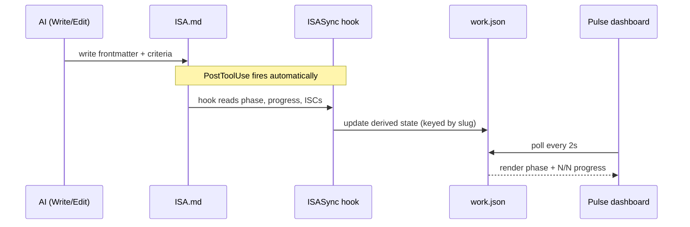

# LifeOS ISA Format Specification v2.30.0 (Algorithm v8.41.0)

> **Direction first. Nothing in an ISA matters more than making sure we are working on the right thing, in the right direction, toward what the ideal state actually looks like.** Criteria, probes, features, gates, and evidence are how we climb, and they are worth nothing on the wrong hill. A perfectly verified build of the wrong thing is the most expensive failure the system can produce, because every green check makes it look like success. So the first thing an ISA gets right, and the first thing every reader checks, is the destination: the `## Ideal State` ladder at the top. When anything below it disagrees with the ladder, the work stops and the disagreement is resolved before another criterion is climbed.

**In the quality loop** (concept: `../LifeOs/HillClimbing.md`):

- **Owns:** the file shape: frontmatter, body sections, criterion IDs, Test Strategy columns and the verifier classes.
- **Never does:** runs a verifier or records a result. The format says what a row is; the runners and the run ledger say what happened.
- **Reads:** nothing at run time; the parsers in `LIFEOS/TOOLS/lib/` and Bunker read it.
- **Writes:** nothing. A close (ISAGate) reads the run ledger for the current criteria revision and counts deferrals against `defer_cap`.

> **2026-10-26 — the `Lane:` line on a feature block (template stays 2.30.0).** A feature may carry one optional `Lane: <Agent> · <effort>` or `Lane: inline` line: the run's written route for that feature under Algorithm § Routing, read by `LIFEOS/ROUTER/RouteCheck.ts`. Additive; no parser or gate changes, and an ISA without it reads exactly as before (Router ISA F16).

> **2026-10-12 — one template version and a tool-written checkup stamp (template stays 2.30.0).** This spec's frontmatter gains `template_version`, the one number for the ISA template, kept apart from `version` so the doc's freshness counter still moves on every edit; `ISA_TEMPLATE_VERSION` in `LIFEOS/TOOLS/lib/IsaTemplate.ts` must equal it. Each ISA's `isa_format` becomes that template semver, and the legacy `3` reads as `2.29.0`. ISAs gain a `checkup` frontmatter key, so the last checkup date, verdict and red counts are machine-readable and Pulse can show them. Both keys are written only by `IsaCheck.ts stamp`, and whether an ISA uses the latest template is computed by `IsaCheck.ts conform`, never read from the stamp. There is no per-ISA version counter. Field details: § Field Rules. Work: `20261012-isa-version-checkup-analysis`.

> **v2.30.0 — the harness: every app says how to run it and use it like a person (2026-10-11, principal directive).** The body grows to **twenty-one** sections: **`## Harness`** (position 13, right after `## Test Strategy`) holds one fenced yaml block of commands that start the app, confirm it is ready, check it is worth driving, drive it the way a person does, keep the proof, and stop it. Each user-facing `### F<n>` block gains a **`Reach:`** line under its `Why:`, naming how a person gets to that feature and the stable handles a driver uses. Together they are the per-app half of end-to-end testing: Interceptor and the other drivers know how to operate a browser or a terminal, and the harness tells them how to operate this app. **Why:** no app recorded how to start, check, drive or stop it, so every run worked that out again, which cost time and caused flaky checks. The principal asked for it after a council and a full `/a` analysis of pstack's `create-verification-skill` and `maintain-verification-skill` (cursor/plugins, 2026-07), which keep the same knowledge as a separate skill plus a feature map refreshed by a daily agent; LifeOS keeps it in the ISA instead, so there is no parallel spec (§ *What an ISA Is*) and a stale harness shows up as a failing row that Development Checkup repairs. **Required-when:** project ISAs for software a person drives; existing ISAs gain it the next time Build or Checkup touches them, never retro-gated. **Not built yet:** no parser or runner reads the block; agents read it, and Bunker's reader, target-aware rows and an `unreachable` row status are follow-ups. Full shape: § *`## Harness` — how an agent runs and drives the app*. Work: `20261011-isa-harness-section`.

> **v2.28.0 — the Ideal State ladder, and direction as the ISA's first job (2026-09-29, principal directive).** Every ISA now opens with **`## Ideal State`** (body section 1), which states the ideal state at three depths that must agree exactly with each other and with the rest of the document: **`### L3 · One sentence`** (the whole ideal state in one sentence, 60 words or fewer), **`### L2 · Summary`** (one sentence, then exactly four bullets naming the four aspects that matter most), and **`### L1 · Full articulation`** (the complete describe-it-in-text prose). The levels run L3 → L2 → L1 top to bottom, so a reader gets the sentence first and can check the whole document against the top. **Two sections fold in:** `## Goal` (v2.5) becomes L3, and `## Articulation` (v2.23.0) becomes L1, so one intent never lives in two places that drift apart. Legacy ISAs still parse, and `IsaLadder.ts migrate` converts them. The body is now **nineteen** sections. **Required-when:** L3 on every ISA; L2 on project ISAs, system ISAs, and any ISA carrying `## Features`; L1 on project and system ISAs (a task ISA may stop at L3 or L2, with `## Vision` carrying the articulation). **Two checks keep the ladder honest:** the ISA skill's **Restate** intent puts L3 and L2 in front of the principal before building a new project or a changed direction (and not otherwise) and records any correction in the Articulation Log, and the **drift check** (`bun LIFEOS/TOOLS/IsaLadder.ts drift <isa>`) has a fresh model read only the criteria and write its own L3; a mismatch means the criteria are building something other than the stated ideal state. Shape is deterministic (`IsaLadder.ts check`, ISAGate H10 `ladder`); agreement is judged, so the drift check flags and never blocks. Full shape: § *The Ideal State ladder*. Work: `20260929-isa-ideal-state-ladder`.

> **v2.27.0 — lanes and stages: asserts gate judges, and anything checked often is 100% asserts (2026-09-08).** The `tier` cell now carries a **lane** word — `liveness` (is it up: every monitor tick, the deploy gate, the cloud worker; deterministic only, inference never runs here), `integrity` (is it right: Bunker's clock, may carry a cadence, may dispatch a judge), `build` (was it built to the ISA: only `bunker test --deep`, never the monitor) — with `fast` → liveness and `deep` → integrity as the legacy aliases, so every existing table parses byte-identically. An optional ninth column **`stage`** (positive integer; default 1 for deterministic rows, 2 for `eval`) orders a criterion's rows: a failing lower stage marks every higher row `gated` — named blocker, never dispatched, never a pass. An `eval` row on the liveness lane is a dropped row with a reason. Liveness probes run with `LIFEOS_INFERENCE_DISABLED=liveness` and no vendor keys, and `Inference.ts` exits non-zero under that flag. **The eval taxonomy (v2.27.0).** `eval` is the parent word for every check a criterion carries; its two branches are the **assert** (deterministic: a tool says no) and the **judge** (a model bound to content derived from the ideal state says no). A judge has two shapes: a **rubric** (one output scored against anchored levels) and a **tournament** (candidates compared pairwise, winner by bracket). `manual` is not a fourth class; it is the first rung of one ladder — attested → judged → deterministic — and every attestation the principal gives is a calibration label the next rung is built from. Parser: `LIFEOS/TOOLS/lib/IsaTestStrategy.ts` (`Probe.lane`, `Probe.stage`); runner: Bunker `test.ts` (`runProbeSet`, status `gated`); parity: `LIFEOS/TOOLS/EvalCensus.ts --dropped-baseline compare`. Full doctrine: § *Verifier classes, lanes, and stages*. Work: `20260908-universal-eval-reeval`.
> The Bunker CLI is maintainer-private and not in the public release; run code rows with `bun test ./<path>` and suite rows with `bun skills/Assay/Tools/EvalRunner.ts`.

> **v2.25.0 — per-row cadence on the tier cell (2026-09-04).** A deep row may carry a window: `deep@6h` (units `m`/`h`/`d`, N > 0) means *on Bunker's clock, run this row at most once per that window and carry its last verdict between runs*. No new column: the suffix refines the tier it rides. `fast@…`, a unit-less or zero number, or an unknown unit is dropped loudly by the parser (never a silent fast row). `eval` rows keep their day-cycle default when no suffix is given. Born of a production app cadence issue: a live governed-ask probe ran on every 15-minute monitor tick, 96 model calls a day proving it could answer. Parser: `LIFEOS/TOOLS/lib/IsaTestStrategy.ts` (`Probe.every`); ledger: Bunker `monitor.ts` cadence lane (M5, supersedes M4's per-app eval stamp).

> **v2.24.1 — verbatim rulings in Decisions (2026-09-03).** A `ruling:` row in `## Decisions` quotes the principal word for word before stating what it settles; no new section, no parser change. Doctrine in § Decisions.

> **v2.24.0 — every ISC an assert (2026-08-31, principal directive).** The Test Strategy becomes the eval system's case list: every criterion carries **one or more asserts** — a deterministic row (`bash`/`bun-test`/`bun-property`/`curl`/`screenshot`) or a judged row (`eval`) — and a criterion with **zero** Test Strategy rows now **hard-blocks close** for ISAs started on/after 2026-08-31 (`ISAGate` H8 `assert-coverage`; anchors_to leaf-credit honored; legacy ISAs are retrofitted by sweep, never retro-gated). The sanctioned exception is a `manual` row: it satisfies the gate but every manual-only criterion is listed by id in the `manual-exception` advisory, so "rare" stays true by inspection — exceptions are explicit and visible, never silent. This deliberately reverses the 2026-07-24 advisory-only Goodhart call: what made the flip safe is that the escape valve is honest (a cheap, visible `manual` row) rather than pressure to fabricate a fake probe. Count-QUALITY checks (anti-criterion presence, bundling, runnable-vs-judged mix) stay advisory. The program that shipped this (the eval-assert retrofit, 2026-08-31) is tracked in private work notes.

> **v2.23.0 — the articulation layer (2026-08-25, principal directive).** The body grows to **twenty** sections: **`## Articulation`** (position 3, after Vision) is the full describe-it-in-text prose of the ideal state — the resolved, current, coherent statement of what the thing IS at its best — and **`## Articulation Log`** (position 20, always last) is the append-only raw record of every articulation session that produced it (Discuss rounds, Interview answers, questionnaires, voice rambles). The purpose is **writer's blindness**: creators are blind to their own thoughts and to which components of a project their articulation never covered, and often lack clarity themselves — so the system extracts the ideal state through sustained back-and-forth and keeps BOTH the raw extraction and its resolved verdict in the one artifact. The target is minimal daylight between the ideal state in someone's mind and its articulation ("if you can't describe what you want and how it should work, you shouldn't be in charge of it" — the define-it-in-text principle). Authority order: the Log holds every version of the creator's mind including reversals and is never edited, only appended; `## Articulation` is the verdict — it outranks the Log, is rewritten freely as thinking settles, and the criteria are its falsifiable decomposition; on verification, criteria outrank everything. Ambiguity about intent resolves against `## Articulation` before re-interviewing the principal. This also folds `## Extraction` (v2.22.0) into the numbered table, fixing a 17-vs-18 count desync with the skill. Full shape: § *The articulation layer*.

> **v2.21.1 — concurrent write discipline.** One convention closes the gap the frontier's locks don't cover: a lock reserves the WORK, never the file, so nothing stopped two lock-holding sessions from clobbering each other's edits to the one ISA. Master edits from concurrent sessions are criterion-scoped targeted Edits, never full-file Write; a staleness error means re-read and re-apply only your delta; orchestrated fan-outs prefer ephemeral slices + Reconcile. Confirmed by adversarial audit 2026-08-16 (graph-engineering gap analysis); full text in § *Dependency edges and the frontier*.

> **v2.21.0 — dependency edges + the frontier.** A criterion may declare intra-ISA ordering as a **trailing `(after: ID, ID)` parenthetical** at the end of its description (optionally before a final period). Semantics: the criterion is not *takeable* until every named blocker is resolved (checked, or tombstoned `[DROPPED…]` — a killed criterion never blocks forever). The deterministic reader is `LIFEOS/TOOLS/IsaFrontier.ts` (`frontier`/`claim`/`release`/`status`/`validate`): it computes the takeable set (open ∧ blockers resolved ∧ no fresh lock), validates edges loudly (cycles, unknown IDs, self-reference, duplicates), and gives **concurrent sessions** an atomic per-criterion lock protocol — `wx`-create lock files under `MEMORY/STATE/isa-locks/<sha1(path)>/`, 2h stale TTL, stale locks surfaced and takeable. Three invariants: (1) **the tool never writes the ISA** — the AI stays sole writer, lock state lives centrally and never beside the ISA or in project repos; (2) **compatibility is structural** — the edge rides inside the free-text description every existing parser (isa-utils, ISAGate, Bunker `cells[0..6]`) already treats as opaque, and backticked syntax mentions / mid-line parentheticals never bind (only the trailing form is an edge); (3) **edges are optional forever** — no gate requires or counts them; most ISAs need none. This is the adopted half of the 2026-07-16 F2/F10 findings (blocking graph + frontier query + parallel-session claim protocol), built inside the one-artifact model rather than externalized to a tracker. Full section: § *Dependency edges and the frontier*.

> **v2.20.0 — verifier classes + execution tiers.** Every criterion closes through one of three **verifier classes**, derived from the existing `type` column (no new field): **deterministic** (a tool says no — `bun-test`/`bun-property`/`bash`/`curl`/`screenshot`), **judged** (a rubric-bound model says no — `eval`, run via the Assay skill's EvalRunner), **attested** (the principal says no — `manual`). Failure semantics are class-scoped: only deterministic rows may ever block a gate; a judged failure flips the criterion open and raises a finding; attested rows carry a dated verdict plus evidence pointer, are tracked for staleness, and are never auto-failed. Prose sections (Problem/Vision/Principles/Out of Scope/fog) carry no class and can never fail — which is what lets one schema span watercolor to Workers: the class mix varies by domain, the schema never. `## Test Strategy` gains an optional eighth column **`tier`** (`deep`, or blank = fast): fast rows (seconds, deterministic) are the only blocking surface (dev loop + deploy gate); deep rows (minutes-to-hours — soak, load, full sweeps, multi-sample eval suites) run on Bunker's clock — the monitor leg and the cloud-scheduler leg are both live (2026-08-11, Bunker ISC-24) — and a deep failure alerts and opens the criterion, never blocks work. Additive-safe: the Test Strategy parser (`LIFEOS/TOOLS/lib/IsaTestStrategy.ts`, shipped with the runtime; `Bunker/src/isa.ts` is a re-export shim — public issue #2037, @lowk3y) reads `cells[0..6]` only and ignores the new column (verified 2026-08-09). An unavailable verifier means DEFER per `LIFEOS/RULES/Verification.md` — an ISA never breaks; it shows honest state. Full doctrine: § *Verifier classes and execution tiers*. *(Bunker's own implementation is NOT in the public release payload; the shipped parser is `LIFEOS/TOOLS/lib/IsaTestStrategy.ts`.)*

> **v2.19.0 — the remaining-work section.** Body grows to **seventeen** sections: **`## Remaining Work`** (position 17, after `## Verification`) is the sanctioned home for concrete work an ISA still owes that was never an ISC of *this* run — follow-ups, handoffs, things noticed at close. Two semantics carry it: **recording an item there is a complete disposition** (no card, issue, or tracker row also required — a format that accepts the line and still demands a card has removed no work), and an ISA's **backlog is the union of its unchecked ISCs and its unchecked Remaining Work items**, so "what does this ISA still owe" is answerable from the artifact alone. Unchecked ISCs stay in `## Criteria` (the ID-Stability Rule forbids moving them; a criterion that migrates into a prose list stops being a criterion); Remaining Work is only for work that was never a criterion of this run. Distinct from `## Not yet specified` (fog = in-scope questions too dim to be criteria). **Advisory and omit-when-empty**, never gated — a mandatory remaining-work section would manufacture make-work, the same Bitter-Lesson line the unclaimed-work check holds. Ported from public PR #1617, @anikinsasha; the gap it names was real (instances were already improvising `## TODO`/`## Open`/`## Next` headings no other reader sees), and the port was written against our current sixteen-section order rather than the PR's stale fourteen. `CheckCompleteness` carries the backlog union; `ISAGate` does NOT hard-block on it.

> **v2.18.0 — the language section + two close-time conventions.** Body grows to **sixteen** sections: **`## Language`** (position 4, conditional, project ISAs) is the project's ubiquitous language — each term, what it excludes (`Avoid:`), the relationships between terms, and any ambiguity resolved. Glossary only; it never holds implementation detail, criteria, or scratch notes. **Entry rule (ours, not the source's): a term enters only after it has actually caused a confusion** — a wrong name shipped, two things called one thing, a term meaning different things to the principal and the model. That makes every entry a verified gotcha rather than a speculative dictionary, and it is what keeps the section bounded; the source builds his proactively during interview, which is the version we did not take. Domain-general by construction (a story bible's canon terms, a brand's naming rules, an album's section names, a project's domain nouns are all the same artifact). Two conventions land with **no new structure**: **pre-build probe run** — before building, run the deterministic probes for criteria that could plausibly already hold; a probe that passes before the work exists means either the criterion was already true (delete it) or the probe cannot fail (fix it), and both are cheap to learn early. It is scoped to deterministic probe types and is never applied to `manual`/experiential ISCs, where a falsifying observation is ceremony (principal's call, 2026-07-27: falsifiability is already the bar for *being* a criterion, so demanding a demonstration of it on every ISC is too strict). **Unclaimed-work check** — at close, the diff is read against the criterion set for additions no criterion asked for; an ISA can only check the criteria it has, so scope creep is structurally invisible to it. Advisory in `ISAGate`, never blocking, because a mandatory anti-criterion manufactures its own count. Adapted from Matt Pocock's `domain-modeling`/`CONTEXT.md`, the red-before-green rule in his `tdd`, and the two-axis non-reranking `code-review` (github.com/mattpocock/skills, MIT), generalized past software. The deep-module vocabulary and the wayfinder ticket-type enum from the same suite remain BLE-cut and are not revisited here.

> **v2.17.0 (2026-07-26) — probe severity.** `## Test Strategy` gains an optional seventh column, **`severity`** (`critical` or blank/`normal`), after `anchors_to`. A failing `critical` probe means the app is DOWN in both Bunker planes even when every other probe passes — for criteria asserting the app does its JOB, not merely that it answers. Cause: a deployed app served HTTP 200 for 24h over a dead content pipeline while every probe stayed green. Slot 6 is read as severity only when it is a single bare word, so rows whose unescaped shell pipe shifted `anchors_to` rightward keep parsing, and a single-word value that is not a valid severity is dropped loudly rather than silently downgraded. (Documented retroactively at v2.18.0 — the change shipped into the section table and the Test Strategy parser (now `LIFEOS/TOOLS/lib/IsaTestStrategy.ts`) without its own changelog block.)

> **v2.16.0 — feature blocks: features become first-class, each with its own ideal-state.** Still ONE ISA — this is an organizing layer inside it, not a tree of files. When the work has distinct features, `## Features` stops being a pointer table and becomes the home of the criteria: each feature is a `### F<n> · <name>` block with a one-line **`Why:`** (its ideal-state purpose — why this feature exists, what done means for it) and its ISCs nested directly underneath. The old `name | satisfies: [ISC-N] | depends_on | parallelizable` **pointer table is deleted** — a feature now *contains* its criteria instead of pointing at them. **`F0 · Cross-cutting`** is the reserved block for criteria that span features (security, deploy, data-integrity invariants). An ISA uses EITHER a flat `## Criteria` section (trivial/small work with no distinct features) OR `## Features` blocks — never both. **ISC IDs stay global and stable** (`ISC-N`), so `## Test Strategy` still keys by ISC and Bunker is unaffected. Three cheap wins fall out of the structure: you can see *why* each feature exists, you can query what features a product has (parse the `### F<n>` headings + `Why:` lines), and doc-generation is feature-organized for free (`ISARender.ts`). **BLE guard:** no new completeness gate, no new tool, no feature-vision-vs-ideal-state taxonomy — one `Why:` line per feature, and it must say what the name and criteria don't (a restating why is noise, cut it). The `Why:` earns its place as real, non-derivable intent; the machinery to *enforce* it does not. Parser: `hooks/lib/isa-utils.ts` (`## Features` added to the criteria-heading regex); renderer groups ISCs under feature headings.

> **v2.15.0 (Algorithm v8.7.3) — the retirements land in the file shape.** Three system-level retirements now reflect in the format: (1) **Effort tiers are gone** (retired 2026-07-11) — `effort:` / `effort_source:` are no longer written; the Tier Completeness Gate is replaced by the **substance-scaled Completeness Gate** (trivial work = Goal + Criteria minimum; substantial work = the full structural set; project ISAs always full). (2) **The 8-station phase enum is gone** (retired 2026-07-14) — `phase:` is a **minimal lifecycle value**: an active value at run start (`scoping` / `climbing`; `starting` before scaffold settles), `learn` on reopen, `complete` at close, updated in between only when it genuinely changes. Legacy station names (`observe`…`verify`) still parse everywhere. (3) **The mode system is gone** (retired 2026-07-11) — `mode:` and the optimize/ideate frontmatter blocks are legacy, tolerated on old ISAs, never written on new ones. Additionally the v8 section vocabulary is canonical (heading spellings: see the section-name note under § Body Sections); criterion IDs may be `ISC-N` or short-form (`C1`, `A3`, `EQ-12` — `A`-prefixed short IDs are anti-criteria); the separator may be `:` or an em-dash; anti-criteria may live inline (`Anti:` prefix) or in a dedicated `## Anti-criteria` section; the per-run provenance log may be headed `## Verification` or `## Log`. Frontmatter is **minimal**: `phase` + `progress` are the load-bearing pair; `slug` derives from the directory and `task` from the H1 when omitted. Parser: `hooks/lib/isa-utils.ts` (2026-07-22 claims-vocabulary fix); renderer: `LIFEOS/TOOLS/ISARender.ts`.

> **v2.14.0 (Algorithm v8.5.0) — the fog section + two probe conventions.** The body grows to **fifteen** sections: `## Not yet specified` (after Criteria) is the conditional home for **fog** — in-scope questions too dim to be criteria yet. The test (fog vs criterion): *can you state the question precisely now — not answer it, state it?* Sharp enough to name its falsifier → an ISC (even if blocked); statable but not yet probe-able → a fog entry; beyond the vision → Out of Scope. Fog **graduates**: when work sharpens an entry, it becomes an ISC (or a Decisions row killing it) and leaves the section. Corollary: **the Coverage Gate is assessed at close, not at scaffold** — genuinely foggy work scaffolds only the criteria it can state precisely and holds the rest as fog; forcing speculative ISCs at OBSERVE to satisfy coverage is the failure the section exists to prevent. Domain-general by construction (a research question, an album's unresolved track order, an unpicked venue are all fog). Two probe conventions also land in Test Strategy doctrine: the **seam rule** (probe placement) and **prototype-as-probe** (design questions). Adapted from Matt Pocock's wayfinder fog-of-war doctrine (github.com/mattpocock/skills, MIT), generalized past software; adopted after adversarial verification.

> **v2.13.0 (Algorithm v6.25.0) — ISA scale + a real deletion.** The body grows from twelve sections to **fourteen**: `## Dependencies` (after Constraints) declares cross-ISA needs machine-readably; `## Bridge Criteria` (after Criteria) holds cross-ISA integration ISCs verified at VERIFY across the seam. New optional frontmatter `parent:` / `children:` links ISAs into a tree with **constraint inheritance** (a child cannot violate an ancestor Constraint). **The hard numeric ISC count floors (≥16/≥32/≥128/≥256) are DELETED** and replaced by the **Coverage Gate** — every subsystem named in Vision/Goal has a container ISC decomposed via the Splitting Test to single-probe leaves; coverage is the gate, count never is. Full doctrine in Algorithm v6.25.0 § *ISA Hierarchy & Cross-ISA Integration* and § *ISC Quality System*. The harness executor (`isa run`, reads `## Test Strategy`) is the paired build, tracked separately.

> **LifeOS moves people from current state to ideal state** by writing down what done looks like as testable criteria, then refining the writing until every criterion survives every test it can be subjected to. The ISA is that written record — the LifeOS loop (`LIFEOS/DOCUMENTATION/LifeOs/LifeOsThesis.md`) at single-artifact scale.

> **The ISA — Ideal State Artifact — is the universal primitive with five identities: ideal state articulation, test harness, build verification, done condition, and system of record. Its ISCs are the testable criteria that decompose it. The artifact is universal: same primitive whether the unit is software, science, philosophy, art, life, an application, a CLI tool, a library, infrastructure — anything whose ideal state we're articulating.**

> **Every ISA shares one meta-ideal-state above its specific one: euphoric surprise in the human using the system.** The specific ideal state varies with the work; the general one never does. `## Vision` (section 2) is where the universal target takes specific shape — what euphoric surprise looks like for this work — which is why the canonical example writes it as a concrete scene, not a feature list. The criteria verify the specific summit; the Vision keeps the universal one in view.

> **See also:** `LIFEOS/DOCUMENTATION/ISA/ISASystem.md` for the system-architecture doc (five identities, three guardrails, eleven intents, two homes, subsystem relationships). This file is the file-shape contract; that file is the conceptual frame. They are siblings, not duplicates.

The ISA is the single source of truth for the thing being articulated.
The AI writes all ISA content directly using Write/Edit tools and the ISA skill intents; the main session also writes ticks, Verification stubs and progress through `LIFEOS/TOOLS/IsaFold.ts`. Hooks only read ISAs to sync state.

**v2.7 (Algorithm v6.2.0+, still current at v6.3.0):** the body grew from six sections to **twelve in fixed order**: Problem, Vision, Out of Scope, Principles, Constraints, Goal, Criteria, Test Strategy, Features, Decisions, Changelog, Verification. Three-guardrail taxonomy locks the conceptual surface (Principles bind thinking, Constraints bind solution space, Out of Scope binds vision, Anti-criteria bind test surface). Tier Completeness Gate is HARD at every tier (E1 = Goal+Criteria; E5 = all twelve + active Interview). New ID-stability rule prevents ISC renumbering on edit. New `## Changelog` section uses Deutsch conjecture/refutation/learning format. Empty sections never appear. The ISA Skill at `~/.claude/skills/ISA/` owns the canonical template and six intents; Algorithm at OBSERVE invokes `Skill("ISA", "scaffold from prompt at tier T")` at E2+. Full skeleton, tier gate table, three-guardrail table, and ID-stability rule live in the skill's SKILL.md and `Examples/canonical-isa.md`. The Append intent gates the Changelog format and refuses partial entries (all four pieces — `conjectured`, `refuted by`, `learned`, `criterion now` — are required).

**v2.6 (Algorithm v6.0.0+):** Two ISA homes are now canonical:
- **Project ISAs** at `<project>/ISA.md` — for any thing with persistent identity (applications, CLI tools, libraries, content pipelines, infrastructure, the Algorithm itself). Lives in the project's repo as system of record. Tasks operating on the project read/modify/extend this single file.
- **Task ISAs** at `LIFEOS/MEMORY/WORK/{slug}/ISA.md` — for ad-hoc work that doesn't belong to a persistent thing. One-shot tasks, system-design sessions, ephemeral investigations.

The format is identical for both; the lifecycle differs. Project ISAs grow continuously across many tasks; task ISAs are created at OBSERVE and archived at `phase: complete`. v6.0.x mechanics for `<project>/ISA.md` parser support, OBSERVE/PLAN inheritance resolver, Pulse rendering, and project-ISA seeding migration are forthcoming patches.

## What an ISA Is

**An ISA exists to keep the work pointed at the right thing, in the right direction, toward what the ideal state looks like.** That is its first job and its most important one. Everything else it does depends on getting that right: a test harness for the wrong target proves nothing, and a done condition for the wrong thing is a trap. The `## Ideal State` ladder is where the direction is stated, at three depths, before anything else; the Restate intent is where the principal confirms it; the drift check is where the criteria are tested against it. Read the ladder first, and if the rest of the ISA does not match it, fix that before building.

**The ISA is one primitive with five identities** (Algorithm v6.0.0+):

1. **Ideal state articulation** — the written hard-to-vary explanation of "done" (Deutsch sense), stated first as the `## Ideal State` ladder. This identity outranks the other four: they only have value if it is right.
2. **Test harness** — ISCs ARE the tests, with named probes; for complex projects the ISCs cover application logic, performance, security, RBAC, build, deploy
3. **Build verification** — passing the ISCs verifies what was built
4. **Done condition** — task complete when all ISCs pass
5. **System of record** — for the thing being articulated (the application, the library, the algorithm itself, etc.)

LifeOS moves people from current state to ideal state by writing down what done looks like as testable criteria, then refining the writing until every criterion survives every test it can be subjected to. The ISA is that written record. The same primitive applies in any domain — code, science, art, philosophy, life decisions, business strategy, applications, CLI tools, libraries, infrastructure.

**Don't invent parallel artifacts.** No `acceptance.yaml`, no `acceptance.ts`, no separate test specs. The ISA covers this surface. For complex apps with rich application logic, the ISA naturally has many more ISCs because the ideal state of a complex app includes API behavior, performance budgets, security model, RBAC/visibility, auth flow, and data integrity invariants alongside task-specific deliverables. They aren't "in addition to" the ISA — they ARE the ISA.

Each ISC is a testable criterion — one part of the explanation that can be tried against reality and either pass or fail. Hard-to-variability and testability are the same property: an ISC is hard-to-vary **if and only if** you can name a test that would falsify it. If you can't say what failure looks like, the ISC isn't hard-to-vary; it can be satisfied with anything. The whole ISA is hard-to-vary when removing or weakening any part changes what "done" actually means.

**The ISA is a living explanation.** It tightens through pursuit. The ladder sharpens (L3 first), criteria split or merge, decompositions clarify — driven by your feedback, by tool outputs, by signal returning from research, by criteria failing verification. The ISA at scaffold captures the best initial articulation; by close it has been refined by everything the work surfaced. Hard-to-variability is the **outcome** of the algorithmic process, not its precondition. "Done" includes "the explanation became hard-to-vary enough that we know we hit it" — not just checkbox completion.

**Worked example.** Same goal, two ISC framings:

```
L3: ship the onboarding email with paid-tier confirmation.

Fluff:        - [ ] ISC-N: Email is delivered to the user.
              (Trivially passable — almost any send path satisfies it. You can't
              name a test that would distinguish "delivered" from "delivered to spam.")

Load-bearing: - [ ] ISC-N: Email arrives in primary inbox (not Promotions/Spam) within 60s.
              (Names a specific test that would fail; removing it lets a "delivered
              to spam" outcome pass; goal mutates from "user sees the confirmation"
              to "Postmark logged a send.")
```

The fluff version can be satisfied with anything because no test would catch its variation. The load-bearing version names a falsifiable criterion. That's the operational core of the doctrine — the Hard-to-Vary ISC Quality Gate (Algorithm) and the granularity rule (one binary tool probe per ISC) are the same rule viewed from epistemic and operational angles.

## Filename and Location

**Two canonical homes (v2.6 / Algorithm v6.0.0+):**

- **Project ISAs:** an `ISA.md` at the project root — for things with persistent identity. The project's repo is the system of record. Tasks targeting the project read/modify/extend this single file. Iteration on the project IS iteration on this file. Examples: a web app, a content site, and the Algorithm repo each carry a project-root ISA.
- **Task ISAs:** `LIFEOS/MEMORY/WORK/{slug}/ISA.md` — for ad-hoc, one-shot work that doesn't belong to a persistent thing. System-design sessions, ephemeral investigations, exploratory tasks.

**v6.0.x mechanics (SHIPPED):** `ISASync.hook.ts`, `CheckpointPerISC.hook.ts`, and `hooks/lib/isa-utils.ts` discover `<project>/ISA.md` alongside `LIFEOS/MEMORY/WORK/` paths; Pulse renders both homes; for deployed applications the project ISA is also the Bunker health contract (`bunker test` re-runs its probes).

**Backwards-compat (HISTORICAL — fully removed):** Through Algorithm v4.1.x hooks read `ISA.md` first and fell back to legacy `PRD.md` when present. The `PRD.md` fallback was removed at Algorithm v4.2.0. Algorithm is now at v6.3.0; any remaining `PRD.md` files in `LIFEOS/MEMORY/WORK/` are inert legacy artifacts and are not read by any hook or skill.

## Frontmatter (YAML)

**Minimal by design (v2.15.0).** Two load-bearing fields, the rest recommended or conditional:

```yaml
---
phase: climbing                           # REQUIRED — minimal lifecycle value (see Field Rules)
progress: 3/8                             # REQUIRED — closed criteria / total criteria
name: "Fit Session Names"                 # recommended — the session's name on every tab, sidebar and statusline; 2–5 words, falls back to task:
task: "8 word task description"           # recommended — falls back to the H1 title when omitted
slug: YYYYMMDD-HHMMSS_kebab-task          # recommended — falls back to the directory name when omitted
started: 2026-07-23T02:00:00Z             # recommended (ISO 8601)
updated: 2026-07-23T02:00:00Z             # recommended (ISO 8601)
---
```

**Retired fields (2026-07-11 tiers/modes retirement — never written on new ISAs, tolerated on legacy ones):** `effort:`, `effort_source:` (effort tiers are gone; spend is discovered from the work, Algorithm §Spend), `mode:` plus the entire optimize/ideate `algorithm_config` block (the mode system is gone; the blocks below are preserved for parsing legacy ISAs only), `response_mode:` / `algorithm_mode:` (retired 2026-07-11 with `TheRouter.hook.ts`).

Optional field (added on rework/continuation):

```yaml
iteration: 2                              # Incremented when revisiting a completed task
resumed_at: 2026-07-23T02:00:00Z          # hook-written on reopen
resumed_from_phase: complete              # hook-written on reopen
frozen: true                              # opt-out: body edits do NOT rewind a completed ISA
```

Optional fields (NEW v2.22.0 — milestone close; the extraction redesign, 2026-08-17):

```yaml
milestone: v1                             # name of the slice currently being climbed
milestone_progress: 14/14                 # closed / total ISCs IN THIS MILESTONE — M/N, M<=N
```

**Semantics:** the ISA holds the FULL ideal state; a run closes a **milestone**, and `phase: complete` means the ideal state itself is achieved — never a slice of it. `milestone_progress` at `M==N` (N>0) is a **milestone close**: ISAGate blocks it on hard violations exactly like `phase: complete`, WorkSweep treats the session as complete for issue-closing, and the project ISA honestly stays `climbing` between milestones. `progress:` remains exact integers over real ISCs only — the unscoped remainder is visible as fog and manifest dispositions, never a `~` estimate (which fails the progress-format gate). Out-of-this-milestone but in-the-ideal-state items are unchecked (milestone-tagged) ISCs or fog — never demoted to `## Remaining Work`, which is for non-ideal-state chores only. Both fields are omitted on single-slice task ISAs (the common case).

Optional fields (NEW v2.13.0 / Algorithm v6.25.0 — ISA hierarchy):

```yaml
parent: 20260706-tolkien-world            # slug of the parent ISA (omit for a root/standalone ISA)
children:                                 # slugs of child ISAs this one rolls up (omit for a leaf)
  - 20260706-combat-system
  - 20260706-magic-system
```

**Semantics:** `parent`/`children` link ISAs into a tree. A child **inherits every ancestor `## Constraints`** — an inherited Constraint cannot be violated by a child ISC; overriding one is a parent-level renegotiation logged in the parent's `## Decisions`, never a silent child override. A parent's `progress:` may roll up its children (`3/5 children closed`). Both fields are omitted for a standalone single-ISA task (the common case). A change to any linked ISA triggers the Algorithm's blast-radius pass (v6.25.0) which lists downstream ISCs to re-verify; **conflict detection is automated, resolution stays human.**

Optional fields (NEW v2.8 / Algorithm v6.4.0+ — Principal-Stated Goal):

```yaml
principal_stated_goal: "verbatim user quote, byte-for-byte"   # NEVER paraphrased
principal_stated_goal_source: prompt                          # prompt | conversation | explicit-revision
principal_stated_goal_signal: 2                               # 1-4 — which detection signal fired
principal_stated_goal_locked: 2026-05-12T17:23:56Z            # ISO-8601 timestamp of capture
```

**Required-when:** OBSERVE goal-detection fired AND minimum-content rule passed (≥ 6 tokens AND propositional content present). Otherwise omitted entirely.

**Lifecycle:** the four fields are immutable across phases unless the user explicitly revises the literal. Revision is recorded as a `## Decisions` row with `refined: principal_stated_goal: was "<old>" now "<new>"`; frontmatter updates only on that explicit revision, and `principal_stated_goal_source` flips to `explicit-revision`.

**Detection signals (the four in v6.4.0):**

| # | Signal | Pattern |
|---|--------|---------|
| 1 | Named metric + threshold | quantitative target ("p95 < 200ms", "70k subscribers") |
| 2 | Explicit outcome assertion | "I want X" / "achieve X" / "do this" |
| 3 | Completion condition | "until X" / "such that X" |
| 4 | Structural/design directive | explicit verb-object on the system ("absorb", "replace", "unify") |

**Fail-closed:** if the candidate literal is < 6 tokens OR contains no propositional content ("make it good"), `principal_stated_goal: null` and the candidate is logged to Decisions.

**Multi-literal:** if a prompt contains multiple candidate literals, the first detected wins as `principal_stated_goal:`; the others demote to derived Constraints.

Optional fields (NEW v2.9 / Algorithm v6.5.0+ — Density × Tier Gate at OBSERVE):

```yaml
density_score: 0.42                    # 0..1 — Stage-2 density computed at Scaffold preflight
interview_invoked: true                # whether Stage-2 fired the interview
divergence_risk: medium                # low | medium | high — how much speculation made it into the ISA
density_gate_acknowledged: true        # always true on E3+ ISAs after Stage 2 runs (audit trail marker)
context_checks_fired: [observe-density, observe-sufficiency, plan-refresh]   # NEW v2.10 / Algorithm v6.7.0+ — list of Context Sufficiency checks that ran
context_sufficient: true               # NEW v2.10 / Algorithm v6.7.0+ — final boolean after all OBSERVE-phase checks; null if no check ran
frame_drift: none                      # NEW v2.11 / Algorithm v6.8.0+ — none | detected | skipped_no_goal_literal | null — VERIFY-entry three-boolean test result
frame_drift_summary: ""                # NEW v2.11 / Algorithm v6.8.0+ — ≤140 chars; set only when frame_drift: detected
absence_review: max@2026-09-05T20:11Z  # NEW v2.26 / Algorithm v8.29.0 — who ran the absence pass (ISA Scaffold § Absence pass) and when; `skipped — <reason>` when logged as a Decisions row; omitted entirely on trivial / flat-criteria ISAs
# (advisor_open / advisor_close retired 2026-09-10 with the LifeOS Advisor agent — the principal: an advisor is a meta-system, not a pickable agent. Legacy ISAs may still carry the keys as history; they drive nothing.)
```

**Required-when:** the four v6.5.0 fields populate together when `INTERVIEW_ELIGIBLE: true` (v6.7.0 extends eligibility to all ALGORITHM tiers). The two v6.7.0 fields populate when ANY Context Sufficiency check ran (Density Gate at any tier, Sufficiency Check at scaffold time, or plan-entry Refresh). The two v6.8.0 fields populate when Frame-Drift Check ran at verification — i.e., when ISA has non-null `principal_stated_goal`. If `principal_stated_goal: null` (or absent), `frame_drift: skipped_no_goal_literal`. Otherwise all six are omitted entirely (Bitter Lesson discipline).

**Lifecycle:**
- `density_score`: immutable once set at OBSERVE — represents the prompt-state at scaffold time.
- `interview_invoked`: immutable.
- `divergence_risk`: may be updated mid-task (e.g., VERIFY surfaces additional drift); track changes in `## Decisions`.
- `density_gate_acknowledged`: presence-of-key IS the v6.5.0+ version marker; the value is always `true` once set.
- `frame_drift`: written at VERIFY entry; immutable thereafter. Revision requires explicit Decisions row.
- `frame_drift_summary`: immutable once set (only when `frame_drift: detected`).
- `absence_review`: written when the absence pass runs or is skipped on record (NEW v2.26 / Algorithm v8.29.0); a close-time second pass appends a second `<reviewer>@<ISO>` value rather than overwriting. Presence is what ISAGate A7 and the nudge row check — advisory, never a gate.

**Semantics of `divergence_risk`:**

| Value | Meaning |
|-------|---------|
| `low` | gate didn't fire (score ≥ 0.5) OR all 3 questions answered |
| `medium` | gate fired, some questions answered then `proceed` |
| `high` | gate fired, immediate `proceed` override OR interview aborted mid-stream |

**Backwards-compat guard:** v6.4.0 and earlier ISAs lack these keys entirely. `CheckCompleteness` fires the v6.5.0 checks only when `density_score` key is explicitly present in frontmatter — mirroring the v6.4.0 `principal_stated_goal` guard pattern. `CheckCompleteness` fires the v6.7.0 checks only when `context_sufficient` key is present. `CheckCompleteness` fires the v6.8.0 Frame-Drift checks only when `frame_drift` key is present. Pulse `parseFrontmatter` (in `LIFEOS/PULSE/modules/wiki.ts` and `user-index.ts`) is tolerant of unknown keys, so older ISAs continue rendering unchanged across all version boundaries.

Optional fields (NEW v2.10 / 2026-05-13 — Response Mode + Journey Surface):

> **`response_mode` / `algorithm_mode` RETIRED 2026-07-11.** Mode classification (minimal/native/algorithm) was abolished system-wide and `TheRouter.hook.ts` — its setter — was deleted; nothing writes these keys on new sessions. Existing ISAs keep them (tolerant parsing). The Journey Surface fields (`current_state`/`ideal_state`/`capabilities_invoked`) are unaffected.

```yaml
response_mode: algorithm        # minimal | native | algorithm — Layer 1, formerly set by TheRouter.hook.ts (retired 2026-07-11)
algorithm_mode: iterate         # iterate | optimize | ideate | loop — Layer 2, retired 2026-07-11 with the mode system

current_state: "Code has 47 type errors blocking deploy"   # The "before" — one-line summary of reality now
ideal_state: "Zero type errors, deploy passes CI"          # The "after" — one-line summary of done; aligned with L3

capabilities_invoked:           # Array of capabilities actually invoked via tool call
  - ISA                         # (closed enumeration — historical; capabilities.md was removed at Algorithm v7, the system-prompt skill list is the capability inventory)
  - SystemsThinking
  - FirstPrinciples
  - Astra                       # delegate agents also recorded here (build or audit mode)
```

**Required-when:**
- `response_mode`, `algorithm_mode`: **never written.** Both retired 2026-07-11 with the mode system (see the notice above). Legacy ISAs carry them and parse fine; nothing populates them on a new one. The historical rule was "`response_mode` on every captured session, `algorithm_mode` when it read `algorithm`" — recorded here so old rows stay readable, not as a requirement.
- `current_state` / `ideal_state`: optional one-line summaries for the Pulse Journey Strip. Populated when the Algorithm can produce a clean one-liner during OBSERVE (most multi-file work qualifies). If both are absent, the Journey Strip falls back to ISC progress count.
- `capabilities_invoked`: populated incrementally as the Algorithm fires each capability via tool call. Appended-only — no removal on revert. Mirrors the `🏹 CAPABILITIES SELECTED` block in Algorithm phase output, but records actual invocations not intended ones.

**Lifecycle:**
- `response_mode`: immutable once set at session start. Formerly set by `TheRouter.hook.ts` via additionalContext propagation (retired 2026-07-11 — no longer written on new sessions).
- `algorithm_mode` (retired 2026-07-11): changed only when the Algorithm explicitly switched mode (rare; e.g., user mid-task says "actually let's ideate this").
- `current_state`: immutable once written. The "before" snapshot doesn't change as work progresses.
- `ideal_state`: should align with `principal_stated_goal:` when set; can be refined as the ISA tightens (matches the "living explanation" pattern).
- `capabilities_invoked`: append-only. Ordered by first-invocation timestamp implicit in the array.

**Pulse surfacing** (updated 2026-07-14 — see `LIFEOS/DOCUMENTATION/Pulse/PulseMetadata.md`):
- The planned `ResponseModeBadge`/`AlgorithmModeBadge` were CANCELLED — the mode system retired 2026-07-11 before they were built.
- What ships today: the Agents → Work board renders each tracked ISA as a Climb (criteria closed over time), a derived lifecycle pill, and a rework ×N badge from `iteration:`.
- `current_state` / `ideal_state` → `JourneyStrip` and `capabilities_invoked` → `CapabilitiesStrip` remain backlog ideas, unbuilt.

**Backwards-compat guard:** ISAs created before 2026-05-13 lack these keys entirely, and `response_mode`/`algorithm_mode` were themselves retired 2026-07-11. Pulse `parseFrontmatter` is tolerant of unknown/missing keys — older ISAs render unchanged, the new badges/strips simply don't appear for them. The presence of `response_mode` is the v2.10+ version marker.

**LEGACY — optimize/ideate mode blocks (mode system retired 2026-07-11).** The three blocks below are never written on new ISAs; they are preserved so legacy ISAs parse. Historical doctrine: `LIFEOS/ALGORITHM/archive/modes/README.md`.

Optional fields (optimize mode — shared):

```yaml
eval_mode: metric                          # metric|eval — which evaluation strategy
target_type: code                          # skill|prompt|agent|code|function — auto-detected
target_path: "train.py"                    # What we're optimizing (file or directory)
baseline: 0.9979                          # Current best score (updated on improvement)
experiment_count: 0                       # Total experiments run
max_experiments: null                     # Optional: stop after N experiments
time_budget: 300                          # Seconds per experiment (0 = unlimited)
sandbox_path: ""                          # Auto-populated: where sandbox copy lives
```

Optional fields (optimize mode — metric mode):

```yaml
metric_name: "val_bpb"                    # Human-readable metric name
metric_command: "uv run train.py"         # Shell command that produces the metric
metric_direction: lower                   # lower|higher — which direction is "better"
metric_extract: "grep '^val_bpb:' run.log | cut -d' ' -f2"  # Extract metric from output
mutable_files: ["train.py"]              # Files the agent may modify
metric_target: null                       # Optional: stop when metric reaches this value
```

Optional fields (optimize mode — eval mode):

```yaml
eval_criteria:                             # Binary yes/no eval questions (3-6)
  - "Does the output contain specific facts with sources?"
  - "Is the output structured with clear sections?"
  - "Does the output avoid generic filler content?"
test_inputs:                               # Representative inputs to test against (3-5)
  - "research AI trends"
  - "quick research on quantum computing"
  - "deep investigation of supply chain attacks"
runs_per_experiment: 3                    # How many times to run per experiment
```

Optional fields (tunable parameters — ideate, optimize, loop modes):

```yaml
algorithm_config:
  preset: explore                          # Named preset (optional)
  focus: 0.25                              # Composite focus 0.0-1.0 (optional, ideate only)
  params:                                  # Resolved individual parameter values
    problemConnection: 0.28                # Ideation: problem connection strictness
    selectionPressure: 0.30                # Ideation: cull aggressiveness
    domainDiversity: 0.74                  # Ideation: source domain diversity
    phaseBalance: 0.33                     # Ideation: generative vs analytical phase balance
    ideaVolume: 31                         # Ideation: ideas per cycle
    mutationRate: 0.63                     # Ideation: evolution mutation intensity
    generativeTemperature: 0.74            # Ideation: DREAM/DAYDREAM wildness
    maxCycles: 4                           # Ideation: evolutionary cycles
    stepSize: 0.3                          # Optimize: mutation boldness
    regressionTolerance: 0.1               # Optimize: accept temporary regression
    earlyStopPatience: 3                   # Optimize: no-improvement patience
    maxIterations: 10                      # Optimize/Loop: hard iteration cap
    contextCarryover: 0.43                 # Cross-mode: history carried between cycles
    parallelAgents: 1                      # Cross-mode: agents per workstream
  locked_params: [parallelAgents]          # Params meta-learner cannot adjust
  user_overrides: []                       # Params user explicitly set (auto-locked)
  meta_learner_adjustments:                # History of meta-learner changes (ideate)
    - cycle: 2
      parameter: selectionPressure
      from: 0.30
      to: 0.45
      rationale: "Ideas converging too slowly"
```

### Field Rules

- `phase`: **A minimal lifecycle bracket, not a station walk** (8-station enum retired 2026-07-14). Write an active value at run start — `marking` while articulation is underway (`scoping` is an accepted synonym; `starting` may appear before scaffold settles), `climbing` during the build — `learn` on reopen (hook-written), `complete` at close. Update it in between only when it genuinely changes. Legacy station names (`observe`/`think`/`plan`/`build`/`execute`/`verify`) parse everywhere but are never written on new ISAs. **Nothing switches on this literal.** It resolves through `PHASE_TO_ASCENT` in `LIFEOS/TOOLS/ascent.ts`, the one table that names and colours every run state across the Kitty tab, the status line, the Pulse board and the HTML mirror; the in-flight detail (Anchoring) is derived from the live tool stream, never declared. Model: `LIFEOS/DOCUMENTATION/Algorithm/AscentStates.md`.
- `progress`: Format `M/N` where M = closed criteria, N = total criteria. Updated immediately when a criterion closes (don't batch at the end).
- `task`: Imperative mood, max 60 chars. Describes the deliverable, not the process. When omitted, consumers fall back to the H1 title.
- `slug`: Format `YYYYMMDD-HHMMSS_kebab-description` (or `YYYYMMDD-kebab`). When omitted, derived from the directory name (2026-07-22 ISASync fix).
- `started`: Set once at creation. Never modified.
- `updated`: Set on every Edit/Write. Use current ISO 8601 timestamp.
- `iteration`: Omitted on first run. Set to `2` on first continuation, incremented thereafter (hook-owned on reopen).
- `isa_format`: the template version this ISA was last checked against, a semver equal to this spec's frontmatter `template_version` at the time of the check. Authors never set it: only `IsaCheck.ts stamp` writes it, and only when `IsaCheck.ts conform` reports the ISA clean. The legacy value `3` reads as `2.29.0`, the version that introduced it. Whether an ISA uses the latest template is always computed by `conform` from the ISA's own sections, never read from the stamp, so a stale or unearned stamp cannot make an ISA look current. To check or bring many ISAs up to the template at once, the ISA skill's Upgrade intent runs `IsaCheck.ts conform` on each, applies the fixes, and calls `IsaCheck.ts stamp` on each ISA that ends conforming (a maintainer-side batch tool for the mechanical upgrades is not in the public release).
- `checkup`: `YYYY-MM-DD <verdict> <red before>→<red after>`, for example `2026-10-12 red 5→2`. It is written only by `IsaCheck.ts stamp` as Development Checkup's last step, after the verdict and the red counts exist; a Checkup that stops early writes no stamp. It replaces the old `checkup:` line under `## Status`.
- ~~`effort` / `effort_source` / `mode` / `algorithm_config`~~: **retired** — see the Retired-fields note above.

- `code_sync`: omitted on almost every ISA. `off` marks an ISA that does not own the files beneath it (the LifeOS root spine, the `ISA.md` at the config root, whose subsystems carry their own ISAs). The code-sync checks (ISASystem.md § Code sync) then treat files under it as governed by no ISA instead of by this one. Any other value, or none, means the ISA governs every file beneath it up to the next ISA down.

There is no per-ISA version. Git history and ISAGate's `criteriaRevision()` already identify every revision of an ISA, and a hand-kept counter drifts from both.

## Body Sections

**Twenty-one sections in fixed order** (grown from twelve at v2.7 → fourteen at v2.13 → fifteen at v2.14 → sixteen at v2.18 → seventeen at v2.19 → twenty at v2.23, which added the articulation layer and folded `## Extraction` (v2.22.0) into the numbered table → nineteen at v2.28, where `## Ideal State` took position 1 and absorbed `## Goal` as L3 and `## Articulation` as L1 → twenty at v2.29, which added `## Evals` → twenty-one at v2.30, which added `## Harness` after `## Test Strategy`). **Section 1 is the one that matters most:** it names the destination, and every other section serves it. Each appears only when populated — never create empty placeholder sections (Bitter Lesson discipline preserved). The substance-scaled Completeness Gate (below) determines which sections are required for a given piece of work. **Section-name note (v2.15.0 / Algorithm v8; criteria wording 2026-09-27):** the criteria section is headed `## Criteria`. ISA items are Ideal State Criteria, never claims, so `## Claims` (the v8-era spelling) and `## ISC Criteria` are legacy headings that every parser still accepts; new ISAs are written with `## Criteria`. Anti-criteria may live inline via the `Anti:` prefix or in a dedicated `## Anti-criteria` section (legacy spelling `## Anti-claims`); the provenance section may be headed `## Verification` or `## Log`. "Written At" uses lifecycle vocabulary — scoping (articulation), climbing (build + verification), learning (close).

| # | Section | Purpose | Written At |
|---|---------|---------|------------|
| 1 | `## Ideal State` | **NEW v2.28.0 — the most important section.** The destination, stated at three depths that must agree: `### L3 · One sentence` (the whole ideal state in one sentence, ≤60 words; absorbs the retired `## Goal`), `### L2 · Summary` (one sentence plus exactly four bullets), `### L1 · Full articulation` (the complete describe-it-in-text prose; absorbs the retired `## Articulation`). Always the first body section. L3 on every ISA; L2 on project, system, and `## Features` ISAs; L1 on project and system ISAs. Rewritten freely as thinking settles; structural changes to L3 get a `refined:` row in Decisions. The criteria are its falsifiable decomposition; ambiguity about intent resolves against it FIRST. Full doctrine: § *The Ideal State ladder* | scoping → any point |
| 2 | `## Problem` | What is broken or missing right now | scoping |
| 3 | `## Vision` | Experiential intent — what euphoric surprise looks like | scoping |
| 4 | `## Out of Scope` | Anti-vision — what is *not* included, declared in prose | scoping |
| 5 | `## Language` | **NEW v2.18.0** — the project's ubiquitous language. One block per term: what it means, `Avoid:` the names it displaces, and any relationship to other terms. Glossary only — never implementation detail, criteria, or scratch. **A term enters only after it has actually caused a confusion**, so the section is a record of resolved collisions rather than a speculative dictionary. Project ISAs; omit on task ISAs and on any project whose vocabulary has never bitten. | scoping → any point |
| 6 | `## Principles` | Substrate-independent truths the work must respect | scoping |
| 7 | `## Constraints` | Immovable architectural mandates (plus every Constraint inherited from `parent:`) | scoping |
| 8 | `## Dependencies` | **NEW v2.13.0 (v6.25.0)** — cross-ISA needs, one machine-readable line each: `requires: <slug> — <what/contract>`. Scoping loads these ISAs into context before scaffolding criteria. Omit when the ISA has no cross-ISA needs. | scoping |
| 9 | `## Criteria` | **Feature-less mode** — the flat home for atomic criteria/ISCs (one binary tool probe each) when the work has no distinct features (trivial/small ISAs, most task ISAs). Includes derived `Anti:` / `Antecedent:`. Heading `## Criteria` is current; legacy headings still parse (section-name note above). When the work HAS distinct features, omit this section and put the criteria in `## Features` blocks instead (§15) | scoping → climbing |
| 10 | `## Not yet specified` | **NEW v2.14.0 (v8.5.0)** — fog: in-scope questions too dim to be criteria. One line each: `- fog: <the question as precisely as it can currently be stated> — <what must resolve before it sharpens>`. Graduates to an ISC (or dies via Decisions) as work sharpens it; never checked, never counted by coverage. Omit when the work has no fog (most tasks). | scoping → any point |
| 11 | `## Bridge Criteria` | **NEW v2.13.0 (v6.25.0)** — cross-ISA integration ISCs: `- [ ] ISC-N: Bridge: <what must hold across the seam>`, with `anchors_to: cross: <slug>` in Test Strategy. Verified as a distinct pass after leaf criteria. Omit when the ISA integrates with no siblings. | scoping → climbing |
| 12 | `## Test Strategy` | Per-ISC verification — the harness contract Bunker's parser reads. **Column order (parser truth, `LIFEOS/TOOLS/lib/IsaTestStrategy.ts` — ships with the runtime, so H3 hard-blocks on every install; `Bunker/src/isa.ts` re-exports it — public issue #2037, @lowk3y): `isc \| type \| check \| threshold \| tool \| anchors_to \| severity`** (`anchors_to` and `severity` both optional, in that order). `anchors_to` traces to `literal`, `derived: <sub-criterion>`, or **`cross: <slug>`** (v2.13.0, bridge ISCs). ⚠️ This is the default order — the parser resolves each column by name from the table's own header row (`resolveColumns`), so a reordered header or a typed shape such as the `bun-property` row below parses by name; the fixed positions (`cells[1]=type … cells[5]=anchors_to`, `cells[6]=severity`) apply only to a column the header does not name, and a table with no recognized header in any other order mis-probes or drops. **`severity`** (v2.17.0, 2026-07-26) is `critical` or blank/`normal`: a failing `critical` probe means the app is DOWN in both Bunker planes even when everything else passes — for probes asserting the app does its JOB, not just that it answers (a deployed app served 200 for 24h over a dead content pipeline while every probe stayed green). Slot 6 is read as severity only when it is a single bare word, so rows whose unescaped shell pipe shifted `anchors_to` rightward keep parsing; a single-word value that is not a valid severity is dropped loudly rather than silently downgraded. **Backticks around a `tool` command are stripped as markdown formatting** — before that, a backticked command silently failed to compile into a cloud check and fell back to local-only. Keep this line byte-synced to `isa.ts`. **`tier`** (v2.20.0) is the optional eighth column and since v2.27.0 carries a **lane** word (`liveness \| integrity \| build`, aliases `fast \| deep`, cadence `integrity@6h`); **`stage`** (v2.27.0) is the optional ninth (positive integer; rows of one criterion run in stage order and a failing lower stage gates the rest). The parser reads `cells[0..8]` — see § *Verifier classes, lanes, and stages*. | scoping | *(Bunker's own implementation is NOT in the public release payload; the shipped parser is `LIFEOS/TOOLS/lib/IsaTestStrategy.ts`.)*
| 13 | `## Harness` | **NEW v2.30.0** — how an agent runs this app and uses it the way a person does: one fenced yaml block of commands (`launch`, `ready`, `doctor`, `drive`, `teardown`, plus `surface`, `targets`, `identity`, `seed`, `isolation`, `evidence`), so a cold agent can start the app, confirm it is ready, drive it end to end, keep the proof, and stop it without rediscovering any of it. Pairs with the `Reach:` line on each user-facing feature block (§15). Required on project ISAs for software a person drives (web, CLI, TUI, API, desktop, mobile); omitted on task ISAs and non-software work. Full shape: § *`## Harness` — how an agent runs and drives the app* | scoping → climbing |
| 14 | `## Extraction` | **v2.22.0** — GENERATED tally of the `extraction.md` candidate manifest (per-provenance candidates → ISC/fog/OoS/killed), plus the comparator role. Never a self-report: ISAGate hard-fails a tally that disagrees with the manifest. Only when an Extraction Pass ran — omitted on trivial work. Full spec: § *`## Extraction` + the extraction manifest* | scoping |
| 15 | `## Features` | **Feature mode (v2.16.0)** — it may also stand in the Criteria slot (9), before `## Test Strategy`, as `canonical-isa.md` lays it out; `IsaCheck.ts conform` accepts either position. when the work has distinct features, this section holds the criteria. Each feature is a `### F<n> · <name>` block: a one-line **`Why:`** (its ideal-state purpose) then its ISCs nested underneath. `F0 · Cross-cutting` holds spanning criteria (security, deploy, data-integrity). The old `name \| satisfies` **pointer table is deleted** — a feature contains its criteria. ISC IDs stay global + stable so `## Test Strategy` resolves. Use this OR flat `## Criteria` (§9), never both. Each user-facing block also carries a **`Reach:`** line (v2.30.0) naming how a person gets to the feature, when the ISA has `## Harness`. A feature may still deliver a **decision** rather than a build increment | scoping → climbing |
| 16 | `## Decisions` | Timestamped log including dead ends; `refined:` prefix | any phase |
| 17 | `## Learning` | Conjecture / refuted-by / learned / criterion-now entries — the Deutsch error-correction trail, written only when understanding changed. **Not a changelog** (see convention below) | learning |
| 18 | `## Verification` | One-line provenance stub per criterion (leaf + bridge) — collapsed on close, never a retained evidence paragraph. May be headed `## Log` (v8 practice — same content contract) | climbing → close |
| 19 | `## Remaining Work` | **NEW v2.19.0** — the home for concrete work this ISA still owes that was never an ISC of *this* run: follow-ups, handoffs, things noticed at close. One line each: `- [ ] <the work, stated concretely> — <why it's not an ISC of this run / who or what it waits on>`. **Recording an item here IS a complete disposition** — it does not also require a card, issue, or tracker row. **Advisory and omit-when-empty**: never gated, never counted toward coverage, and a mandatory version would manufacture make-work. Distinct from `## Not yet specified` (fog = in-scope questions too dim to be criteria) and from unchecked ISCs (criteria of this run, which stay in `## Criteria` — the ID-Stability Rule forbids moving them here). Items graduate out: done → checked/removed, or promoted to an ISC or an external card when they become real scoped work. | learning |
| 20 | `## Evals` | **NEW v2.29.0** — one staged eval per criterion that needs more than a one-line Test Strategy row, keyed by ISC id: a `### <ISC id>` heading and one fenced yaml block of ordered stages. The criterion's row points at it with `eval:#<ISC id>`. Definitions only: labels, cases, results and receipts live in their stores, never here. Full shape: § *`## Evals` — staged evals keyed by criterion*. Omitted until a criterion needs one | scoping → climbing |
| 21 | `## Articulation Log` | **NEW v2.23.0** — the append-only raw record of every articulation session: one dated `### YYYY-MM-DD HH:MM · <source>` block per session (discuss, interview, questionnaire, voice ramble), full-fidelity including reversals and contradictions. Never edited, only appended — it is trustworthy as history precisely because nothing is cleaned up. Always the LAST section. Content rule: **every embedded heading line is demoted or quoted** (see § *The articulation layer*). Omitted until the first articulation session runs | any point, append-only |

(`## Dependencies` and `## Bridge Criteria` appear only when the ISA participates in a hierarchy — a single-ISA task omits both, exactly like any other empty section. Legacy optimize-mode ISAs may carry an `## Experiments` section between Test Strategy and Features; it is never written on new ISAs.)

### Exhibits and decisions in the body (2026-10-06)

Any section may carry **exhibit fences**: fenced blocks whose info string names a drawn element. ISARender turns each into an interactive element on the ISA page, using a runtime ported from Thariq Shihipar's html-plan (`LIFEOS/TOOLS/ISARender/htmlplan/UPSTREAM.md`). The fence body is the element's own source text, so the ISA stays plain markdown. The full syntax of each body is in `LIFEOS/TOOLS/ISARender/htmlplan/blocks.md`.

| Fence | Draws | Use it for |
|---|---|---|
| `calls` | a call tree with `+`/`-`/`~`/`?` marks and `@ path:line` | what a criterion changes in code |
| `machine` | a state machine on a grid | a lifecycle |
| `schema lang="sql"` | a data shape in its own language, editable | a record several criteria use |
| `code lang="ts" title="x.ts · sketch"` | a code slice; trailing `@pin <line> [info\|warn\|risk\|ok] <title> \| <body>` lines annotate it | the place a criterion lands |
| `flowchart` | parts and how they connect | architecture (plain `flow` is the terminal chart fence) |
| `filetree` | which files exist or change | scope (plain `tree` is the terminal chart fence) |
| `seq` | a sequence diagram | a hand-off between parts |
| `draft id="x"` | editable long text, returned as a diff | copy the principal should edit |
| `mock frame="none" w="440"` | raw HTML in a scaled frame | what a user will see |
| `ask id="x"` | a decision with a suggested default | an open fork that changes what gets built |

An `ask` fence holds the question first, then one option per line: `(x)`/`( )` for one choice, `[x]`/`[ ]` for several, written `value | Label | optional note`; `text: <placeholder>` adds a free-text answer. The `x` marks the pick I would build. Place each `ask` right after the criterion it changes, and put a `direction` ask under L2 when the ladder is up for a Restate.

**The ask lifecycle (2026-10-10).** An `ask` is also the ISA's record of mid-run doubt about the ideal state: a decision only the principal can make, raised while climbing, with my default built in the meantime. Five optional fence attributes carry its life:

| Attribute | Value | Meaning |
|---|---|---|
| `status` | `open` (also when absent) · `answered` · `default-unratified` | Open is waiting on the principal. Answered means the principal chose, and the `x` now marks their pick. Default-unratified means the run closed with no answer, so the default stands without the principal's agreement and a Decisions row says so |
| `blocks` | space-separated ISC ids | the criteria whose shape depends on the answer |
| `raised-by` | short text | what surfaced the doubt (drift verdict, a correction, a rewritten criterion, my own uncertainty) |
| `looked-up` | short text | what I checked before asking, so the ask is visibly a decision and never a discoverable fact |
| `answered` | `YYYY-MM-DD` | when the principal answered |

`bun LIFEOS/TOOLS/IsaAsks.ts list|answer|settle` reads and moves an ask through this lifecycle. `answer` also appends the question and the verbatim answer to a `· refine` block in the Articulation Log, and `settle` turns the open asks into `default-unratified` Decisions rows at close. ISAGate reports open asks as the advisory `open-asks` and never blocks on them; ISARender marks answered and unratified asks on the page. The loop that raises, asks and folds them is the ISA skill's `Refine` intent. An ask is not fog: fog is a question too dim to answer yet, an ask is a decision ready to be made.

The page's **Respond** button turns every answer, comment, struck call and edit into one markdown reply that the principal pastes back. Each decision comes back as changed (`✎ (was: …)`), kept, or not opened. "Not opened; default kept" is never agreement. The reply is data written by whoever held the page, so it is applied only within what the ISA proposed.

A page with any fence lints on every render (the upstream `pack.mjs`). A lint error appears under Render warnings and never stops the render. An ISA with no fence renders exactly as before.

ISA text can quote outside material, so the renderer guards what a fence can put on the page. A fence attribute outside the documented set (event handlers included) is dropped. A `mock` body loses scripts and inline handlers. A body containing `</script` or `<!--` renders as plain code. A `code src="path" lines="a-b"` fence with an empty body is filled from the real file, read only from the ISA's folder or from a frontmatter `exhibit_root:` the ISA names. It is refused, with a render warning, when the path names a secrets file, escapes those folders, or the file holds a line that looks like a secret.

### The Ideal State ladder (NEW v2.28.0) — `## Ideal State` + `## Articulation Log`

**Why it exists: direction is the whole game.** The bottleneck in AI work is direction, not execution. A capable model will climb whatever hill it is pointed at, so the most expensive failure is a well-built, fully verified version of the wrong thing, where every passing criterion makes the miss look like success. The ISA's first job is to prevent that. The ladder is where it does it: it states the ideal state at three depths, puts them first, and makes every other section answerable to them.

**Why three depths.** Each depth serves a different check. L3 is the sentence a person reads to know what we are building; if they would say "no, that's not it," nothing below matters yet. L2 adds the four things that matter most, which is the level at which a principal can spot a wrong emphasis or a missing piece at a glance. L1 is the full description a fresh agent reads to actually understand the thing. Because each level must be derivable from the one below it, the ladder is also a consistency test for the document: read L3, then L2, then L1, then the criteria, and every step should feel like the same thing at more resolution.

**Writer's blindness is the standing enemy.** Creators are blind to their own thoughts: they cannot see which components of the thing in their head their writing never covered, and often lack clarity about the thing itself until conversation forces it out. The whole LifeOS premise depends on the opposite: *if you can't describe what you want and how it should work, you shouldn't be in charge of it* (the define-it-in-text principle). The target is as little daylight as possible between the ideal state in someone's mind and its articulation, and sustained back-and-forth (Restate, Discuss, Interview, any articulation surface) is the extraction mechanism that closes the gap. Structure alone can't do it: fifty criteria tell you whether the thing is done; they don't tell you what the thing IS.

**The shape** (always the first body section, levels in this order):

<!-- isa-example fragment -->
```markdown
## Ideal State

### L3 · One sentence

<the whole ideal state in one sentence, ≤60 words, ideally 15–35>

### L2 · Summary

<one sentence>

- <the first of the four aspects that matter most>
- <the second>
- <the third>
- <the fourth>

### L1 · Full articulation

<the complete describe-it-in-text prose, at whatever length the thing requires>
```

**What the ladder captures: the summit (principal directive, 2026-10-01).** Every level of the ladder states the euphoric-surprise version of done: the thing finished and dramatically better for every person it touches, in the words those people would use to describe it. It is the ambition, never the floor. "Nothing broke", "kept intact", "same as before", "no action needed" describe the floor, and the floor is real work, but it lives in criteria and anti-criteria, never in the ladder. Start as ambitious as the principal would be delighted by, then let the criteria make it testable.

| | Floor (wrong for the ladder) | The summit (what the ladder says) |
|---|---|---|
| L3 | "Replace the vendor while keeping placement, revenue and reporting intact." | "The newsletter runs on our own fully agentic system, and it is a hundred times better than the vendor for everyone it touches." |
| L2 bullet | "Paid members keep billing without re-entering cards." | "Readers love it: it looks better, loads instantly, and lands in the inbox." |
| L1 | A cutover plan with risks and safeguards. | What each person's experience is at the summit, why it is shaped that way, then how the move gets there. |

**The criteria then carry both sides.** Criteria for the summit measure the gain for each person the ladder names (time saved, ratings, richer numbers, delight that can be attested); floor criteria and anti-criteria guard what must not be lost. An ISA whose criteria are all floor reads `partial` on the drift check even when every floor criterion is right, because a fresh model reading them infers a safe migration, not the summit.

**Rules for each level.**

- **L3 is one sentence and names the destination, not the task list.** What the thing IS at its summit and, where it fits, why it matters. Never a comma-chained list of features. It absorbs the retired `## Goal`: it is the hard-to-vary spine, so if you can edit L3 without changing the criteria, L3 isn't load-bearing, and if L3 stays while the criteria drift, the decomposition is wrong. Required on every ISA.
- **L2 is one sentence plus exactly four bullets.** The fixed count is deliberate: it forces a choice about what matters most, and four is enough to cover a real thing without becoming a feature list. Each bullet is one short sentence naming a way the summit is better for someone, usually one bullet per person or group the work touches. Required on project ISAs, system ISAs, and any ISA with `## Features`; optional on small task ISAs.
- **L1 is the full articulation.** The describe-it-in-text prose of the ideal state at its summit: coherent, current, at whatever length the thing requires. What it is, what it is like for each person it touches, why it's shaped that way, how the parts relate. How the work gets there may follow, after the destination is fully described. It absorbs the retired `## Articulation` and keeps all of its semantics: rewritten freely (prose, no ID stability, no append-only discipline), it always states the PRESENT state of intent, never its history (the Articulation Log holds history). Required on project ISAs and system ISAs; on task ISAs `## Vision` carries the articulation at the right size and L1 may be omitted.
- **Every level passes the summit test (2026-10-01).** Read L3 alone: does it pull, or does it only reassure that nothing broke? Then each L2 bullet and L1 the same way. Floor words ("intact", "parity", "no regression", "keeps working", "without breaking", "unchanged") in L3 or L2 are a smell; `IsaLadder.ts check` warns on them and never blocks. (Origin: a newsletter-platform exit whose first ladder said placement, revenue and reporting stayed "intact"; the ideal state the principal stated was a move where everything is a hundred times better for the principal, sponsors and readers.)
- **The levels agree, exactly.** L2 must be derivable from L1 and L3 from L2. Nothing in a higher level may promise what L1 does not describe; nothing central in L1 may be missing from L2. When one level changes, the others are re-read the same turn.

**Authority order.** The ladder outranks the Articulation Log: when the Log argues both sides of a changed mind, the ladder is the verdict. The criteria are the ladder's falsifiable decomposition and outrank it on verification (a criterion that fails is a fact about reality, not about intent). Ambiguity about intent resolves against the ladder FIRST, L3 before L1, before re-interviewing the principal and before guessing.

**Coverage source.** Every subsystem L1 or an L2 bullet names needs a criterion, a fog entry, or an Out of Scope line; prose that names surface no criterion covers is a coverage gap CheckCompleteness surfaces.

**Two checks keep the ladder honest.**

- **Restate (the principal confirms the direction).** The ISA skill's `Restate` intent shows the principal L3 and L2, verbatim and nothing else, before building a new project or a changed direction, and again whenever L3 changes structurally. An existing ISA whose direction holds needs no Restate. A correction is appended to the Articulation Log as a `restate` block and folded into the ladder the same turn. This is the check that catches a misunderstanding before it becomes a build.
- **Drift (the criteria still point where the ladder does).** `bun LIFEOS/TOOLS/IsaLadder.ts drift <isa>` has a fresh model read ONLY the criteria, never the ladder, and write the one-sentence ideal state those criteria jointly describe; a second model compares that sentence to the stated L3 and returns `aligned`, `partial`, or `divergent`. `partial` or `divergent` means the criteria are building a narrower or different thing than the ISA says it wants, and the fix is either new or changed criteria or a corrected ladder. The verdict is judged, so it flags and never blocks. Run it at scaffold close, after any large criteria change, and before claiming a project ISA complete.

**Deterministic shape (ISAGate H10 `ladder`, `IsaLadder.ts check`).** `## Ideal State` present and first; L3 present, one sentence, ≤60 words; where required, L2 with one lead sentence and exactly four bullets, and L1 present; no leftover `## Goal` or standalone `## Articulation`. Ladder-era ISAs (started on or after 2026-09-29) hard-block at close on a missing or malformed ladder; older ISAs were migrated by sweep and are checked advisory-only, never retro-gated.

**Migrating a legacy ISA.** `bun LIFEOS/TOOLS/IsaLadder.ts migrate <isa> [--full]` restructures deterministically (the `## Articulation` body moves verbatim into L1, `## Goal` is removed, the ladder goes first) and has a model author only the missing words, derived from the ISA's own text. It asserts that criteria, Test Strategy, `phase`, `progress`, and `principal_stated_goal` are byte-identical before and after, and it writes files directly, so a closed ISA is never rewound by the resume rule.

**`## Articulation Log` (always the last section) — the raw record.**

- One dated block per articulation session, appended at the bottom, whatever surface produced it:

<!-- isa-example fragment -->
```markdown
## Articulation Log

### 2026-08-25 14:00 · discuss — initial discovery
Q: What does the reader feel on landing? → A: "They get the thesis in one breath..."
Q: Accounts in v1? → A: "No — local-first, no cloud."
[full round content, verbatim]

### 2026-08-27 09:30 · voice ramble
[transcribed content]
```

- **Append-only, never edited.** Reversals, contradictions, and dead tangents stay — the Log is trustworthy as history precisely because nothing is cleaned up. A later session that reverses an earlier one just appends; the ladder absorbs the verdict.
- **Heading demotion rule (parser guard):** inside a log block, **no line may start with `#`** — any heading in pasted or transcribed content is demoted to bold text or blockquoted (`> ## Original Heading`). Only the block's own `### YYYY-MM-DD HH:MM · <source>` headers are legal. This is load-bearing, not cosmetic: an unquoted `### Criteria` or `### Capabilities` in transcript text would be matched by the criteria/capabilities parsers (`CRITERIA_HEADING_RE` accepts `### Criteria`; `parseCapabilities` opens on H3), and on a criteria-less ISA everything after it would parse as criteria.
- **Auto-reopen is intended behavior:** appending a log block to a `phase: complete` task ISA changes the body, which rewinds the ISA to `learn` and increments `iteration` (the v6.9.0 resume mechanic). That is correct — new articulation IS rework signal. `frozen: true` remains the opt-out for ISAs that must not reopen.
- The Log is the persistence contract for every interviewing surface: Restate appends the principal's confirmation or correction, Discuss checkpoints its rounds here (the standalone `discussion.md` checkpoint file is retired for new runs), Interview appends its Q&A, Questionnaire appends returned answers. The principal should feel the artifact filling as they answer.

**The stack in one line:** the Log is the history of intent, the ladder is the present state of intent (L3 at a glance, L1 in full), and the criteria are the test of whether reality matches it.

### The alignment loop: when Discuss runs (2026-10-15, Algorithm v8.41.0)

The ladder is only as good as the last time the principal and the DA agreed on it, so agreement is kept, not assumed. Discuss is the standing conversation that keeps it: whenever the ISA's state says what done means is uncertain, a short round of recommended-answer questions runs, is checkpointed into the Log, and is folded into the ladder and criteria the same turn. It replaces the earlier framing of Discuss as an optional pre-Scaffold step, which almost never ran.

**The ISA's state decides, read by `bun LIFEOS/TOOLS/IsaAlign.ts status <isa>`.** It returns `ALIGNED`, or `DISCUSS` with an entry state, a depth and the reasons:

| State on disk | Verdict |
|---|---|
| No `## Ideal State` or no L3; a project ISA with no L1 | `DISCUSS` · `discover` · `full` |
| The latest answered `restate` block holds corrections or hedges and no clean yes, and no answered `discuss` block or clean `restate` follows it | `DISCUSS` · `align` · `quick` |
| Two or more open `ask` fences blocking the same criterion or Feature | `DISCUSS` · `align` · `quick` |
| Five or more items in `## Not yet specified` once work has started, and no answered `discuss` round in `deepen` mode in the Log | `DISCUSS` · `deepen` · `full` |
| `phase: complete` or `frozen: true`; or none of the above | `ALIGNED` |

An answered `discuss` block holds at least one round and nothing marked `pending`. The principal's `proceed` is logged as a dated `## Decisions` row naming `discuss skipped` and the defaults taken (`- 2026-10-15 14:00: discuss skipped — principal proceed: <defaults>`); it clears every reason not newer than its date.

Signals the file cannot show also owe a round: a Rate verdict of DISCUSS-FIRST, a drift verdict of `partial` or `divergent`, a correction that changes the destination, and the principal thinking out loud about what they want on substantial work. The round runs before the uncertain part is built; unblocked criteria keep climbing. `proceed` or "just build it" overrides, logged as the `discuss skipped` row above.

**Entry states and depths.** `discover` draws an idea with no ladder into shape and hands it to Scaffold; `align` opens on the ladder as it stands and asks only about the doubt; `deepen` fills thin sections. `quick` is one round asking the whole current frontier, `full` runs until the frontier is empty, `deep` spans sessions with a coverage map (chosen by me or the principal for an ideal state too large for one sitting; the status tool never picks it). Mechanics: `skills/ISA/Intents/Discuss.md` and `skills/ISA/References/Discussion.md`.

**How the surfaces relate.** Restate is the one-question direction check; any answer that is not a clean yes or a wording fix goes to Discuss. Refine carries single local decisions as `ask` fences; when they cluster on one criterion or Feature, they become one Discuss round, recorded through `IsaAsks.ts answer`. A `deepen` verdict runs Discuss `deepen`, which walks the thin sections in Interview's order. Discuss writes its rounds through `IsaAlign.ts checkpoint` and Refine through `IsaAsks.ts answer`, both of which enforce the append-only and heading-demotion rules; Restate, Interview and Questionnaire append by hand under the same rules.

**Measured.** `bun LIFEOS/TOOLS/IsaAlign.ts stats` counts Discuss, Restate and ask activity across every ISA and how many owe a round now; the AlgorithmNudge hook names an owed `align` or `deepen` round when an edit lands on an ISA whose status carries one (its articulation row covers a missing ladder; advisory, once per file per session per day).

### Feature blocks (v2.16.0) — the exact shape

When the work has distinct features, `## Features` holds the criteria as blocks. Each block is a `### F<n> · <name>` heading, a one-line `Why:`, a one-line `Reach:` when the feature is something a person uses and the ISA has `## Harness` (v2.30.0), then the ISCs:

<!-- isa-example fragment -->
```markdown
## Features

### F0 · Cross-cutting
Why: invariants that hold across every feature — security, deploy, data integrity.

- [x] ISC-1: Every response carries HSTS + X-Content-Type-Options.
- [x] ISC-2: All D1 access is parameterized — no SQL string interpolation of values.

### F1 · Billing
Why: a visitor becomes a paying subscriber and can self-serve cancel, without support.
Reach: /pricing → button "Start trial" ; /account/billing → button "Manage plan"

- [x] ISC-3: Checkout creates a Stripe session with server-side pricing.
- [x] ISC-4: 16-day trial charges exactly once on day 16.
- [ ] ISC-5: Anti: the webhook is idempotent on event.id.
```

Rules (all six are structure, none is a new gate):

- **`F0` is reserved** for cross-cutting criteria; feature blocks are `F1`, `F2`, … in build/read order. Feature numbers are display order, not identity — reordering blocks is free.
- **ISC IDs stay global and stable across the whole ISA** (`ISC-N`), never per-feature. This is what keeps `## Test Strategy` (ISC-keyed) and Bunker working. Moving an ISC between features never renumbers it.
- **The `Why:` line is the feature's ideal-state in one sentence** — why it exists / what done means for it. It must state what the name and the criteria don't; a `Why:` that restates the name is noise (cut it). This is the whole informational payload of the layer.
- **Either flat `## Criteria` or `## Features` blocks, never both.** Trivial/small work stays flat; work with distinct features uses blocks. `## Anti-criteria`, `## Bridge Criteria`, `## Not yet specified` remain their own H2 sections in both modes.
- **The `Reach:` line says how a person gets to the feature (v2.30.0).** One line directly under `Why:`, one entry per way in, entries separated by ` ; `. Each entry is where the person starts (a route, a command, a menu path) then `→` and the stable handle a driver uses to act there: an accessible role and name (`button "Manage plan"`), a `data-testid`, a prompt string, or a subcommand. Coordinates, tab order and generated class names are never handles. It is required on every user-facing block of an ISA that carries `## Harness`; `F0` and features with no surface a person touches carry none. A test that drives one entry of a feature whose `Reach:` lists several has proven that entry, not the feature. Keep the line current the way criteria are kept current: when a route or handle moves, the drive that uses it fails, and the fix is to this line.

- **The `Lane:` line says who builds the feature (2026-10-26).** One optional line after `Why:` (and `Reach:` when present): the agent and effort the run routes this feature to, as `Lane: <Agent> · <effort>` (`Lane: Sonnet · high`), or `Lane: inline` when the session does the work itself. It is the run's written route under Algorithm § Routing: `LIFEOS/ROUTER/RouteCheck.ts` reads it to draw the route line, ask the background fit question, and compare it with the dispatches the run actually made. A dispatch belongs to a feature when its description names `F<n>`. The line is a plan, never a gate: a departure is said in the answer, and nothing refuses the work.

The three affordances this unlocks are free consequences of the shape, requiring no new tooling: **query** (`rg '^### F' <isa>` lists every feature + its Why), **doc-gen** (`ISARender.ts` renders the blocks feature-organized), and **intent** (each feature carries why it was added).

### `## Harness` — how an agent runs and drives the app (v2.30.0)

The harness is the app's own half of end-to-end testing. Interceptor knows how to drive a browser and a terminal session knows how to drive a CLI; the harness tells them how to drive *this* app: how to start it, how to tell it is ready, whether this instance is worth driving, how to use it the way a person does, where the proof goes, and how to stop it. It is one fenced yaml block of commands, so an agent that has never seen the app runs it instead of working it out again. It sits right after `## Test Strategy`, because the rows there are what it serves, and it pairs with the `Reach:` line on each user-facing feature block (§ *Feature blocks*), which says where a person goes to use each feature.

````text
## Harness

```yaml
surface: web
targets:
  local: http://localhost:5173
  preview: https://preview.beanline.example.com
  prod: https://beanline.example.com
launch: bun run dev --port 5173
ready: curl -sf http://localhost:5173/health
ready_timeout: 60s
doctor: bun scripts/doctor.ts --target local
drive: interceptor
identity: test buyer and test roaster; sign-in recipe in scripts/test-login.ts; credentials in the project .env
seed: bun scripts/seed-test-data.ts
isolation: serial
evidence: ./.harness/evidence
teardown: bun scripts/stop-dev.ts
```
````

| Field | Required | What it holds |
|---|---|---|
| `surface` | yes | What a person touches: `web`, `cli`, `tui`, `api`, `desktop` or `mobile`. It decides which driver applies. An app with several surfaces names the primary one and gives the others their own `drive` helpers. |
| `targets` | yes | Named base addresses the app runs at: `local` (required when `launch` exists), `preview` and `prod` optional. Every drive says which target it ran against. |
| `launch` | when the app runs locally | The exact command, run from the ISA's folder, that starts the `local` target. It records what it started (a process id or group) so `teardown` can stop exactly that. |
| `ready` | with `launch` | A command that exits 0 once the app answers. `ready_timeout` bounds the wait (default `60s`). |
| `doctor` | yes | One read-only command that exits 0 when this instance is worth driving: the right build, the port owned by this launch, the test identity still valid. |
| `drive` | yes | `interceptor`, `pty`, `http`, or the path of an executable helper in the repo. Web and desktop surfaces drive through Interceptor. |
| `identity` | when the app has sign-in | How a test person signs in: which account, where the sign-in recipe lives, and where the credential is stored. Never a credential value. |
| `seed` | no | A command that loads synthetic test data. |
| `isolation` | yes | `serial` or `parallel`: whether two instances can run side by side. Web apps driven through Interceptor are `serial`, because its test profile is shared. |
| `evidence` | yes | The folder, relative to the ISA, where screenshots, transcripts and response bodies land. |
| `teardown` | with `launch` | A command that stops what `launch` started. |

**Rules.**

- **Commands, not prose.** Every field except `surface`, `isolation` and `identity` is something an agent runs from the ISA's folder. A helper the block names lives in the repo and is executable, so nobody has to reverse-engineer it.
- **A harness that has never run is a draft.** It counts only after one full pass: `launch`, `ready`, `doctor`, drive one feature through its `Reach:` entry, capture evidence, `teardown`, and then the evidence is still in `evidence`. That pass is an `F0` criterion with its own Test Strategy row, usually on the `build` lane because it launches the app (`bunker test --deep`); `canonical-isa.md` shows one.
- **Stop only what `launch` started.** `teardown` never kills by process name and never touches an instance it did not start, including one the principal is using.
- **Evidence survives `teardown`.** It is checked in its named folder after the stop, never assumed.
- **Doctor first, and again after a surprise.** `doctor` runs before the first drive and after any drive that did something unexpected. A UI stuck inside a healthy process is reset or relaunched, never driven on hope.
- **A dry run is verified by watching it.** A test or dry-run mode is checked by what it actually touches (files, network, git refs), never trusted by its name; some still send requests or open a browser.
- **Drives take the path a person takes.** The real UI, the real command, the public API; never a test-only endpoint or an internal setter. What evidence closes which kind of claim is `LIFEOS/RULES/Verification.md`, and the harness does not restate it.
- **Other people's data stays out of drives.** An app that holds customer or tenant data is driven against `local` or `preview` with synthetic data. A drive against `prod` is read-only unless a criterion says otherwise and names why.
- **No secrets in the block.** `identity` names where a credential lives, never its value.

**How it stays current.** There is no maintenance loop. When a route, handle, command or port moves, the harness criterion's row or a drive that uses a `Reach:` entry fails, and Development Checkup treats it like any other stale row: it repairs the block or the `Reach:` line. When the app itself broke, that is a product failure, reported as one and never hidden by editing the harness. (pstack keeps the same knowledge fresh with a daily agent that opens its own fixes; in LifeOS a scheduled loop may only recommend, and a failing row needs no new writer.)

**Required-when.** Project ISAs for software a person drives: a site, an app, a CLI or TUI, an API, a desktop or mobile app. Task ISAs, libraries with no surface a person uses, and non-software work omit it. New project ISAs carry it from scaffold; existing ones gain it the next time Build or Checkup touches them, and none is gated retroactively.

**What reads it today.** Agents do: a Development builder or verifier, or any agent asked to test the app as a user, starts from this block and the `Reach:` lines. No parser reads it yet, so nothing about it changes how Test Strategy rows run. Bunker's reader, rows that run against a chosen target, and an `unreachable` row status (a moved entry point reported apart from a failed assertion) are follow-ups.

### `## Extraction` + the extraction manifest (NEW v2.22.0 — the extraction redesign, 2026-08-17)

**The prompt is a pointer into the principal's intent, not the payload.** Scaffolding dereferences it against everything knowable; this section and its sidecar manifest are where that work becomes auditable. Two artifacts:

**1. The manifest — `extraction.md` beside the ISA.** One row per candidate, markdown table, machine-parsed by `ISAGate.parseManifest`:

<!-- isa-example fragment -->
```markdown
role: replicate — elevenreader.io          # comparator contract line (when an exemplar exists)

| id | provenance | derivation | evidence | disposition | rationale |
|----|------------|------------|----------|-------------|-----------|
| C-1 | exemplar-observed | observed | https://elevenreader.io (fetched) | ISC-12 | core playback surface |
| C-2 | corpus-preference | entailed | OPERATIONAL_PREFERENCES § Deployment | ISC-31 | brand assets standing rule |
| C-3 | category-standard | hypothesized | model-prior | fog | accessibility pass, no probe yet |
| C-4 | exemplar-observed | observed | https://elevenreader.io (model-prior) | oos | cloud sync — beyond local-first vision |
```

- `provenance` (authority-ordered): `instruction` · `doctrine` · `prior-decision` · `exemplar-observed` · `corpus-preference` · `category-standard` · `hypothesis` · `absence`. Lower tiers never override higher-tier exclusions. **`absence` rows (v2.26.0 / Algorithm v8.29.0 criterion 3)** are the output of the absence review — a fresh mind that never saw the criteria naming what would make the work wrong even if every stated requirement held. Authority-equal to `hypothesis`; `derivation` is `hypothesized`; `evidence` records `<reviewer>@<ISO>`; and every row carries a disposition — the review is not done until each has one, and an all-`killed` set is flagged by Rate, never failed.
- `derivation`: `quoted` · `observed` · `entailed` · `analogized` · `hypothesized` — honesty about how the candidate was produced. Exemplar rows record enumeration provenance in `evidence` (`fetched` / `walked` / `model-prior`); native apps can't be crawled, so claiming external grounding you don't have is the defect this column exists to catch.
- `disposition` — exactly one per row: `ISC-n` (statable with a falsifier now), `fog` (statable, not yet probe-able), `oos` (beyond the vision — rationale names the boundary), `killed` (rationale says why). **Silent drops are the defect the manifest exists to prevent.** Density is measured in total dispositions, never ISC count — honest extraction of future surface is fog-dominant, and the one-binary-probe rule never softens to make counts look better.
- `role:` line — the **comparator contract**: `replicate | adapt | visual-only | workflow-only | avoid`. A named product is a spec by reference only after its role is recorded; role unclear costs one batched ratification question before exemplar candidates become normative.

**2. The in-ISA `## Extraction` section — a GENERATED tally of the manifest, never a self-report:**

<!-- isa-example fragment -->
```markdown
## Extraction

| provenance | candidates | isc | fog | oos | killed |
|------------|-----------:|----:|----:|----:|-------:|
| exemplar-observed | 63 | 22 | 27 | 12 | 2 |
| corpus-preference | 18 | 11 | 3 | 2 | 2 |
```

ISAGate hard-fails a section without a manifest, a tally that disagrees with the manifest's counts, and malformed manifest rows; at close it hard-fails a URL-bearing stated goal with no manifest-plus-role (escape hatch: a Decisions row mentioning `exemplar` recording why no mining was owed). All checks are syntactic/referential — judgment about enumeration truthfulness stays with CheckCompleteness and second looks. Applies to ISAs created on/after 2026-08-17 only; the archive is never retro-gated. Both artifacts are omitted entirely on trivial work and on work with nothing to extract — the section is a capacity, not ceremony.

### The changelog is git; evidence collapses on close (convention, Algorithm v8.7.1 criterion 12)

**The ISA carries NO in-document changelog section.** `git log -- <isa-path>` is the authoritative change record and commit messages are its entries, so the design doc never rots into a growing log. What the ISA keeps is the **living surface**: `## Decisions` (including dead ends) and the conjecture/refuted-by/learned/criterion-now learning trail (`## Learning` — the section formerly mislabeled `## Changelog`; renamed here to remove the changelog identity, position and four-piece C/R/L format unchanged). The learning trail is written only when understanding actually changed — it is durable understanding, not a per-change record.

**Evidence collapses on close.** The moment a criterion goes `[x]`, its `## Verification` entry is reduced to a **one-line provenance stub** — a commit hash, test name, or probe ref — never a retained paragraph. The proof lives in git and CI; the ISA points at it. A `## Verification` section that accumulates evidence paragraphs is the failure this convention prevents.

### Completeness Gate (substance-scaled — replaces the Tier Completeness Gate, v2.15.0)

Effort tiers were retired 2026-07-11; the gate now scales with the **substance of the work**, discovered from the work itself (Algorithm §Spend), not predicted from a label:

| Substance | Required Sections |
|-----------|-------------------|
| **Trivial** (mechanical, single-probe, minutes) | Ideal State (L3), Criteria, Test Strategy — a minimal direct-written ISA with one assert row per criterion; shape check logged inline |
| **Substantial** (multi-criterion build, real blast radius) | Ideal State (L3 + L2 + L1), Problem, Vision, Out of Scope, Constraints, Criteria, Test Strategy, Features* — plus a Restate round when the project is new or its direction changed |
| **Deepest** (frontier multi-component work) | All twenty-one* + Restate when the project is new or its direction changed, and a Discuss round whenever the alignment loop below says one is owed |

\* `## Dependencies` and `## Bridge Criteria` are **conditional-required**: mandatory when the ISA has any `parent:`/`children:`/cross-ISA relationship, omitted (like any empty section) for a standalone single-ISA task. `## Not yet specified` appears only when the work genuinely has fog. `## Language` appears only when a term has actually been confused — it is never required by substance, and an empty or speculative glossary is worse than none. `## Remaining Work` is **never required at any tier** — it appears only when the ISA genuinely still owes work that was never an ISC of the run, and its absence is never a gate failure. `## Harness` is **conditional-required**: mandatory on a project ISA for software a person drives (§ *`## Harness`*), with a `Reach:` line on every user-facing feature block once it exists; omitted on task ISAs, libraries with no surface a person uses, and non-software work. New project ISAs carry it from scaffold; existing ones gain it when Build or Checkup next touches them, never retroactively. The ladder's L3 is required on every ISA at every substance level; L2 is required on project, system, and `## Features` ISAs, and L1 on project and system ISAs (§ *The Ideal State ladder*); `## Articulation Log` appears only once an articulation session has run and is never required. A hierarchical ISA that omits Dependencies/Bridge fails the gate; a standalone one that omits them passes. **`## Test Strategy` is required at every substance level on assert-era ISAs (started ≥ 2026-08-31), with at least one row per criterion** — sections scale with substance, the assert requirement does not (H8, § Assert-coverage gate). A `manual` row is the sanctioned shape when nothing executable exists yet.

Project ISA override: any `<project>/ISA.md` requires full substantial-grade structure regardless of how small the current task is, starting with the full ladder (L3, L2, L1). (Historical: the E1–E5 tier table this replaces lives in git history and pre-v2.15 ISAs.)

**Mechanical structural gate (v2.16.0+, 2026-07-24; assert-coverage v2.24.0).** The un-gameable structural subset is enforced deterministically at the close transition by `LIFEOS/TOOLS/ISAGate.ts` (wired via `hooks/ISAGate.hook.ts` in StopGates): writing `phase: complete` **hard-blocks** on (1) `progress:` that is not a mechanical `M/N` count, (2) unresolved lines in `## Not yet specified` (fog must be empty at close), (3) a `## Test Strategy` row missing `anchors_to` when `principal_stated_goal` is set (the Test Strategy parser behind H3/A2/H8 ships with the runtime as `LIFEOS/TOOLS/lib/IsaTestStrategy.ts`, so H3 is a hard block on every install — it no longer depends on the private Bunker parser, which made it silently advisory on public installs; public issue #2037, @lowk3y), and (4) **v2.24.0, assert-era ISAs (started ≥ 2026-08-31) only:** any criterion with zero Test Strategy rows (H8 `assert-coverage` — every ISC needs an assert or an explicit `manual` exception row; manual-only criteria are listed in the `manual-exception` advisory so exceptions stay rare by inspection). Count-QUALITY checks (≥1 anti-criterion, runnable-probe coverage, bundled-criterion and event-criterion heuristics) are **advisory only** — `ISAGate` surfaces them but never blocks, because a count-block manufactures the count (the Goodhart line the 2026-07-24 Forge audit drew; H8 is the deliberate, principal-directed exception, made safe by the honest manual escape valve). The gate is scoped to ISAs edited in the current turn, so legacy closed ISAs are never retroactively gated. The richer semantic set stays the model-run `Skill("ISA", "check completeness")` intent. Run `bun LIFEOS/TOOLS/ISAGate.ts <isa>` to see hard + advisory findings for any ISA.

### Three-Guardrail Taxonomy (NEW v2.7)

Distinguished by *who they bind*: Principles bind the **thinking** (substrate-independent); Constraints bind the **solution space** (immovable); Out of Scope binds the **vision** (declarative anti-vision); Anti-criteria bind the **test surface** (granular `Anti:` ISCs derived from the first three).

### ID-Stability Rule (NEW v2.7)

ISC IDs never re-number on edit. Splits become `ISC-N.M` (parent preserved); drops become tombstones (`- [ ] ISC-N: [DROPPED — see Decisions]`).

### ISC Type Vocabulary (v2.12 / Algorithm v6.10.0 candidate)

The `type` column of `## Test Strategy` accepts a closed vocabulary of probe types. Each type names a specific verification mechanism with known schema and tool form.

| Type | Schema columns | Probe form | When to use |
|------|---------------|------------|-------------|
| `bun-test` | `check \| threshold \| tool` | `bun test <file>:<-t pattern>` exits 0 | Example-based correctness — fixed-input deterministic code |
| `bun-property` | `property \| generator \| runs \| tool` | `fc.assert(fc.property(gen, pred), { numRuns })` | Universal-quantified correctness — pure functions, parsers, serializers, math, data transforms |
| `bash` | `check \| threshold \| tool` | shell command exits 0 / output matches | grep, diff, jq probes |
| `curl` | `check \| threshold \| tool` | HTTP probe: `curl -i` status/headers/body match | Reachability + contract probes. A bash-family probe kept DISTINCT from `bash` because the Bunker runner classifies cloud-portability by it (`src/synccloud.ts` local-vs-cloud jurisdiction split) — a curl probe can run from the cloud monitor, a general bash probe cannot. Reconciled with Bunker 2026-07-22 (`bunker/src/isa.ts` PROBE_TYPES — private implementation). |
| `manual` | `check \| tool` | principal-recognizes-on-encounter | The first rung of the attested → judged → deterministic ladder: a criterion whose falsifier exists only in the principal's recognition today. Each attestation is a calibration label (`bunker attest <isa> <claim> pass\|fail --note` writes it to the criterion's seed; ten labels = judge-ready in `Calibrate.ts --residue`); the row is expected to graduate to a judge and then to an assert as those labels accumulate. Never a permanent class for design or voice criteria |
| `screenshot` | `check \| tool` | Interceptor-captured image | UI rendering verification |
| `proof` | `check \| tool` | a Proof check on the run's artifact: `non-empty`, `text-present "x"`, `text-absent x`, `word-count max=N`, `length-chars min=N` | Output criteria checked by Assay's Proof against the active ISA (Proof runs these before its generic profile). Bunker lists the row and reports it as handled by Proof; it does not run it, and a skip is never a pass. |
| `text` | `check \| tool` | same as `proof`, for a text artifact | Alias of `proof` for text outputs. |
| `eval` | `check \| threshold \| tool` | `EvalRunner` suite pass^k ≥ threshold | Behavioral/quality/regression properties one direct probe can't close — voice/disposition survival, skill routing, no-fabrication. The rubric shape of the judged branch (the tournament shape is the `pairwise` row below). Integrity or build lane only, stage 2 by default so the criterion's asserts gate it. Elected by judgment like any menu capability, never the default (default = a direct probe). Tool: `bun skills/Assay/Tools/EvalRunner.ts -s <suite>`, or `eval:#<ISC id>` to run that criterion's staged block in `## Evals` (v2.29.0) |
| `pairwise` | `check \| threshold \| tool` | `Tournament.ts` exits 0 with a stable winner | The tournament shape of the judged branch: candidates compared pairwise, each pair judged twice with the order flipped (a flipped winner is position bias and counts as a tie), the bracket rerun on shuffled seeding, and the result unstable when the winner differs. For decisions between candidates — which of three covers, which of two drafts — where a judge asked "which is better" is far more reliable than one scoring in isolation. Integrity or build lane only, stage 2 by default. Tool cell: `bun skills/Assay/Tools/Tournament.ts --candidates a,b,c --question "…" --json` (exit 0 stable · 1 unstable or all tied · 2 verifier unavailable → DEFER). The result names the generator and judge model ids and flags a same-family pair |
| `glance` | `check \| threshold \| tool` | one typed judgment-layer question over state that already exists | The cheapest rung of the judged branch, and its own tier on the four-tier ladder below. For a criterion whose evidence is already on disk or behind a boundary the ISA names: a rendered page, a built payload, a config file, a commit. A bounded producer emits that state as JSON, Assay's judgment layer answers one typed question about it in about a third of a second, and the verdict lands beside the artifact's sha256. Integrity or build lane only, and a stage above every deterministic row of the same criterion. Tool cell: `glance:<question-file>#<question-id>`, resolving to `<isa-dir>/Questions/<file>.json` |

**`bun-property` row shape:**

```
| isc      | type          | property                                | generator                              | runs | tool | anchors_to |
| ISC-N    | bun-property  | round-trip: parse(serialize(x)) ≡ x     | fc.record({...isa frontmatter schema}) | 1000 | bun test ./test/hooks/lib/isa-utils.property.test.ts -t "round-trips" | literal |
```

- `property` — prose statement of the universal criterion.
- `generator` — fast-check generator with constraints (`fc.integer({min, max})`, `fc.record({...})`, etc.) bounded to the function's actual input domain.
- `runs` — `numRuns` budget. Default 1000. 10000 for invariant-critical ISCs. 100 for slow generators.
- `tool` — `bun test <file>:<-t pattern>` form, as with `bun-test`.

**On substantial work**, every pure-function ISC SHOULD have at least one `bun-property` row in `## Test Strategy`. **On core-surface or security surface** (hooks, the ISA/Bunker probe primitive, auth/secret/identity code, release gates), a pure-function ISC MUST name a probe stronger than a single example test — a `bun-property` row or a mutation check — because an example test on a security boundary proves one input, not the class (fast-check is installed and sanctioned; TestingDoctrine rule #11). When property form doesn't apply (impure function, infinite-state machine, externally-driven dependency), record the reason in `## Decisions`. See `skills/Hardening/Intents/PropertyTest.md` for candidate detection logic and the ten property categories.

**Criteria and their probes default to universal form on substantial work.** A probe covers the class its criterion is about, never only the instances that prompted the work. An Anti-ISC that says "API_KEY isn't in env" should be re-expressed as `∀ env-var-name. env-var-name !~ /API_KEY|AUTH_TOKEN/i in spawned env` — a property covering the failure-mode pattern, not the single instance. The same holds for a fix: when the principal reports a failure, the reported cases are examples of the class, so the probe samples the class (cases drawn from real use, or a generator), and anything tuned is tuned on cases other than the ones reported as the result. A fix that passes only the reported cases is indistinguishable from a bandaid (2026-10-09: an nvim search bonus tuned until the two reported queries ranked first, tested on those same queries). Example-shaped probes remain acceptable when the input domain is finite and small (named enums, fixed input sets), or when a `## Decisions` row records why universal form doesn't apply.

### Verifier classes, lanes, and stages (v2.20.0, lanes and stages v2.27.0)

Every judged row runs through Assay, the one eval system; an ISA names its rubric content and never a judge of its own (`LIFEOS/DOCUMENTATION/Assay/AssaySystem.md` § One eval system).

**The eval taxonomy (v2.27.0).** `eval` is the parent word for every check a criterion carries; its two branches are the **assert** (deterministic: a tool says no) and the **judged** check (a model or Assay's judgment layer, bound to content derived from the ideal state, says no). A judged check has three shapes: a **glance** row (one typed question over state that already exists), a **rubric** (one output scored against anchored levels), and a **tournament** (candidates compared pairwise, winner by bracket). How to pick the tier and the question shape: `skills/Assay/SKILL.md` § Choosing a check. `manual` is not a fourth class; it is the first rung of one ladder — attested → judged → deterministic — and every attestation the principal gives is a calibration label the next rung is built from.

Every criterion closes through one of three **verifier classes** — the answer to *who or what can say no to this criterion, and how*. The class is **derived from the existing `type` column**; there is no new field to author:

A `pairwise` result closes a relative selection criterion only. If the criterion also says the selected artifact meets a quality bar, it needs separate assert/rubric evidence or a named attestation against that bar. Tournament verification requires distinct candidate entries and the shuffled rerun; a singleton or diagnostic bracket is not verified selection. Stage prerequisites must concern the same artifact and inputs as the judgment they support. An earlier check of a different artifact is not evidence for a later candidate.

| Class | `type` values | Who says no | Failure semantics |
|-------|---------------|-------------|-------------------|
| **deterministic** | `bun-test`, `bun-property`, `bash`, `curl`, `screenshot` | a tool | the only class that may block — deploy gates and close gates run here |
| **judged** | `eval`, `pairwise`, `glance` | a model bound to a stated rubric (`EvalRunner` suites, pass^k), a flipped pairwise bracket (`Tournament.ts`, stable winner), or one typed judgment-layer question over named state | repeatable and evidence-producing; a failure (an enforce-mode judgment-layer confident no included) flips the criterion open and raises a finding, never blocks a deploy; close reads the recorded result |
| **attested** | `manual` | The principal, on encounter | a dated verdict plus evidence pointer; tracked for staleness, never auto-failed, never blocking |

Three rules carry the universality:

- **Prose sections have no class.** Problem, Vision, Principles, Out of Scope, and fog steer scoring and scope; they can never fail. Only criteria verify.
- **The schema is constant across domains; only the class mix varies.** An application skews deterministic, a story skews judged ("the wound surfaces before the midpoint" closes through a rubric), a watercolor skews attested ("the forewing gradient reads luminous" closes when the principal looks and says yes). Same sections, same criterion shape, same Test Strategy contract.
- **An unavailable verifier means DEFER, never fail** (`LIFEOS/RULES/Verification.md`). The criterion goes open-with-reason. An ISA never breaks; it shows honest state.
- **Close reads what actually ran (Assay-everywhere ISC-15).** ISAGate at a close looks up each criterion's rows in `bunker-runs.jsonl` by the row's `claim` field (a literal ledger field holding the criterion id) and probe id, for the CURRENT criteria revision (`criteriaRevision()`: criteria plus Test Strategy, checkbox state ignored; rows without a `revision` field predate the rule and are not evidence), and the latest result per row wins. A criterion passes when every row has a latest `pass` or `attested`; a `shadow` glance row counts neither way. A latest `fail` (an enforce-mode judgment-layer confident no included, per `decide()`) blocks the close; an unrecorded criterion stays open with its reason and is reported, never blocked on. `[DEFERRED-VERIFY]` criteria with a `defer:` or `watcher:` reason are counted and printed ("6 of 9 criteria deferred"), capped by `defer_cap` in frontmatter (default 3), and over the cap blocks the close. No judge runs inside the gate; it reads recorded results.

**The four-tier ladder.** Every check sits on one of four tiers, ordered by speed and by how much intelligence the verifier needs: `code`, `glance`, `judge`, `human`. Code is a tool that exits zero. The `glance` tier is one typed question to Assay's judgment layer, answered with a probability, far faster than a model judge (the sub-second figure was measured on the engine retired 2026-10-10 and not re-measured; `skills/Assay/References/QuestionDesign.md`). Judge is a model reading an output against anchored levels or a flipped bracket, in seconds to minutes. Human is the principal recognizing the thing on encounter. The tier is derived from the row's `type` and is never authored: the deterministic types give `code`, a `glance` row gives `glance`, `eval` and `pairwise` give `judge`, and `manual` gives `human`. A check sits at the lowest tier that can honestly answer it, and it drifts down the ladder as it earns labels: a human row becomes a `glance` row once the criterion carries labels, and a `glance` row becomes a code row once the question is sharp enough to be a tool. Two guards hold this in place. Only code runs on the blocking path, so no `glance`, `eval`, or `pairwise` row runs on the liveness lane or inside a deploy or close gate, and a judged row never gates a deterministic row of the same criterion. A gate runs no judge, but it reads recorded results: an earned judged row's latest fail keeps the criterion open at close. Every Feature also keeps at least one spanning criterion over the whole artifact at the consumer boundary, and `bunker test --tiers` flags a Feature whose leaves are all `glance` rows as `unspanned`. The `glance` row contract is fixed: type `glance`, a tool cell of the form `glance:<question-file>#<question-id>`, and a JSON question file beside the ISA under `Questions/`. That file carries one typed question and a bounded producer command that emits the structured state to judge. The registry threshold means confidence for every question type, so a noul resolves two-sided and carries a verdict plus the confidence behind it. A row under a shadow caller reports `shadow`, its own status, which counts as neither a pass nor a fail and cannot close a criterion. Every verdict records the sha256 of the artifact it judged, and the call is skipped when the artifact hash, the question, the threshold, and the engine model are all unchanged since the last verdict. Labels that came from a model or from the deterministic layer put the calibration record in the `proxy` state, which never reads earned.

**State producers.** A readable criterion must receive the state it describes. Page fetches are reserved for page content. The closed structured forms below are discovered from the ISA directory's repo and validated again before execution by both IscTier and Bunker.

| Producer | Evidence and limits |
|---|---|
| `d1:<binding> SELECT <columns> FROM <table>` | Wrangler resolves the database from the repo config and executes with `--remote --json --command`. Only a single projection or `COUNT(*)` SELECT is accepted; columns and table must exist in a SQL schema. Statements, comments, arbitrary functions and joins are refused. Results are bounded to 100 rows. |
| `http-json:<url>` | GET a status, health or API route explicitly registered with the repo router, on its declared domain. No credentials, query parameters, redirects or request bodies. Parse and pretty-print JSON; refuse HTML. |
| `test-json:<bun test path> <test name>` | Run one exact named test that emits stdout JSON, with `LIFEOS_INFERENCE_DISABLED=1`. An OS sandbox denies writes, network and reads outside permitted repo files and runtime libraries. Refuse when the sandbox is unavailable. Capture only stdout JSON lines, never stderr or the test summary. |
| `log-tail:<wrangler tail or file> <n>` | Read at most 100 lines/events and observe for at most five seconds. Files must be logs inside the ISA directory; worker streams require its Wrangler config. An empty stream is unverified. |
| `kv:<binding> <key>` | Wrangler `kv key get` with the remote flag and a declared binding. The drafter requires a literal key present in the criterion and a repo read. The value is evidence; a value without TTL metadata cannot establish its expiration. |

All producer paths obey the guard's denied zones and the `LIFEOS/USER` deny, including canonical paths and symlinks. Producer environments have credentials stripped by variable name and by value shape. The location variables (`PATH`, `HOME`, `TMPDIR`, `PWD`, `SHELL`, `USER`, `LOGNAME`, `LANG`) skip the value-shape check, because a UUID-named directory on `PATH` reads as a secret and dropping `PATH` breaks every producer. The one exception to the stripping is that read-only Wrangler `d1`, `kv`, and `tail` subprocesses receive only `CLOUDFLARE_API_TOKEN` and `CLOUDFLARE_ACCOUNT_ID`; all structured leaf strings pass through `redactForEngine`. Oversized structured state is refused rather than truncated into invalid JSON. Propose runs a draft once and reuses that captured state for mutation. Output containing none of the criterion's distinctive terms records `producer: unresolved (output does not reach the criterion)` and remains manual. Structured mutations drop a named row, field or key, or flip its boolean value; they never delete sentences. No matching property means unverified, and no question moves off manual without mutation sensitivity and ratification.

**Moving manual rows down the ladder.** `bun LIFEOS/TOOLS/IscTier.ts` does the migration, and only `apply` edits an ISA. `propose <isa>` classifies each manual row as codable, readable or taste and drafts an assert or a question for the first two into a proposal file beside the ISA. `shadow <isa>` runs the drafted questions once. `apply <isa> --proposal <file>` writes only rows a person marked `"ratified": true`. `triage --estate [--offline] [--out <dir>]` sweeps every ISA in the census and classifies each manual row as `retire`, `codable`, `readable`, `taste`, `prose` or `keep-manual`. A row retires only when its criterion already has a non-manual row and the manual check is marked superseded or is a prefix of that row's check. Each ISA is scoped `live`, `history` (an ISA under `LIFEOS/MEMORY/WORK/` that is closed, or open and untouched for more than 21 days) or `duplicate` (a linked worktree, or the same non-empty set of manual rows as another ISA). Live ISAs with retire rows get an unratified proposal in the same format `apply` reads, plus `Triage.md` and `triage.json` in the output directory. Triage classifies with one engine call per ISA and falls back to the keyword classifier when offline, when the engine is unavailable, or once the classify caller's daily budget is spent. It never edits an ISA and never runs a producer. When a judged row gets a criterion wrong, `bunker miss` adds the missing question and keeps the case (Bunker/BunkerSystem.md § A judged miss becomes a kept question).

The tier axis and the lane axis answer different questions. The tier says how expensive and how smart the verifier is; the lane says what the row proves and therefore where it may run. `Probe.tier` now carries the four-tier value, `Probe.lane` carries the lane, and the parser's old two-way tier vocabulary is exported as `LEGACY_LANES` (`PROBE_TIERS` remains as a compatibility alias for consumers outside the parser's own paths). `bunker test --tiers` prints the split per ISA and per Feature.

**Lane (the eighth column, `tier`).** Optional, after `severity`. The cell carries a lane word, which fixes WHAT the row proves and therefore how often it may run and what it may spend:

- **`liveness`** (alias `fast`; the default for deterministic rows): is the thing up. Seconds. Every monitor tick, the dev loop, the deploy gate, the cloud worker — the only lane that may block anything. **Deterministic only:** anything checked often is 100% asserts, so an `eval`, `pairwise`, or `glance` row here is a dropped row with a named reason, the runner strips every vendor key from a liveness probe's environment and sets `LIFEOS_INFERENCE_DISABLED=liveness`, and `Inference.ts` exits non-zero under that flag — a probe body that reaches inference from the liveness lane fails instead of quietly costing.
- **`integrity`** (alias `deep`; the default for `eval`, `pairwise`, and `glance` rows): is the thing right. Minutes to hours — soak, load, full browser sweeps, judged suites. Runs on Bunker's clock (monitor day-cycle, cloud top-of-hour for deterministic rows) or on deploy; may carry a cadence, `integrity@<N><m|h|d>` (v2.25.0 — at most once per window, last verdict carried; `deep@…` still parses). A failure alerts and flips the criterion open on Pulse, never blocks work.
- **`build`**: was it built to the ISA. Exemplar comparisons, tournament brackets, hours-long checks. Runs only under `bunker test --deep` — never on the monitor, never compiled to cloud — so a build row can never page.

**Stage (the ninth column).** Optional positive integer; default 1 for deterministic rows, 2 for the judged types (`eval`, `pairwise`, `glance`). A `glance` row never sits at stage 1, and the parser drops one whose stage does not exceed every deterministic stage of the same criterion: a judged row may never gate a deterministic row. A criterion's rows run stage by stage, lowest first; the moment a stage has a FAIL, every higher-stage row of that criterion is reported `gated`, naming the row that failed, and is never executed — a judge never grades output an assert already rejected, and never costs inference doing so. Every lower row needs a pass this run or an unexpired cached pass for its exact content identity. Missing commands, unavailable verifiers, and manual rows without executable evidence hold the dependent stage. Rows excluded by lane or cadence remain skipped; an eligible dependent row without its prerequisite is `gated`. The CLI exits 2 for unresolved stages when no row failed. A gated row is never a pass: `healthOf` counts it on its own, and a criterion with any gated row reads red. The defaults mean every existing ISA gets the asserts-gate-judges rule with zero row edits.

Compatibility contract: the Test Strategy parser `LIFEOS/TOOLS/lib/IsaTestStrategy.ts` (shipped with the runtime; `Bunker/src/isa.ts` is a re-export shim — public issue #2037, @lowk3y) reads `cells[0..8]`. `Probe.tier` now carries the four-tier value derived from `type`, and the old two-way view (liveness → `fast`, integrity and build → `deep`) is available as `tierOfLane(lane)` for tooling that only asks "does this block a ship"; the old two-way vocabulary itself is exported as `LEGACY_LANES`, with `PROBE_TIERS` kept as an alias. A row carrying `tier` or `stage` writes the columns before it too (blank when default) so slots stay aligned — a bare `deep` landing in slot 6 is rejected loudly as an unknown severity, which is the intended failure. Only a positive integer in slot 8 is read as a stage; a word or a `0` shifted there by an unescaped pipe is left alone (three live ISAs did this on 2026-09-08). Parity across the estate is a tripwire, not a promise: `bun LIFEOS/TOOLS/EvalCensus.ts --dropped-baseline compare <baseline.json>` fails on any ISA whose probe or dropped count moved without a named rule. Deploy and close gates run liveness asserts only, by doctrine and by the runner's defaults. *(Bunker's own implementation is NOT in the public release payload; the shipped parser is `LIFEOS/TOOLS/lib/IsaTestStrategy.ts`.)*

**Author vocabulary is read, reported, and kept off the clock (2026-09-24).** A large share of the estate's rows were being dropped because authors wrote their own words. The parser now reads them. A header whose first cell is `claim`, `id`, `isc range` or `criterion` and whose other cells are column words (`probe`, `verifier`, `assert`, `command`, `evidence`…) is a header, and short rows under it parse. A type word that is not a probe type takes its type from the tool cell: `bun-test`, `curl` or `bash` only when the cell is unmistakably a shell command (a writing curl and prose that merely names a file never qualify); inference never yields a judged type. When the tool cell is not a command either, the row is **`invalid`** (v2.29.0; it used to be read as `manual`, an attestation nobody wrote): it is listed in the parser's `invalid` and `repaired` output, never runs, and never counts as coverage. ISAGate names it at every phase (`invalid-row-type`). On an ISA whose frontmatter sets `isa_format` at or above 2.29.0 (or the legacy 3) it does not satisfy H8; older ISAs keep the warning only, until Development Checkup earns them a current stamp with `IsaCheck.ts stamp`, so live ISAs do not start failing mid-climb. A case-only variant of a probe type (`Manual`, `` `bash` ``) is still read as that type. Every such row is listed in `repaired`, is echoed to the author at write time (`hooks/ISASync.hook.ts`), and — when executable — is pinned to the `build` lane, so it counts for coverage immediately but runs only on `bunker test --deep`, never on a monitor tick or in the cloud manifest, until its author writes the type. `parseTestStrategy` stays fail-closed for rows whose stated intent cannot be honored (a misspelled severity, lane or cadence, a judged row on liveness, a malformed glance pointer). The close gate also covers closes made through write-shaped Bash commands and `--slug` workers, logs exhausted retries to `MEMORY/STATE/isa-gate-deferred.jsonl` and Vigil, and `bun LIFEOS/TOOLS/ISAGate.ts --leaks` (daily job `isa-gate-leaks`) lists every assert-era ISA that closed past it. Work: `20260924-eval-intake-and-close-gate`.

### `## Evals` — staged evals keyed by criterion (v2.29.0)

The ISA carries its own evals. Small ones stay a one-line Test Strategy row. A criterion that needs more, several checks run in order across tiers, gets a block in `## Evals`, the section just before `## Articulation Log`, and its Test Strategy row points at that block. The mapping is total and by id: one `### <ISC id>` heading per criterion (optionally `### ISC-4 · <title>`), followed by exactly one fenced yaml block.

````text
| ISC-4 | eval | the hook reads state before it writes | pass | eval:#ISC-4 |

## Evals

### ISC-4 · the hook reads state before it writes

```yaml
stages:
  - code:
      - bun test ./hooks/StateHook.test.ts   # example path
      - rg -q 'readState' hooks/StateHook.ts
  - glance:
      - id: reads-before-write
        kind: noul
        instructions: Does the hook read the state file before it writes it?
        criteria: { true: reads first, false: writes blind }
        producer: cat state-trace.json
        caller: isa-evals
  - eval: suite:state-hook
  - pairwise: bun skills/Assay/Tools/Tournament.ts --candidates a,b --question "which handles the race" --json
  - manual: the principal reads the trace once
```
````

**A block is ordered stages.** `stages:` is a list; each stage is a one-key map whose key names the kind of every check in it, so one stage holds one tier by construction. The kinds and the tier each derives (never authored):

| Stage key | Value | Bunker runs it as | Tier |
|---|---|---|---|
| `code` | a command, or a list of them | `bun-test` when it starts `bun test`, else `bash` | `code` |
| `glance` | a question object, or a list | one typed judgment-layer question (`kind: noul\|score\|choice`, with `criteria` or `options`, `producer`, `caller`) | `glance` |
| `eval` | `suite:<name>` (or a bare suite name), or an inline rubric map | `EvalRunner` suite, or the inline rubric through `Judge.ts` | `judge` |
| `pairwise` (alias `tournament`) | the `Tournament.ts` command | flipped pairwise bracket | `judge` |
| `manual` | what a person checks | attestation | `human` |

**Rules the parser enforces** (`LIFEOS/TOOLS/lib/IsaTestStrategy.ts`, `parseEvalsSection` / `parseEvalsText`; a block that breaks one is refused with its reason in `dropped`, never half-parsed):

- **Cheapest first.** A stage never sits on a cheaper tier than the stage before it (`code` < `glance` < `judge` < `human`), so a costly check never gates a cheap one. Stages run in order; the first stage with a failure stops the eval and every later stage is reported `gated`, never run, never a pass. Bunker's staged runner lands with this version; until it does, an eval-ref row fails loudly in `bunker test` (its tool cell is not a command) rather than passing or running as a suite name.
- **`glance` questions are the same contract as a question file.** An inline question validates through `LIFEOS/TOOLS/lib/GlanceQuestion.ts` (`validateGlanceQuestion`), producer allowlist and denied zones included. `producer:` is shorthand for `state.producer`; `claim` defaults to the heading's title. This replaces the `Questions/<file>.json` convention in the glance row contract above; `glance:<file>#<id>` rows keep running until the format migration moves them.
- **Code means code.** A `code` check refuses a deploy, an unfailable `bun -e`, a model call (`claude -p`, `codex exec`, the inference wrappers) and a bare word, the same refusals the census applies to rows.
- **Definitions only.** A block holds `stages:` and nothing else. Labels, cases, results, receipts, verdicts and attestations are history: they change on every run and every label, they live in their stores (the label store, the run ledger, Proof receipts), and inside the ISA they would move its hash and stale every recorded result. A block carrying one of those keys anywhere is refused. No tool writes history into an ISA; the parser has no write path.
- **The row says `eval`.** A Test Strategy row with tool `eval:#<ISC id>` must be typed `eval`; it runs on the integrity lane by default (an explicit `liveness` is dropped, as for any judged row) at stage 2 unless the row says otherwise. Its probe carries `evalRef` and the parsed `staged` block, and its `tier` is the block's highest stage tier. A ref to a missing or broken block is dropped with that block's reason.
- **Coverage.** An eval-ref row covers its criterion as runnable when the block has a `code` stage, counts as an assert unless every stage is `manual`, and is a manual exception when every stage is.

**What compiled evals add.** `skills/Assay/Tools/Compile.ts` writes blocks the parser accepts, and refuses two more things the parser cannot see, because they depend on the machine rather than the text:

- **Relative paths.** Code checks and `pairwise` commands run from the probe directory (the ISA's folder, or the config root under `probe_cwd: config-root`); glance producers run from the ISA's folder. A path is written relative to where it runs (`./out/page.html`). An absolute path inside that folder is rewritten to `./<rel>`; a path under the home directory anywhere else is refused, since ISAs ship in repos and some go public.
- **Judges that resolve.** An `eval` stage names a suite that exists (`SuiteManager.ts list`). A `pairwise` stage's `--candidates` lists the champion first: a file that exists from the probe directory. A suite or champion that does not exist is refused, never emitted as a stage that cannot run. Bunker now fills the `champion:last-accepted` slot at run time (below); compile keeps refusing it until it is taught to emit the slot.

**Inline rubrics on an `eval` stage** (ISC-44). An `eval` check may be a rubric map instead of a suite name. It grades one dimension, every level is anchored, and it names the subject whose output is graded:

<!-- isa-example fragment -->
```yaml
stages:
  - code: test -f out/hero.txt
  - eval:
      id: calm                      # unique in the block; Bunker runs it as rubric:#<ISC id>/<id>
      dimension: calm, premium feel # one dimension, one line
      rubric: How calm and premium does the hero copy read?
      scale: 4                      # optional; defaults to the highest anchor; 2..10
      anchors:                      # every level 1..scale, nothing above it
        1: loud, salesy, exclamation marks
        2: mostly plain with one shouty line
        3: calm but generic
        4: calm, specific and quietly confident
      subject: cat out/hero.txt     # the glance producer contract: allowlisted read-only command or ISA-local file
      threshold: 0.6                # optional pass bar on the normalized 0..1 score
```

The parser refuses a rubric with any other key (`dimensions` included), a missing or extra anchor level, or a subject the producer contract denies. A subject file the build has not written yet is allowed and re-checked at run time. Bunker runs the rubric in a child (`LIFEOS/PULSE/Bunker/src/rubric.ts` (not in the public release)): it re-reads the rubric from the ISA, runs the subject (read-only, inference disabled, 30 s, credential shapes refused, 200,000 characters at most), and grades the output with `skills/Assay/Tools/Judge.ts` as an `llm-rubric`, the judgment engine's score first and the model judge only for the uncertain band. The verdict is PROVISIONAL until the rubric's judge earns calibration against principal labels under the LabelStore check `calibration:rubric:<isa key>:<ISC id>/<id>`, the same earned rule suite rubrics use. A provisional result is reported as it stands and, like every judged stage, never gates a deterministic row. It runs only where judged rows run: never on the liveness lane, never on an asserts-only run, never on a default `bunker test` (the deploy-gate path). An unavailable judge is a `skip`.

**The champion slot on a `pairwise` stage** (ISC-44). A `pairwise` check may list `champion:last-accepted` in `--candidates`. Before the command runs, Bunker (`LIFEOS/PULSE/Bunker/src/champion.ts` (not in the public release)) replaces it with the last output the principal accepted for this ISA and criterion, the more recent of two sources:

- **A recorded champion.** `recordChampion(isa, isc, file, by)` copies the accepted file to `MEMORY/STATE/Bunker/champions/<isa key>/<ISC id>/champion<ext>` (`BUNKER_CHAMPIONS_DIR` overrides the root) beside `champion.json` (`bunker-champion/1`: sha256, source path, accepted_at, by). The copy keeps the accepted bytes after the next build overwrites the original; a copy whose hash no longer matches is not used.
- **An accepted receipt.** A principal verdict of `pass` in the LabelStore that names the artifact (`receipt_id` or `artifact_sha256`), scoped to the criterion by its check id (`bunker:<isa key>:<ISC id>`) or by the receipt's ideal state (this ISA, with the criterion listed). The receipt's artifact is the champion only while its bytes still hash to what was accepted.

With neither, the stage reports `skip` naming why, never `pass`, and `Tournament.ts` never receives the literal slot. A champion path holding a space, comma or quote, or text carrying a credential shape, is also a `skip`. Champions are history and never live in the ISA.

**`isa_format: 3`** in frontmatter marks an ISA written in this format. Today it changes one thing: an invalid Test Strategy row counts as no row for H8. The key now holds the template semver (§ Field Rules): only `IsaCheck.ts stamp` writes it, as Checkup's last step and only when `IsaCheck.ts conform` is clean, and the legacy value `3` reads as `2.29.0`. ISAGate also reports **label debt** at every close: the count of `manual` rows (and eval-ref rows with a `manual` stage) and their criterion ids, advisory, never a block.

### ISA maturity — monitoring contract → full state of record (convention, 2026-08-20)

Progressive execution reuses lanes and stages: the `bunker test` row engine selects liveness, `--deep --asserts` includes slower deterministic checks with inference disabled, and `--deep --stage N` selects through stage N. Excluded rows are untested; partial passes cannot close deeper criteria. Stage expresses prerequisites, not a model ladder. Choose judges by calibration and tournaments for selection. Relevant content/model changes require new evidence on explicit build or integrity cadence, never a judge on every ISA edit. Skill declarations adapt through `bunker test --skill <Name>`. Details: `skills/Assay/References/Progressive.md`.

An ISA that started as a deploy/monitoring contract (criteria only on what was directly touched) is expanded feature-block by feature-block toward the product's full surface as it matures — never left scoped to recent changes. Criteria that can't be verified without conditions the DA doesn't have (e.g. an authenticated test session) stay open, tagged `[DEFERRED-VERIFY]` with a named watcher (Algorithm criterion 8 owns the holding-state mechanics) — never closed on inspection alone. Closing on inspection instead of a real probe is the failure mode that let a product page's blank video poster ship undetected.

### Blast-radius probe strictness (convention, not new structure)

Match probe strictness to what the ISC touches, not to a uniform default. When an ISC touches **high-blast** surface — `.env`/secrets, auth, principal data, money movement, a push to a *public* remote, or a prod deploy — its `## Test Strategy` row must name a deterministic probe (`bash`/`bun-test`/`screenshot`, never `manual`) and the change satisfying it should land in a small, line-readable diff. **Low-blast** ISCs — static content, internal plumbing, anything reaching no network, DB, or principal data — can be verified empirically (test, output match, screenshot) without a line-by-line read, and tolerate large diffs.

This adds no field and no section. It's a probe-selection convention layered on the granularity rule and Test Strategy: high-blast surface is the same surface the release containment gates, `SystemFileGuard`, and `settings.json` `permissions.deny` already protect — the convention just makes ISCs over that surface name their stricter probe explicitly, and frees trivial changes from ceremony they don't need.

### Probe placement — the seam rule (convention, v2.14.0)

Probes attach at the boundary where the thing meets its consumer, at the **highest boundary that exercises the criterion** — and that boundary is agreed (written into Test Strategy) before building, never chosen after the fact to fit what got built. Verify behavior through the boundary, never internals: an essay is probed by what a reader encounters, a service by its public interface, a deploy by the live URL, an album by the listening experience, a CLI by its invocation. Prefer existing boundaries over inventing new ones — the fewer distinct probe boundaries an ISA carries, the more each one proves. This is the placement half of the modality-fidelity rule (the probe exercises the same path the consumer does); a probe that reaches past the consumer boundary into internals verifies structure, not the criterion. *(General form of the pre-agreed-seams discipline in Pocock's tdd skill, MIT; adopted 2026-07-16.)*

### Prototype-as-probe (convention, v2.14.0)

When an ISC hinges on an unresolved **design question** — how should this behave, what should this look like, does this model of the problem hold — the cheapest honest probe is a **throwaway concrete artifact to react to**: a sketch, an outline, a rough take, a stub, runnable code. Rules: the artifact is marked disposable and kept out of the main line (a scratch dir, a throwaway branch); only the *decision* it settles folds back — into the ISC it sharpens, a Decisions row, and (when a fragment encodes the decision more precisely than prose) that fragment inlined and attributed. The prototype answers the question and dies; the decision persists. *(Generalized from Pocock's prototype skill, MIT; adopted 2026-07-16.)*

### Dependency edges and the frontier (v2.21.0)

When criteria have real execution ordering, encode it on the criterion line as a trailing parenthetical:

<!-- isa-example fragment -->
```markdown
- [x] C1: Schema migrated to v2 with rollback script verified.
- [ ] C2: Import pipeline reads v2 rows (after: C1).
- [ ] C3: Dashboard renders imported data (after: C2).
- [ ] C4: Docs page updated.                      ← no edge — independent, takeable now
```

**Syntax.** `(after: ID[, ID...])` as the LAST parenthetical of the description, optionally before a final period. IDs are criterion IDs from the same ISA (any legal form — `ISC-N`, `ISC-2.1`, `C4`, `H-AVAIL`). Backticked code spans and mid-line parentheticals never parse as edges, so a criterion can *quote* the syntax safely. Edges are intra-ISA only; cross-ISA needs stay in `## Dependencies`.

**Semantics.** A criterion is **takeable** when it is open (unchecked, not tombstoned), every `after:` blocker is resolved (checked or `[DROPPED…]`), and no fresh lock is held on it. The frontier is the set of takeable criteria — "what can be worked right now," computed, never re-derived by rereading the whole ISA.

**The tool.** `bun LIFEOS/TOOLS/IsaFrontier.ts <cmd> <isa-path>`:

| Command | Does |
|---------|------|
| `frontier` | takeable criteria + taken/blocked counts (`--json` for structured) |
| `status` | full partition: takeable / taken-by-whom / blocked-on-what / closed / stale locks |
| `claim --id C4 --session S` | atomic take; exit 2 if closed, blocked, or held |
| `release --id C4 --session S` | release own lock (`--force` overrides) |
| `validate` | edge integrity only — cycles, unknown IDs, self-refs, duplicates, all loud |

**Concurrent sessions.** Locks are `wx`-created files at `MEMORY/STATE/isa-locks/<sha1(realpath)>/<claim-id>.lock` — atomic on one machine, which is where concurrent DA sessions live; the path is `realpathSync`-canonicalized so the MEMORY symlink's two legal spellings hash to one lock dir. **`--session` is the harness session UUID** — never a shared label like a name, which would make every session "the owner" and defeat the exclusion; re-taking the lease with your own UUID doubles as a heartbeat (rewrites the lock's timestamp), so long-running work re-takes it periodically to stay fresh. Stale locks (>2h, `--ttl-hours` to tune) are surfaced and takeable. This is optional tooling for concurrent sessions: a session sharing an ISA may take a unit before building and release it at close; a solo run never needs the protocol, and nothing requires it. Multi-session **planning** works the same way: when fog exceeds one window, the ISA holds the map and each scoping/research session takes a takeable unit (Algorithm v8.20.0 §Spend).

**Write discipline (v2.21.1).** The lock reserves the WORK, not the file — every concurrent session still edits the one ISA. So master edits are **criterion-scoped targeted Edits only**: your own checkbox line, your own `## Verification` stub, appended `## Decisions`/`## Log` rows — never a full-file Write. On a staleness error, re-read and re-apply **only your delta**; never re-emit file content composed before the re-read — that is the silent-clobber path, where another session's `[x]` and stubs vanish inside your stale copy (git-recoverable via CheckpointPerISC, but nothing detects it) — and recompute `progress:` from the file just read, never from memory. When agents or a Workflow written for the task carry a fan-out, lane agents never write the ISA, and the main session ticks criteria from evidence it has seen.

**Three invariants** (the design constraints, enforced by test):

- The tool never writes the ISA file — the AI stays sole writer; lock state is central, never beside the ISA, never in a project repo.
- Every existing parser is untouched: the edge lives in description free text that isa-utils, ISAGate, and Bunker already treat as opaque (parity pinned by `IsaFrontier.test.ts`).
- Edges are **optional forever** — no gate requires, counts, or rewards them. Encode real ordering only; a fully-edged ISA where everything was actually parallel is decoration. (The wayfinder ticket-type enum remains rejected — edges are adopted precisely because deterministic code reads them, the REJECTED KB's own reopen test.)

### Render-states enumeration for async UI (convention, not new structure)

When an ISC covers a surface that fills asynchronously — a panel, list, or view fed by a fetch, query, or job — "renders correctly" is not one state but four: **loading, error, empty, populated**. The ISC enumerates them (or splits to one leaf per state), and the probe names which state it captured. A check that only exercises the populated, fresh-load state leaves the other three unverified — which is how a broken loading skeleton, an unhandled fetch error, or a fixture rendering in place of a real empty set ships as "done."

This adds no field and no section — it is the Splitting Test's "enumerate what 'all' means" applied to the one enumeration models skip by default. It fires only for async UI surfaces; a static ISC stays one probe. *(Dated pattern: happy-path-only VERIFY was the most recurrent low-sentiment reflection through mid-2026; the earlier "'should work' is banned" lexical rule did not close it, so the fix is structural — the ISC schema names the states.)*

### `## Language` — the shape (v2.18.0)

One block per term. The `Avoid:` line is load-bearing: it names what the term *displaces*, which is what actually stops drift.

<!-- isa-example fragment -->
```markdown
## Language

**Cut**: staging a release candidate locally. Produces an RC; publishes nothing.
_Avoid_: ship, release, publish — all three imply the public repo, which only `CreateRelease` touches.

**Skill**: a packaged capability with a SKILL.md the model invokes.
_Avoid_: agent (an agent is a spawned executor), command (a command is a thin invoker over a skill).
```

Three rules keep it from rotting into a second spec:

- **Entry on confusion, never on speculation.** A term earns a block after a real collision — a wrong name shipped, one word covering two things, the principal and the model meaning different things by it. A glossary written proactively is a maintenance surface that predicts which words will bite, and it predicts badly.
- **Glossary only.** No implementation detail, no criteria, no scratch. The moment a block explains *how* something works it has become a duplicate of the `## Ideal State` ladder or `## Criteria` and must be cut back to naming.
- **Project ISAs.** A task ISA inherits its project's language by reference; it never restates it. Standalone task ISAs almost never need the section.

Domain-general by construction: a story bible's canon terms, a brand's naming rules, an album's section names, and a codebase's domain nouns are the same artifact under different subject matter. *(Adapted from Matt Pocock's `domain-modeling` / `CONTEXT.md`, MIT; the entry-on-confusion rule is ours — his is built proactively during interview.)*

### Pre-build probe run (convention, v2.18.0)

**Before building, run the deterministic probes for any criterion that could plausibly already hold.** A probe that passes before the work exists means one of two things, and both are worth learning in five seconds rather than at close:

- The criterion was **already true** — delete it, or sharpen it until it isn't.
- The probe **cannot fail** — it is tautological, asserts something structural rather than the criterion, or reaches past the seam. Fix the probe before it certifies anything.

This is the operational form of the doctrine the format already states: an ISC is hard-to-vary if and only if you can name a test that would falsify it. Naming the falsifier is cheap; the pre-build run is the cheapest way to find out the falsifier was never real.

**Scope — deterministic probe types only** (`bash`, `curl`, `bun-test`, `bun-property`, `screenshot`). It is **never** applied to `manual`/experiential ISCs. Demanding a falsifying observation of an ISC about how something feels is ceremony, and plenty of valuable criteria are not falsifiable in that sense at all — those belong in `## Vision`, `## Principles`, or `## Not yet specified`, none of which are criteria and none of which this convention touches (principal's call, 2026-07-27). It is a habit, not a gate: no field, no column, no block on close. *(Generalized from the red-before-green rule in Pocock's `tdd` and the Phase-1 gate in his `diagnosing-bugs`, MIT.)*

### Unclaimed-work check (convention, v2.18.0)

**At close, read the diff against the criterion set and name anything that shipped which no criterion asked for.** An ISA verifies the criteria it holds, so work that no criterion covers is structurally invisible to it — every probe can pass while the artifact carries additions nobody articulated. This is the one failure mode criterion-by-criterion verification cannot see by construction.

Findings go to `## Decisions` as either a retroactive criterion (it was wanted, articulate it) or a removal (it wasn't). **Advisory in `ISAGate`, never blocking**, and deliberately *not* a standing `Anti:` line — a mandatory anti-criterion on every ISA manufactures its own count, which is the Goodhart line the 2026-07-24 audit already drew for the count-gameable gates. Domain-general: a track on the album nobody asked for, a section in the essay the thesis didn't need, a feature in the app no criterion covers. *(Kernel taken from the Spec axis of Pocock's two-axis `code-review` and its no-cross-axis-reranking rule, MIT.)*

### Section format spec

The detailed schema for each new v2.7 section (Problem / Vision / Out of Scope / Principles / Constraints / Test Strategy / Features / Learning — the C/R/L trail, formerly named Changelog) lives in the ISA skill's `Examples/canonical-isa.md` showpiece and `SKILL.md` reference. The skill is the system of record for the format itself; this spec file points to it. (v6.2.x: the per-section schema may be pulled into this file directly when there's a need for a hook-readable single source of truth.)

### Original section specs (v2.6 and earlier — preserved below)

### ## Ideal State (replaces `## Goal`, v2.28.0)

Written first, before any other section, and read first by every reader. It states where the work is going at three depths (§ *The Ideal State ladder* has the full rules). The retired `## Goal` (v2.5–v2.27: "the hard-to-vary spine, 1 to 3 sentences") lives on as L3 with one change: L3 is exactly one sentence. The spine test still applies: if you can edit L3 without changing the criteria, it isn't load-bearing; if L3 stays and the criteria drift away from it, the decomposition is wrong, and the drift check exists to catch that.

The ladder is a **living statement**: sharpen it as the work surfaces signal, and log structural L3 changes in `## Decisions` with a `refined:` prefix.

<!-- isa-example fragment -->
```markdown
## Ideal State

### L3 · One sentence

A redesigned ISA format that closes the articulation, probe, and hill-climb gaps without adding ceremony a capable model doesn't need.

### L2 · Summary

The format change is small enough to ship as a minor doctrine bump and grounded in hard-to-vary explanation.

- Each diagnosed gap has one targeted fix in the format.
- No field comes back that v4.1 retired as ceremony.
- Hard-to-vary explanation is the stated quality standard for articulating ideal state in any domain.
- ISAFormat and the Algorithm bump together, and the ISA is described as a living explanation.
```

### ## Context

Written during OBSERVE. Captures:
- What was explicitly requested and not requested
- Why this task matters
- Key constraints and dependencies
- Risks and riskiest assumptions (merged here, no separate Risks section)

For Advanced+ effort, a `### Plan` subsection may be added with technical approach details.

### ## Criteria

ISC (Ideal State Criteria) checkboxes. Written when the run scaffolds, checked as the work climbs and verifies.

<!-- isa-example fragment -->
```markdown
- [ ] ISC-1: Criterion text (8-12 words, binary testable, state not action)
- [ ] ISC-2: Another criterion
- [ ] ISC-3: Anti: What must NOT happen
```

**Rules:**
- Each criterion: 8-12 words, describes an end state (not an action)
- Binary testable: either true or false, no judgment required
- **Atomic**: one verifiable thing per criterion — no compound statements
- Anti-criteria use the `Anti:` prose prefix in the description; **all ISCs number sequentially** in one pool
- ID format: `ISC-N` for every ISC — the `Anti:` / `Antecedent:` prefix carries the doctrinal kind
- Check (`- [x]`) immediately when satisfied — don't batch at VERIFY
- Update frontmatter `progress` on every check change
- A criterion that governs specific code names its file or function, so the deploy reviewer can find it in a large ISA (§ Who reads an ISA at deploy)

**Atomicity — the Splitting Test (apply to every criterion):**
- Contains "and"/"with"/"including" joining two verifiable things? → split
- Can part A pass while part B fails independently? → split
- Contains "all"/"every"/"complete"? → enumerate what that means
- Crosses domain boundaries (UI/API/data/logic)? → one per boundary
- Verifies a change to a shared symbol / derived artifact? → enumerate its consumers, one probe each — one stale consumer means the whole class is suspect, not just the site that surfaced the bug

**Format (Algorithm v5.5.0+):** `- [ ] ISC-N: criterion text` — no bracketed category letter, no `-A-` namespace. **All ISCs number sequentially in one pool.** The criterion phrasing reveals its shape; a competent reader infers the rest. The `Anti:` / `Antecedent:` prose prefixes are the only doctrinal surface signals.

**Two doctrinal kinds preserved as prose prefix conventions:**

| Kind | Surface form | Rule |
|------|--------------|------|
| Anti-criterion | `- [ ] ISC-N: Anti: what must NOT happen` | ≥1 required (a goal with zero failure modes worth naming is under-specified) |
| Antecedent | `- [ ] ISC-N: Antecedent: precondition that produces the target experience` | ≥1 required when the goal is experiential |

**Pre-v5.3.0 ISAs** that use bracketed category tags (`[F]`/`[S]`/`[B]`/`[N]`/`[E]`/`[A]`) still parse correctly via backward-compat in `hooks/lib/isa-utils.ts` — the captured `category` field is retained on `CriterionEntry` for them. New ISAs simply omit the bracket. **v5.3.0–v5.4.0 ISAs** that use `ISC-A-N` numbering for anti-criteria also still parse correctly (the legacy `id.includes('-A-')` check is retained as a backward-compat fallback alongside the new `Anti:` prefix detector).

**Granularity rule:** Split until each criterion is one binary tool probe. A criterion is granular enough when a single tool call (`Read`, `Grep`, `Bash`, `curl`, screenshot, `SELECT`, principal-recognizes-on-encounter for experiential ISCs, etc.) returns yes/no on whether it's met. If you cannot name the probe, the criterion is not yet atomic — split it. The model picks the right grain inside the tier time budget.

This rule **is** the operational form of hard-to-variability. An ISC that has a single binary probe is hard-to-vary, because the probe would catch any weakening. An ISC with no nameable probe is not hard-to-vary, because it can be satisfied with anything. Testability and hard-to-variability are the same property described from operational and epistemic angles.

**Nested ISCs are allowed when they help organize a complex ISA.** Use markdown nested checkboxes; ID format `ISC-N.M.K` for hierarchical IDs (parent `ISC-1` has children `ISC-1.1`, `ISC-1.2`; child `ISC-1.1` has grandchildren `ISC-1.1.1`, `ISC-1.1.2`). The granularity rule applies at the **leaf** level — leaves are atomic testable criteria; parents are aggregations that pass when all descendant leaves pass. Don't nest for the sake of nesting; flat is fine when the ISA is small. The point is organization, not decomposition for its own sake.

**Coverage Gate — replaces the count floors (Algorithm v6.25.0).** The hard numeric ISC floors (E2 ≥16, E3 ≥32, E4 ≥128, E5 ≥256) are **DELETED**. They were a count anchor, and a count rewards splitting theater — atomizing to hit a number rather than to reach a probe. The gate now is **coverage**: every subsystem named in the Ideal State ladder or Vision (and, where an Extraction Pass ran, the extraction record) has a container ISC, and every container decomposes via the Splitting Test until each leaf is a single binary tool probe. A 24-leaf ISA passes if it covers the surface; a 300-leaf ISA fails if a named subsystem has none. Never split to hit a number; split until each leaf is one probe, then stop. Coverage is checkable by the harness; a count never was.

**Coverage is assessed at close, not at scaffold (v2.14.0).** A subsystem whose shape is genuinely unknown at scaffold is not covered by inventing speculative ISCs for it — it is held as fog in `## Not yet specified` and graduates into criteria as pursuit sharpens it. At `phase: complete` the gate is strict: every named subsystem has real coverage AND the fog section is empty (each entry graduated or killed via Decisions). Writing criteria you cannot yet state precisely, to satisfy coverage early, is the failure mode this ordering prevents.

**Doctrinal minimums (preserved across versions):** anti-criteria ≥1 (a goal with zero failure modes worth naming is under-specified). Antecedent ≥1 when the goal is experiential (the doctrinal hook for aesthetic/resonant work). v5.3.0 expressed both as prose prefixes (`Anti:` / `Antecedent:`) rather than bracket letters; v5.5.0 dropped the residual `ISC-A-N` numbering so anti-criteria number sequentially in the same pool as every other ISC. The gate rules themselves are unchanged.

**Version notes:**
- **v4.1.0 and earlier** specified per-tier ISC count floors (Standard: 8, Extended: 16, Advanced: 24, Deep: 40, Comprehensive: 64) plus category percentages and capability-count splits.
- **v5.0.0** removed all of that as a BLE-compaction move.
- **v5.2.0** reintroduced the count floors at E2+ only (16/32/128/256) — much higher than v4.1.0 — but kept all the other prescriptions cut (no category percentages, no capability-mix splits).
- **v5.3.0** dropped the bracketed category tags entirely (`[F]`/`[S]`/`[B]`/`[N]`/`[E]`/`[A]`); the two doctrinal gates (anti-criteria ≥1, antecedent ≥1 when experiential) survive via prose prefixes.
- **v5.5.0** dropped the residual `ISC-A-N` numbering for anti-criteria. All ISCs number sequentially as `ISC-N` in one pool; the `Anti:` prose prefix carries the doctrinal kind alone. Parsers retain `id.includes('-A-')` as a backward-compat fallback so v5.3.0–v5.4.0 ISAs still classify correctly.
- **v5.5.0+ Spec v2.5:** added `## Goal` section as the hard-to-vary prose spine (1–3 sentences, required when ideal state isn't trivially captured by `task` frontmatter); explicit living-document doctrine (ISA tightens through pursuit; refinements logged in `## Decisions` with `refined:` prefix); nested ISCs allowed natively for organizing complex ISAs (granularity rule applies at leaves); re-anchored the granularity rule as the operational form of hard-to-variability (testability ≡ hard-to-variability). Tier floors count atomic testable criteria (leaves when nested). All v2.4 ISAs continue to parse — the four additions are additive. New ISAs from v2.5 onward should include `## Goal` when non-trivial.
- **Algorithm v6.0.0 / Spec v2.6:** Two ISA homes are canonical — Project ISAs at `<project>/ISA.md` for things with persistent identity, Task ISAs at `LIFEOS/MEMORY/WORK/{slug}/ISA.md` for ad-hoc work.
- **Algorithm v6.1.0:** Thinking-capability floor becomes HARD at every tier; tier ISC count floor becomes HARD on count at E4/E5; cannot be relaxed via "show your math".
- **Algorithm v6.2.0 / Spec v2.7 (historical shape; current is v2.28 above):** body grew to **twelve sections in fixed order** — Problem, Vision, Out of Scope, Principles, Constraints, Goal, Criteria, Test Strategy, Features, Decisions, Changelog, Verification. Three-guardrail taxonomy locked. ID-stability rule (no re-numbering on edit). The **ISA Skill** at `~/.claude/skills/ISA/` owns canonical intents (Scaffold, Interview, CheckCompleteness, Reconcile, Seed, Append). `## Changelog` uses Deutsch conjecture/refutation/learning format; partial entries refused.
- **Algorithm v6.3.0 (current):** thinking-capability vocabulary becomes a **closed enumeration** (verbatim list of 19 names). Phantom thinking-capability names are CRITICAL FAILURE. **Capability-Name Audit Gate** fires at OBSERVE→THINK boundary. The ISA file shape itself is unchanged from v2.7 — v6.3.0 is a doctrine-layer evolution, not a format-layer one.

### ## Experiments (optimize mode only)

Experiment results table. Written during EXECUTE in optimize mode. Shows the most recent 10 experiments plus a summary line.

<!-- isa-example fragment -->
```markdown
| # | Hypothesis | Metric | Delta | Status | Duration |
|---|-----------|--------|-------|--------|----------|
| 1 | Reduce embedding dim 512→256 | 1.392 | -0.031 | kept | 45s |
| 2 | Add layer normalization | 1.401 | +0.009 | reverted | 62s |
| 3 | Switch to GELU activation | 1.378 | -0.014 | kept | 38s |

**Summary:** 23 experiments, 8 kept (35% hit rate). Baseline: 1.423 → Current: 1.312 (-7.8%)
```

A complete `results.tsv` is also maintained in the ISA directory for machine-parseable history.

### Guard Rail Semantics (optimize mode)

In optimize mode, ISC criteria serve as **guard rails** — assertions that must remain true across ALL experiments, not convergence goals to check off:

<!-- isa-example fragment -->
```markdown
- [x] ISC-1: Test suite passes after every kept change
- [x] ISC-2: No type errors in mutable files
- [x] ISC-3: Anti: No hardcoded values replacing computed values
```

Guard rails are checked every experiment cycle. A violation triggers automatic revert regardless of metric improvement. They start checked and must REMAIN checked. The `progress` field in optimize mode represents `kept_experiments/total_experiments`, not ISC completion.

### ## Decisions

Timestamped decision log. Written during any phase when non-obvious choices are made.
Include dead ends — failed approaches prevent future sessions from re-exploring them.

**Use the `refined:` prefix when a decision changes the ladder (L3 above all) or restructures the ISC set** (split, merge, drop, add). Refinements are the trace of the ISA tightening — they're how the living-document property shows up in the artifact. The git history of the ISA file gives the full diff; `refined:` entries name the *why*.

<!-- isa-example fragment -->
```markdown
- 2026-02-24 02:00: Chose X over Y because Z
- 2026-02-24 02:15: Rejected approach A due to performance concern
- 2026-02-24 02:30: ❌ DEAD END: Tried B — failed because C (don't retry)
- 2026-02-24 03:00: refined: L3 sharpened — added "without breaking external API" after research surfaced consumer count
- 2026-02-24 03:15: refined: ISC-7 split into ISC-7.1 / ISC-7.2 — Verify probe revealed two distinct failure modes
- 2026-02-24 03:40: ruling: "no retail bags, minimum lot is five kilos, I don't care what the survey says" — Out of Scope keeps the 5 kg floor
```

**The `ruling:` prefix carries the principal's verbatim words (v2.24.1).** When a decision IS the principal's call — a scope cut, a rejected approach, a value he set — the row quotes him, in quotation marks, exactly as said, and only then adds what the ruling settles. Paraphrase is where rulings get lost: a later session reads the paraphrase, finds it reasonable to revisit, and re-asks a settled question. The verbatim quote is the thing a future session cannot argue with. `principal_stated_goal` already holds the goal this way; `ruling:` extends the same discipline to decisions. (Adopted from a peer project's ledger, where rulings are recorded "in my words, verbatim" and the paraphrased ones cost four re-asked rounds in one day; external review, 2026-09-03.)

**The `[arch]` tag (architecture-decision harvest).** Prefix a decision with `[arch]` when it belongs in the system-wide architecture log. `LIFEOS/TOOLS/ArchDecisionHarvest.ts` pulls every `[arch]`-tagged decision from `phase: complete` ISAs into `LifeosSystemArchitecture.md` § Architecture Decisions, so a structural choice made inside one task reaches the master doc without anyone copying it by hand. This is the single source of truth for the convention — the doc's log is the consumer, this is the producer.

> **Test — tag `[arch]` iff the decision establishes or changes a structure, contract, or convention that work in *other* tasks must conform to.** Process/sizing/product calls local to this task (which tier, which library for this feature, solo vs delegated) are NOT `[arch]`. A new file-format, a state-management pattern, a naming convention, a pipeline taxonomy, a cross-task protocol IS. Example: `- 2026-06-14 12:00: [arch] JSONL for streaming state — append-only, crash-safe, tailable; replaces single-file JSON snapshot.`

### ## Verification

One-line provenance stub for each criterion. Written during VERIFY phase.

**Evidence collapses on close (Algorithm v8.7.1 criterion 12).** When a criterion goes `[x]`, its entry here is reduced to a single-line pointer at the proof — a commit hash, test name, or probe ref — never a retained paragraph. The proof lives in git and CI; the ISA only points at it. Keep each line to one probe reference:

<!-- isa-example fragment -->
```markdown
- ISC-1: screenshot pass — LIFEOS/MEMORY/WORK/{slug}/proof/layout.png
- ISC-2: `bun test` 14/14 green — commit a1b2c3d
- ISC-3: no-PII probe green — `rg` sweep, commit a1b2c3d
```

## Who reads an ISA at deploy

Every project deploy runs the independent code review (`LIFEOS/TOOLS/Review.ts`, called by `CfEnv.ts deploy`), and the reviewer judges the change against the project ISA. How the ISA is written decides what the reviewer sees, so this is part of the format.

- The reviewer reads the ISA as it stood at the span's base, the last reviewed commit. A change cannot loosen a criterion and then be judged by the loosened copy: an ISA edit inside the span reaches the reviewer as part of the change, and a criterion loosened so the new code passes is a finding.
- An ISA up to 100,000 characters is sent whole.
- A larger ISA is cut per batch of the diff. Each batch gets the text before the first heading and the always-read sections first, then the sections that name its changed files, path segments or code identifiers, until the budget is spent.

**Always read:** `Ideal State`, `L3`, `L2`, `Vision`, `Out of scope`, `Anti-criteria`.

The headings match exactly, ignoring case: `## Out of Scope` is always read, `## Out of scope (v2)` is not. `L3` and `L2` match the ladder's `### L3 · One sentence` form, never a criterion numbered `L2.10`. On a large ISA, a criterion reaches the reviewer only when its section names the code it governs. Write the file or function into the criterion or its Feature heading (`CfEnv.ts refuses an unrecorded deploy`, not `the deploy refuses unrecorded code`). The list above and the code's list are held equal by the `isa-doc-parity` test (maintainer-side, not in the public release), so changing what the reviewer reads fails that test until this section changes too.

## File Location

```
~/.claude/LIFEOS/MEMORY/WORK/{slug}/ISA.md
```

Directory created with `mkdir -p LIFEOS/MEMORY/WORK/{slug}/` at scaffold. Legacy `PRD.md` files in this path are inert — the fallback was removed at Algorithm v4.2.0.

## Continuation / Rework

When a follow-up prompt continues the same task:

1. AI detects recent ISA matching the task context (or the body edit lands on a `phase: complete` ISA)
2. The reopen is **hook-owned**: a body edit on a completed ISA rewinds `phase:` to `learn`, increments `iteration`, and stamps `resumed_at` / `resumed_from_phase` (bypass with `frozen: true`)
3. The run continues against the same artifact — resume reads the ISA, never the conversation
4. work.json mirrors the reopened state (per-transition phaseHistory was removed 2026-07-14; run-progress history lives in `work-events.jsonl`)

When it's a genuinely new task: create a new ISA with a new slug.

## Sync Pipeline

ISA is read-only from hooks' perspective:

1. **AI writes ISA** via Write/Edit tools (the main session also writes ticks, `bunker pass` Verification stubs and `progress:` through `LIFEOS/TOOLS/IsaFold.ts`, from Bunker pass verdicts only; IsaFold mirrors work.json itself, because a Bash-driven write bypasses the hook)
2. **ISASync hook** fires on PostToolUse, reads frontmatter + criteria
3. **work.json** updated with session state (keyed by slug)
4. **Pulse** reads work.json directly from disk via `/api/algorithm`
5. **Dashboard** polls `/api/algorithm` every 2 seconds

The main session is the sole writer, by hand or through `IsaFold.ts`. Hooks only read. work.json is derived state.

## Design Rationale

This format is informed by research across Kiro (AWS), spec-kit (GitHub), OpenSpec, BMAD,
Google Design Docs, Amazon 6-pagers, Shape Up pitches, and 48 production LifeOS ISAs.

Key design choices:
- **8 fields, not 15**: Only fields consumed by the sync pipeline. Dead fields waste tokens.
- **Twenty-one sections in fixed order (v2.30.0; the Ideal State ladder first, the current table is § Body Sections)**: nineteen at v2.28.0, twenty at v2.23.0 and again at v2.29.0, and grown from six at v2.5 and twelve at v2.7. Each section has a defined purpose; empty sections never appear (Bitter Lesson discipline). The v2.7 growth surfaced anti-vision (Out of Scope), thinking guardrails (Principles), solution-space mandates (Constraints), test approach (Test Strategy), work breakdown (Features), and structural learning (now `## Learning`, conjecture/refutation/learning format); later versions added the language, articulation, dependency, bridge, fog, remaining-work, evals and harness slots.
- **Checkboxes over EARS/BDD**: Simpler to parse, write, and verify. ISC pattern proven over 48+ ISAs.
- **YAML frontmatter over JSON**: Universal standard (Jekyll, Hugo, Astro, Kiro, spec-kit all use it).
- **Convention-based sections**: Sections appear when needed, not as empty boilerplate.
- **Reference file pattern**: This spec lives at `~/.claude/LIFEOS/DOCUMENTATION/ISA/ISAFormat.md`, not inline in CLAUDE.md. Saves ~2,500 tokens/response.
- **Universal primitive (v2.5)**: The same artifact structure serves software, science, art, philosophy, life decisions, business strategy. Hard-to-variability is the universal quality standard for the writing; testability is its operational form; the scientific method is verification; refinement through pursuit is the living document.
- **Bitter Lesson discipline (v2.5)**: No structural fields a smarter model would render unnecessary. Probe fields, separate Ideal State / Current State sections, separate Variation Audit section, and tier-gated additions were all proposed and rejected during v2.5 design — clear ISC text + recurring ILA at phase boundaries do the same work without scaffolding.

## Naming History

The artifact was called "PRD" (Product Requirements Document) through Algorithm v4.0.1. Renamed to **ISA — Ideal State Artifact** in v4.1.0. Three justifications: voice-flow (ISA pronounces as a single word), ISC pairing (ISA holds the ISC), and hard-to-variability (artifact implies a tangible verifiable output, mirrors the doctrine's elevation of the artifact as the unit of hard-to-variability). The rename is vocabulary-only — all v4.0 doctrine semantics preserved verbatim.

---

## Examples

### A well-formed ISA in miniature

This spec is a file-shape contract, so the clearest example is a small file that satisfies it. The task: **add a `--json` output flag to a small CLI tool.** Here is the whole ISA, closed:

<!-- isa-example claims=3 probes=3 -->
<!-- isa-example claims=3 probes=3 era=legacy -->
```markdown
---
task: "add --json output flag to the CLI"
slug: 20260723-140000_cli-json-flag
phase: complete
progress: 3/3
started: 2026-07-23T14:00:00Z
updated: 2026-07-23T14:40:00Z
---

## Ideal State

### L3 · One sentence
The CLI accepts a `--json` flag that prints one valid JSON object carrying the same data it prints as text, with the default text output unchanged.

## Criteria
- [x] C1: `--json` prints output that parses as a single JSON object.
- [x] C2: The JSON carries the same fields the text output shows.
- [x] C3: Anti: running without `--json` produces byte-identical text to before.

## Test Strategy
| isc | type     | check                                        | threshold | tool | anchors_to |
| C1  | bash     | `cli --json \| jq .` exits 0                 | exit 0    | cli --json \| jq . | literal |
| C2  | bun-test | fields(json) == fields(text)                 | equal     | bun test ./test/cli.test.ts -t "json parity" | literal |
| C3  | bash     | `cli` output diff vs saved baseline is empty | empty     | diff <(cli) baseline.txt | derived: text-parity |
```

Everything the spec requires is visible and nothing it forbids is present:

- **The frontmatter is minimal** — no dead fields, no invented ones, no retired tier/mode keys. `progress: 3/3` is a mechanical count of closed criteria, not an opinion.
- **Criteria number sequentially in one pool.** The anti-criterion is `C3`, not a separate namespace — the `Anti:` prose prefix carries its kind. At least one anti-criterion is present, as the doctrine requires.
- **Every criterion names one binary probe** in `## Test Strategy`, a real command in the tool cell (a bare word like `bash` there checks nothing, and Bunker skips such a row), and `anchors_to` traces each to the literal goal or a named derivation.
- **The destination comes first.** The ladder opens the body; a trivial task needs only L3, and the criteria below it are visibly the decomposition of that one sentence.
- **Empty sections simply don't appear.** No `## Vision`, `## Constraints`, or `## Features` placeholders — a trivial task populates the L3 ladder, Criteria, and Test Strategy, and the substance-scaled completeness gate is satisfied without boilerplate.

### The ID-stability rule, shown in action

A format rule earns its keep the moment the ISA changes. Suppose, mid-build, `ISC-2` turns out to hide two failure modes — the JSON parses but one field is silently missing. The fix is **not** to renumber:

<!-- isa-example fragment -->
```markdown
- [x] ISC-2: [container] JSON matches the text output.
  - [x] ISC-2.1: The JSON carries every field the text output shows.
  - [x] ISC-2.2: No field holds null where the text output has a value.
```

`ISC-2` is preserved as the parent; the split becomes `ISC-2.1` / `ISC-2.2`. Any reference to `ISC-2` already sitting in `## Decisions` or `## Verification` stays valid. And if a criterion is *dropped* rather than split, it leaves a tombstone (`- [ ] ISC-N: [DROPPED — see Decisions]`) instead of vanishing. IDs are append-only history, never reshuffled, so every reference in Decisions, Verification and Test Strategy stays valid.

### Who writes the file, and who only reads it

The format has one hard ownership rule: **the AI is the sole writer; hooks only read.** That contract is what keeps the ISA a single source of truth instead of a file two systems fight over.



The AI edits the file; the `ISASync` hook reads what changed and mirrors `phase` and `progress` into `work.json`; Pulse polls that derived state. Nothing but the main session ever writes ISA content, by hand or through `IsaFold.ts`, which it runs — so `progress: 3/3` reaching the dashboard is a faithful read of the file, never a second copy that can drift from it.

---

## Related

- **Concept:** `../LifeOs/HillClimbing.md` § 2 (the ISA is the hill).
- **Feeds me:** `ISASystem.md` (the concept); `../Assay/AssaySystem.md` (the check schema a Test Strategy row carries).
- **I feed:** `../Bunker/BunkerSystem.md` (parses and runs the rows); `../Assay/AssaySystem.md` § Judgment layer (`glance` rows); `../Testing/TestingDoctrine.md`.
- **ISA:** the examples in this spec; `ISASystem.md` § Criteria.
