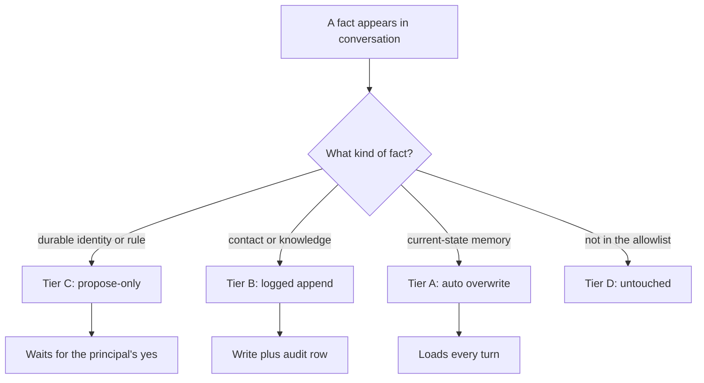

# Curation Coverage — what LifeOS autonomic systems touch

LifeOS has several autonomic curation pipelines, each with its own SLA and write boundary. This document is the canonical matrix of which files are touched by which pipeline, and what's left to manual writes.

The principle is: **anything that matters for LifeOS's context should be managed and curated**, with different SLAs for different content types. Hot-layer memory loads every turn; identity-doctrine proposals fire on conversation cadence; TELOS reviews fire on a slower cron; manual files remain manual until promoted.

## The four mutation tiers (memory subsystem)

Defined in `LIFEOS/TOOLS/MutationTier.ts` as a closed allowlist (default-deny):

| Tier | Behavior | Files |
|---|---|---|
| **A** | Auto, set-overwrite | `PRINCIPAL_MEMORY.md`, `DA_MEMORY.md` |
| **B** | Logged append + audit | `PROJECTS.md`, `CONTACTS.md`, `MEMORY/KNOWLEDGE/**`, `MEMORY/IDEAS/**` |
| **C** | Propose-only (queues for the principal's yes unless its kind has a numeric auto-apply threshold in `memory-review.json`; the shipped template queues `identity` and `operational-rule` always, and this install maps every kind to `null`, so nothing auto-applies here, since 2026-10-08) | `PRINCIPAL_IDENTITY.md`, `DA_IDENTITY.md`, `WRITINGSTYLE.md`, `DEFINITIONS.md`, `CANONICAL_CONTENT.md`, `RESUME.md` |
| **D** | Untouchable by memory subsystem | Everything else, including `OPERATIONAL_PREFERENCES.md`: `operational-rule` proposals name it as their target and wait in the queue for the principal's yes, but `MutationTier.ts` does not list it |

A new file added to `~/.claude/` is Tier D by default until a code change promotes it.

## Coverage matrix

### Curated by the memory subsystem (Reviewer + MutationTier)

| File | Tier | Cadence | Subtype | Currently emitting? |
|---|---|---|---|---|
| `USER/PRINCIPAL/PRINCIPAL_MEMORY.md` | A | 8 turns / 30 min / 2 idle | `memory` (actor=the principal's name) | ✓ live (set-overwrite) |
| `USER/DIGITAL_ASSISTANT/DA_MEMORY.md` | A | Same | `memory` (actor=the DA's name) | ✓ live (set-overwrite) |
| `USER/PROJECTS.md` | B | Same | `proposal` (kind=projects) — propose-first | P1 extends |
| `USER/CONTACTS.md` | B | Same | `proposal` (kind=contacts) — propose-first | P1 extends |
| `MEMORY/KNOWLEDGE/**` | B | Same | `knowledge` (append with `related:` merge) | ✓ live |
| `MEMORY/IDEAS/**` | B | Same | `idea` (append) | ✓ live |
| `USER/PRINCIPAL/PRINCIPAL_IDENTITY.md` | C | Same | `proposal` (kind=identity) | ✓ live |
| `USER/DIGITAL_ASSISTANT/DA_IDENTITY.md` | C | Same | `proposal` (kind=identity) | ✓ live |
| `USER/PRINCIPAL/WRITINGSTYLE.md` | C | Same | `proposal` (kind=style) | P1 extends |
| `USER/DEFINITIONS.md` | C | Same | `proposal` (kind=definition) | P1 extends |
| `USER/CANONICAL_CONTENT.md` | C | Same | `proposal` (kind=canonical-content) | P1 extends |
| `USER/PRINCIPAL/RESUME.md` | C | Same | `proposal` (kind=resume) | P1 extends |
| `USER/CONFIG/OPERATIONAL_PREFERENCES.md` | D (proposal target) | Same | `proposal` (kind=operational-rule) | P1 extends |

### Curated by OTHER autonomic pipelines (orthogonal to MutationTier)

These files are Tier D from the memory subsystem's POV (untouchable by the reviewer) but have their own dedicated writer:

| File | Writer | Trigger | Cadence |
|---|---|---|---|
| `USER/TELOS/PRINCIPAL_TELOS.md` | `LIFEOS/TOOLS/GenerateTelosSummary.ts` | TELOS source-file change | Manual run; planned cron in P2 |
| `USER/TELOS/LIFEOS_STATE.json` | `LIFEOS/TOOLS/UpdateLifeosState.ts` (measured progress from `IdealState.ts reconcile` first) | DerivedSync / daily `ideal-reconcile` | Daily |
| `DOCUMENTATION/ARCHITECTURE_SUMMARY.md` | `LIFEOS/TOOLS/ArchitectureSummaryGenerator.ts` | `DocIntegrity.hook.ts` on SessionEnd | Per session end |
| `LIFEOS/MEMORY/WORK/**/ISA.md` | `hooks/ISASync.hook.ts` | Algorithm phase transitions | Per Edit (debounced 30s) |
| `MEMORY/LEARNING/**` | `WorkCompletionLearning` and `SatisfactionCapture` hooks; `SatisfactionCapture` calls the `FailureCapture.ts` tool | SessionEnd, UserPromptSubmit | Per event |
| `MEMORY/WISDOM/**` | Algorithm LEARN phase; otherwise hand-curated (no writer tool since 2026-10-14) | Algorithm LEARN phase | Per LEARN |
| `MEMORY/SECURITY/**` | `Safety.hook.ts` (PermissionRequest path) | Tool calls | Per event |
| `MEMORY/OBSERVABILITY/**` | Many hooks (EventLogger, MemoryReviewer, etc.) | Tool events | Continuous |
| `MEMORY/STATE/work.json` | `hooks/ISASync.hook.ts` | Phase transitions | Per change |
| `MEMORY/STATE/session-names.json` | `LIFEOS/TOOLS/SessionRename.ts` (manual), the PromptProcessing hook's naming step through `hooks/lib/session-identity.ts` (auto-name) | First prompt at session start; manual rename | One-shot per session |
| `MEMORY/VOICE/voice-events.jsonl` | `hooks/handlers/VoiceNotification.ts`, `hooks/lib/notification-channel.ts` | Voice event | Per fire |

### Manual-only (no autonomic pipeline)

These files are Tier D AND have no other writer. The principal writes directly; the autonomic system never proposes changes.

| File / Directory | Why manual |
|---|---|
| `USER/TELOS/TELOS.md` (the single unified source) | Belief revision is deep-conviction work; planned P2 TELOS Reviewer will propose changes via the `Telos` skill Update intent, not direct edit |
| `USER/PRINCIPAL/PRONUNCIATIONS.json` | Voice-server runtime config; principal-curated |
| `USER/CONFIG/memory-review.json` | Cadence config for the memory system itself; principal-curated to avoid recursive auto-tuning |
| `USER/CONFIG/CREDENTIALS/**` | Security boundary — credentials never autonomic |
| `USER/GEAR.md`, `USER/SECURITY/SecurityPosture.md` | Manually curated documentation (GEAR.md also skill-updated by gear-aware skills) |
| `USER/BUSINESS/**`, `USER/HEALTH/**`, `USER/FINANCES/**` | Domain-specific, principal-curated |
| `USER/INTEGRATIONS/*.yaml` | Per-skill config; principal-curated |
| `USER/WORK/config.yaml` | Work-hub config; principal-curated |
| `USER/CUSTOMIZATIONS/**` | Per-skill customizations; principal-curated |
| All of `LIFEOS/DOCUMENTATION/` source files (except auto-generated summary) | Architecture docs; principal-curated (the ArchitectureSummary derives FROM these) |
| `CLAUDE.md`, `LIFEOS_SYSTEM_PROMPT.md` | Constitutional layer; principal-curated |
| `hooks/`, `skills/`, `Algorithm/`, `Tools/` source | Code; principal-curated (the system has no auto-codegen path) |
| `.env`, `settings.json`, `settings.system.json` | Operational config; principal-curated |

## SLAs per content type

Different content types update at fundamentally different rates. The cadence per autonomic surface:

| Content class | Cadence | Reason |
|---|---|---|
| Hot-layer memory (`memory` items) | Per-turn-batched (8 / 30 min / 2 idle) | Loads every turn; needs freshness |
| Knowledge graph (`knowledge`, `idea`) | Same | BM25 retrieval; freshness matters less |
| Identity / style / definition / canonical / resume / operational-rule proposals | Same | Queued for the principal's approval unless the kind has a numeric threshold in `confidence_threshold_by_kind`. The shipped template queues `identity` and `operational-rule` always; this install maps every proposal kind to `null`, so none auto-applies here (`USER/CONFIG/memory-review.json`, 2026-10-08). Logged in pending-proposals.jsonl |
| TELOS reviews (planned P2) | Weekly cron | Belief revision; deep observation window |
| Wisdom frame synthesis (planned P3) | Monthly cron | Compounding wisdom; long observation window |
| Architecture summary | Per-session-end (DocIntegrity hook on SessionEnd) | Tracks source `LifeosSystemArchitecture.md` changes |
| Work / ISA / phase tracking | Per Edit (debounced 30s) | Mirror of in-flight Algorithm runs |
| Observability streams | Continuous (per event) | Append-only telemetry |

## Roadmap

- **P1 (this build, 2026-05-25)** — extend reviewer prompt with 7 new proposal subtypes (`style`, `definition`, `canonical-content`, `resume`, `operational-rule`, `projects`, `contacts`); persist `target_kind` on queue rows; render `[kind]` badge in Telegram; group pending by subtype in the memory-status CLI. (Telegram integration since removed 2026-07-15.)
- **Ideal-state loop (built 2026-10-07)** — daily `ideal-reconcile` measures bound targets; weekly `ideal-recommend` proposes at most 3 IDEAL_STATE rows and 2 watchers, each applied only on the principal's yes (`IdealState.ts accept`).
- **P2 (named follow-up ISA)** — TELOS autonomic loop. Weekly `TelosReviewer.ts` cron that reads recent ISAs + LEARNING + WISDOM + recent PRINCIPAL_MEMORY snapshots, emits TELOS-change proposals (goal-deferral, new-strategy, mission-drift) routed via the `Telos` skill Update intent.
- **P3 (named follow-up ISA)** — WISDOM autonomic loop. Monthly synthesis pass extracts new WISDOM frames from accumulated LEARNING signals; surfaces principle candidates via the Pulse dashboard for principal review-and-graduate.
- **P4 (named follow-up ISA)** — On-demand LLM-agent retrieval tier (`recall "<question>"` CLI command) for deep questions that need tool-using LLM loops over KNOWLEDGE. Different latency budget, different use case from per-turn BM25.

## Adding a new file to the curation system

The closed-allowlist posture means new files default to Tier D (untouchable). To bring a new file under autonomic curation:

1. Add the absolute path to the appropriate Tier set in `LIFEOS/TOOLS/MutationTier.ts` (Tier A / B / C).
2. If Tier C — add an entry to `PROPOSAL_KIND_TO_FILES` in `LIFEOS/TOOLS/MemoryTypes.ts` with a new `target_kind` value.
3. Extend the reviewer prompt in `LIFEOS/TOOLS/MemoryReviewer.ts` with subtype guidance describing when to emit a proposal targeting the new kind.
4. Add a row to the matrix above.
5. Regenerate `ARCHITECTURE_SUMMARY.md` (or let the DocIntegrity hook do it on next SessionEnd).
6. Run the MemoryTypes + MemoryReviewer smoke tests; they should still pass.

The principle: code is the source of truth; documentation mirrors. The MutationTier file is the authoritative list — this document is the human-readable view of it.

## Examples

### One conversation, four destinations

The whole matrix comes alive when you watch a single conversation get sorted. Suppose in one working session a user reveals four different things. Each is a different *kind* of fact, so each lands in a different place under a different SLA:

- **"I always want measurements in metric."** A durable operating preference → the reviewer emits a **Tier C** proposal (`operational-rule`). It queues and waits for the principal's yes. The mechanism is the `confidence_threshold_by_kind` map in `memory-review.json`: kind → a number (that kind's own auto-apply threshold) or `null` (never auto-apply; always queue). An install that sets every kind to `null` auto-applies nothing; the live values are whatever `memory-review.json` holds. A kind the map leaves out, or a missing map, falls back to `confidence_threshold`, and any value other than a number reads as `null`. The shipped template also sets `identity` and `operational-rule` to `null`, so edits to the always-loaded identity and rules files wait for review. (GHSA-xjxj-cqpp-gf82, @mj-deving; discussion #2229, @Steffen025)
- **A new collaborator named three times, with role and why they matter.** → **Tier B** (`contacts`): a logged append to the contacts file, with an audit row. Additive, reversible, no approval gate.
- **"I'm currently deep in a migration."** Fast-moving current-state → **Tier A** (`memory`): auto set-overwrite into hot-layer memory, loaded on every future turn until it goes stale.
- **A change to a credentials file.** → **Tier D**: untouchable. The memory system never proposes, never writes. It isn't in the allowlist, so default-deny holds.

Same conversation, four fates — decided entirely by *what kind of fact it is* and *which file it targets*, never by how important it felt in the moment.

### Why default-deny is the safe posture

The reason a new file is Tier D until code promotes it: silence is the safe failure. If the classifier is unsure where something belongs, the worst outcome is that nothing is written and a human curates it later — never that an autonomic pipeline mutates a file it was never meant to touch. Coverage is opt-in, one allowlist entry at a time.

### Routing one captured fact

The diagram is the coverage decision in one frame: type and target decide the tier, the tier decides the behavior, and anything the allowlist doesn't name falls through to Tier D and is left alone.

---
