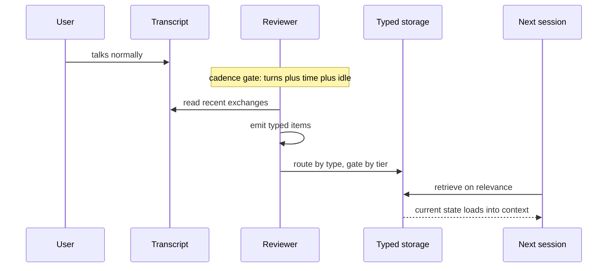

# Cortex — the LifeOS Memory System

> **Cortex is everything LifeOS knows.** Every fact the system holds about you, your work, your people, and itself lives here — captured by hooks as you work, curated by an autonomic loop while you rest, and retrieved into context the moment it's relevant. In Life OS terms (`LIFEOS/DOCUMENTATION/LifeOs/LifeOsThesis.md`), Cortex is how the OS knows your **current state**: the hill-climb is only as good as the system's picture of where you actually are, and every capture pipeline below exists to sharpen that picture so the gap to ideal state is measured against reality, not guesses.

**Why "Cortex."** In the brain, long-term memories don't live where they're formed — the hippocampus consolidates them, then hands them to the cortex for durable storage. That is this system's exact shape: hooks and the autonomic reviewer are the consolidation loop, and the tiered store they write into is where knowledge settles for good. The neural naming runs through the whole stack: **Conduit and Feed are the senses** (internal and external), **Synapse is the relay that grades and routes every signal**, and **Cortex is the store it promotes into**.

> **Named Cortex, 2026-08-01.** Previously the generic "Memory System." As with Synapse (renamed from Amber, 2026-07-28), identity is what changed, not plumbing: the store keeps its paths and code names (`LIFEOS/MEMORY/`, `MemorySystem.ts`, `MemoryReviewer.ts`, the 🧠 MEMORY line) — Cortex is the product, those are its internals.

This is not a narrow event log or a preferences store. This is LifeOS's comprehensive knowledge system — the full shared memory between the principal and the DA. If we built knowledge together, it belongs here. That includes: work tracking, learnings from failures and successes, research and OSINT investigations, contact dossiers, security events, runtime state, voice events, observability metrics, and any other knowledge that would be valuable in future conversations.

**One storage layer:**
- **LifeOS MEMORY** (`~/.claude/LIFEOS/MEMORY/`) — structured, hook-driven, entity-based

LifeOS MEMORY is the system of record. Claude Code's built-in auto-memory (`~/.claude/projects/<project>/memory/`) is disabled by design (`autoMemoryEnabled: false` in shipped settings, plus deny rules on that path) — see "Claude Code Auto-Memory & Auto-Dream" below.

**Version:** 8.4.0 (Cortex Ledger, 2026-08-16 — log-plus-projection for hot-layer memory; preserves 8.3 naming + 8.2 proposal subtypes + 8.1 inventory + drift + autonomic loop + health gate)
**Location:** `~/.claude/LIFEOS/MEMORY/`

---

## Architecture

**Claude Code's `projects/` is the source of truth for transcripts. Hooks capture domain-specific events directly. Harvesting tools extract learnings from session transcripts. Everything else — research, OSINT, contact profiles, reference material — is written into LifeOS MEMORY by the intents that produce it; harness auto-memory is disabled.**

```
User Request
    ↓
Claude Code projects/ (native transcript storage - 30-day retention)
    ↓
Hook Events trigger domain-specific captures:
    ├── Algorithm (AI) → WORK/
    ├── SatisfactionCapture → USER/ERRATA/ (FAILURES/ only as linked deep-context attachments)
    ├── WorkCompletionLearning → LEARNING/
    ├── EventLogger (tool-activity / tool-failures / config-changes) → OBSERVABILITY/
    ├── VoiceCompletion hook (handlers/VoiceNotification.ts) → VOICE/
    ├── SystemFileGuard / BashSystemWriteGuard (deny-list blocks) → OBSERVABILITY/
    └── EventLogger (stop failures) → SECURITY/
    ↓
Knowledge capture (inline):
    ├── Algorithm LEARN phase → KNOWLEDGE/ (writes People/Companies/Ideas/Research with schema)
    └── Algorithm LEARN phase → WISDOM/FRAMES/ (Level-3 wisdom updates)
    ↓
Harvesting (periodic):
    ├── SessionHarvester → LEARNING/ (extracts corrections, errors, insights)
    ├── SessionHarvester --mine → KNOWLEDGE/_harvest-queue/ (mines decisions, preferences, milestones, problems)
    ├── KnowledgeHarvester → KNOWLEDGE/ (validates schema, maintenance)
    └── LearningPatternSynthesis → LEARNING/SYNTHESIS/ (aggregates ratings)
    ↓
Retrieval & Navigation (on-demand):
    ├── MemoryRetriever → compressed context from KNOWLEDGE/ + LEARNING/ (BM25 search + LLM compression)
    └── KnowledgeGraph → associative traversal over KNOWLEDGE/ (tags + wikilinks + related fields)
```

**Key insight:** Hooks write directly to specialized directories. There is no intermediate "firehose" layer — Claude Code's `projects/` serves that purpose natively. Retrieval tools read the same markdown files without any intermediate index or database.

### Portable local Cortex contract (v1)

`LIFEOS/TOOLS/Cortex.ts` exposes Cortex as a versioned, agent-neutral local Bun CLI. The implemented commands are `status`, `search`, `timeline`, `get`, `export`, `rebuild`, `remember`, and `propose`. Read commands use progressive disclosure: search and timeline return compact cards (`id`, type, dates, provenance, score, estimated fetch tokens), while get/export return full sanitized content only for explicit IDs. Filters cover type, source, session, and created-date ranges; listings report exact totals and deterministic pagination; optional recency weighting and graph expansion are caller-selected and resource-bounded.

Every command emits one `lifeos-cortex/v1` JSON envelope. The published schema is `LIFEOS/TOOLS/schemas/lifeos-cortex-v1.schema.json`; semantic exits distinguish success (0), internal failure (1), not found (3), invalid input/integrity (4), and write or governance refusal (5). Options are strict: unknown, duplicate, missing-value, or command-inapplicable options fail rather than being ignored.

`LIFEOS/TOOLS/CortexAdapter.ts` ships the in-process adapter factory for `claude`, `hermes`, `codex`, and `subagent`. Adapter calls are read-only by default: every remember/propose call must individually opt in with `{allowWrite:true}`, corresponding to the CLI's explicit recognized `--adapter` plus `--allow-write`. Command/type binding is enforced before dispatch: `remember` accepts `memory|idea|knowledge`; `propose` accepts only `proposal`. Authorized items then delegate to `MemorySystem.add()` so the existing mutation tiers, proposal approval, target pinning, audit trail, snapshots, and shrink guard remain authoritative. `export` is read-only stdout serialization, not a filesystem writer.

Canonical Markdown/JSONL remains the source of truth. Cortex allows the intentional top-level `LIFEOS/MEMORY` symlink, resolves and pins its canonical target, and rejects nested symlinks or escapes. The shipped `LIFEOS/CORTEX_INDEX_POLICY.json` affirmatively declares `no-index-v1`: BM25 reads canonical files, `status` reports no indexes, and `rebuild --from-canonical` produces equal deterministic SHA-256 record-view digests without creating an index. A missing policy plus missing manifest warns rather than silently turning green. There is no CMEM, Chroma, SQLite FTS, vector index, cloud sync, external telemetry, MCP server, or Cortex daemon.

`CaptureEnvelope.ts` provides the concrete `ingestCaptureEnvelope(input, consumer)` helper, which sanitizes through `createCaptureEnvelope` before invoking the consumer. It is source-neutral. Both legacy transcript capture writers are envelope-migrated (2026-08-03): `MemoryReviewer.ts` ingests transcript text via `transcriptCaptureEnvelope` and `SessionHarvester.ts` via its `ingestTranscriptText` boundary, each binding source/channel/captured_at/session provenance and making private-span stripping structural; harvester outputs (harvest-queue JSON, LEARNING files) carry that provenance. Probes (source tree only; tests are not in the public release payload): `test/tools/cortex/writers.test.ts`. The versioned benchmark imports the production validity/ranking/card functions, shares one ranking between full-fetch and card-first disclosure paths, and can write only an explicit versioned report under `MEMORY/BENCHMARKS/`. The verified live artifact is `LIFEOS/MEMORY/BENCHMARKS/cortex-benchmark-v1-20260802.json`; see the contract for its point-in-time metrics and non-claims.

The privacy boundary removes case-insensitive, nested `<private>...</private>` spans before reviewer inference/debug artifacts, typed persistence, canonical ranking, get, export, and rebuild; unclosed opening tags fail closed. Validity is `valid_from` inclusive and `valid_until` exclusive, with malformed windows excluded. **Native harness transcripts may retain `<private>` content outside Cortex's control for the documented 30-day retention period**: Cortex leaves transcript bytes untouched and sanitizes its controlled copy. This is not transcript redaction.

Full command syntax, limits, privacy scope, benchmark method, vector evidence gate, and truthful health thresholds: [`CortexContract.md`](./CortexContract.md).

---

## Typed-Item Memory System (Autonomic Loop)

The autonomic mutation loop sits on top of the existing Memory subsystem inventory below. Architectural concepts (turn-cadence reviewer, cap-as-prompt, set-overwrite writes, debounced cancellable scheduler) reimplemented natively in TypeScript/Bun. Zero runtime dependency on third-party agent frameworks.

**Health gate & per-turn indicator (2026-05-24 addendum):**

- `LIFEOS/TOOLS/MemoryHealthCheck.ts` — evidence-driven CLI. Verifies hook files and registrations in BOTH `settings.system.json` AND `settings.json`, state and hot-layer files, reviewer/retrieval evidence, proposal backlog, observability retention, and optional-index integrity. The JSON report includes measured evidence and effective thresholds; exit 0/1/2 = ok/warn/critical. Missing evidence never produces green. Writes a per-invocation row to `MEMORY/OBSERVABILITY/memory-health.jsonl`.
- `hooks/MemoryHealthGate.hook.ts` — Stop-chain hook running the check on every turn end. WARN/CRITICAL surfaces to stderr. Non-blocking.
- `<lifeos-memory-delta>` additionalContext block — `MemoryDeltaSurface.hook.ts` (invoked at UserPromptSubmit by `MemoryTurnStart.hook.ts`) emits it **change-only** as one verbatim `🧠 MEMORY` line, and adds `<lifeos-memory-health>` when the latest `memory-health.jsonl` row is CRITICAL. (`MemoryReviewTrigger`'s every-UserPromptSubmit `<autonomic-memory>` frozen banner — which carried `turns_since_last_review`, `pending_review`, `last_review_*`, `cadence`, etc. — was retired/merged 2026-07-11; see Superseded.)
- Render contract in `LIFEOS/LIFEOS_SYSTEM_PROMPT.md` (v3.0.0, one-format): the DA renders the hook-fed 🧠 line verbatim when a `<lifeos-memory-delta>` block is present that turn, omits it otherwise — change-only; the model never computes the line. **Action-first since 2026-09-06 (principal directive):** the line leads with the next command when a file is due (`🧠 Do next: /interview — TELOS.md never reviewed · 1/8 fresh`) and drops to a quiet `🧠 memory N/M fresh` when nothing is due — the A–F grade and the `MEMORY:` label are gone from the visible line. With the plugin loaded it is drawn in the band ABOVE the prompt (via the `band-state` bridge → `refreshBand` → AbovePrompt), not trailing beneath the answer. (The seven-state every-turn render table retired with the NATIVE mode template, 2026-07-11.)
- Source-of-truth wiring: the memory hooks (`MemoryTurnStart`, `MemoryReviewFire`, `MemoryHealthGate`) live in `settings.system.json` so `LIFEOS/TOOLS/MergeSettings.ts` regeneration at SessionStart preserves them.
- **Tag prefix, `pai-` → `lifeos-` (2026-07-29, public issue #1592 / PR #1594, @anikinsasha):** every emitter (`MemoryDeltaSurface`, `LoadMemory`, `MemoryTurnStart`, `PostToolObserver`) writes `lifeos-*` blocks only; `FormatGate` — the substring gate that ties the 🧠 line to the delta — accepts BOTH prefixes so a stale in-flight session can't silently drop enforcement. Legacy acceptance is a migration window, droppable once no `pai-` transcripts remain; the emitters and the gate must never move separately.

### Thirty-second story

> The DA has one memory system. Every item in it has a type — memory, idea, knowledge, or proposal. A background reviewer reads recent conversation and emits typed items. The system routes each item to the right place based on type. Memory items load into every prompt. Ideas and knowledge load when relevant. Proposals get surfaced on the Pulse dashboard and the inline 🧠 MEMORY line for review (a kind whose threshold in `memory-review.json` is a number auto-applies at that confidence; a kind set to `null` never auto-applies, and an install that sets every kind to `null` reviews everything). Four safety tiers gate writes by destination. That's it.

### Type registry

Defined in `LIFEOS/TOOLS/MemoryTypes.ts`. Frozen at module load — adding a type requires source edit + commit, not runtime mutation.

| Type | Storage | Load timing | Tier | Write mode |
|---|---|---|---|---|
| `memory` | `USER/PRINCIPAL/PRINCIPAL_MEMORY.md` (actor=the principal's name), `USER/DIGITAL_ASSISTANT/DA_MEMORY.md` (actor=the DA's name) | always (hot-layer, every prompt) | A | set-overwrite, cap 48 × 256 chars |
| `idea` | `MEMORY/IDEAS/<slug>.md` | on relevance (BM25) | B | append (atomic rename) + tier-b-writes.jsonl audit |
| `knowledge` | `MEMORY/KNOWLEDGE/{People,Companies,Research}/<slug>.md` | on relevance (BM25) | B | append + tier-b-writes.jsonl audit, with `related:` cross-link merge |
| `proposal` | `MEMORY/OBSERVABILITY/pending-proposals.jsonl` | Pulse dashboard + 🧠 MEMORY line | C (gates the eventual write) | queue (status: pending → sent → accepted/rejected/edited/auto-applied) |

**Type is data, tier is permission.** Type tells the routing layer WHERE an item belongs. Tier tells the writer WHETHER the write is allowed. They're orthogonal — never collapsed.

### Proposal subtypes (P1 2026-05-25)

Proposals carry a `target_kind` discriminator that tells the reviewer which curated-context file class the proposal targets. The reviewer's prompt teaches the model when to emit each subtype; the dispatcher validates `(target_kind, target_file)` against the closed allowlist in `PROPOSAL_KIND_TO_FILES` (`LIFEOS/TOOLS/MemoryTypes.ts`); the proposal surfacer renders the subtype as a `[kind]` badge in the proposal header. `target_kind` is optional for backwards compat — when absent, the dispatcher infers it from `target_file`. Since 2026-07-21 the enqueue path also PINS `target_file` via `pinProposalTargetFile` (public PR #1563, @anikinsasha): single-file kinds ignore the reviewer's free-text path and store the canonical one; identity proposals must name one of the two allowed files or the proposal is rejected (`EINVAL_ITEM`), so a hallucinated path can never be persisted.

| `target_kind` | Target file | Trigger for emission |
|---|---|---|
| `identity` | `USER/PRINCIPAL/PRINCIPAL_IDENTITY.md` or `USER/DIGITAL_ASSISTANT/DA_IDENTITY.md` | The principal reveals a durable identity-level fact or how the principal wants the assistant to operate |
| `style` | `USER/PRINCIPAL/WRITINGSTYLE.md` | The principal corrects voice/tone/cadence in a way that generalizes — banned vocabulary, preferred constructions |
| `definition` | `USER/DEFINITIONS.md` | The principal defines a term (coined concept, principle's exact meaning, acronym) the DA must interpret correctly in future sessions |
| `canonical-content` | `USER/CANONICAL_CONTENT.md` | The principal names a piece of content (post, talk, framework) as canonical to the principal’s body of work |
| `resume` | `USER/PRINCIPAL/RESUME.md` | The principal mentions a career fact (new role, certification, achievement) that should land in the resume |
| `operational-rule` | `USER/CONFIG/OPERATIONAL_PREFERENCES.md` | The principal states an operating directive about HOW the DA/LifeOS should handle a class of work |
| `projects` | `USER/PROJECTS.md` | The principal names a new project that should be in the project routing table |
| `contacts` | `USER/CONTACTS.md` | The principal mentions a person 3+ times with role, relationship, and why they matter |

Confidence guidance:
- **≥ 0.70** — auto-apply silently to the target file when the kind has a numeric threshold at or below that confidence (the queue row transitions `pending → auto-applied` and the reviewer's `dispatchItems` calls `applyProposalEdit`). A kind set to `null` in `confidence_threshold_by_kind` always queues. The shipped template sets `identity` and `operational-rule` to `null`; an install that sets every kind to `null` auto-applies nothing
- **0.40–0.69** — surfaced on the Pulse dashboard and the inline 🧠 MEMORY line with a `[kind]` badge for principal accept/reject/edit
- **< 0.40** — discouraged unless cross-session pattern is clear

### Curation coverage at a glance

The reviewer + four-tier classifier covers a defined slice of `~/.claude/` content. The canonical coverage matrix (which files the system curates, which it ignores, which other autonomic pipelines own) lives in [`CurationCoverage.md`](./CurationCoverage.md).

### Four mutation tiers

Defined in `LIFEOS/TOOLS/MutationTier.ts` — code-only allowlist, default-deny on everything not enumerated:

| Tier | Behavior | Paths |
|---|---|---|
| A | Auto, full set-overwrite | `PRINCIPAL_MEMORY.md`, `DA_MEMORY.md` |
| B | Logged-append (tier-b-writes.jsonl audit row per write) | `PROJECTS.md`, `CONTACTS.md`, `MEMORY/KNOWLEDGE/**`, `MEMORY/IDEAS/**` |
| C | Propose-only (queue; waits for the principal's yes unless its kind has a numeric auto-apply threshold in `memory-review.json`) | `PRINCIPAL_IDENTITY.md`, `DA_IDENTITY.md`, `WRITINGSTYLE.md`, `DEFINITIONS.md`, `CANONICAL_CONTENT.md`, `RESUME.md` |
| D | Untouchable by the memory system | everything else (`.env`, `settings.json`, `hooks/`, code, `CLAUDE.md`, `LIFEOS_SYSTEM_PROMPT.md`, `Algorithm/`, `skills/`, …). `OPERATIONAL_PREFERENCES.md` is Tier D too: `operational-rule` proposals name it as their target and wait for the principal's yes, but `MutationTier.ts` does not list it |

### Components

- **`LIFEOS/TOOLS/MemoryTypes.ts`** — type registry. Resolvers for storage path per item.
- **`LIFEOS/TOOLS/MemoryWriter.ts`** — set-overwrite primitive for Tier A memory files. Atomic rename, lock sidecar, prefix soft-convention, dedupe, cap enforcement.
- **`LIFEOS/TOOLS/MemorySystem.ts`** — the single public API. `add(item)` routes by type; `find(query, options)` returns BM25 top-K.
- **`LIFEOS/TOOLS/MemoryRetriever.ts`** — BM25 retriever over the typed-item corpus: KNOWLEDGE notes, the `LEARNING/` tree, and the two hot-layer memory files. Pure-function, no LLM call. Every hit carries a `noteClass` (`knowledge` / `learning` / `memory`) and learning notes score at 0.7x so historical records never outrank curated knowledge on an equal match (public issue #1776, @umair-a11y). The CLI searches all of LEARNING; the per-turn hot path takes a recency-bounded slice (`HOT_PATH_LEARNING_LIMIT`, currently 500) because LEARNING grows monotonically and soon outnumbers the KNOWLEDGE corpus several times over, so a full scan on every turn costs noticeably more than a KNOWLEDGE-only search.
- **`LIFEOS/TOOLS/MemoryReviewer.ts`** — the autonomic centerpiece. Single-pass orchestrator: locate most-recent harness transcript, extract last N exchanges (every user event since the last reply joins one exchange, so typed words followed by a pasted image or skill body stay together), call `Inference.ts` at level `medium` on the configured inference vendor (`--tools ""`), parse `{items:[...]}` JSON, route each typed item through `MemorySystem.add()`.
- **`LIFEOS/TOOLS/MutationTier.ts`** — tier classifier. Pure function, no config file (code-only allowlist).
- **`LIFEOS/TOOLS/MemoryStatus.ts`** — read-only memory-status viewer for terminal use.
- **`hooks/MemoryReviewFire.hook.ts`** — Stop handler, v2 (2026-07-11: tick + decide + fire in one pass; absorbed the MemoryReviewTrigger cadence gate). Increments turn count, sets `pending_review=true` when cadence gates fire.
- **`LIFEOS/PULSE/lib/lifeos-context.ts`** — `buildLifeosContextBlock()` adds `## PRINCIPAL MEMORY` and `## DA MEMORY` blocks to the per-turn LifeOS CONTEXT injection (mtime-cached 60s).
- **`LIFEOS/PULSE/lib/memory-proposals.ts`** — proposal queue API (renamed from `telegram-proposals.ts`, same API); surfaces Tier-C proposals on the Pulse dashboard and the inline 🧠 MEMORY line, and owns the four decision writers (accept / reject / edit / applied-elsewhere) plus `TERMINAL_STATUSES`. A proposal auto-applies only when its kind has a numeric threshold in `memory-review.json` and its confidence meets it (default 0.70; a kind set to `null` never does); every other proposal is resolved by a human through `bun LIFEOS/TOOLS/ProposalDecide.ts`, which any Pulse or Hermes surface can wrap.

### Reviewer cadence

Cadence state is **per session** at `MEMORY/STATE/memory-review/<session_id>.json`, so concurrent sessions cannot reset or starve each other's turn counter (public issue #1711, @jacobo-ortiz). `MEMORY/OBSERVABILITY/review-state.json` is still written every Stop as a mirror for the statusline, `MemoryStatus.ts`, `MemoryHealthCheck.ts` and Pulse; its `last_review_at` is the load-bearing global clock, its turn count is display-only. Stale per-session files are pruned after 7 days. Trigger conditions are AND-gated; defaults in `USER/CONFIG/memory-review.json`:

- `turn_count >= 8` — **per session** (has this conversation moved enough to be worth reviewing?) — OR `hours_since_last_review >= 24` with at least one turn in this session (the time-based safety net: many short sessions never reach the per-session turn threshold, so the reviewer could starve indefinitely — public issue #1893, @waveman2020-sudo) AND
- `minutes_since_last_review >= 30` — **global across sessions** (the inference-volume guard; a per-session cap would let N sessions run N reviews per window, and it still gates the safety net so staleness can never produce a burst) AND
- `idle_minutes >= 2`

When all three hold, the next Stop hook spawns the reviewer subprocess. New UserPromptSubmit before Stop cancels (debounce — Honcho's dream-scheduler pattern, vendored).

### Entry age and durability (2026-08-20, Honcho parity)

Hot-layer entries carry no per-entry time on disk — the files hold only a file-level `last_updated`. That made the reviewer's own supersession rule ("keep the most recent entry") unexecutable and left consolidation choosing blind at ≥80% occupancy. `LIFEOS/TOOLS/MemoryEntryMeta.ts` closes it **without touching the file format**: `MemoryWriter.setEntries` folds the eviction/addition delta it already computes in-lock into a sidecar at `MEMORY/STATE/memory-entry-meta.json` (`first_seen`, `last_seen`, `survivals`), keyed on entry text normalized past its `~tag`, case, and whitespace. `renderCurrentMemory` then annotates each entry as `⟨since DATE · survived N⟩` **at prompt-render time only**.

Four properties are load-bearing. **The model never authors a date** — a model-authored timestamp is a hallucinated one, and read back later it becomes a fact. **It can never break a write**: unlike the fail-closed ledger append, `recordWrite` swallows its own I/O failures, because stale metadata is cheaper than a refused curation cycle. **Echoed annotations are stripped at the write chokepoint** (`validateAndDedup`, plus a second belt in `normalizeKey`) — a prompt telling the reviewer not to echo is a wish, and an echoed suffix would pass every existing check, land on disk, and orphan the record that produced it. **The store is derived and disposable** — delete it and the prompt degrades to bare entries; `bun LIFEOS/TOOLS/MemoryEntryMeta.ts backfill` rebuilds it by replaying the ledger's `memory/set` rows, which is also how the cold start avoids stamping every existing entry as new. Ages are floored at the ledger genesis. `survivals` counts curation passes survived, NOT Honcho's `times_derived` (set-overwrite resubmits everything every run, so resubmission carries no re-derivation signal). Probes (source tree only; not in the public release payload): `test/tools/MemoryEntryMeta.test.ts`, `test/tools/MemoryWriter.test.ts`. Origin: the Honcho parity review of 2026-08-20 (private work notes).

### Per-turn retrieval

`buildLifeosContextBlock(query)` in `LIFEOS/PULSE/lib/lifeos-context.ts` calls `getRelevantContext(query)` (in `MemoryRetriever.ts`); the BM25 top-K (default 5, score threshold 0.20) renders as a `## RELEVANT MEMORY` block injected after the hot-layer memory files and before `PRINCIPAL_TELOS`. Below-threshold returns empty (no header noise). Cache TTL 60s by query-hash. Graph traversal (`KnowledgeGraph.ts`) stays available as a separate explicit call — not on the hot path.

### Observability

| Stream | Path | Written by |
|---|---|---|
| Memory-file writes — THE LEDGER (`memory/set`, `memory/rejected`, `memory/restore`, `checkpoint`, `memory/redact`, `proposal/apply`) | `MEMORY/LEDGER/cortex-events.jsonl` (old `OBSERVABILITY/memory-writes.jsonl` is frozen pre-2026-08-16 history) | MemoryWriter (event-first), CortexLedger.ts, applyProposalEdit |
| Reviewer runs | `MEMORY/OBSERVABILITY/reviewer-runs.jsonl` | MemoryReviewer |
| Reviewer-fire events | `MEMORY/OBSERVABILITY/reviewer-fires.jsonl` | MemoryReviewFire hook |
| Failed-item payloads — parked so a failed dispatch stays replayable through `MemorySystem.add` instead of needing a hand-replay of `response.parsed.json` (public issue #1904, @hjbrandt) | `MEMORY/OBSERVABILITY/reviewer-failed-items.jsonl` | MemoryReviewer dispatch |
| Tier-B append audit | `MEMORY/OBSERVABILITY/tier-b-writes.jsonl` | MemorySystem.add |
| Proposal lifecycle | `MEMORY/OBSERVABILITY/identity-proposals.jsonl` | memory-proposals.ts surfacer |
| Proposal replies | `MEMORY/OBSERVABILITY/proposal-replies.jsonl` | Pulse dashboard reply handler |
| Per-turn retrievals | `MEMORY/OBSERVABILITY/memory-retrievals.jsonl` | MemoryRetriever |

### Reading status

```
bun ~/.claude/LIFEOS/TOOLS/MemoryStatus.ts          # human-formatted block
bun ~/.claude/LIFEOS/TOOLS/MemoryStatus.ts --json   # machine-readable
```

Reports hot-layer file utilization, corpus sizes, pending-proposals depth, reviewer state, last reviewer run, last retrieval.

---

## Curation + Visibility + Recoverability (2026-06-06, Hermes/Honcho parity — CANONICAL)

This supersedes the prior 2026-05-28 `<autonomic-memory>` banner and the every-turn heartbeat-enforcement approach (both are gone — see *Superseded* below).

The autonomic loop now genuinely **adjusts** and is **visible**, fixing the two defects that made the prior build look complete while it was silently frozen.

### Curation, not appending (the forgetting model)

The reviewer runs in **curation mode**: it reads the file's CURRENT entries (`readCurrentMemorySnapshot`) plus recent conversation and returns the **full desired next state** via a `memory` item with `op: "set"` + `entries[]`. `MemorySystem.add` routes `op:"set"` to `MemoryWriter.setEntries` as a REPLACE — so **forgetting is omission**: a stale fact is dropped by leaving it out, a contradicted fact is superseded (drop old + write new). This is the Honcho peer-card model ("replaces the entire card — does not merge"), chosen over Hermes substring verbs because full-set replace is atomic and unfragile. The reviewer prompt enforces: supersede contradictions, merge duplicates, **consolidate before adding when ≥80% full (≥39/48)**, write **declarative facts not directives** (Hermes verbatim), and an expanded do-not-save list (task progress, SHAs, PR numbers, anything stale in 7 days). Legacy `op:"add"` merge-append is retained for back-compat. This permanently kills the `EAT_CAP` cap-jam: the system can always drop to make room.

### Data-loss guard (in-lock)

set-overwrite has a whole-file blast radius. `MemoryWriter.setEntries` computes a **catastrophic-shrink guard IN-LOCK** (against the just-read prior state, race-free): it blocks a result that is near-empty (`< 3` entries) OR a mass deletion (`>50%` dropped) **with zero additions**, while ALLOWING honest large consolidation (many drops accompanied by additions). `ESUSPECT_SHRINK` is the error; `allowDrastic` opts out for legitimate restores. (This guard exists because a cross-vendor audit wiped the live file with an empty `op:"set"` — it's now structurally impossible.) A second in-lock guard catches **slow erosion** (public issue #1761, @jacobo-ortiz): a single write that net-drops 2+ entries returns `ESUSPECT_EROSION` and logs the full delta to the write-log — re-transcription bleed passed the catastrophic checks every time (each write ~10% smaller, each carrying additions) until 12 durable rules died in 48h on a reporter's install. A reviewer's deliberate consolidation sets `consolidation: true`, which lifts only the erosion limit and only at ≥39 entries with the result staying at the floor; `allowDrastic: true` lifts both guards and is for a human only (a restore, or a deletion the principal asked for).

### The Cortex Ledger (curated ⟺ folded, 2026-08-16)

The hot-layer memory files are **log-plus-projection** (adopted from DeepSeek Harness's "model-visible ⟺ logged" pattern; designed and dual-audited during the Cortex Ledger build). The invariant: **every autonomically curated byte of a fold-owned file is a deterministic render of ledger events.** The LLM authors events (the reviewer's `op:"set"` full desired state); deterministic code folds events into files. The ledger is not the only writer: rename sweeps and hand edits change these files too, and those edits are **adopted** into the ledger as `memory/adopt` events rather than refused or erased (2026-10-09, after repeated drift stalls left the reviewer refused).

- **The stream:** `MEMORY/LEDGER/cortex-events.jsonl` — append-only, hash-chained (`row_hash` over `prev_row_hash` + canonical row), monotonic `seq`, schema `v` per row. Folding kinds carry the FULL rendered document, so a fold is a byte copy of the head event filtered by redact tombstones — no render template to drift. Torn final lines are quarantined to `LEDGER/torn-*.txt` and truncated; interior corruption fails every reader loudly.
- **Event-first, fail-closed:** `MemoryWriter.setEntries` appends the event (in-lock, fsync) BEFORE the file write; a failed append aborts the write with `EWRITE_FAILED` and the file untouched. A failed file write after the append is forward-healable drift. Guards (shrink/erosion/cap) gate event ADMISSION; rejected writes append non-folding `memory/rejected` events.
- **Adopt, never heal, for a legitimate edit:** when the live entries differ from the ledger head, the next `setEntries` first appends a `memory/adopt` event carrying the live bytes (with `lost`/`gained` entries and the git HEAD when committed), then judges its own delta against that adopted base, so the shrink and erosion guards still apply to the reviewer. It adopts unattended when the edit drops no ledger entry, or when it is a fresh commit (committed after the ledger's last write to the file, so a revert to an older version does not count) whose net loss is under 2, which covers a rename sweep. Anything else is refused with `EDRIFT`, as is a live file holding a redacted entry or an entry the writer itself would refuse (malformed, overlength, instruction-shaped). `CommitOwn` adopts a memory file it commits; `CortexLedger.ts adopt` adopts by hand (`--force` accepts dropped entries, which stay recorded on the row, but never an invalid or redacted one). After an adopt, and at the start of each reviewer run, `ParkedReplay.ts` replays reviewer writes that drift refused, as additions only, newest first up to the 48-entry cap: never an entry the ledger once held and dropped, never one item twice.
- **Detection:** `bun LIFEOS/TOOLS/CortexLedger.ts verify` runs inside MemoryHealthCheck on the Stop cadence — entries-region drift or chain break is CRITICAL (`ledger-fold-drift`, remedy `CortexLedger.ts adopt`), byte-only drift (out-of-band frontmatter, e.g. the release version bumper) warns and folds in at the next curation write. The SystemFileGuard `fold-owned:cortex-ledger` tooth denies direct harness Write/Edit (partial prevention — Bash/editors/non-Claude runtimes bypass hooks; their edits are adopted, and verify flags any that are not).
- **CLI:** `bun LIFEOS/TOOLS/CortexLedger.ts {status | genesis | verify | adopt [--force] | fold [--at ISO] [--heal] | checkpoint | compact | redact <sha256> | provenance}`. `adopt` is the drift remedy. `fold --at` is time travel; `fold --heal` rebuilds live files from the ledger and erases any live edit, so it is for a missing or corrupt file, a failed write that left the ledger ahead, and finishing a redaction (proven byte-identical after live file deletion, 2026-08-17 probe E). `checkpoint` + `compact` bound growth: full-state checkpoints anchor the chain, pre-checkpoint rows archive to `LEDGER/archive/events-*.jsonl`.
- **Redaction runbook:** `redact <entry-hash>` appends a fold-honored tombstone, then `fold --heal` removes the entry from live files. For privacy-grade removal the tombstone is not enough — the entry text survives in earlier event rows, checkpoints, snapshots, and the content-addressed archive: physically rewrite `cortex-events.jsonl` dropping/scrubbing the offending rows, append a fresh full-state checkpoint, delete matching `LEDGER/archive/` + `OBSERVABILITY/memory-snapshots/` copies, and record the rewrite in `LEDGER/ledger-incidents.jsonl`. This is the ONE sanctioned history rewrite, always explicitly logged.
- **Provenance:** `provenance` writes `LEDGER/provenance/<base>.map.json` (entry-hash → first admitting event id + session/run). Tier-C auto-applies (`applyProposalEdit`) append content-carrying `proposal/apply` events, fail-closed — an identity-file robot write we cannot audit does not happen.
- **Replay corpus:** every reviewer run records its envelope-sanitized window (exchanges + prior snapshot + emitted items) to `LIFEOS/USER/CACHE/cortex-replay/` (ring 50, release-excluded). Reviewer-prompt changes replay the corpus and diff emissions SET-LEVEL with pass^k grading via the Assay skill — never byte-diff of a nondeterministic writer.

### Per-write snapshots (recoverability)

Every Tier-A write calls `snapshotBeforeWrite` — the prior file content is copied to a ring buffer at `MEMORY/OBSERVABILITY/memory-snapshots/<file>__<ts>.md` (last 30 per file) before the overwrite. So any individual autonomic write is reversible — not just at git-commit granularity. Recover via `bun LIFEOS/TOOLS/MemoryRestore.ts {list | restore <snap> | latest <principal|da>}`.

### Always-on visibility (`🧠 MEMORY` + `🩺 health`)

**Current form (since 2026-09-06):** the line is action-first: the next memory action when one is due, otherwise a quiet freshness count. The grade letter and the graded heartbeat described below are historical.

`hooks/MemoryDeltaSurface.hook.ts` (UserPromptSubmit, synchronous — stdout must inject) is the visible heartbeat — **deterministic and always-on** as of 2026-06-11 (principal-directed Hermes-style redesign). Every primary-session prompt gets a `<lifeos-memory-delta>` block with one of two line forms, rendered **verbatim** (hook-computed, never model-computed — the every-turn *self-policed* line remains the failure to never repeat):

- **Delta form** (rows newer than the monotonic cursor where `updated_by === "MemorySystem.add"`, smoke/manual/restore skipped): `🧠 MEMORY: +N learned · −M dropped — "<samples>" · <grade> (<n>/<t> fresh)`. Samples are truncated and pass an instruction-shape filter (`[withheld — instruction-shaped]`) because memory items can originate from external content and verbatim echo into context is an injection channel.
- **Heartbeat form** (no new rows): `🧠 MEMORY: <grade> (<n>/<t> fresh) · due: <stalest> · last curation … ago` — freshness from `USER/CACHE/freshness.json` with a 24h staleness guard (`⚠ freshness data Nd ago`, never confident stale numbers; missing/corrupt cache degrades to `no data`/`unreadable`, exit 0).
- It also reads the latest `memory-health.jsonl` row; when CRITICAL it injects `<lifeos-memory-health>` → a `🩺 MEMORY HEALTH:` line that nags every turn until fixed. This is the "silent failure is impossible to ignore" guarantee — a cap-jam once sat unread in that log.

**Liveness guards (2026-06-11, after the surface died silently):** the hook's registration was clobbered by a concurrent-session whole-file `settings.json` rewrite (`787f66ef7`) and change-only silence hid it. Now: the hook touches `MEMORY/STATE/delta-surface-heartbeat` every run; `MemoryHealthCheck` lists it in `REQUIRED_HOOKS` (both settings files) and goes CRITICAL via `delta-surface-dead` when memory writes run >24h past the heartbeat. Two warnings cover the gaps in that relative check: `delta-surface-stale` when the heartbeat itself is more than 72h old (the surface and the writer can die together, freezing both clocks close enough that the relative check passes forever), and `delta-surface-no-data` when the ledger tail holds no `MemorySystem.add` rows to compare against. This bounds detection to ≤24h for guarded hooks — the settings writer itself is still last-writer-wins (class fix outstanding).

`OutputFormatGate.hook.ts` (retired/merged 2026-07-11) kept the heartbeat check at `log` (observability only) — it never blocked on the line, because absence can be legitimate (subagents, hook errors) and blocking was the 2026-05-28 failure mode.

### Health detection

`MemoryHealthCheck.ts` (run on Stop by `MemoryHealthGate.hook.ts`) detects both legacy memory pressure and the evidence-driven Cortex failure classes. Cap pressure at `≥44/48` warns and any `EAT_CAP` dispatch drop is CRITICAL. Independently, the latest reviewer run overrides prior successes: failed, parse-failed, timed-out, malformed, or schema-invalid evidence is CRITICAL; stale or absent evidence warns. Retrieval staleness, proposal backlog, observability retention, and optional-index freshness warn at the thresholds in [`CortexContract.md`](./CortexContract.md), while an invalid or mismatched existing index is CRITICAL. Verified `no-index-v1` remains healthy.

### Superseded

The 2026-05-28 `<autonomic-memory>` frozen banner (emitted by `MemoryReviewTrigger`, retired/merged 2026-07-11) and the every-turn `OutputFormatGate` (retired/merged 2026-07-11) heartbeat *enforcement* are gone. The banner was model-noise; the enforcement made an every-turn line mandatory and failed compliance repeatedly. Both replaced by the change-only hook-fed surfaces above plus the deterministic `🧠 MEM` statusline.

### 3. Inline "what just landed" narration (retired 2026-07-11 with the banner)

Historical: this fed the retired banner's second line, and nothing renders it now.

When `dispatched_since_last_turn > 0` and the latest reviewer run dispatched at least one item, the banner's line 2 surfaces a verbatim excerpt of the most recent item:

- `memory` type → last entry of `PRINCIPAL_MEMORY.md` or `DA_MEMORY.md` (whichever was written), truncated to 80 chars.
- `knowledge` / `idea` types → file slug (without `.md`).
- `proposal` type → target file path.

`LIFEOS_SYSTEM_PROMPT.md` § 🧠 MEMORY indicator's ACTIVE-state row extended: when the banner shows a `└── +N just landed` line, the heartbeat line in `📃 CONTENT` (NATIVE) or SUMMARY CONTENT (ALGORITHM) must append the verbatim suffix (truncated to 60 chars).

### 4. `memory insights [--days N]` CLI

`LIFEOS/TOOLS/MemoryInsights.ts` — pure deterministic delta reader over `MEMORY/OBSERVABILITY/*.jsonl`. Default window `--days 1`. Sections: window, memory growth (per file), knowledge / idea adds, proposals by status (with 3 recent samples), reviewer runs (success rate, p50 / p95 latency), health snapshot, freshness verdict. Example output (illustrative numbers):

```
$ bun LIFEOS/TOOLS/MemoryInsights.ts --days 1
memory insights — last 1 day(s)
════════════════════════════════════════════════════════════
window: 2026-05-27 17:00 → 2026-05-28 17:00

Memory growth:
  PRINCIPAL_MEMORY.md   +4 entries (mtime: 2026-05-28 16:27)
  DA_MEMORY.md          +1 entries (mtime: 2026-05-27 21:30)

Knowledge / Ideas:
  knowledge notes added  4
  idea notes added       2

Proposals (3 total in window):
  auto-applied   3

Reviewer runs (5 total):
  succeeded   3
  failed      2
  p50 latency 30000ms
  p95 latency 60000ms

Health:
  overall   ok
  counts    critical=0 warn=0 ok=22

Verdict: fresh-with-misses
```

`fresh` / `fresh-with-misses` / `stale` / `cold` / `degraded` / `unhealthy` are the canonical verdict values.

---

## Directory Inventory (authoritative)

This is the canonical list of every directory under `~/.claude/LIFEOS/MEMORY/`. The `MemoryDirIntegrity.ts` drift handler (called by `DocIntegrity.hook.ts` on SessionEnd) parses this table and warns whenever the on-disk tree contains a directory not listed here, or this table lists a directory that is supposed to be there and is not. **Status decides whether absence is drift, and only a recognised Status value grants silence** — see § Status below. Add new memory subsystems by adding a row to this table FIRST, then creating the directory.

| Directory | Class | Status | Purpose | Primary writers |
|-----------|-------|--------|---------|-----------------|
| `KNOWLEDGE/` | core | active | Curated knowledge archive (People / Companies / Ideas / Research) | Algorithm LEARN, KnowledgeHarvester, manual `/knowledge add` (routes via the Cortex skill) |
| `WORK/` | core | active | Per-session work directories with ISA.md as source of truth | Algorithm execution, ISASync, SessionCleanup |
| `LEARNING/` | core | active | Categorized learnings (SYSTEM/ALGORITHM/FAILURES/SYNTHESIS/REFLECTIONS; SIGNALS is retired) | WorkCompletionLearning, SessionHarvester, FailureCapture, LearningPatternSynthesis |
| `WISDOM/` | core | active | Level-3 compounding wisdom — FRAMES/, PRINCIPLES/, META/ | Algorithm LEARN; hand-curated |
| `RESEARCH/` | core | active | Agent research outputs and OSINT dossiers | Agent task completions, OSINT intents |
| `SECURITY/` | core | active | Stop-failure records, plus a frozen archive of the retired security-event pipeline's blocks/confirms/alerts. **Guard blocks do NOT land here** — SystemFileGuard and BashSystemWriteGuard both write `OBSERVABILITY/system-file-guard.jsonl` | `EventLogger.hook.ts` (StopFailure path only) |
| `STATE/` | core | active | Ephemeral runtime state (algorithms, sessions, kitty, tab-titles, events.jsonl) | Many hooks; see STATE/ section |
| `STATVS/` | core | active | The one record of state: append-only, hash-chained JSONL segments per privacy class, day and writer, plus `objects/`; every STATE file is meant to become a view rebuilt from it (`LIFEOS/DOCUMENTATION/Statvs/StatvsSystem.md`). This machine's spool to the cloud record, which is the authority; not in git, backed up as age ciphertext (StatvsSystem § Backup) | `LIFEOS/STATVS/lib/record.ts` (the only writer); `hooks/lib/work-events.ts` dual-write, `Statvs.ts` seal and drill |
| `OBSERVABILITY/` | core | active | Structured event/metric JSONL feeds for the Observability pipeline (a nightly `observability-prune` workflow archives rows older than 30 days, 7 for `bunker-runs`, into `OBSERVABILITY/ARCHIVE/`) | EventLogger (tool-activity/tool-failures/config-changes), SystemFileGuard + BashSystemWriteGuard (system-file-guard.jsonl — every deny-list block from either lane), CostTracker, syslog (Pulse), camera-detector event feeds, Speedtest |
| `VOICE/` | core | active | Voice notification audit log (voice events) | `hooks/handlers/VoiceNotification.ts`, `hooks/lib/notification-channel.ts` |
| `RELATIONSHIP/` | core | dormant archive | Daily principal↔DA interaction notes, opinions, reflections. Last write 2026-07-08; all three writers retired in the 2026-07-11 hooks-BLE pass (`RelationshipMemory.hook.ts`, `RelationshipReflect.ts`, `OpinionTracker.ts` are gone from disk). Relationship signal is carried by the autonomic memory reviewer now; the tree is kept for recall, not appended to. | (none — read-only archive) |
| `VERIFICATION/` | core | active | Cross-vendor audit findings (Astra audit mode) | CrossVendorAudit |
| `TEAMS/` | core | reserved | Reserved — team configuration/membership snapshots; no shipped writer or reader (ShadowRelease only seeds its README template), dir retained for taxonomy stability (public issue #1926, @pybe) | (none active) |
| `SKILLS/` | core | active | Skill-execution telemetry log | ShadowRelease (test-shadow-release), skill instrumentation |
| `SYSTEMUPDATES/` | core | active | Architecture change history | `CreateUpdate.ts`, `ActivityParser.ts --generate` |
| `PLANS/` | core | reserved | Reserved — multi-session implementation plans; no shipped writer or reader (plans live in ISAs and WORK/ now), dir retained for taxonomy stability (public issue #1926, @pybe) | (none active) |
| `REFERENCE/` | core | reserved | Reserved — reference materials for recall; no shipped writer or reader (the Knowledge Archive holds this now), dir retained for taxonomy stability (public issue #1926, @pybe) | (none active) |
| `BOOKMARKS/` | core | on-demand | External bookmark state (X/Twitter sync) — created when the skill first runs | the X bookmarks skill's PullBookmarks intent |
| `CALLS/` | core | on-demand | Outbound-call transcripts + cost ledger — created when the skill first runs | the outbound-call skill (cost ledger, transcript store) |
| `GRAPH/` | core | on-demand | Memory graph (graph.json + PATTERNS.md) — created when first built | `LIFEOS/TOOLS/MemoryGraph.ts` |
| `INBOX/` | core | on-demand | Email-triage sweeps state — created when the skill first runs | the email-triage skill |
| `DATA/` | core | active | Generic structured data dumps from skills | Various skills (e.g. a crime-stats skill) |
| `SCRATCHPAD/` | core | active | Ad-hoc scratch artifacts (queries, drafts, experiments) | Ad-hoc |
| `PROJECT/` | core | reserved | Reserved — singular per-project notes (distinct from `LIFEOS/USER/PROJECTS/`); no shipped writer or reader (project state lives in each project's ISA), dir retained for taxonomy stability (public issue #1926, @pybe) | (none active) |
| `ARCHIVE/` | core | reserved | Reserved — archived legacy memory content; no shipped writer or reader, dir retained for taxonomy stability (public issue #1926, @pybe) | (none active) |
| `AUTO/` | core | reserved | Reserved capture surface — auto-memory role retired in v7.4; stub README retained for taxonomy stability | (none active) |
| `RAW/` | core | reserved | Reserved capture surface — firehose role retired in v7.0; stub README retained for taxonomy stability | (none active) |
| `_<skill>/` | skill-private | on-demand | Per-skill private state (e.g. sensor data, device inventory, assessment artifacts) — created when the owning skill first runs; internal schema owned by that skill | the owning skill |
| `_BROWSER_STATE/` | skill-private | reserved | Legacy browser-skill profile/cookie scratch — that skill retired 2026-07-04; dir retained for taxonomy stability | (none active) |
| `UPGRADES/` | core | active | System-improvement queue — the PENDING half of the change pipeline (records/) | `LIFEOS/TOOLS/Upgrades.ts`, `SatisfactionCapture.hook.ts` |
| `BENCHMARKS/` | core | on-demand | Versioned Cortex retrieval benchmark reports — created when a benchmark is run | `LIFEOS/TOOLS/CortexBenchmark.ts` |
| `PULSE_DATA/` | core | retired | Pulse Data Plane materialized JSON (e.g. goals.json + .meta.json). The Data Plane was retired on 2026-10-14 (no page had rendered it since Pulse moved to the Next app); files built before then stay in place and nothing writes or reads them | (none; the manifests, adapters and RebuildAll were removed 2026-10-14) |
| `DIGESTS/` | core | on-demand | Weekly Distill read-outs, at most ten cited items each (`YYYY-MM-DD-distill.md`) | `LIFEOS/TOOLS/KnowledgeDistill.ts` |
| `EVIDENCE/` | core | on-demand | Derived evidence index (`evidence.sqlite`) rebuilt from harness transcripts and the router log; delete it and `build` recreates it | `LIFEOS/EVIDENCE/Store.ts` |
| `LIFELOG/` | core | on-demand | Lifelog fetch cache and follow-up records | the optional lifelog skill, if installed |
| `ACHILLES/` | core | on-demand | Remediation patch diffs and reports (`patches/`) | `LIFEOS/TOOLS/AchillesRemediate.ts` |
| `Network/` | core | on-demand | Home-network inventory (`assets.json`), topology snapshots and rollback copies | the optional home-network skill, if installed |
| `LEDGER/` | core | active | Cortex Ledger — append-only hash-chained event stream for fold-owned memory (cortex-events.jsonl), content-addressed archive/, provenance/ maps, torn-row quarantine | MemoryWriter (event-first writes), CortexLedger.ts (genesis/checkpoint/redact/compact), applyProposalEdit (audit events) |

**Class definitions:**
- **core** — top-level LifeOS subsystem; written by core hooks/pipelines; documented in this file.
- **skill-private** — `_<skill>`-prefixed directory owned by an individual skill named `_<skill>`. Content schema is the skill's responsibility, not the core memory system. The drift hook recognizes any `_`-prefixed dir by this convention — they are NOT enumerated by name here (naming private skills in a shipping doc would leak them); full documentation lives in the owning skill's SKILL.md.

### Status

Status is the enforceable half of a row: it tells `MemoryDirIntegrity.ts` whether the directory's ABSENCE is drift. The vocabulary is closed — these four values and nothing else.

| Status | Absence means | Use it when |
|--------|---------------|-------------|
| `active` | **drift, reported** | A shipped component writes the directory and it is expected on every install. |
| `on-demand` | normal | A shipped writer creates the directory on first use; a fresh install has not run it yet. |
| `dormant archive` | normal | The tree is kept for recall; its writers are retired and nothing appends. |
| `reserved` | normal | Nothing creates it and nothing reads it. The row must state why it is kept. |

Two properties of the checker follow from this table, and both are deliberate:

- **An unrecognised Status is reported, never exempted.** Before 2026-08-05 any value other than `active` bought silence, so a misspelling and a deliberate exemption were indistinguishable, and the only way to quiet a row was a value nobody had defined.
- **Status cells are read verbatim, positionally.** A multi-word value like `dormant archive` is legal. It used to drop the whole row out of the parse — which silently removed the directory from the unknown-subsystem check too, so `RELATIONSHIP/` reported as an unknown directory on every run while its own absence went unchecked.

**Governance — reclassification.** A row may not be moved to a silent Status while a shipped component still reads its directory, unless the same change gives that reader an empty state. Silencing the checker is not the same as the subsystem being optional, and a reader that assumes a directory exists will fail on the install where the quieted row let it not exist.

**Adding a memory subsystem:** Add a row above, create the directory with a one-page README, and (if it has structured frequency) add a writer reference to the Hook Integration table below. The drift hook will accept the new directory on next Stop.

---

## Skill-Private Memory (the `_<skill>` Convention)

Skill state lives under `LIFEOS/USER/CUSTOMIZATIONS/SKILLS/<Skill>/` (the CreateSkill rule: personal data, corpora, registries and state go there, unless a canonical USER home already owns it). New skills do not create `MEMORY/_<skill>/` directories.

Existing `MEMORY/_<skill>/` directories are legacy. They stay listed in the Directory Inventory so the drift hook recognizes them, and their internal structure is owned by the skill that writes them. Documentation for what lives inside lives in the skill's SKILL.md, not here.

**Why the convention:** the underscore prefix sorts these to the top of `ls` output and visually separates skill-owned data from core LifeOS subsystems. It also mirrors the `_*` convention already used for `KNOWLEDGE/_archive/`, `KNOWLEDGE/_embeddings/`, `KNOWLEDGE/_harvest-queue/`, and `KNOWLEDGE/_index.md`/`_schema.md` — anything underscore-prefixed is metadata, queue, or scope-private.

---

## Directory Details

### Claude Code projects/ — Native Session Storage

**Location:** `~/.claude/projects/-Users-{username}--claude/`
*(Replace `{username}` with your system username, e.g., `-Users-john--claude`)*
**What populates it:** Claude Code automatically (every conversation)
**Content:** Complete session transcripts in JSONL format
**Format:** `{uuid}.jsonl` — one file per session
**Retention:** 30 days (Claude Code manages cleanup)
**Purpose:** Source of truth for all session data; harvesting tools read from here

This is the actual "firehose" — every message, tool call, and response. LifeOS leverages this native storage rather than duplicating it.

### KNOWLEDGE/ — Organized Knowledge Archive

**What populates it:** Algorithm LEARN phase (direct writes on the kb-v3 envelope), manual `/knowledge add`, `MemorySystem.renderInitialNote` (autonomic reviewer writes), KnowledgeHarvester.ts (validates against schema, reflections disabled)
**Content:** Curated knowledge notes organized by object type — people, companies, ideas, blogs, research. Topic is a tag, not a domain.
**Format:** Markdown files with a single flat, typed **kb-v3 frontmatter envelope** — `id`, `type`, `title`, `tags`, `status`, `quality`, `source_name`/`source_url`/`source_author`/`source_date`/`source_kind`/`source_session`, `created`/`updated`, typed `related`, `convention: kb-v3`. The contract lives in `LIFEOS/TOOLS/KnowledgeSchema.ts` (single source of truth); `_schema.md` is GENERATED from it via `GenerateKnowledgeSchemaDoc.ts`.
**Purpose:** Browsable, organized, AND queryable archive of entities we'd look up by name — harvested from sessions and manual captures

**5 object types:** People, Companies, Ideas, **Blogs** (archived external posts), Research. `type: X` on disk; topic is a tag. (Bookmarks are `status: inbox` + `source_kind: bookmark`, not a 6th type.)
**The lookup test:** "Would the principal look this up by name?" — if yes, it's knowledge. If not, it belongs in WORK/ or LEARNING/.
**Research vs. Ideas:** If it involved multiple sources, parallel investigation, verification, and produced a comprehensive dataset — it's research. A single insight or thesis is an idea. Research entries link to full output in WORK/.
**What doesn't belong:** Task logs, algorithm reflections, ISA checklists, verification stubs → WORK/ and LEARNING/, not KNOWLEDGE/
**Note types:** reference, synthesis, moc, source, temporal
**Status lifecycle:** seedling → budding → evergreen (90-day expiry for unreferenced seedlings → `_archive/`)
**Linking:** `[[kebab-case-wikilinks]]` for explicit links, tags for cross-cutting, `rg` for backlinks, semantic embeddings deferred
**Navigation:** `_index.md` MOC dashboards per entity type (auto-generated, structured: recently-updated, most-referenced, by-tag, seedlings)

**Key principle:** Algorithm LEARN phase writes directly with proper schemas (best context to capture what was learned). Harvester validates against schema and handles maintenance. Topic (security, AI, business) is a tag on the entity, not a separate domain.

**The Cortex skill (2026-08-13):** all interactive memory operations live in ONE consolidated public skill, `skills/Cortex` — the eleven archive operations (status, search, add, harvest, develop, ingest, contradictions, graph, retrieve, mine, distill) plus `recall` (prior sessions/ISAs/conversations via `skills/Cortex/Tools/ContextSearch.ts`, `/cs`). The standalone Knowledge and ContextSearch skills are retired; `/knowledge …` triggers still route here. Consolidation grain: one skill per named subsystem, never a mega-skill.

**Recall's judgment path:** `bun skills/Cortex/Tools/ContextSearch.ts --judge` asks Assay's judgment layer, in parallel under caller `cortex-recall`, one relevance question per top candidate (20 by default; `--judge-top N` changes it). Candidates carry passages matching the query, never the file head. With `--answer`, the low-level model reads only the top three and returns `{answer, used, found}`. The caller is shadow, so nothing is skipped yet; output notes what enforcement would have skipped. With neither flag, recall makes no judgment-layer or model calls. See `LIFEOS/DOCUMENTATION/Assay/AssaySystem.md` § Judgment layer.

**Distill (2026-08-13):** the weekly read-out lane — the archive was write-heavy/read-rarely, so `com.lifeos.distill` (Sun 09:00, also `/knowledge distill`) harvests the week's notes into a ≤10-item cited digest at `MEMORY/DIGESTS/`, routing each item to the system of record that owns it: content candidates → labeled work-repo issues, system improvements → the Upgrades store, archive health → report-only. Distill is a router, not a destination — it never mints or edits KNOWLEDGE notes, and `MEMORY/STATE/distill.json` guarantees nothing surfaces twice. Engine: `LIFEOS/TOOLS/KnowledgeDistill.ts` (gather/mark/run/status; headless synthesis via `Inference.ts`); per-install destinations in `USER/CUSTOMIZATIONS/SKILLS/Cortex/DistillConfig.json`. The content lane files issues only into a `contentRepo` that verifies private (`lib/PrivateRepo.ts`); an unverified or public repo refuses the lane and the items stay digest-only, because pitches carry Cortex-derived material. No installer ships for the plist yet (`Services.ts` lists it as a manual plist).

**kb-v3 schema toolchain (2026-07-05):** the archive migrated from three competing frontmatter dialects (v2.0 / pai-memory-v1 / an undocumented blog-import dialect) onto ONE enforced contract. The toolchain lives in `LIFEOS/TOOLS/`:
- **`KnowledgeSchema.ts`** — pure-data source of truth (Core Envelope + per-type required fields + relation vocab) + body-safe parse/normalize/validate. Deliberately separate from the memory-WRITE registry in `MemoryTypes.ts` (that's `memory|idea|knowledge|proposal`; this is the archive object-schema `person|company|idea|blog|research`).
- **`KnowledgeLint.ts`** — conformance validator, splitting envelope-conformance (~100%) from per-type source completeness. Karpathy's "Lint," made real.
- **`MigrateKnowledge.ts`** — the idempotent, body-byte-preserving migration that brought the full archive onto kb-v3 (dry-run default; deterministic ids; reversible via git in the user-data repo).
- **`KnowledgeQuery.ts`** (`kb query`) — filter/sort on type, tag, source-name/author/date/kind, status, created-range, quality, title, typed relations; table/json/count/slugs. The queryability payoff, and the archive is now Obsidian-Bases-queryable for free.
- **`GenerateKnowledgeSchemaDoc.ts`** — regenerates `_schema.md` FROM the schema so the human doc can't drift from the code.
- **`MemorySystem.renderInitialNote`** now emits the kb-v3 envelope (was pai-memory-v1), so new autonomic notes are born conformant. Design + rationale lives in the session's work-directory ISA.

### WORK/ — Primary Work Tracking

**What populates it:**
- Algorithm (AI) creates work dir with ISA.md during execution
- `WorkCompletionLearning.hook.ts` on SessionEnd (significant work completions)
- `SessionCleanup.hook.ts` on SessionEnd (marks COMPLETED)

**Content:** Flat work directories with a single ISA.md as source of truth
**Format:** `WORK/{timestamp}_{slug}/ISA.md` — consolidated metadata + ISC + decisions + changelog
**Purpose:** Track all discrete work units with lineage, verification, and feedback

**ISA.md Structure (v4.0 — consolidated single file):**
- **YAML frontmatter** — session metadata (id, title, session_id, status, completed_at, iteration count, verification_summary)
- **STATUS** — progress table (criteria passing, phase, next action, blockers)
- **APPETITE** — time budget, circuit breaker, ISC target count
- **CONTEXT** — problem space from user prompt, key files
- **RISKS & RABBIT HOLES** — populated during THINK phase
- **PLAN** — populated during PLAN phase
- **IDEAL STATE CRITERIA** — checkbox markdown (`- [x]`/`- [ ]`) as system of record
- **DECISIONS** — non-obvious technical decisions logged during BUILD/EXECUTE
- **CHANGELOG** — timestamped entries replacing THREAD.md

**Work Directory Lifecycle:**
1. Algorithm execution → AI creates work dir with ISA.md (frontmatter includes session metadata)
2. `PostToolUse` → ISASync syncs ISA frontmatter to work.json on Write/Edit
3. `SessionEnd` → SessionCleanup marks ISA status COMPLETED, clears state

**Note:** Legacy work directories (pre-2026-02-22) may have META.yaml, ISC.json, THREAD.md alongside ISA.md. All consumers check ISA.md frontmatter first, fall back to legacy files.

### LEARNING/ — Categorized Learnings

**What populates it:**
- `WorkCompletionLearning.hook.ts` (significant work session completions)
- `SessionHarvester.ts` (periodic extraction from projects/ transcripts)
- `LearningPatternSynthesis.ts` (aggregates historical learning material into pattern reports)

**Structure:**
- `LEARNING/SYSTEM/YYYY-MM/` — LIFEOS/tooling learnings (infrastructure issues)
- `LEARNING/ALGORITHM/YYYY-MM/` — Task execution learnings (approach errors)
- `LEARNING/SYNTHESIS/YYYY-MM/` — Aggregated pattern analysis (weekly/monthly reports)
- `LEARNING/REFLECTIONS/algorithm-reflections.jsonl` — Algorithm performance reflections. Written by `LIFEOS/TOOLS/Reflect.ts` (schema 9), never by hand: hand-appending is what drifted the corpus (one malformed line made the whole file unstreamable by jq, and self-attested `within_budget` kept returning true while the spend auditor disagreed). The required `reflection` field carries the self-critique channel (successor of the legacy Q1/Q2/Q3 questions, which were orphaned in the 2026-07-11→07-24 schema 7/8 era and restored as one field in schema 9, 2026-07-28).
- `LEARNING/SIGNALS/ratings.jsonl` — Retired 2026-09-20; the Errata ledger (`USER/ERRATA/errata-YYYY-MM.jsonl`) is the replacement and single satisfaction/feedback signal store

**Categorization logic:**
| Directory | When Used | Example Triggers |
|-----------|-----------|------------------|
| `SYSTEM/` | Tooling/infrastructure failures | hook crash, config error, deploy failure |
| `ALGORITHM/` | Task execution issues | wrong approach, over-engineered, missed the point |
| `FAILURES/` | Deep-context attachments linked from Errata | rating ≤3 or explicit correction |
| `REFLECTIONS/` | Algorithm performance analysis | per-session 3-question reflection from LEARN phase |
| `SYNTHESIS/` | Pattern aggregation | weekly analysis, recurring issues |

### LEARNING/FAILURES/ — Linked Deep-Context Attachments

**What populates it:**
- `SatisfactionCapture.hook.ts` via `FailureCapture.ts` (for ratings ≤3 or explicit corrections; the Errata row stores `links.failure_dir`)
- (The one-off `--migrate` mode is gone; `FailureCapture.ts` now takes `<transcript_path> <rating> <sentiment_summary> [detailed_context]`)

**Content:** Complete context attachments for severe Errata; not an independent signal corpus
**Format:** `FAILURES/YYYY-MM/{timestamp}_{8-word-description}/`
**Purpose:** Enable retroactive learning system analysis by preserving full context

**Each failure directory contains:**
| File | Description |
|------|-------------|
| `CONTEXT.md` | Human-readable analysis with metadata, root cause notes |
| `transcript.jsonl` | Full raw conversation up to the failure point |
| `sentiment.json` | Sentiment analysis output (rating, confidence, detailed analysis) |
| `tool-calls.json` | Extracted tool calls with inputs and outputs |

**Directory naming:** `YYYY-MM-DD-HHMMSS_eight-word-description-from-inference`
- Timestamp in PST
- 8-word description generated by fast inference to capture failure essence

**Rating thresholds:**
| Rating | Capture Level |
|--------|--------------|
| 1 | Full failure capture + learning file |
| 2 | Full failure capture + learning file |
| 3 | Full failure capture + learning file |
| 4-5 | Learning file only (if warranted) |
| 6-10 | No capture (positive/neutral) |

**Why this exists:** When significant frustration occurs (1-3), a brief summary isn't enough. Full context enables:
1. Root cause identification — what sequence led to the failure?
2. Pattern detection — do similar failures share characteristics?
3. Systemic improvement — what changes would prevent this class of failure?

### WISDOM/ — Compounding Domain Knowledge (Level 3)

**What populates it:** Algorithm LEARN phase writes Frames, and Frames, Principles and Meta are otherwise hand-curated; no writer tool maintains them (the three unwired writer tools were retired 2026-10-14). LoadContext reads Frames at session start.
**Content:** Domain-specific Frames (living models of communication, development, deployment, etc.), cross-frame Principles, and META frame-health metrics.
**Format:** Markdown frames per domain (`FRAMES/{domain}.md`), markdown principles (`PRINCIPLES/verified.md`), JSON/markdown health reports (`META/`).
**Purpose:** Anticipation, taste, contextual judgment, transfer — the layer above LEARNING/ patterns. While LEARNING/ captures events (Level 1) and patterns (Level 2), WISDOM/ captures Frames — living, contextual, evolving models of each domain.

**Structure:**
- `FRAMES/` — Domain-specific wisdom models (communication.md, development.md, deployment.md, etc.)
- `PRINCIPLES/` — Cross-domain principles confirmed across 3+ frames (`verified.md`)
- `META/` — Frame health metrics and system status

**Dual-loop integration:** Algorithm OBSERVE reads Frames → work happens → Algorithm LEARN writes Frames. Knowledge compounds across sessions.

### RESEARCH/ — Investigations & Agent Outputs

**What populates it:** Agent tasks write directly; OSINT intents; any multi-agent research
**Content:** Agent completion outputs, OSINT dossiers, investigation reports, competitive analysis, deep dives
**Format:** `RESEARCH/YYYY-MM/YYYY-MM-DD-HHMMSS_AGENT-type_description.md`
**Purpose:** Archive of all research and investigation work — the structured output side of knowledge we build together

**Note:** RESEARCH/ holds the full output. Reusable facts from a run go to `MEMORY/KNOWLEDGE/`, never to the harness auto-memory path, which is disabled and write-denied.

### SECURITY/ — Stop Failures + Frozen Security-Event Archive (Active — v3.0)

**What populates it:** `EventLogger.hook.ts` on the StopFailure path, and nothing else. The `security-alert-*` / `security-confirm-*` files under `2026/01`–`2026/05` are a frozen archive from the retired security-event pipeline; `security-events-deprecated-20260114.jsonl` is its dead legacy log. Every file written since 2026-06 is a stop-failure.
**Content:** Stop-failure records, plus the historical security-event archive
**Format:** `SECURITY/YYYY/MM/stop-failures-YYYY-MM-DD.jsonl`
**Purpose:** Stop-failure audit trail and preserved security history

> **Guard blocks are NOT here.** The write-time deny-list guards — `SystemFileGuard` (Write/Edit/MultiEdit) and `BashSystemWriteGuard` (Bash) — both append their block records to `OBSERVABILITY/system-file-guard.jsonl`, one JSONL line per block, distinguished by the `guard` field. (public issue #1901, @pybe)

### STATE/ — Fast Runtime Data

**What populates it:** Various tools and hooks
**Content:** High-frequency read/write JSON files for runtime state
**Key Property:** Views, not records. Every file here is (or is being moved to be) a view rebuilt from STATVS, the one record of state (`../Statvs/StatvsSystem.md`, AD-11); deleting STATE and rebuilding it loses nothing once a system has moved in. Until then, a STATE file that holds the only copy of something is migration debt, not a cache.

**Key contents:**
- `kitty-sessions/` — Per-session Kitty terminal env (`{sessionId}.json` — listenOn, windowId for tab control and voice gating)
- `tab-titles/` — Per-window tab state (`{windowId}.json` — title, color, phase for daemon recovery)
- `session-names.json` — Auto-generated session names, written by the PromptProcessing hook's naming step (`hooks/lib/session-identity.ts`)
- `work.json` — Canonical session registry. Keyed by slug; each entry holds `sessionUUID`, `phase`, `progress`, `criteria[]`, `phaseHistory[]`, `lastToolActivity`, etc. Written by `ISASync.hook.ts` on every ISA edit and by `PromptProcessing.hook.ts` for native rows. Read by `/api/algorithm`, `/api/life/work`, `ULWorkSync` (maintainer-side), `SessionCleanup`, `WorkCompletionLearning`. The pre-v6.9 `current-work.json` pointer is gone — `work.json` is the single source of truth.
- `progress/` — Multi-session project tracking
- `integrity/` — System health check results

This is mutable state that changes during execution — not historical records. If deleted, system recovers gracefully.

**`events.jsonl` — Unified Event Log:**

An append-only JSONL file where hooks emit structured, typed events alongside their normal state writes. Each line is a JSON object with `timestamp`, `session_id`, `source`, `type`, and type-specific fields. The type field uses a dot-separated topic hierarchy (e.g., `algorithm.phase`, `work.created`, `rating.captured`, `voice.sent`). This file is an observability layer — it does NOT replace any of the mutable state files listed above. Events are written by `${LIFEOS_DIR}/hooks/lib/events.ts` (the retired `observability-transport.ts` path was doc rot the staged G7 lane now catches — public issue #1955, @pybe) using synchronous append, and errors are silently swallowed so the event log never disrupts hook execution. Consumers can tail or `fs.watch` this file for real-time visibility into LifeOS activity.

### OBSERVABILITY/ — Structured Telemetry

**What populates it:** Many hooks and tools write `*.jsonl` files here for the Observability pipeline.
**Content:** Tool activity, tool failures, config changes, teammate events, anthropic call sites, anthropic costs, gap history, session costs, vendor costs, statement spend, UniFi syslog, speedtest, camera-detector event feeds, perimeter.
**Format:** Append-only JSONL, one file per source (e.g. `tool-failures.jsonl`, `anthropic-cost.jsonl`, `config-changes.jsonl`).
**Purpose:** Single canonical home for structured telemetry consumed by Pulse Observability dashboards.

**Writers (non-exhaustive):**
- `hooks/EventLogger.hook.ts` → `tool-activity.jsonl`, `tool-failures.jsonl`, `config-changes.jsonl` (consolidated 2026-07-11)
- Retention: the nightly `observability-prune` workflow (`LIFEOS/TOOLS/ObservabilityPrune.ts`) archives OBSERVABILITY/ rows older than 30 days (7 for `bunker-runs`) into `OBSERVABILITY/ARCHIVE/`. SECURITY/ is not rotated. The former log-rotation lib in hooks/lib was dead code with zero importers and was removed 2026-06-12.
- `LIFEOS/TOOLS/CostTracker.ts` → `anthropic-cost.jsonl`, `anthropic-call-sites.json`
- `LIFEOS/IDEALSTATE/IdealState.ts reconcile` → `~/.local/state/lifeos/ideal-state/measurements.jsonl` (`IdealState.ts gap` prints its report)
- `LIFEOS/PULSE/Performance/cost-aggregator.ts` → `session-costs.jsonl`
- `LIFEOS/PULSE/modules/syslog.ts` → `unifi-syslog.jsonl`
- the home-security skill's detector tool → one camera-detector event feed per detector, plus `perimeter.jsonl`
- the network skill's speedtest tool → `speedtest.jsonl`

### VOICE/ — Voice Notification Log

**What populates it:** `hooks/handlers/VoiceNotification.ts` (the 🗣️ closer's notify call) and `hooks/lib/notification-channel.ts` (a skipped-voice event). The Pulse voice server does not write this file.
**Content:** Voice event audit trail (timestamps, voice_id, message, status).
**Format:** `voice-events.jsonl` (append-only).
**Purpose:** Reconstruct what the DA said when, debug voice flakiness, charge back voice spend.

### RELATIONSHIP/ — Principal↔DA Interaction History

**What populates it:**
- (historical) the RelationshipMemory hook wrote daily notes — deleted in the 7.0.0 dead-code wave; notes remain readable

**Content:** Daily relationship notes (mood, micro-events, opinions the principal shared).
**Format:** `RELATIONSHIP/YYYY-MM/YYYY-MM-DD.md`
**Purpose:** Long-term context the DA uses to remain in-relationship across sessions. Not loaded at session start: `LoadContext.hook.ts` dropped its relationship-notes reader on 2026-08-17.

### VERIFICATION/ — Cross-Vendor Audit Findings

**What populates it:** `LIFEOS/TOOLS/CrossVendorAudit.ts` (Astra audit-mode pipeline).
**Content:** cross-vendor audit-mode findings on high-stakes Algorithm ISAs (blind-spot detection via the OpenAI flagship). The log file keeps its legacy name `cato-findings.jsonl` for backward compatibility.
**Format:** `cato-findings.jsonl`.
**Purpose:** Audit trail for the cross-vendor verification pipeline.

### TEAMS/ — Team Configuration (reserved)

**What populates it:** Nothing in the public release. No shipped intent writes or reads it; the release tooling only seeds its README template, and a teammate-event writer is maintainer-side.
**Content:** Reserved for team membership snapshots organized by team name.
**Format:** Markdown + JSON per team directory, if a writer is added.
**Purpose:** Kept for taxonomy stability (public issue #1926). No shipped intent uses it; the ComposeAgent composition skill was retired.

### SKILLS/ — Skill Execution Telemetry

**What populates it:** Skill instrumentation; the release tooling writes test-run logs.
**Content:** Skill execution events (start/finish, duration, outcomes), shadow release test results.
**Format:** Append-only JSONL (`execution.jsonl`, `test-shadow-release.jsonl`).
**Purpose:** Observability into skill behavior across sessions; release-test history.

### PLANS/ — Implementation Plan Documents

**What populates it:** Manual writes during planning sessions, agent writes during ALGORITHM PLAN phase for multi-session work.
**Content:** Implementation plans (architecture, security-restructure, etc.) that span more than one session.
**Format:** Markdown files, slug-based filenames.
**Purpose:** Stable home for plans that need to outlive a single ISA work directory.

### REFERENCE/ — Reference Materials

**What populates it:** Manual writes.
**Content:** Specifications, primer documents, reference notes worth re-reading (algorithm specifications, project primers).
**Format:** Markdown.
**Purpose:** Long-lived reference material that is not knowledge (per the "look up by name" test) but is also not a per-session work artifact.

### BOOKMARKS/ — External Bookmark State

**What populates it:** the X bookmarks skill's PullBookmarks intent.
**Content:** Bookmark sync state (CSV of pulled X/Twitter bookmarks, seen-IDs registry).
**Format:** `bookmarks.csv` + state files.
**Purpose:** Incremental bookmark ingestion without re-pulling history.

### DATA/ — Generic Skill Data Dumps

**What populates it:** Various skills that need to persist structured datasets (e.g. a crime-stats skill writes to `DATA/CrimeStats/`).
**Content:** Per-skill data subdirectories with structured datasets.
**Format:** Per-skill (CSV, JSON, etc.).
**Purpose:** Catch-all for skill-produced data that is too generic for skill-private memory but isn't research output.

### SCRATCHPAD/ — Ad-Hoc Scratch

**What populates it:** Ad-hoc writes during exploratory work.
**Content:** Throwaway queries, drafts, experiments, search-result dumps that may or may not graduate to KNOWLEDGE/.
**Format:** Mixed.
**Purpose:** Working area; nothing here is durable knowledge.

### PROJECT/ — Singular Project Notes

**What populates it:** Ad-hoc writes during project-specific deep work.
**Content:** Per-project deep-dive notes that don't belong in `USER/PROJECTS.md` (which is the project registry).
**Format:** Markdown per project.
**Purpose:** Provide a memory home for project-specific reasoning that outgrows a single ISA but is not a published project doc. Distinct from `LIFEOS/USER/PROJECTS/`.

### ARCHIVE/ — Archived Memory Content

**What populates it:** Manual archival of legacy memory content.
**Content:** Whatever has been retired from the active memory tree but is worth keeping retrievable.
**Format:** Mixed.
**Purpose:** Quarantine zone for content that should not appear in active retrieval.

### AUTO/ — Reserved (legacy auto-memory location)

**Status:** Reserved. The auto-memory role moved to `~/.claude/projects/<project>/memory/` in v7.4 (2026-03-31). This directory is retained as a stub with its README so the public release taxonomy stays stable; nothing currently writes to it. Harness auto-memory is disabled, so nothing lands here or there; reusable facts go to `MEMORY/KNOWLEDGE/`.

### RAW/ — Reserved (legacy firehose location)

**Status:** Reserved. The firehose role moved to Claude Code's native `projects/` JSONL transcripts in v7.0 (2026-01-12). This directory is retained as a stub with its README so the public release taxonomy stays stable; nothing currently writes to it.

### SYSTEMUPDATES/ — Change History

**What populates it:** Manual via CreateUpdate.ts tool
**Content:** Canonical tracking of all system changes
**Purpose:** Track architectural decisions and system changes over time

---

## Hook Integration

| Hook | Trigger | Writes To |
|------|---------|-----------|
| Algorithm (AI) | During execution | WORK/ISA.md, KNOWLEDGE/, WISDOM/FRAMES/ (work.json is written by ISASync, not the AI) |
| ISASync.hook.ts | PostToolUse (Write/Edit) | STATE/work.json (syncs ISA frontmatter) |
| WorkCompletionLearning.hook.ts | SessionEnd | LEARNING/ (significant work) |
| SessionCleanup.hook.ts | SessionEnd | WORK/ISA.md (status→COMPLETED), clears STATE |
| SatisfactionCapture.hook.ts | UserPromptSubmit | USER/ERRATA/; FAILURES/ only as a linked deep-context attachment for ratings ≤3 or explicit corrections; Upgrades linked downstream for standing directives |
| EventLogger.hook.ts | PostToolUse (catch-all) | OBSERVABILITY/tool-activity.jsonl (always) + SKILLS/execution.jsonl (Skill) |
| EventLogger.hook.ts | PostToolUseFailure | OBSERVABILITY/tool-failures.jsonl |
| EventLogger.hook.ts | ConfigChange (settings.json edits) | OBSERVABILITY/config-changes.jsonl |
| EventLogger.hook.ts | StopFailure | SECURITY/YYYY/MM/stop-failures-*.jsonl (log-only) |
| VoiceCompletion.hook.ts → handlers/VoiceNotification.ts | Stop | VOICE/voice-events.jsonl |
| DocIntegrity.hook.ts | SessionEnd | (no MEMORY writes — runs RebuildArchSummary + MemoryDirIntegrity + RebuildKnowledgeSchema + KnowledgeConformance) |
| MicroIntegrity.hook.ts | Stop (async) | `STATE/micro-integrity/<session>.json` + `<session>.cursor` + `runs.jsonl` (per-turn doc sync result, read by the statusline's doc chip) |

> **Note:** The advisory checkers — `MemoryDirIntegrity` and `KnowledgeConformance` — emit typed events to `STATE/events.jsonl` via `hooks/lib/events.ts`. The other hooks in this table write their own stores and do not participate in that log. See [../Hooks/HookSystem.md § Unified Event System](../Hooks/HookSystem.md) for event types and consumer details.

## Harvesting & Retrieval Tools

| Tool | Purpose | Reads From | Writes To |
|------|---------|------------|-----------|
| SessionHarvester.ts | Extract learnings from transcripts | projects/ | LEARNING/ |
| SessionHarvester.ts --mine | Mine conversations for decisions, preferences, milestones, problems | projects/ | KNOWLEDGE/_harvest-queue/ |
| KnowledgeHarvester.ts | Validate schemas, maintenance, contradictions | KNOWLEDGE/ | KNOWLEDGE/ |
| LearningPatternSynthesis.ts | Aggregate historical learning material into patterns (does not read the live feedback ledger) | LEARNING/ | LEARNING/SYNTHESIS/ |
| FailureCapture.ts | Create linked deep-context attachments for severe Errata | projects/, Errata context | LEARNING/FAILURES/ (attachment store indexed by Errata) |
| MemoryRetriever.ts | BM25 search + LLM compression for context retrieval | KNOWLEDGE/, LEARNING/ | (stdout — read-only) |
| KnowledgeGraph.ts | Associative graph navigation over tags/wikilinks | KNOWLEDGE/ | (stdout — read-only) |
| Reflect.ts | The reflection writer (schema 9). `within_budget` is DERIVED from the session's spend-audit verdict and cannot be supplied by the caller; absent audit writes null, never true. `--reflection` (the self-critique channel) is required; a record without it is rejected. | (CLI input), spend-audit verdicts | LEARNING/REFLECTIONS/algorithm-reflections.jsonl |
| AskFidelity.ts | The ask-fidelity writer (Algorithm criterion 10). `all_met` is DERIVED from the per-ask statuses; zero parseable asks is an error, not an empty pass; exit 1 when any ask is unmet so the caller's gate can block. | (CLI input) | OBSERVABILITY/ask-fidelity.jsonl |
| CostTracker.ts | Track Anthropic API spend | (callsites) | OBSERVABILITY/anthropic-cost.jsonl |
| IdealState.ts reconcile | Measure bound ideal-state targets and their pace daily (`IdealState.ts gap` prints it) | TELOS/IDEAL_STATE/, USER/ data files | ~/.local/state/lifeos/ideal-state/ |
| CrossVendorAudit.ts | Run cross-vendor audits (Astra audit mode) | WORK/ISA.md | VERIFICATION/cato-findings.jsonl |
| ActivityParser.ts | Parse recent file changes | projects/ | (analysis only) |

---

## Drift Detection (Memory Inventory)

The `MemoryDirIntegrity.ts` handler (run from `DocIntegrity.hook.ts` on SessionEnd) keeps the Directory Inventory table above honest. On every SessionEnd where any system file changed, it:

1. Lists every directory under `~/.claude/LIFEOS/MEMORY/` (one level deep, excluding `.git`, `.DS_Store`, etc.)
2. Parses the Directory Inventory table in this file
3. Reports any directory on disk not in the table (**unknown subsystem**)
4. Reports any directory in the table not on disk (**missing subsystem** — flagged for `active` rows only; `on-demand`, `dormant archive` and `reserved` rows are allowed to be absent, per § Status)
5. Reports any row whose Status is not one of the four recognised values (**unclassified row**) — an unrecognised value is not an exemption
6. Logs to stderr with `[MemoryDirIntegrity]` tag and emits a `doc.integrity.memory_dir` event to `STATE/events.jsonl` — the full finding set on every completed check, empty set included, which is what lets a fixed finding disappear from the SessionStart advisory digest

If the handler reports drift, the fix is to either (a) add the new subsystem to the inventory table above, or (b) remove the stray directory from disk. Drift is a soft warning; the hook never blocks.

---

## Data Flow

```
User Request
    ↓
Claude Code → projects/{uuid}.jsonl (native transcript)
    ↓
Algorithm (AI) → WORK/{timestamp}_{slug}/ISA.md   (ISASync.hook.ts mirrors to STATE/work.json on PostToolUse)
    ↓
[Work happens — AI writes ISA directly, ISASync keeps work.json + KV in sync]
    ↓
[If context compacts] → PreCompact.hook.ts (retired — file no longer exists) → stdout handover (preserved through compaction)
    ↓
SatisfactionCapture → USER/ERRATA/ (FAILURES/ only as linked deep-context attachments; Upgrades linked downstream)
    ↓
WorkCompletionLearning → LEARNING/ (for significant work, reads ISA.md frontmatter)
    ↓
SessionEnd hooks → SessionCleanup marks the matching work.json entry phase=complete; ULWorkSync (private maintainer hook — not shipped in the public release) pushes the ISA to gh issue in WORK.REPO

[Periodic harvesting]
    ↓
SessionHarvester → scans projects/ → writes LEARNING/
LearningPatternSynthesis → analyzes historical LEARNING/ material → writes SYNTHESIS/
```

---

## Quick Reference

### Check current work
```bash
# All sessions (active + resumable), keyed by slug:
jq '.sessions | to_entries | map({slug: .key, phase: .value.phase, updatedAt: .value.updatedAt}) | sort_by(.updatedAt) | reverse' ~/.claude/LIFEOS/MEMORY/STATE/work.json

# Just the non-complete ones:
jq '.sessions | to_entries | map(select(.value.phase != "complete")) | from_entries' ~/.claude/LIFEOS/MEMORY/STATE/work.json

ls ~/.claude/LIFEOS/MEMORY/WORK/ | tail -5
```

### Check satisfaction and feedback
```bash
bun LIFEOS/ERRATA/Errata.ts list --json --since 2026-09-20
```

### View session transcripts
```bash
# List recent sessions (newest first)
# Replace {username} with your system username
ls -lt ~/.claude/projects/-Users-{username}--claude/*.jsonl | head -5

# View last session events
tail ~/.claude/projects/-Users-{username}--claude/$(ls -t ~/.claude/projects/-Users-{username}--claude/*.jsonl | head -1) | jq .
```

### Check learnings
```bash
ls ~/.claude/LIFEOS/MEMORY/LEARNING/SYSTEM/
ls ~/.claude/LIFEOS/MEMORY/LEARNING/ALGORITHM/
ls ~/.claude/LIFEOS/MEMORY/LEARNING/SYNTHESIS/
```

### Check failures
```bash
# List recent failure captures
ls -lt ~/.claude/LIFEOS/MEMORY/LEARNING/FAILURES/$(date +%Y-%m)/ 2>/dev/null | head -10

# View a specific failure
cat ~/.claude/LIFEOS/MEMORY/LEARNING/FAILURES/2026-01/*/CONTEXT.md | head -100

```

### Check observability
```bash
# Recent tool failures
tail ~/.claude/LIFEOS/MEMORY/OBSERVABILITY/tool-failures.jsonl | jq .

# Anthropic spend ledger
tail ~/.claude/LIFEOS/MEMORY/OBSERVABILITY/anthropic-cost.jsonl | jq .

# Config edits this session
tail ~/.claude/LIFEOS/MEMORY/OBSERVABILITY/config-changes.jsonl | jq .
```

### Check relationship notes (dormant archive — read-only since 2026-07-08)
```bash
# Read a note from the archive
cat ~/.claude/LIFEOS/MEMORY/RELATIONSHIP/2026-07/2026-07-08.md 2>/dev/null
```

### Check multi-session progress
```bash
ls ~/.claude/LIFEOS/MEMORY/STATE/progress/
```

### Run harvesting tools
```bash
# Harvest learnings from recent sessions
bun run ~/.claude/LIFEOS/TOOLS/SessionHarvester.ts --recent 10

# Mine conversations for decisions, preferences, milestones, problems
bun run ~/.claude/LIFEOS/TOOLS/SessionHarvester.ts --mine --recent 10

# Generate pattern synthesis
bun run ~/.claude/LIFEOS/TOOLS/LearningPatternSynthesis.ts --week
```

### Retrieve knowledge (compressed context)
```bash
# Search knowledge archive with BM25 ranking
bun run ~/.claude/LIFEOS/TOOLS/MemoryRetriever.ts "query terms"

# Raw excerpts without LLM compression
bun run ~/.claude/LIFEOS/TOOLS/MemoryRetriever.ts "query terms" --raw --top 5
```

### Navigate knowledge graph
```bash
# Graph stats: nodes, edges, clusters
bun run ~/.claude/LIFEOS/TOOLS/KnowledgeGraph.ts stats

# BFS traversal from a note
bun run ~/.claude/LIFEOS/TOOLS/KnowledgeGraph.ts traverse <slug> --hops 2

# Directly connected notes
bun run ~/.claude/LIFEOS/TOOLS/KnowledgeGraph.ts related <slug>

# Find notes by tag
bun run ~/.claude/LIFEOS/TOOLS/KnowledgeGraph.ts find <tag>
```

### Check the inventory drift hook
```bash
# Run the drift handler ad-hoc against current MEMORY/
bun run ~/.claude/hooks/handlers/MemoryDirIntegrity.ts
```

---

## Migration History

**2026-05-01:** Memory System v8.1 — Full Subsystem Inventory + Drift Detection
- Documented all live core subsystems that had grown organically since v7.x: OBSERVABILITY/, VOICE/, RELATIONSHIP/, WISDOM/, TEAMS/, VERIFICATION/, SKILLS/, PLANS/, REFERENCE/, BOOKMARKS/, DATA/, SCRATCHPAD/, PROJECT/, ARCHIVE/.
- Added the **Directory Inventory** authoritative table (used by drift hook) — every MEMORY/ subdirectory is listed with class, status, purpose, and writers.
- Documented the `_<skill>` skill-private convention (each private skill owns its matching memory directory) so the drift hook recognizes such directories.
- Reclassified `AUTO/` and `RAW/` as **reserved** (their active roles were retired in v7.4 and v7.0 respectively but the directories still ship in the public-release taxonomy via `ShadowRelease.ts` FLAT_README_ROOTS).
- Added `MemoryDirIntegrity.ts` handler to `DocIntegrity.hook.ts` — diffs MEMORY/ on disk against this file's inventory table on every Stop and warns on drift. Same pattern as `DocCrossRefIntegrity.ts`.
- Reduced `MEMORY/README.md` to a stub redirecting to this canonical doc, ending the dual-doc drift between the v7.6 doc and the v8.0 README.
- No data was moved or deleted; this migration is documentation + drift detection only.

**2026-04-07:** Memory System v7.6 — Retrieval + Navigation + Mining + Temporal
- Added `MemoryRetriever.ts` — BM25-lite search across KNOWLEDGE/ with optional LLM compression via Inference.ts low. Returns compressed context within configurable token budget.
- Added `KnowledgeGraph.ts` — In-memory graph over KNOWLEDGE/ frontmatter tags, wikilinks, and related fields. BFS traversal, stats, hubs, related notes, tag search. Computed at query time, zero persistent storage.
- Added `--mine` flag to `SessionHarvester.ts` — Regex-based classification of conversation segments into decisions, preferences, milestones, problems. Candidates written to `KNOWLEDGE/_harvest-queue/` for review, never directly to KNOWLEDGE/.
- Added `valid_from`/`valid_until` optional frontmatter fields to all 4 entity types in `_schema.md` — Temporal fact validity tracking. Contradiction detector now skips note pairs with non-overlapping validity windows.
- Updated `KnowledgeHarvester.ts contradictions` command to check temporal fields before flagging pairs.
- Knowledge skill updated with `graph`, `retrieve`, and `mine` commands.
- Pulse wiki module's `/api/wiki/graph` endpoint uses wikilinks only; `KnowledgeGraph.ts` provides richer graph (tags + wikilinks + related fields) via CLI.
- Inspired by MemPalace (Ben Sigman) analysis — adapted 4 techniques to LifeOS's file-based architecture without adding vector DB, SQLite, or any opaque storage.

**2026-04-05:** Knowledge Archive v2.1 — Research entity type added
- Added Research as 4th entity type in KNOWLEDGE/ — for multi-source investigations with methodology, sources, and verified findings
- Research vs. Ideas: multi-source investigation = research, single insight = idea
- Schema includes methodology, agent_count, source_session fields
- Observatory API and KnowledgeHarvester updated to support Research domain
- MEMORY/RESEARCH/ remains as raw agent output archive; KNOWLEDGE/Research/ holds curated entries

**2026-04-02:** Knowledge Archive v2.0 — Entity-based redesign
- Redesigned from 8 topic-based domains (Business, Health, Learnings, People, Projects, Research, Security, Technology) to 3 entity types: People, Companies, Ideas
- Topic is now a tag on the entity, not a separate domain folder
- Strict schema per entity type defined in `_schema.md`
- Algorithm LEARN phase writes directly to KNOWLEDGE/ with proper schemas (no harvester intermediary needed)
- Harvester reflections disabled; harvester now validates against schema and handles maintenance
- The lookup test: "Would the principal look this up by name?" — if not, it's not knowledge
- Observatory renders type-specific layouts per entity type

**2026-04-01:** v7.5 — Comprehensive Knowledge Store
- Updated documentation to reflect that memory is LifeOS's everything — not just prefs and events
- Auto-memory stores all shared knowledge: research, OSINT, contact dossiers, reference material, not just corrections/patterns
- RESEARCH/ section expanded to cover investigations, OSINT workflows, competitive analysis
- Added guidance: research findings should be summarized in auto-memory (reference type) for discoverability
- Clarified two-layer architecture: LifeOS MEMORY (structured/hook-driven) + Auto-Memory (everything else)

**2026-03-31:** v7.4 — Eliminated LIFEOS/MEMORY/AUTO active role
- Removed `autoMemoryDirectory` setting from settings.json (was still redirecting to LIFEOS/MEMORY/AUTO/)
- Migrated the unique feedback items to CC's native memory at `~/.claude/projects/-Users-{YourName}--claude/memory/`
- AUTO/ retained as a stub directory with README for taxonomy stability — see Directory Inventory above (status: reserved)
- Updated LifeOS Upgrade redistribution workflow to scan CC native memory path
- Updated statusline token estimation to use CC native memory path

**2026-03-24:** v7.3 — Auto-Memory & PreCompact Integration
- Enabled Claude Code's built-in auto-memory using default path (`~/.claude/projects/<project>/memory/`)
- Replaced blocking MEMORY.md ("Do Not Store Memories Here") with clean index
- Created `PreCompact.hook.ts` — captures work state before conversation compaction
- Added PreCompact hook to settings.json (matcher: `"*"` for auto + manual)
- Documented auto-dream (server-controlled consolidation feature)
- LifeOS hooks and auto-memory now coexist: hooks for structured domain events, auto-memory for unstructured learnings

**2026-02-22:** v7.2 — ISA Consolidation (v4.0 work directories)
- Consolidated META.yaml, ISC.json, THREAD.md into single ISA.md per work directory
- ISA.md frontmatter now holds session metadata (title, session_id, status, completed_at)
- ISC section in ISA (checkbox markdown) is the system of record for criteria
- CHANGELOG section in ISA replaces THREAD.md
- All hooks updated: SessionCleanup, WorkCompletionLearning, LoadContext
- Legacy fallback preserved: consumers check ISA.md first, fall back to META.yaml/ISC.json
- Dropped never-populated sections: NON-SCOPE, ASSUMPTIONS, OPEN QUESTIONS

**2026-01-17:** v7.1 — Full Context Failure Analysis
- Added LEARNING/FAILURES/ directory for comprehensive failure captures
- Created FailureCapture.ts tool for generating context dumps
- Updated RatingCapture.hook.ts to create failure captures for ratings 1-3
- Each failure gets its own directory with transcript, sentiment, tool-calls, and context
- Directory names use 8-word descriptions generated by fast inference
- Added migration capability via `bun FailureCapture.ts --migrate`

**2026-01-12:** v7.0 — Projects-native architecture
- The RAW/ firehose role was retired in favor of Claude Code's `projects/` JSONL transcripts as the source of truth.
- RAW/ retained as a stub directory with README for taxonomy stability — see Directory Inventory above (status: reserved).
- Removed EventLogger.hook.ts (was duplicating what projects/ already captures)
- Created SessionHarvester.ts to extract learnings from projects/ transcripts
- Created WorkCompletionLearning.hook.ts for session-end learning capture
- Created LearningPatternSynthesis.ts for rating pattern aggregation
- Added LEARNING/SYNTHESIS/ for pattern reports
- Updated ActivityParser.ts to use projects/ as data source
- Removed archive functionality from lifeos.ts (Claude Code handles 30-day cleanup)

**2026-01-11:** v6.1 — Removed RECOVERY system
- Deleted RECOVERY/ directory (redundant snapshots)
- Removed RecoveryJournal.hook.ts, recovery-engine.ts, snapshot-manager.ts
- Git provides all necessary rollback capability

**2026-01-11:** v6.0 — Major consolidation
- WORK is now the PRIMARY work tracking system (not SESSIONS)
- Deleted SESSIONS/ directory entirely
- Merged SIGNALS/ into LEARNING/SIGNALS/
- Merged PROGRESS/ into STATE/progress/
- Merged integrity-checks/ into STATE/integrity/
- Fixed AutoWorkCreation hook (prompt vs user_prompt field)
- Updated all hooks to use correct paths

**2026-01-10:** v5.0 — Documentation consolidation
- Consolidated WORKSYSTEM.md into MEMORYSYSTEM.md

**2026-01-09:** v4.0 — Major restructure
- Moved BACKUPS to `~/.claude/BACKUPS/` (outside MEMORY)
- Renamed RAW-OUTPUTS to RAW
- All directories now ALL CAPS

**2026-01-05:** v1.0 — Unified Memory System migration
- Previous legacy locations: `~/.claude/history/`, `~/.claude/context/`, `~/.claude/progress/`
- Current: `~/.claude/LIFEOS/MEMORY/`
- All files from the legacy locations migrated

---

## Claude Code Auto-Memory & Auto-Dream

Harness auto-memory is intentionally disabled. LifeOS's own memory surfaces are the system of record.

### Auto-Memory (disabled by design)
Claude Code ships a built-in auto-memory feature: `~/.claude/projects/<project>/memory/` with a `MEMORY.md` index and `feedback_*.md` files. LifeOS turns it off.

**Configuration (shipped):**
- `autoMemoryEnabled: false` in `settings.json` (mirrored in the shipped `settings.system.json`)
- `permissions.deny` blocks `Write` and `Edit` on `~/.claude/projects/**/memory/**`

**Why:** since the v5.4.0 Unified Learning Router, all learning routes through LifeOS surfaces instead. Rules, preferences, and operational behavior get encoded where they're structurally enforced (CLAUDE.md, hooks, settings.json, skills); reusable knowledge goes to `MEMORY/KNOWLEDGE/`; task state to `LIFEOS/MEMORY/WORK/`; corrections and ratings to `MEMORY/LEARNING/`. A feedback memo in harness memory treats the symptom (the AI didn't remember) instead of the cause (the rule wasn't encoded where it lives) — see the system prompt's "Override of harness auto-memory" rule.

### Auto-Dream (Server-Controlled)
**Trigger:** Server-side feature flag — runs between sessions when 24+ hours and 5+ sessions have elapsed
**What it does:** Background subagent consolidates auto-memory files — prunes stale entries, resolves contradictions, converts relative dates, deduplicates

LifeOS doesn't control auto-dream activation. With auto-memory disabled there is nothing in that directory for it to consolidate.

### PreCompact Hook (retired)
**What:** Preserved active work context before conversation compaction
**Hook:** `PreCompact.hook.ts` — retired, file no longer exists
**Captured:** Active task, ISA summary, files modified, key decisions, session ID
**Output:** Structured handover note on stdout, preserved through compaction

### LifeOS Memory Surfaces (harness auto-memory disabled)

| System | Writer | Content | Loaded When |
|--------|--------|---------|-------------|
| LifeOS WORK/ | Algorithm + hooks | Task tracking, ISAs, ISC | On demand via LoadContext |
| LifeOS LEARNING/ | Hooks + harvesters | Ratings, failures, synthesis | On demand via dynamic context |
| LifeOS WISDOM/ | Algorithm LEARN + harvesters | Frames, principles, frame health | OBSERVE phase reads frames; on-demand |
| LifeOS RELATIONSHIP/ | (writer retired 2026-07-11 — legacy notes retained) | Daily principal↔DA notes | Not loaded (LoadContext reader removed 2026-08-17) |
| LifeOS OBSERVABILITY/ | Many hooks | Tool activity, costs, config audits | Pulse dashboards |
| LifeOS VOICE/ | VoiceNotification hook handler | Voice notification audit | On demand |
| LifeOS STATE/ | Hooks | Ephemeral runtime state | On demand |
| PreCompact | Hook (retired) | Work-in-progress handover | Before compaction |

---

## Examples

### One fact, from spoken to remembered

Here is the memory system at its smallest: **a user mentions, in passing, that they've switched their main editor.** No one saves anything by hand. Watch it become durable knowledge on its own:

1. The remark sits in the session transcript like everything else.
2. On cadence — enough turns, enough time, a short idle gap — the background reviewer wakes, reads the last stretch of conversation, and emits one typed item: `{type: memory, actor: user, text: "primary editor is now X"}`.
3. The router sees `type: memory` and sends it to the hot-layer file. The tier check sees Tier A and allows a set-overwrite.
4. Next session, that line loads into context on the very first turn. The DA just *knows* it — no lookup, no reminder.

The user never issued a "remember this" command. That's the whole point: memory is *autonomic*: it captures the picture of your current state as a side effect of normal conversation.

### Two ways in: proposed vs captured

Not everything flows through the reviewer. The system has two capture paths, and the split is deliberate:

- **Reviewer path (judgment):** durable facts and preferences the model has to *notice* in conversation — a changed tool, a new contact, a stated rule. Emitted as typed items, gated by tier.
- **Hook path (mechanical):** events that fire deterministically and shouldn't wait for anyone to notice them — a tool failure logged the instant it happens, a work-phase transition mirrored to state. These write straight to their directories.

Rule of thumb: if it takes reading the conversation to know it's worth keeping, the reviewer handles it; if it's a discrete event with an exact moment, a hook captures it.

### The autonomic loop over time



The loop is the whole design: conversation is the raw input, the reviewer distills it on a cadence, type decides where each item lives and tier decides whether the write is allowed, and the next session reads it back — so the system's picture of you sharpens every time you use it, without you managing it.

---

## Related Documentation

- **Portable Cortex contract, privacy, benchmark, and health:** [`CortexContract.md`](./CortexContract.md)
- **Hook System:** `../Hooks/HookSystem.md`
- **Architecture:** `../LifeosSystemArchitecture.md`
- **ISA format:** `../ISA/ISAFormat.md`
- **Drift handler source:** `~/.claude/hooks/handlers/MemoryDirIntegrity.ts`

### Retrieval absence statements + tag-match semantics (2026-06-10)

Both retrieval CLIs now state absence affirmatively instead of returning silence: `MemoryRetriever.ts` prints `No prior work found on "<query>" in the knowledge corpus.` and the Cortex recall CLI (`ContextSearch.ts`) prints an equivalent line naming its five searched sources. Implemented in the retrieval layer — the model is never asked to assert absences it can't know.

Semantic change in `MemoryRetriever.ts` tag matching: reverse containment (query-term ⊇ tag) now requires tag length ≥ 4. Short tags (`ai`, `sec`) still match via exact/forward containment; what's gone is garbage terms swallowing short tags, which had made the zero-hit branch unreachable.
