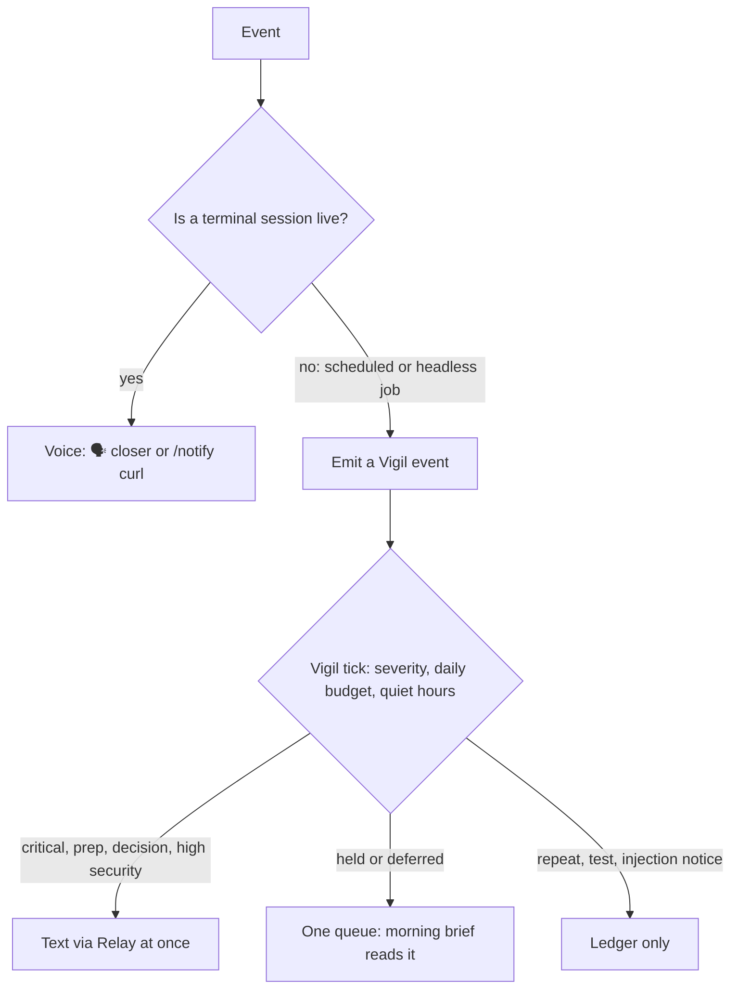

# The Notification System

> Voice is the Life OS speaking. Notifications close the loop's feedback edge: when the system advances the hill-climb (`LIFEOS/DOCUMENTATION/LifeOs/LifeOsThesis.md`), the principal hears it without having to look.

**Voice notifications for LifeOS intents and task execution.**

> **Infrastructure:** The voice notification endpoint (`http://localhost:31337/notify`) is served by the unified Pulse daemon (`~/.claude/LIFEOS/PULSE/`). Voice is implemented at `~/.claude/LIFEOS/PULSE/VoiceServer/voice.ts` and routed through Pulse -- there is no separate VoiceServer process. One daemon, one port, one launchd plist (`com.lifeos.pulse`).

> **Pronunciation normalization:** Every LifeOS voice (this voice server, ReadIt, blog and podcast audio, the narrators, Relay voice notes, live talk and the phone line) says text through one pass, `pronounce()` in `LIFEOS/TOOLS/PronounceCore.ts`, loaded with the rules by `LIFEOS/TOOLS/Pronounce.ts`: first `disambiguateHomographs()`, then the term map from `LIFEOS/USER/PRINCIPAL/PRONUNCIATIONS.json`, re-read when the file changes. `FishTTS.fishRequestBody` runs it on every Fish request; the phone Worker runs it on each call line with the rules `deploy.ts` pushes as its `PRONUNCIATIONS` secret; the narrators run it themselves before hashing and tell FishTTS not to repeat it. `Pronounce.guard.test.ts` fails on a second copy (Fish voice ISA F7). The homograph stage exists because the voice engine guesses a reading from context and gets some words wrong; the worst offender is "live": every `live` reads /laɪv/ (on air) unless a verb signal sits next to it ("I live", "to live", "where … live", "live a good life"), since the on-air sense is the common one in the DA's speech (principal directive, 2026-10-25).

This system provides:
- Voice feedback when intents start (live sessions only)
- Consistent user experience across all skills
- A map of the other channels and of Vigil, the one decider of what interrupts the principal when no session is open

---

## Task Start Announcements

**When STARTING a task, do BOTH:**

1. **Send voice notification**:
   ```bash
   curl -s -m 5 -X POST http://localhost:31337/notify \
     -H "Content-Type: application/json" \
     -d '{"message": "[Doing what {PRINCIPAL.NAME} asked]"}' \
     > /dev/null 2>&1 &
   ```

2. **Output text notification**:
   ```
   [Doing what {PRINCIPAL.NAME} asked]...
   ```

**Skip curl for conversational responses** (greetings, acknowledgments, simple Q&A). The 🗣️ closer already drives voice output; adding a curl creates a redundant voice message.

---

## Context-Aware Announcements

**Match your announcement to what {PRINCIPAL.NAME} asked.** Start with the appropriate gerund:

| {PRINCIPAL.NAME}'s Request | Announcement Style |
|------------------|-------------------|
| Question ("Where is...", "What does...") | "Checking...", "Looking up...", "Finding..." |
| Command ("Fix this", "Create that") | "Fixing...", "Creating...", "Updating..." |
| Investigation ("Why isn't...", "Debug this") | "Investigating...", "Debugging...", "Analyzing..." |
| Research ("Find out about...", "Look into...") | "Researching...", "Exploring...", "Looking into..." |

**Examples:**
- "Where's the config file?" → "Checking the project for config files..."
- "Fix this bug" → "Fixing the null pointer in auth handler..."
- "Why isn't the API responding?" → "Investigating the API connection..."
- "Create a new component" → "Creating the new component..."

---

## Intent Invocation Notifications

Intent announcements come from one place, the intent voice (`hooks/lib/intent-voice.ts`, run from `hooks/EventLogger.hook.ts`). When an intent file is read during a skill's execution, it announces "Running the X intent in the Y skill". Skills and intents carry no curl and print no "Running the..." line; `../Skills/SkillSystem.md` § Intent anatomy is the standard. Because the announcement keys off an intent file actually being read, it never names an intent that does not exist. Work that is not an intent is announced with a context-appropriate gerund (above), never in the intent format.

Like all voice, it stays silent in subagents and on headless channels (§ Voice IDs, § Who Decides What Reaches the Principal).

### The /notify API

Callers that do speak (hooks, tools, the task-start line above) POST to the endpoint. The trailing `&` and the redirect keep the call from blocking the work:

```bash
curl -s -m 5 -X POST http://localhost:31337/notify \
  -H "Content-Type: application/json" \
  -d '{"message": "<spoken text>", "voice_id": "{DA_IDENTITY.VOICEID}", "title": "{DA_IDENTITY.NAME}"}' \
  > /dev/null 2>&1 &
```

**Parameters:**
- `message` - The spoken text
- `voice_id` - the id of a configured voice with a Fish model (default: {DA_IDENTITY.NAME}'s voice)
- `title` - Display name for the notification
- `voice_enabled` (optional, default true) - `false` shows the desktop notification and skips the speech. Every cadence caller passes `false`.
- `voice_settings`, `volume` (optional) - per-call settings and playback volume.
- `interruptible` (optional) - `true` lets a talk microphone opening cut this clip off (voice mode's barge-in).

**Phase tracking:** `/notify` is audio and desktop only. It ignores `phase` and `slug`: the phase-capture path in `VoiceServer/voice.ts` was removed 2026-04-27. Session phase reaches `work.json` only through the ISASync hook (ISA frontmatter edits), and the ascent table in `LIFEOS/TOOLS/ascent.ts` (`LIFEOS/DOCUMENTATION/Algorithm/AscentStates.md`) derives every icon, color, and label from the phase key.

---

## Voice Notifications During Work

**Intent voice announcements come from the intent voice in `hooks/EventLogger.hook.ts`** (§ Intent Invocation Notifications), not from curls written into skills. The per-phase announcement table keyed to effort tiers was retired with the modes/tiers system on 2026-07-11; how much a run narrates is discovered from the work, not read off a tier.

**Task completion voice** is handled by `VoiceCompletion.hook.ts` → `handlers/VoiceNotification.ts`, which extracts the `🗣️` line from the response and POSTs to the Pulse `/notify` endpoint at `http://localhost:31337`.

**Scheduled/cadence jobs never voice-notify** (principal directive, 2026-08-14). `/notify` defaults voice ON, so every cadence caller (launchd, cron, Hermes jobs, recurring tools) passes `voice_enabled: false` explicitly. A PULSE cron job with `output = "voice"` is suppressed by `dispatchSingle` in `LIFEOS/PULSE/lib.ts` unless `PULSE_CRON_VOICE=1` is set. Cadence channels are the silent banner, logs, or NotifyPrincipal SMS; interactive-session voice (intent announcements, completion 🗣️) is unaffected.

**Global voice mute — the recording/call kill switch** (2026-08-18). `GET /voice/mute` returns `{muted}`; `POST /voice/mute` with `{}` toggles or `{"muted": bool}` sets. State is file-backed at `LIFEOS/MEMORY/STATE/voice-mute.json` (survives Pulse restarts, live-read per call) and gates TTS only — desktop notifications still show, and `/notify` still returns success while muted. The route sits ABOVE the shared rate limiter so a notification burst can never 429 the mute switch. Two front-ends: the Pulse menu bar app's "Voice: On/Muted" row (`LIFEOS/PULSE/MenuBar/PulseMenuBar.swift`, hidden when the voice server is unreachable) and the Hammerspoon `Shift+Cmd+M` hotkey (`~/.hammerspoon/init.lua`; the shift matters — bare `Cmd+M` is system minimize, and the menu row's `keyEquivalent` shows the same ⇧⌘M). `/voice/health` reports `muted`. Every state CHANGE speaks its own confirmation — "Voice muted." / "Voice back on." — via an internal mute-bypass in `sendNotification` that HTTP callers cannot reach; a POST that doesn't change state stays silent.

---

## Voice IDs

| Agent | Voice ID | Notes |
|-------|----------|-------|
| **{DA_IDENTITY.NAME}** (default) | `{DA_IDENTITY.VOICEID}` | Use for most intents |

**The DA is the only speaker.** Subagents never emit voice — the DA narrates every completion, so there is no per-subagent voice routing to configure. The `voiceId:`/`voice:` frontmatter in `agents/*.md` has **no consumer in code** (verified 2026-07-27: nothing under `hooks/`, `LIFEOS/TOOLS/`, or `LIFEOS/PULSE/` parses agent frontmatter for voice); it is persona flavor, not configuration, and two agents currently share one ID without consequence.

**Voice config:** canonical in `LIFEOS/USER/CONFIG/LIFEOS_CONFIG.toml` `[da.voices.main]`; hooks read the runtime mirror at `~/.claude/settings.json` → `daidentity.voices.main.voiceId`. The former "Priya (Artist)" row was removed 2026-07-27 — that agent does not exist.

---

## When to Skip Notifications

Skip the task-start curl for conversational responses (greetings, acknowledgments, simple Q&A) and for quick utility operations such as a file read or a status check. The 🗣️ closer already speaks once for those.

Intent announcements need no decision from the DA or the skill author. The hook fires only when an intent file is read during a skill’s execution, so a skill without intents, or a request a skill handles in its SKILL.md alone, is never announced as an intent.

---

## Who Decides What Reaches the Principal

**Vigil is the one decider of what interrupts the principal away from the terminal** (`../Vigil/VigilSystem.md`, ISA `LIFEOS/VIGIL/ISA.md` (not in the public release) F12). Subsystems and scheduled jobs log events to Vigil in one format; Vigil's five-minute tick routes them by severity floor, a daily budget (`interruptions_per_day` in `LIFEOS/USER/CONFIG/notifications.json`) and the shared quiet-hours window (`LIFEOS/TOOLS/QuietHours.ts`). Security criticals and meeting prep go out at once; everything held or deferred lands in one queue that the morning brief reads (`Vigil.ts queue`, three items at most).

**On the principal's install this runs in enforce mode** (`decider_mode` in `LIFEOS/USER/VIGIL/policy.json`, set 2026-10-08; the code default in `LIFEOS/VIGIL/Policy.ts` is `shadow`). Vigil's own texts follow the daily budget and quiet hours. AgentJob, CloudPager, SchedulerWatch and the Workflows engine still text through `send.ts` on their own. Until Vigil ISA ISC-144 (those senders stop calling `send.ts`) and ISC-146 (an `/ic` check that only Vigil, the Relay skill's Send and Relay `session.ts` spawn `send.ts`) land, those senders still text on their own. Docs and new code describe that as the legacy path being migrated, never as a place to add new senders.

**Relay is the texting bridge.** The text itself goes out through Relay (`bun LIFEOS/RELAY/bridge/send.ts`, operated through the `Relay` skill, which ships in the public release), the iMessage bridge behind Tex (`../Tex/TexSystem.md`). Tex is the other direction: the principal texting the DA. A caller never composes its own channel logic; it emits a Vigil event and Vigil decides whether a text is warranted.

**Voice is for live sessions only.** The 🗣️ closer, the intent announcements, and the `/notify` calls above speak because a terminal session is open. Scheduled and headless work never voices: a session with no terminal identity resolves to channel `headless` and every voice-firing hook goes silent. New headless spawners set `LIFEOS_NOTIFICATION_CHANNEL=headless`.

Terminal output and Pulse cards are not interruptions; they have no cap.

---

## Other Channels (Push, Discord, Email)

These channels, except Discord (configuration only, no sender), are implemented, but they do not decide on their own when to interrupt. Pulse cron jobs pick one per job through their `output` target (`voice | ntfy | email | log`, `LIFEOS/PULSE/lib.ts`), and the legacy hook path can call `sendPush`.

| Channel | Service | Purpose | Configuration |
|---------|---------|---------|---------------|
| **ntfy** | ntfy.sh | Mobile push | `LIFEOS/PULSE/PULSE.toml → [notifications.ntfy]` for `sendPush`; the `NTFY_TOPIC` environment variable for Pulse cron jobs with `output = "ntfy"` |
| **Discord** | Webhook | Reserved: no sender reads the block yet | `LIFEOS/PULSE/PULSE.toml → [notifications.discord]` |
| **Desktop** | macOS native | Local desktop alerts | Always available |
| **Email** | Gmail CLI | System emails (alerts, digests, pings) | Brand config: `LIFEOS/USER/CONFIG/email-brand.json`. A Pulse cron job with `output = "email"` instead uses the Google Workspace CLI (`gws`) and `GMAIL_USER`, and skips with a warning when either is missing |

**Every email LifeOS sends renders through `LIFEOS/TOOLS/EmailTemplate.ts`** — the one branded shell (brand banner + logo, severity band in red/amber/green for alert systems, white content card, brand footer). Enforced deterministically by the `email-branding` /ic check: a tracked `.ts` file that sends via the Gmail CLI without importing the template is a blocking finding. Brand identity (name, logo URL, company lines) lives in the USER-zone config, never in the public template file.

**Not built: event-type routing.** An earlier version of this doc described a `taskComplete / longTask / backgroundAgent / error / security` routing table read from `settings.json → notifications`. `settings.json` has no `notifications` key, and nothing reads the `[notifications.routing]` block in `PULSE.toml`. Do not rely on it; interruption decisions belong to Vigil.

### ntfy.sh Setup

1. **Generate topic**: `echo "lifeos-$(openssl rand -hex 8)"` _(topic is effectively a shared secret — anyone who knows it can read your notifications, so keep it unpredictable)_
2. **Install app**: iOS App Store or Android Play Store → "ntfy"
3. **Subscribe**: Add your topic in the app
4. **Test**: `curl -d "Test" ntfy.sh/your-topic`
5. **Enable**: set the topic under `[notifications.ntfy]` in `PULSE.toml` (read by `sendPush`), and export `NTFY_TOPIC` for Pulse cron jobs that use `output = "ntfy"`.

Topic name acts as password - use random string for security.

### Discord Setup (configuration only: nothing in LifeOS posts to the webhook yet)

1. Create webhook in your Discord server
2. Add the webhook URL under `[notifications.discord]` in `PULSE.toml`
3. Set `enabled = true`

### SMS (Not Recommended for the carrier route)

**Carrier SMS is impractical for personal notifications.** US carriers require A2P 10DLC campaign registration since Dec 2024, which involves:
- Brand registration + verification (weeks)
- Campaign approval + monthly fees
- Carrier bureaucracy for each number

The principal's phone is reached by text through Relay (above), which sends over iMessage and avoids the carrier registration. Researched alternatives (Jan 2025), kept for reference:

| Option | Status | Notes |
|--------|--------|-------|
| **ntfy.sh** | ✅ Works | Phone alert with zero registration |
| **Textbelt** | ❌ Blocked | Free tier disabled for US due to abuse |
| **AppleScript + Messages.app** | ⚠️ Requires permissions | What Relay builds on |
| **Twilio Toll-Free** | ⚠️ Simpler | 5-14 day verification (vs 3-5 weeks for 10DLC) |
| **Email-to-SMS** | ⚠️ Carrier-dependent | `number@vtext.com` (Verizon), `@txt.att.net` (AT&T) |

### Implementation

`~/.claude/hooks/lib/notifications.ts` holds session timing (`recordSessionStart`, `getSessionDurationMinutes`) and one push helper:

```typescript
import { sendPush } from './lib/notifications';

// ntfy push, fire-and-forget; returns false when ntfy is disabled or the call fails
await sendPush("Message", { title: "Title", priority: "high" });
```

There is no `notifyTaskComplete`, `notifyError` or `sendDiscord` helper. New code that needs to reach the principal emits a Vigil event (`bun LIFEOS/VIGIL/Vigil.ts emit`, or the `Emit.ts` library) instead of calling a channel directly. Vigil's engine ships in the public release (`LIFEOS/VIGIL/`, `skills/Vigil/`); shared tools that must also run where Vigil is not installed reach it through `LIFEOS/TOOLS/lib/VigilOptional.ts`, which does nothing when Vigil is absent.

---

## Event Log Channel (events.jsonl)


Events are emitted directly from each hook via `fs.appendFileSync` to `~/.claude/LIFEOS/MEMORY/OBSERVABILITY/*.jsonl` — synchronous, fire-and-forget, no shared transport library. This channel is additive — it does not replace any of the notification channels above, and hooks emit events alongside their existing state writes and notifications.

---

### Design Principles

1. **Fire and forget** - Notifications never block hook execution
2. **Fail gracefully** - Missing services don't cause errors
3. **Conservative defaults** - Avoid notification fatigue; one decider (Vigil) and one daily budget
4. **Voice only when a session is live** - Headless work stays silent

---

## Examples

### One task finishing, two very different outcomes

A run wraps up. What the principal experiences depends on whether a session is open:

- **A quick question** — "what's this env var for?" The assistant answers in a sentence. No `curl` fires; the `🗣️` line in the response is the only voice, spoken once. The phone stays quiet. Adding a start-of-task `curl` here would just double the voice for a two-second answer.
- **A scheduled job that finds a security problem while the principal is away** — nothing speaks, because no terminal is open. The job emits a typed event to Vigil. A high-severity security event is routed at once and texted through Relay; a routine one waits in the held queue and shows up in the morning brief.

### When to speak, when to stay silent

The system is tuned against notification fatigue, so most events resolve to nothing:

- **Speak (live session only):** an intent starts significant work, a long task finishes, an error surfaces.
- **Stay silent:** greetings, acknowledgments, simple Q&A, and every headless job.

### How an event reaches the principal



Every notification is fire-and-forget — a channel being offline never blocks the run. Until Vigil ISA ISC-144 lands, the legacy senders named above still text directly beside this path.

---
