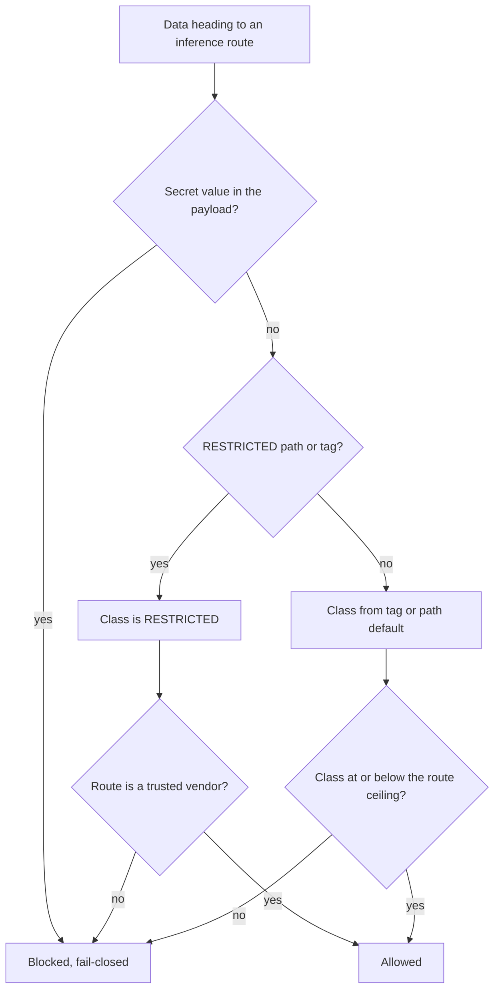

# LifeOS Data Classification & Inference-Source Routing

> The doctrine that decides **which inference source may process which data**. Four data classes, four+ inference sources, one per-route routing matrix. Fail-closed as policy: unclassified data counts as RESTRICTED. Since 2026-10-24 no code checks a payload against these ceilings; see the enforcement section below. Designed + adversarially hardened 2026-06-18; routing policy revised by the principal the same day.

## Why this exists

LifeOS draws inference from sources at different trust/egress tiers. Anthropic, OpenAI (Astra, the workers, and the maintainer-side Pentest, which is not in the public release payload), Google (Gemini, since 2026-10-10), Cloudflare Workers AI on our own account (Assay's Clef-omni engine, since 2026-10-10), xAI (Grok) and Meta (Muse), both since 2026-10-16, are restricted-capable under the current vendor policy. The data broker Treg is the one wired external route with a lower ceiling (PUBLIC). The GLM route through the OpenRouter broker (`OpenRouter.ts`) was the third tier from 2026-06-18 until 2026-09-03, when it was removed: nothing called it and the broker account was dead. Each external call is a data-egress surface. This doctrine classifies every piece of data and binds each class to the routes allowed to see it.

**The core principle: data egress is ranked by trust, content is ranked by sensitivity, and a route may only process data at or below its ceiling. Unclassified data is RESTRICTED (fail-closed).**

## The four data classes

| Class | Rank | One-line test | Leak consequence |
|-------|------|---------------|------------------|
| **RESTRICTED** | 0 (highest) | "If this showed up in someone else's logs, do I have to rotate something or notify someone?" | Irreversible — rotation, breach notice, contract/law break |
| **CONFIDENTIAL** | 1 | "Is this about MY health, money, security posture, private strategy, or inner life?" | Real harm (embarrassment, competitive loss, profiling) — no rotation |
| **INTERNAL** | 2 | "Would I shrug if a trusted peer saw this, but I haven't published it?" | Low — reveals how the system works, not who I am |
| **PUBLIC** | 3 (lowest) | "Is this already on the internet, or built to go there?" | None — already public or publish-destined |

**RESTRICTED** — auth material, third-party PII, customer-owned data. `.env` + anything quoting it; API keys/OAuth/Cloudflare/Google creds; customer-owned engagement data; contacts' PII; financial source docs; health/medical data. Paths: `**/.env`, `LIFEOS/USER/CONFIG/CREDENTIALS/**`, `LIFEOS/USER/WORK/CUSTOMERS/**`, `LIFEOS/USER/FINANCES/**` (legacy alias `LIFEOS/USER/TELOS/FINANCES/**`), `LIFEOS/USER/HEALTH/**`, `LIFEOS/USER/CONTACTS.md`. **Also the fail-closed default.**

**CONFIDENTIAL** — the principal's own sensitive life/business data: health, financials, own-infra security findings, TELOS internals, hot-layer + relationship memory, People/Companies notes. **Default for all of `LIFEOS/USER/**`** except RESTRICTED sub-globs and named PUBLIC demotes.

**INTERNAL** — private but not sensitive: ISAs, work notes, plans, non-PII knowledge, non-secret config, system internals. Paths: `LIFEOS/MEMORY/**`, `skills/**`, `LIFEOS/USER/CONFIG/**` (minus CREDENTIALS), `CLAUDE.md`, `LIFEOS/LIFEOS_SYSTEM_PROMPT.md`.

**PUBLIC** — already published or publish-destined: live blog/newsletter content, the **scrubbed `sync-docs.ts` output only** (raw `LIFEOS/DOCUMENTATION/**` is INTERNAL until scrubbed), post-SecurityFilter daemon profile, `CANONICAL_CONTENT.md`, public repo source.

## The inference sources

| Tier | Source | Vendor | Egress |
|------|--------|--------|--------|
| 0 | **LOCAL** | on-device (ollama) | none — **NOT YET WIRED** |
| 1 | **NATIVE** | Anthropic | home vendor, subscription/enterprise terms |
| 2 | **CODEX** | OpenAI (codex) | external, single known vendor; runs on the principal's ChatGPT plan, never an API key |
| 2 | **GEMINI** | Google (`GeminiSearch.ts`) | external, single known vendor |
| 2 | **WORKERS_AI** | Cloudflare Workers AI (Assay engines) | our own Cloudflare account |
| 2 | **GROK** | xAI (`GrokQuery.ts`) | external, single known vendor |
| 2 | **MUSE** | Meta (`Muse.ts`) | external, single known vendor |
| 2 | **TREG** | data broker (`Treg.ts`) | external data vendor, not an inference vendor; PUBLIC ceiling |
| 2 | _(GENE, removed 2026-09-03)_ | OpenRouter broker → GLM | external **broker** — non-deterministic downstream provider/country; the tier the rules below were hardened against, kept here so the rules read correctly |

## The routing matrix (the rule)

**The ceiling is per-ROUTE — source + model + data-residency — not per-source** (principal policy, revised 2026-06-18). Three rules, most-restrictive wins:

1. **RESTRICTED-capable vendors — Anthropic (Native), OpenAI (codex), Google (Gemini), xAI (Grok), Meta (Muse) and Cloudflare Workers AI on our own account (Assay's two engines, Clef-omni and Clairic) ONLY.** These trusted vendors may process every class, including RESTRICTED. No other provider or model ever touches RESTRICTED. Secret values never leave for any vendor.
2. **Chinese-origin model → INTERNAL ceiling.** Any model from a Chinese lab (GLM/Z.ai, Kimi/Moonshot, MiniMax, Qwen, DeepSeek) caps at INTERNAL regardless of who hosts it — and only when routing is guaranteed off China/Russia; an opaque broker with no such guarantee drops to PUBLIC.
3. **US/allied model, US inference, US company, verified no China/Russia egress → up to CONFIDENTIAL.** Otherwise PUBLIC.

LOCAL (on-device) handles everything. **A route's ceiling depends on the model AND the residency:** a Chinese-origin model pinned to a US+ZDR provider reaches INTERNAL; the same model unpinned drops to PUBLIC. (The GLM route that exercised this rule was removed 2026-09-03; the rule stands for any future broker lane.)

Resolved ceilings for the wired routes:

| Route | Ceiling | Why |
|-------|---------|-----|
| NATIVE (Anthropic) | RESTRICTED | trusted US vendor |
| CODEX (OpenAI) | RESTRICTED | trusted US vendor |
| GROK · xAI via `GrokQuery.ts` | RESTRICTED | trusted vendor since 2026-10-16 (principal call); was Bash-gated by `EgressClassGuard` from 2026-09-03 until that hook was retired 2026-10-24; secret values stay out through the `.env` read rules. Before 2026-10-16 the ceiling was PUBLIC, or INTERNAL while `XaiZdr.ts` showed a verified zero-retention test under 36 h old |
| Gemini (`GeminiSearch.ts`) | RESTRICTED | trusted vendor since 2026-10-10 (principal call); secret values stay out through the `.env` read rules, and nothing scans the payload |
| Assay engine (`Engine.ts`, Cloudflare Workers AI) | RESTRICTED | our own Cloudflare account; secret values still refused |
| Treg (`Treg.ts`) | PUBLIC | data broker outside the trusted vendor set; policy only since 2026-10-24, no gate checks the payload |
| Muse (`Muse.ts`, Meta Muse Code) | RESTRICTED | trusted vendor since 2026-10-16 (principal call; PUBLIC from 2026-10-12); secret values stay out through the `.env` read rules, and nothing scans the payload |
| _(removed 2026-09-03)_ GENE · GLM, pinned US + ZDR | INTERNAL | Chinese model, residency guaranteed by allowlisted US provider |
| _(removed 2026-09-03)_ GENE · GLM, unpinned or non-US pin | PUBLIC | residency not guaranteed (could route to CN/RU) |

The ceilings are policy. The code form (`maxClassForRoute()` and the `InferenceSource` routes in the data-classification lib) and the Bash-time `EgressClassGuard` that enforced it were removed 2026-10-24. What is still enforced is that secret values stay out of reach, by the `.env` deny and ask rules in `settings.json`. Every model vendor is trusted for data (OPERATIONAL_PREFERENCES § Model selection).

**Note on codex/OpenAI at RESTRICTED:** the codex route runs on the principal's ChatGPT subscription and never uses an API key, so OpenAI's enterprise or zero-retention API terms are not what governs it; the subscription's own data terms are. The RESTRICTED ceiling is the installing principal's decision (OPERATIONAL_PREFERENCES § Model selection), not an inherited default. Confirm those terms before sending third-party personal data or customer-owned data, or lower this route's ceiling in the table above and in OPERATIONAL_PREFERENCES § Model selection.

## Marking convention

Path-default-first, fail-closed, mark-only-the-exceptions:

1. **Path defaults** via `LIFEOS/USER/CONFIG/data-classification.json` (longest-match wins). *"If you didn't tag it, it's as locked as its directory."*
2. **Demote-only tags** — public-facing files inside a stricter tree carry `data_class: PUBLIC` frontmatter (DAEMON.md, CANONICAL_CONTENT.md). Tag *down* only.
3. **Auto-promote by content** — a secret-shape match anywhere → RESTRICTED, blocked from all cloud sources.
4. **In-flight requests** declare class; inline `[[dc:public]]` for one-offs.
5. **Precedence**: auto-promote > explicit tag > path default; conflicts resolve to the more restrictive.
6. **Mixed payloads inherit the highest class** of any constituent.

## Enforcement

**Retired 2026-10-24 (ISA `20261024-native-security`).** The enforcement below is gone; this section is history, and the ceilings above are policy. What still holds a secret value in place is the `.env` deny and ask rules in `settings.json`, with secret values masked at writers.
- The Bash-time `EgressClassGuard` hook and its `egress-class-core` lib detected `bun … <gated CLI>` execs for every filename in `GATED_CLI_FILES` (`GrokQuery.ts`, `Engine.ts`, `Treg.ts`, `Muse.ts`), classified the payload (secret-shape scan plus sensitive-path references), and blocked anything above the route ceiling, logging to `LIFEOS/MEMORY/OBSERVABILITY/egress-decisions.jsonl`. It was removed once every model vendor became trusted for data (OPERATIONAL_PREFERENCES § Model selection).
- The `data-classification` lib held `InferenceSource`, `CLASS_RANK`, `maxClassForRoute()` and the `RESTRICTED_CAPABLE_VENDORS` and `CHINESE_MODEL_PATTERNS` tables; it was removed with the guard.
- `LIFEOS/USER/CONFIG/data-classification.json` — path-default glob table. Still on disk; nothing in the hook layer reads it any more.
- (The former `Gene.md` agent's soft prompt-guard was retired with the persona 2026-07-02; the `OpenRouter.ts` tool that carried the route after it was removed 2026-09-03.)
- **GLM route INTERNAL-by-default (2026-06-20, route removed 2026-09-03; kept as the worked precedent for any future broker lane):** the GLM/OpenRouter route now default-pins a US+ZDR provider (Fireworks) so its standing ceiling is INTERNAL, not PUBLIC. `egress-class-core.ts` grants the INTERNAL ceiling ONLY when the `--pin` value is on the `US_ZDR_PROVIDERS` allowlist; an unpinned call or a non-US pin fails closed to PUBLIC. The pin is honored as a *constraint*, not a preference: `OpenRouter.ts` sends `provider.order:[pin]` + `allow_fallbacks:false`, so if the pinned US provider is down the call **errors** rather than silently rerouting off-US (verified live: a Fireworks rate-limit returned 429, did not fall back). Two honest caveats this doctrine must not blur: (1) **ZDR ≠ residency** — `data_collection:deny` is a retention/training guarantee; US *geography* comes only from the pinned provider being US infra (OpenRouter's metadata claim), they are orthogonal. (2) **The broker is inside the trust boundary** — OpenRouter proxies plaintext and has its own logging policy, so the INTERNAL leak surface = OpenRouter infra + the pinned provider, not the provider alone. Acceptable for INTERNAL; named here rather than hidden. The gate enforces residency (route geography); the INTERNAL/CONFIDENTIAL *content* line still rests on the shape-scan + operator discipline (the gate sees secret-shapes and USER-paths, not semantic CONFIDENTIAL prose) — closing the prior "GLM wrapper pin" gap on residency, not on semantic content classification.

**Still planned:**
- Path/identity scrub for INTERNAL→Tier-2 (reuse sync-docs.ts + Daemon SecurityFilter rules).
- Pulse statusline count; ShadowRelease release-time backstop.

**Known limits of the retired v1 gate (honest):** it inspected the Bash *command string* — so it caught secrets and sensitive *paths named in the command*, but not the file *contents* the tool read at runtime, nor free-prose PII with no token-shape or path reference.

## Gaps / roadmap

1. **LOCAL (ollama) not wired** — RESTRICTED data has no on-device model destination; today it's redact-or-deterministic-code only.
2. **`data-classification.json` needs review** before deeper wiring.
3. **No INTERNAL→PUBLIC downgrade-for-egress token** yet.
4. **`LIFEOS/DOCUMENTATION/` is dual-state** — raw=INTERNAL, scrubbed=PUBLIC; pin the scrub-output dir into the PUBLIC glob.
5. **Secret-shape scan catches tokens, not prose PII.**
6. **Return-path leakage uncontrolled** — governs input, not what a response echoes out.
7. **Non-inference egress** (raw WebFetch/WebSearch, skill curls, iMessage/Discord/email) is out of scope here.

## Examples

### One request, two files, two verdicts

Say a workflow wants to summarize a file through an external broker route (the GENE/GLM lane that existed until 2026-09-03: a Chinese model behind a broker, pinned to a US zero-retention provider — ceiling INTERNAL). This is how the retired gate decided, per file, with no model in the loop. The verdicts are still the policy; since 2026-10-24 you apply them, because no code does:

- **A plain work note** — an internal design doc under the memory tree, no secrets, no sensitive paths. Path default lands it at INTERNAL. INTERNAL ≤ the route's INTERNAL ceiling, so the call goes through.
- **A deploy script that names a credential** — the same route, but the command string references an `.env` path. Auto-promote fires: class becomes RESTRICTED. Only the trusted vendors may ever see RESTRICTED, so the broker route is **blocked, fail-closed** — the summary never leaves for the broker.
- **A deploy script that contains a token-shaped string** — the scan finds a secret value. Policy forbids it on every route, trusted vendors included, because secret values never leave for any vendor. In code only the Assay engine refuses a secret shape in the payload; on the other routes the `.env` read rules keep the value out of reach.

Same route, same one-line policy, opposite outcomes — decided by the *content*, not by which route was asked for. Flip the route to Native (Anthropic) and the work note and the script that only names a credential both pass, because a RESTRICTED-capable vendor has no ceiling to exceed. The script holding a secret value still does not: strip the value, then send.

### When a route may see the data, and when it may not

The quick read on any route is "what is this route's ceiling, and is the data at or below it?"

- **Native / codex / Gemini / Grok / Muse** — no ceiling; every class, RESTRICTED included. Trusted vendors (Google since 2026-10-10, xAI and Meta since 2026-10-16). Secret values never go to any route by policy; the `.env` read rules keep them out of reach, and only the Assay engine also refuses a secret shape in code.
- **Treg** — PUBLIC ceiling; a data broker outside the trusted vendor set, so only already-public data may go.
- **A Chinese-origin model pinned US + zero-retention** (the removed GENE lane) — INTERNAL ceiling. Fine for work notes and system internals; never for health, finances, or credentials.
- **The same model unpinned or pinned off-US** — drops to PUBLIC. Residency isn't guaranteed, so only already-public data may go.
- **Unclassified anything** — treated as RESTRICTED. If you didn't tag it, it's as locked as its directory.

### The routing decision as a picture

The diagram is the whole doctrine in one frame: a secret value stops at the first gate on every route, sensitivity is then decided most-restrictively, the trusted vendors are the only path for the top class, and everything else must sit at or below its route's ceiling. Every unresolved branch falls to the blocked side — the default is no, not maybe. The diagram is policy: since 2026-10-24 nothing evaluates it at call time, apart from the Assay engine's own secret-shape refusal.

---
