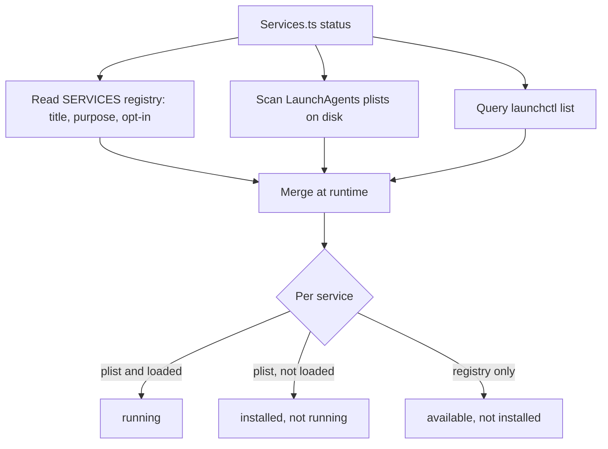

# LifeOS Background Services

> **The legacy launchd services LifeOS runs on the Mac — what each is, how often it fires, and how to install it. `LIFEOS/TOOLS/Services.ts` controls them.** The one list of everything LifeOS runs on a clock is the Workflows inventory (`bun LIFEOS/WORKFLOWS/Workflows.ts summary`, Pulse `/workflows`), which reconciles declared, installed and ran. New timed work is a Workflow definition in `LIFEOS/USER/WORKFLOWS/`, never a new plist here; the services below are legacy runtimes being migrated. Before this doc, the install story was scattered across a dozen `Install*.ts` scripts, Pulse `manage.sh` files, and hand-installed launchd jobs, with nothing that listed what was actually running. This is the fix for the legacy set.

## The one-shot

```bash
bun ~/.claude/LIFEOS/TOOLS/Services.ts status              # what's running vs installed vs available
bun ~/.claude/LIFEOS/TOOLS/Services.ts install --all --yes # stand up every service (macOS)
bun ~/.claude/LIFEOS/TOOLS/Services.ts install --only conveyor-watcher,vigil --yes
bun ~/.claude/LIFEOS/TOOLS/Services.ts uninstall --only conveyor-watcher
bun ~/.claude/LIFEOS/TOOLS/Services.ts doc                 # regenerate the table below
```

`status` and `doc` are **read-only** (safe anytime). `install`/`uninstall` call `launchctl` — a privileged step, so the human (or the installing AI, with permission) runs them; `install` without `--yes` is a dry preview. Core services install by default; opt-in ones need `--all` or `--only`.

## How it works

`Services.ts` is a single registry (`SERVICES`) of human-meaningful metadata — title, purpose, category, opt-in, install command — merged at runtime with the **actual plists on disk**. Cadence and run-state are parsed live from `~/Library/LaunchAgents/*.plist` and `launchctl list`, so `status` reports reality, never a stale hand-maintained guess. Adding a service = one row in `SERVICES` pointing at its existing installer; the tool orchestrates, it does not re-implement each installer.

## Categories

- **pulse** — the Life Dashboard and its rendering jobs (core, default-on).
- **capture** — services that pull signal into LifeOS (the Conveyor watcher and runner, the Vigil tick).
- **sweep** — periodic scans that create work/ideas (commitments, lifelog idea sweep).
- **maintenance** — housekeeping (the interview due-check).

The scheduled jobs that used to sit in these categories (Conduit capture, the iMessage reader, derived-file sync, health sync, work sweep, blog discovery, synthesis, model sync, codex update, usage aggregation, the Socrates and Achilles ticks and the rest) moved into Workflows on 2026-10-22; `bun LIFEOS/WORKFLOWS/Workflows.ts list` shows them.
- **sidecar** — a second front door that runs beside LifeOS under its own label (the Hermes gateway, `ai.hermes.gateway`). Listed only while a Hermes home exists, so it has no row in the table below on an install that never mounted Hermes.

## The services (generated from live plists)

<!-- generated by `bun LIFEOS/TOOLS/Services.ts doc` — do not hand-edit; update SERVICES in Services.ts -->

| Service | Category | Cadence | Opt-in | Purpose | Install |
|---------|----------|---------|--------|---------|---------|
| **Pulse (dashboard server)** `com.lifeos.pulse` | pulse | at load | core | The Life Dashboard HTTP server on :31337 — Pulse, the visible surface onto LifeOS. | `bash ~/.claude/LIFEOS/PULSE/manage.sh install` |
| **Pulse menu-bar app** `com.lifeos.pulse-menubar` | pulse | at load | core | macOS menu-bar app for Pulse — quick status + open the dashboard. | `bash ~/.claude/LIFEOS/PULSE/MenuBar/install.sh` |
| **Herdr web bridge** `com.lifeos.herdr-bridge` | pulse | — | yes | Phone-browser view and control of herdr agent panes, on loopback behind tailnet-only Tailscale serve, refusing any caller but the principal's Tailscale login. | `bun ~/.claude/LIFEOS/PULSE/HerdrBridge/manage.ts install` |
| **Conveyor inbox watcher** `com.lifeos.conveyor-watcher` | capture | at load | yes | Watches ~/Recordings/Inbox and registers dropped recordings in the content-pipeline ledger (Conveyor P1). | `bun ~/.claude/LIFEOS/TOOLS/InstallConveyorWatcher.ts` |
| **Conveyor stage engine** `com.lifeos.conveyor-runner` | capture | at load | yes | Advances claimable INBOX items to PREP via transcription, lease-guarded, one item per tick (Conveyor P2 stage 1). | `bun ~/.claude/LIFEOS/TOOLS/InstallConveyorRunner.ts` |
| **Interview due-check** `com.lifeos.interviewdue` | maintenance | daily/scheduled | yes | Daily 07:10: rebuilds state-evidence, freshness, and interview-due caches feeding the statusline interview chip. Caches only — never claims files. | `bun ~/.claude/LIFEOS/TOOLS/InstallInterviewDue.ts` |
| **Lifelog idea sweep** `com.lifeos.lifelogideasweep` | sweep | daily/scheduled | yes | Reads yesterday's wearable recordings for blog-worthy ideas — marked ones verbatim, unmarked ones as pointers — and emails them over. The unmarked pass sends the day's transcript, bystanders' speech included, to a model provider, so it is opt-in and off by default: "ideaSweepModelPass": true in USER/CONFIG/lifelog.json. | `bun ~/.claude/LIFEOS/TOOLS/InstallLifelogIdeaSweep.ts` |
| **Commitment sweep** `com.lifeos.commitmentsweep` | sweep | daily/scheduled | yes | Sweeps commitments/reminders on a cadence. | `bun ~/.claude/LIFEOS/TOOLS/InstallCommitmentSweep.ts` |
| **Vigil monitor tick** `com.lifeos.vigil` | capture | — | yes | Collects LifeOS monitoring events every five minutes and routes them under the Vigil interruption policy. (maintainer-side; not in the public release payload). | maintainer-side installer (not in the payload) |

_Per-install private services are defined in `LIFEOS/USER/CONFIG/services.json` and are not listed here._

## Fresh install

The LifeOS install skill (`skills/LifeOS/`, `DeployComponents.ts`) stands up the core set during Setup. `Services.ts install --all` is the complete-coverage path: point a fresh macOS install at it and every service comes up, opt-ins included. `DeployComponents.ts` reads its service list from the `Services.ts` registry rather than keeping its own copy, and skips entries whose install is a `#` note (no runnable installer). On Linux, each `Install*.ts` script materializes a systemd --user unit instead of a launchd plist; launchd-only services (the menu-bar app, the deriver) report missing there.

## Examples

### One command, the whole fleet

An operator wants to know what is actually running. `Services.ts status` merges the registry of known services with the plists on disk and `launchctl` run-state, then prints reality in three buckets:

- **running** — installed and up (the Pulse server and its menu-bar app).
- **installed, not running** — a plist exists but launchd shows it stopped.
- **available, not installed** — a service LifeOS knows about but this machine has not stood up yet (an opt-in like `commitmentsweep`).

They spot the commitment sweep sitting in "available." One command stands it up:

```bash
bun ~/.claude/LIFEOS/TOOLS/Services.ts install --only commitmentsweep --yes
```

Because the next `status` reads the live plist again — not a hand-kept note — it shows the sweep running with its real cadence. Scheduled jobs that are not services (work sweep, Conduit capture, the Achilles tick) are Workflows: `bun LIFEOS/WORKFLOWS/Workflows.ts list` shows them. There is no place for the list to drift from the truth.

### When a preview is the point

`install` and `uninstall` touch `launchctl`, so they are the privileged half of the tool. Running `install --all` *without* `--yes` installs nothing — it prints a dry preview of what would happen, which is the safe way to see the full opt-in set before committing. On a fresh Mac, `install --all --yes` is the opposite move: bring up every service, core and opt-in, in one pass. On Linux the installers write systemd --user units instead, and `status` reads those.

### How status stays honest



The registry supplies the human-meaningful metadata; the plists and `launchctl` supply the ground truth. Because the state comes from the live system every time, the table cannot rot the way a hand-maintained service list would — the failure mode that made this tool necessary in the first place.

---

## Cross-references

- Control tool: `LIFEOS/TOOLS/Services.ts`
- Install skill: `skills/LifeOS/` (`skills/LifeOS/Tools/DeployComponents.ts`, `skills/LifeOS/INSTALL.md`, `skills/LifeOS/Intents/Setup.md`)
- Pulse: `LIFEOS/DOCUMENTATION/Pulse/PulseSystem.md`; Conduit: `LIFEOS/DOCUMENTATION/Conduit/ConduitSystem.md`
- Synapse (input routing & capture): `LIFEOS/DOCUMENTATION/Synapse/SynapseSystem.md`
