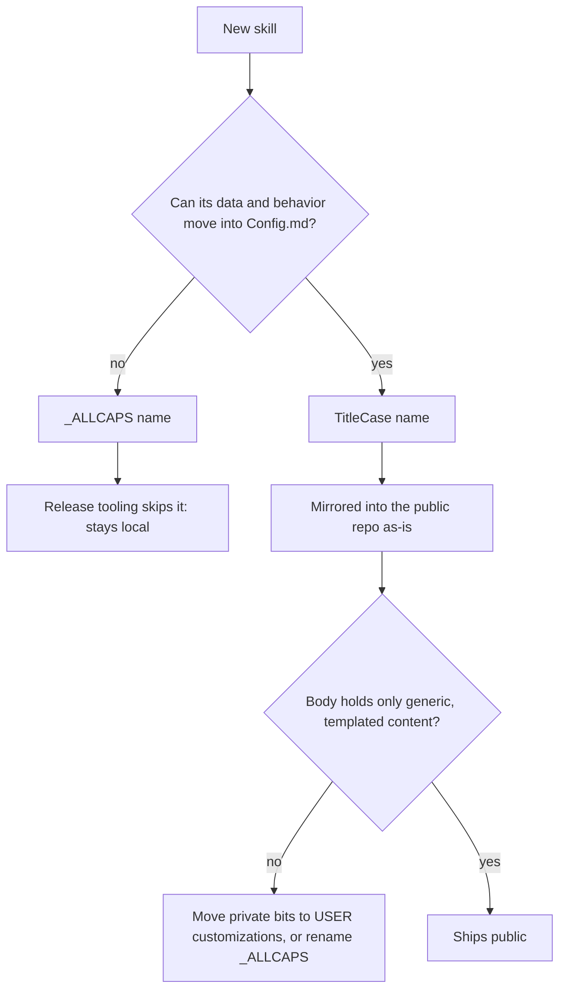

# Custom Skill System

> Skills are the Life OS's action surface. The thesis (`LIFEOS/DOCUMENTATION/LifeOs/LifeOsThesis.md`) puts it directly: "Skills expand so the DA can take more actions to close the gap." Every skill added is a new class of move the DA can make in the current→ideal-state hill-climb; the rules below keep those moves discoverable, composable, and safe to ship.

This document is the authoritative definition of a LifeOS skill, and all skill creation, CreateSkill's included, conforms to it. A skill is a folder. Its `SKILL.md` routes a request to one of its intents, each intent states the outcome it delivers, and its tools do the deterministic work.

The model running a skill is told what done is, what must never happen, and the facts it could not work out for itself. It is not told how to think. § Intent anatomy is that standard; the rest of this document is the structure around it. Paths are relative to the LifeOS install root.

---

## Naming Convention — Public vs Private

A skill's name encodes whether it ships publicly. There are exactly two valid forms, and `skills/CreateSkill/References/Conventions.md` § Naming — public vs private states the same rule.

| Skill type | Directory format | Example | Allowed content |
|------------|------------------|---------|-----------------|
| Public | `TitleCase` | `Research`, `Daemon`, `CreateSkill` | Templated, safe, generic, ready for public release |
| Private | `_ALLCAPS` (underscore prefix, all uppercase) | `_MYFINANCES`, `_HOMELAB`, `_CLIENTWORK` | Skills whose core job cannot move into `Config.md` (§ Public vs Private Skills) |

The leading underscore is the public-release boundary. Release tooling excludes every `_*` skill: `hooks/lib/containment-zones.ts` maps `skills/_*/**` to the `private-skills` zone. Public skills are mirrored as-is into the public LifeOS repo.

Sub-files follow TitleCase in both kinds of skill:

| Component | Wrong | Correct |
|-----------|-------|---------|
| Intent files | `create.md`, `update-info.md`, `SYNC_REPO.md` | `Create.md`, `UpdateInfo.md`, `SyncRepo.md` |
| Reference docs | `prosody-guide.md`, `API_REFERENCE.md` | `ProsodyGuide.md`, `ApiReference.md` |
| Tool files | `manage-server.ts`, `MANAGE_SERVER.ts` | `ManageServer.ts` |
| Help files | `manage-server.help.md` | `ManageServer.help.md` |
| YAML `name:` | `name: create-skill` | `name: CreateSkill` (public) or `name: _CREATESKILL` (private), matching the directory exactly |

TitleCase means each word capitalized and concatenated, with no hyphens, underscores, or spaces (`Blogging`, `UpdateDaemonInfo`). Private skill directories are a leading underscore plus uppercase letters; internal underscores are allowed for compound names. `SKILL.md` is always uppercase.

---

## Public vs Private Skills

Public skills (`TitleCase`) hold only generic, templated content any LifeOS user could run: placeholder values, public API references, and a pointer to per-user customizations (§ Skill Customization System). A public skill never contains:

- real names of people, products, companies, or customers
- real domains, hostnames, IPs, or internal URLs
- API keys, tokens, or credentials, even example-looking ones
- private repo paths or references
- customer data or customer-specific intents
- first-person war stories tied to a specific incident
- user-specific filesystem paths (`/Users/<name>/...`)
- identity-bound preferences (DA name, principal name, partner name, financial figures)

Private skills (`_ALLCAPS`) never leave the local install. The test is one question: could a stranger drop this skill into their `skills/` directory, fill in their own `Config.md`, and have it work? A skill is private only when its data or behavior cannot move into `Config.md`. Names, accounts, domains, figures, tastes, exemplars and keys can always move, so none of them makes a skill private on its own. Any of these forces an `_ALLCAPS` name:

| If the skill's core job depends on… | Skill must be |
|------------------------|---------------|
| A product or business you own or sell (its admin, customers, operations) | `_ALLCAPS` |
| A specific customer, client, or engagement | `_ALLCAPS` |
| Your own content corpus, persona, or record, with no general version | `_ALLCAPS` |
| Offensive security, incident response, your vulnerability stack, home security, or surveillance | `_ALLCAPS` |
| Infrastructure whose shape discloses your security posture | `_ALLCAPS` |
| The release machinery itself | `_ALLCAPS` |

When in doubt, build it private first. Promoting a private skill to public later is easy; discovering that a shipped public skill leaked identity is permanent.

The underscore decides where a skill ships, not what its files may contain. Since 2026-07-23 private skills are held to the same file hygiene as public ones. Names, domains, figures, and other identity data live under `LIFEOS/USER/` (usually `LIFEOS/USER/CUSTOMIZATIONS/SKILLS/<SkillName>/Config.md`), and SKILL.md points at them under `## Data & Config`.

`bun LIFEOS/TOOLS/SkillHygieneGate.ts --skill <SkillName>` checks a skill against the deny-list, the release scrub patterns, home-path shapes, and a gate-scoped name-literal set (`LIFEOS/USER/SECURITY/SkillNamePatterns.txt`, which catches a plain full-name literal the release deny-list leaves out on purpose). It also fails on vendored dependencies tracked in git (a committed `node_modules/` under the skill). A new skill is not done while it reports violations. For a private skill it is the only check, because the write-time guard exempts the private zone. A skill bundled for sale passes three more gates, listed in `skills/CreateSkill/References/Conventions.md` § Sellable bundles.

A worked fork: a skill that converts units (Celsius to Fahrenheit, kilograms to pounds) holds nothing personal, so it is `UnitConverter` and ships publicly (§ Canonical example). Make it call a paid currency-rate API and it stays public: the key goes in the user's own `.env` and its Setup.md says which account to open. Make it price conversions from your company's internal rate service instead and its core job depends on your business, so it is private and release tooling skips it.



### Promoting a private skill

A private skill that passes the test above becomes public by promotion, never by a release-time scrub. It is promoted when all of these hold:

- Every name, account, domain, figure, taste, and exemplar sits in `LIFEOS/USER/CUSTOMIZATIONS/SKILLS/<Name>/Config.md`, with a made-up template under `private-maintenance-tooling-not-included/RELEASE_TEMPLATES/USER/CUSTOMIZATIONS/SKILLS/<Name>/`.
- `skills/<Name>/Setup.md` carries the four parts SetupInventory checks (What it does, Fill in, Accounts and secrets, Prove it works). It walks a first-time user to your working setup with made-up values, and SKILL.md's `## Data & Config` links it. Where the skill is extended with the user's own pieces (an adapter, a monitor, a scheduled workflow, a policy, a source), Setup.md also gives one generic worked example of each, made-up values only, for the reader to copy as the start of their own; your real ones stay in USER (2026-10-11). Its proof runs shipped code (a read-only command, a `--dry-run` or `--help`), never `bun test`: test files do not ship.
- Setup.md teaches; it never ships the backend (2026-10-12). When the skill needs a service behind it (a Worker, a database, a scheduled pipeline), Setup.md explains how to build one: the parts, the endpoints, the auth split, what goes in `Config.md`, and the proof. The reader's own DA builds theirs from that. The working package (service source, wrangler config, migrations, deploy scripts) stays under `LIFEOS/USER/CUSTOMIZATIONS/SKILLS/<Name>/`, and promotion never packages a deployable template. SkillHygieneGate fails any tracked deployable package inside `skills/` (`shipped-backend`).
- The directory and frontmatter `name:` are TitleCase, every live caller uses the new name, and history records keep the old one.
- SkillHygieneGate passes, and a fresh agent from another vendor reads the skill as a stranger would and finds nothing that identifies you or your setup. The September 2026 friend-build audits found leaks no string gate sees (a card roster, a worldview, a mail classifier's sender rules), so the stranger read is required.
- The release owner has classified the new directory public.

Listing skills by kind, from the install root:

```bash
ls -1 skills/ | grep -v '^_'   # Public (TitleCase)
ls -1 skills/ | grep '^_'      # Private (_ALLCAPS)
```

---

## Skill Customization System

Public skills stay generic by reading per-user data and tweaks from outside the skill. A skill's customizations live at `LIFEOS/USER/CUSTOMIZATIONS/SKILLS/<SkillName>/`, and a skill that reads them says so under `## Data & Config` in its SKILL.md. The block `Tools/Scaffold.ts --data-config` writes (template `data-config` in `skills/CreateSkill/References/IntentTemplate.md`) reads:

```markdown
## Data & Config

Personal data and config for this skill live in `LIFEOS/USER/CUSTOMIZATIONS/SKILLS/<SkillName>/` (or the canonical USER home that already owns them), read at run time. The skill body names env var names, never values.
```

The skill then names what it actually reads there (which files, what each holds) and what happens when the directory is absent; usually the skill's defaults stand. A customization never carries private content a skill needs in order to function at all. A skill like that is `_ALLCAPS`.

What a customization directory holds:

| Content | Location | Example |
|---------|----------|---------|
| A skill's identity data and config | `CUSTOMIZATIONS/SKILLS/<Skill>/Config.md` | Accounts, domains, people, endpoints |
| User preferences | `CUSTOMIZATIONS/SKILLS/<Skill>/PREFERENCES.md` | Art style, color palette |
| Named configurations | `CUSTOMIZATIONS/SKILLS/<Skill>/<Name>.md` | Character specs, voice configs |
| A merge manifest for a JSON config (optional) | `CUSTOMIZATIONS/SKILLS/<Skill>/EXTEND.yaml` | See below |
| Skill logic | `skills/<Skill>/` | Generic, shareable intents and tools |

### EXTEND.yaml (optional)

`EXTEND.yaml` matters only to a skill whose tool loads a JSON config through `LIFEOS/TOOLS/LoadSkillConfig.ts`. That loader merges the skill's base config with the same-named file in the customization directory, when the manifest lists that file:

```yaml
skill: SkillName                   # required; matches the skill name exactly
extends:                           # required; the config files that have a customization
  - config.json
merge_strategy: deep_merge         # append (default) | override | deep_merge
enabled: true                      # defaults to true; false turns the customization off without deleting it
description: "What this customization adds"
```

| Strategy | Behavior |
|----------|----------|
| `append` | Top-level arrays are concatenated; other keys are added or overridden (the default) |
| `override` | The customization replaces the base config entirely |
| `deep_merge` | Objects merge recursively; arrays are concatenated |

A customization file can set its own strategy with a `_customization.merge_strategy` key. A skill that reads its customizations by path, through `Config.md` or `PREFERENCES.md` as most do, needs no manifest.

---

## Intent anatomy — the standard every intent is written to

**An intent is a small ISA.** It says what done is and what must never happen, then carries only the how that a smarter model still could not know. Numbered steps that choreograph the model's reasoning ("first analyze, then consider, then decide") are scaffolding: they cap a capable model and rot as models improve. The test for any procedural line: *would a smarter model make this line unnecessary?* Yes → cut it. No → it belongs in one of the sections below. Grounding: `LIFEOS/RULES/Philosophy.md` § Ideal-State Prompting. `LIFEOS/TOOLS/IntentLint.ts` enforces this section; `CreateSkill` scaffolds, validates and canonicalizes to it.

```markdown
---
contract:                 # optional — LIFEOS/TOOLS/IntentContract.ts
  requires: [...]         # intermediate outputs that must exist before the deliverable
---
# IntentName

One line: what this intent produces.

## Ideal State

- A testable outcome, specific enough that a reader could show it failed.
- At least two bullets. They describe the deliverable and its qualities, never the steps.

## Anti-criteria

- What must never happen: the wrong output, the forbidden side effect, the shortcut that looks like success.

## Evals

- compiled: Assay checks every output against the Ideal State and Anti-criteria above.
- library: video          # optional, one bullet per shared eval set the output must also pass

## Inputs | Safety gates | Tool contract | Gotchas | Output format | Examples | References
```

**The two required sections come first.** `## Ideal State` is the first H2 and `## Anti-criteria` follows it. Assay reads both: Proof checks a run's output against them (`Proof.ts run --intent`), and a skill's eval suite builds its rubric from them, so the definition of done the model reads is the same one its output is graded on. A miss the principal catches sharpens these bullets.

**Everything after them is one of eight allowed sections, used only when needed:**

| Section | Holds | Keep-class |
|---|---|---|
| `## Evals` | The Assay eval set the output must pass: `compiled`, plus `library: <name>` / `suite: <name>` bullets | eval-set |
| `## Inputs` | What the intent takes and where it comes from | declarative fact |
| `## Safety gates` | Confirmations, approvals, destructive-op guards, permission rows | safety-gate |
| `## Tool contract` | Exact commands, flags, API parameters, paths, exit codes | tool-contract |
| `## Gotchas` | Documented non-obvious failures, dated when known | verified-gotcha |
| `## Output format` | The required shape of the deliverable | output-format-contract |
| `## Examples` | Worked examples of input and output | declarative fact |
| `## References` | Pointers to docs, config and context files loaded on demand | declarative fact |

A sub-heading (`###`) inside an allowed section is fine. An H2 outside the set is a lint warning: either it belongs in one of the eight, or it is choreography to cut.

**Every intent names its eval set (principal directive, 2026-10-24).** Assay always compiles checks from an intent's Ideal State and Anti-criteria. `## Evals` makes the rest explicit: `- compiled: …` says those compiled checks are the whole set, `- library: <name>` inherits a shared code-check library from `skills/Assay/Libraries/` (a rendered video inherits `library: video`, whose checks include no frozen frames), and `- suite: <name>` a suite under `skills/Assay/Suites/`. The scaffold gives every new intent the `compiled` line, and a single-intent SKILL.md the same; an older intent without the section is read as `compiled` and is not flagged. A deliverable that leaves through a gated door must carry a fresh passing Assay receipt for its exact bytes: `ArtDirection/Tools/Deliver.ts` and `LIFEOS/TOOLS/YouTubeUpload.ts` (upload, thumbnail, publish) read it through `LIFEOS/TOOLS/lib/ProofReceipt.ts` and print the `Proof.ts run` command that writes it.

**Required intermediate outputs are outcomes, not steps.** When the deliverable depends on something produced first (the CSE before the essay, the storyboard before the render, the scope map before the recommendation), say so as an Ideal State bullet ("the storyboard existed and was checked before any render") and, when the output is a file, declare it in `contract.requires`. That keeps the reason an order mattered without scripting the model.

**Ordered sequences survive only as tool contracts.** A deterministic recipe whose order the tools require (build, then deploy, then probe) lives under `## Tool contract`. A list of thinking moves does not survive anywhere. IntentLint's check for this is narrower than the rule: it warns (`numbered-list`) on a numbered list of five or more items outside a fence, `## Tool contract` and `## Output format`, so a shorter list, or one in either of those two sections, is left to review.

**No voice block.** The intent voice (`hooks/lib/intent-voice.ts`, run from `hooks/EventLogger.hook.ts`) announces "Running the X intent in the Y skill" when an intent file is read during a skill's execution. Intents and SKILL.md carry no `## Voice Notification` section, no curl and no "Running the..." line.

**What IntentLint checks in an intent.** Errors: `ideal-state-missing`, `ideal-state-not-first`, `ideal-state-bullets`, `anti-criteria-missing`, `anti-criteria-not-second`, `anti-criteria-bullets`, `voice-section`, `voice-curl`, `running-line`, `done-heading`, `contents-missing` and `contents-stale`. Errors on an `## Evals` section: `evals-empty`, `evals-unknown-entry` (a bullet that is not `compiled`, `library:` or `suite:`) and `evals-missing-suite` (a named library or suite that does not exist). `ideal-state-uncompilable` (no Ideal State bullet Assay can compile, meaning no claim of three or more words) is an error for an intent born with `## Evals` and a warning for an older one. Warnings, which fail only under `--strict`: `extra-section` and `numbered-list` (both above) and `no-h1`, raised when the file has no `# IntentName` title. A voice or done heading is reported as its error, never also as `extra-section`. The order of the eight optional sections is convention and unenforced.

**SKILL.md** carries the frontmatter, a one-paragraph purpose and any declarative facts its intents share, then opens its body with a skill-level `## Ideal State` (what a good use of the skill delivers across its intents), followed by `## Intent Routing`, `## Data & Config` when the skill reads USER data, `## Gotchas` that span intents, and `## Examples`. Each intent owns the Ideal State of its own deliverable. A skill with no `Intents/` directory is its own single intent: its SKILL.md carries `## Anti-criteria` directly after `## Ideal State`. § SKILL.md anatomy has the detail and says which parts the lint checks.

**Deterministic Tools (`*.ts`) are exempt.** They do one fixed thing by design.

---

## SKILL.md anatomy

### Frontmatter

```yaml
---
name: SkillName
version: 1.0.0                    # per-skill semver; new skills scaffold at 1.0.0
description: <What it does>. USE WHEN <triggers>. NOT FOR <neighbor> (<OtherSkill>).
metadata:
  short-description: "<One plain sentence: what the skill does.>"   # required; at most 170 characters
evals:                            # how the skill is verified (§ Verification and evals)
  deterministic:
    - command: "bun test ./skills/<SkillName>"
      falsifier: "a test fails when the contract is broken"
argument-hint: "[add|find]"       # optional, descriptive: the argument shape shown with the skill
license: private                  # optional, descriptive
---
```

- `name` matches the directory exactly: TitleCase for public skills, `_ALLCAPS` for private ones.
- `description` is a single line, never a multi-line `|` block, and must contain `USE WHEN`. Claude Code reads it to decide when the skill activates.
- The form is `<What it does>. USE WHEN <triggers>. NOT FOR <neighbor> (<OtherSkill>).` Triggers describe intent, not exact strings: "user mentions their blog, including things like update, proofread, publish, or headers" covers the domain conceptually. Combine conditions with `OR`. The trailing `NOT FOR` clause, naming the neighboring skill that should take the request instead, is added when a neighbor shares vocabulary; it keeps similar skills from stealing each other's requests.
- There are no separate `triggers:`, `workflows:` or `intents:` arrays.
- `metadata.short-description` is required on every SKILL.md: one plain sentence saying what the skill does, drawn from the description and purpose paragraph, with no trigger list and no marketing words. The Codex front door reads it (`LIFEOS/CODEX/SkillCatalog.ts`): its generated skill view puts the summary in place of the full description, its eager catalog shows the first 72 characters, and the full description moves into the view's body. So the routing cue goes first. The cap is `SUMMARY_MAX_CHARS` in that file, 170 characters counted as code points, and the summary must be nonempty, single-line and trimmed, or the view renderer refuses the file. It also refuses (`renderSkillView` throws) when the summary is present but `description` is missing, empty, or not a top-level YAML field. IntentLint enforces all of it on every SKILL.md (`summary-missing`, `summary-too-long`, `summary-malformed`, and `frontmatter-invalid` when the YAML does not parse), importing the cap rather than restating it. `skills/CreateSkill/Tools/Scaffold.ts` writes the field on every new skill, from `--summary` or else from the description's first sentence before `USE WHEN`. Before this rule was linted, 29 skills had drifted out of compliance, and the Codex catalog tests failed until they were fixed (2026-10-10).
- IntentLint checks neither `name` nor `description`. `skills/CreateSkill/Tools/Scaffold.ts` enforces the name form, the single line, `USE WHEN` and the 1024 cap when it creates a skill (it names the directory after `name`, so the two match at birth); after creation a missing or empty `name:` or `description:` is a blocking `/ic` `skills` finding, while a format error (two lines, no `USE WHEN`, over the cap, a name that no longer matches the directory) is caught only by CreateSkill's ValidateSkill.
- Keep the description under 500 characters where possible; 1024 is the ceiling, and `skills/CreateSkill/Tools/Scaffold.ts` refuses a longer one. The real limit is a shared budget, not a per-skill one: Claude Code reserves a fraction of the context window for all skill descriptions combined (`skillListingBudgetFraction`). The shipped `settings.system.json` sets 0.15. An install may lower it in its user settings. When the combined descriptions do not fit, skills drop to name-only entries in the listing, which leaves the model only the name to route on: with a large skill set, a fraction as low as 0.08 has left dozens of skills listed by name only. That is an observation of the listing; the cut-off rule inside Claude Code was not traced.
- No gate checks the 500-character target, so descriptions drift past it. Every description costs context on every turn, so keep it to a brief summary plus trigger keywords and put detail in the body.

Every skill carries its own `version:`, always three levels, `Major.Feature.Patch` (the system-wide scheme in `LIFEOS/DOCUMENTATION/Ledger/LedgerSystem.md` § The scheme). This is unenforced: no lint checks the field, and `BumpSkillVersions.ts` reads only a three-level `version:`, so it lists a changed skill whose line is missing or malformed as having no version and skips the bump without failing. It is independent of the OS version (`LIFEOS/VERSION`) and of every other skill. CreateSkill stamps `1.0.0` on a new skill. Bumps are never hand-applied where the maintainer flow exists: at private-sync time the release pipeline runs `BumpSkillVersions.ts`, which classifies each changed skill with `ClassifyChange --path skills/<name>`, bumps its `version:` (patch, feature, or major, with major human-gated), and records each bump in the SYSTEMUPDATES registry. On an install without that flow (no `BumpSkillVersions.ts`), the editor hand-bumps `version:` by the rubric in `skills/CreateSkill/References/Conventions.md` § Versioning as part of the edit and leaves `LIFEOS/VERSION` alone. A skill edit also rolls up into the OS version. Public skills inherit the private `version:` at release time; there is no separate public version line.

Every skill runs the same way: inline, through the Skill tool, in the conversation that invoked it. No skill gets a special execution mode (2026-10-11). The frontmatter keys are `name`, `description`, `version`, `metadata` and `evals`, plus `argument-hint` and `license`, which only describe the skill and change nothing about how it runs. Sub-agent work a skill needs is launched from that invoking conversation, and the skill's body describes plain skill behavior, never "you are a forked subagent" or "return your result to the parent".

`disallowed-tools` is the one sanctioned control key. It is used only to hold an analysis skill read-only, and today that means CriticalAnalysis and BiasCheck (`disallowed-tools: Edit, Write, NotebookEdit`). Removing it would weaken a control, so it stays.

These harness keys are banned because each makes one skill run differently from the rest: `context`, `background`, `disable-model-invocation`, `allowed-tools`, `effort`, `model`, `user-invocable` and `hooks`. The same goes for any other key that changes how the harness runs a skill. A model choice belongs to the agent or tool a skill calls, through the registry in `LIFEOS/TOOLS/models.ts`, never to the skill's frontmatter.

`LIFEOS/TOOLS/SkillHygieneGate.ts` enforces this as an allowlist: any top-level SKILL.md key outside the permitted list fails as `frontmatter-key` (exit 1), and `disallowed-tools` passes only while it denies `Edit` and `Write`. The class is "not on the list", so a key the harness adds tomorrow fails the same way. No allowlist entry suppresses it. `/ic` runs the gate over every skill, and `skills/CreateSkill/Tools/Scaffold.ts` writes only permitted keys, which its tests check.

`implements` and `science_cycle_time` are not SKILL.md keys. They were optional markers for following the Science protocol, no skill declares them (measured 2026-10-11), and the gate fails them like any key off the list. A skill that follows the protocol says so in its body; the protocol is `skills/Science/Protocol.md`.

### Body

```markdown
# SkillName

One paragraph: what the skill does, plus the declarative facts its intents share.

## Ideal State

- What a good use of the skill delivers, as a testable outcome across its intents.
- The quality bar every output of the skill meets.

## Intent Routing

| Intent | Trigger | File |
|--------|---------|------|
| **IntentOne** | "trigger phrase" | `Intents/IntentOne.md` |
| **IntentTwo** | "another trigger" | `Intents/IntentTwo.md` |

| File | Read when |
|------|-----------|
| `References/ApiShapes.md` | calling the API |
| `StyleGuide.md` | writing any output |
| `Templates/` | filling a template |

## Data & Config
<!-- when the skill reads USER data or customizations -->

## Gotchas
<!-- required: failures that span intents, each with provenance; a placeholder line until the first one -->

## Examples
```

- **The front door comes first.** After the purpose paragraph, the first H2 is `## Ideal State`: at least two testable bullets for what a good use of the skill delivers. The next H2 is `## Intent Routing` (a skill with no `Intents/` puts `## Anti-criteria` between them). A model that reads only the top of SKILL.md therefore knows what done looks like and where every file is.
- **Every file is one hop from SKILL.md.** The intents table has Intent, Trigger, and File columns; intent names are TitleCase and match their file names exactly, and every file in `Intents/` has a row. A second table (File, Read when) names every `References/` file and every `.md` at the skill root. Other directories that hold `.md` files (templates, examples, pattern libraries) are named once as `Dir/`. A reference file may point at another, but the second one is also in the table, so nothing is two links deep: Claude often previews a nested file with `head` and misses the rest (Anthropic skill authoring guidance, re-raised 2026-10-09). The lint checks presence, not shape: each path (or `Dir/`) must appear somewhere in the routing section, and every `Intents/` or `References/` path named there must exist. The two-table shape, one row per intent and the TitleCase name match are unenforced.
- **Long files open with a contents line.** Any SKILL.md, intent, `References/` file or `.md` at the skill root over 100 lines with two or more H2s carries `**Contents:** A · B · C` (every H2, in order) between its H1 and its first H2, so a partial read still shows everything the file covers. Files inside a directory routed as `Dir/` are exempt: neither IntentLint nor `SkillContents.ts` reads them. `bun LIFEOS/TOOLS/SkillContents.ts --write skills/<Skill>` writes and refreshes it; never type it by hand.
- `bun LIFEOS/TOOLS/IntentLint.ts skills/<Skill>` checks SKILL.md with these error rules: `ideal-state-missing`, `ideal-state-not-first` and `ideal-state-bullets`; `anti-criteria-missing`, `anti-criteria-not-second` and `anti-criteria-bullets` (skills with no `Intents/`); `routing-missing`, `routing-not-early`, `unrouted-file`, `dead-route` and `nested-intent`; `contents-missing` and `contents-stale`; the frontmatter summary rules `summary-missing`, `summary-too-long`, `summary-malformed` and `frontmatter-invalid` (§ Frontmatter); and the retired-voice rules `voice-section`, `voice-curl`, `running-line` and `done-heading`; and, in a single-intent SKILL.md that carries `## Evals`, the `evals-*` rules and `ideal-state-uncompilable` as for an intent (§ Intent anatomy). It checks no other SKILL.md section: `## Data & Config`, `## Gotchas` and `## Examples` are required by this document and judged by CreateSkill's ValidateSkill, not linted, and an extra H2 in SKILL.md raises nothing.
- `/ic` runs the same lint over every skill as its `intent-lint` check, and it blocks: with `INTENT_LINT_BLOCKING` set to `true` in `LIFEOS/TOOLS/IntegrityCheck.ts` (since 2026-10-10), every file with a lint error is its own blocking finding. Warnings never block.
- Shared facts (the stack, key paths, defaults) can sit in the purpose paragraph or under a short heading of their own. Long reference moves into context files (§ Directory structure).
- A gotcha needs provenance: a dated incident, a failing test, or a reproduction. Without one it is methodology, and it is cut (`LIFEOS/RULES/Philosophy.md` § Ideal-State Prompting).
- A skill with no `Intents/` directory is its own single intent. After the purpose paragraph come `## Ideal State` and `## Anti-criteria`, then `## Intent Routing` when it has reference files to name, then `## Data & Config` when it reads USER data, `## Gotchas` and `## Examples`, the order `Tools/Scaffold.ts --single` writes. Only the first two, the routing position and `## Evals` are linted.
- `## Gotchas` is required in every SKILL.md, with a placeholder line until the first reproduced failure. This is unenforced: no lint checks it.
- A skill with intents keeps two levels of done: the SKILL.md Ideal State says what the skill delivers across its intents, and each intent's Ideal State says what that one deliverable must be. Neither restates the other.
- There is no voice block and no "Running the..." line, in SKILL.md or anywhere else in a skill (§ Intent anatomy). IntentLint raises `voice-section`, `voice-curl` and `running-line` in SKILL.md and in every intent; a `References/` or root `.md` file is linted only for its contents line, so a voice block there is left to ValidateSkill.

Every skill carries an `## Examples` section with two or three realistic requests, showing the intent each one routes to and what the user gets back. Descriptions tell the model when to activate a skill, and examples show the whole request-to-result pattern. This is unenforced: no lint checks it, so a skill can lack `## Examples` without any gate noticing. Each example states the outcome, never a procedure:

```
User: "Publish the AI agents post"
→ Publish intent
→ The post is live at its URL, and the deploy was verified
```

### How a skill loads and runs

At session start only the frontmatter of every SKILL.md loads, for routing. When a skill is invoked, its full SKILL.md body loads whole (so a SKILL.md stays short, a few hundred lines at most), and the routing table points at one intent. The model reads that intent and works until the output meets its Ideal State without tripping an Anti-criterion. It reads context files only when the intent or the work calls for them. The Examples show what a correct run produces; they are not a script.

---

## Verification and evals

Every skill names its verification in frontmatter when it is created or updated. A judged suite is useful when quality needs a judge, and optional when deterministic evidence already proves the result:

```yaml
evals:
  suites: [my-skill-core]                    # runnable suite names, resolved USER-first
# OR
evals:
  deterministic:
    - command: "bun LIFEOS/TOOLS/MyCheck.ts --check"
      falsifier: "the command exits nonzero when the contract is broken"
# OR
evals:
  manual:
    reason: "a human must judge the visual composition"
    falsifier: "the named reviewer rejects the recorded artifact"
# OR, while real evidence is being prepared
evals:
  pending: "awaiting a real failure case for the suite"
```

Every accepted form names what verifies the skill and how failure is recognized. A `pending` disposition stays pending and never counts as coverage. The former `declined:` form remains an advisory legacy record until the skill is touched, so the backlog does not become a breaking guard.

Suites live only in the Assay runner's roots: the Assay skill's `Suites/` for generic suites, `LIFEOS/USER/CUSTOMIZATIONS/SKILLS/Assay/Suites/` for identity-bound ones, never in per-skill directories. Suites seed from real usage, never from invented cases. The source is the deterministic run ledger (`MEMORY/SKILLS/execution.jsonl`, one line per Skill-tool call with session, turn and run id, written by `hooks/EventLogger.hook.ts`), turned into cases by the Assay skill's FailureToCase tool.

An intent's `## Ideal State` and `## Anti-criteria` are the criteria Assay checks. `Proof.ts run --intent <path>` checks one run's output against them, and a skill's eval suite builds its rubric from them. The definition of done the model reads is the same one its output is graded on. When the principal catches a miss that the bullets let through, the fix is a sharper Ideal State or Anti-criteria bullet, and every later Proof run and suite inherits it. Mechanics live in `skills/Assay`.

CreateSkill records the disposition when it creates or updates a skill, and its ValidateSkill intent checks it. The retired `/ic` `eval-coverage` check no longer lists dispositions; output-coverage measures receipted outputs instead. Skills that predate the contract migrate on their next CreateSkill touch.

Beyond the declared evals, CreateSkill's TestSkill intent runs a skill against real prompts beside a no-skill baseline. ImproveSkill iterates on a skill that underperforms, and OptimizeDescription tests and tunes a description that does not trigger reliably. A live skill that keeps drawing complaints or failing its suite is climbed with the HillClimb skill's Skill intent (`skills/HillClimb/Intents/Skill.md`): a measured baseline, held-out experiments, a standing check for each miss, and a later check that the complaints fell.

---

## Directory structure

```
SkillName/                    # TitleCase (public) or _ALLCAPS (private)
├── SKILL.md                  # Frontmatter, purpose, routing, examples
├── ApiReference.md           # Context file in the root, loaded on demand
├── Intents/                  # One file per outcome, no subfolders
│   ├── Create.md
│   └── Publish.md
├── Tools/                    # Executables and their help files
│   ├── Publish.ts
│   └── Publish.help.md
└── References/               # Optional: extended reference for large skills
    └── CompleteGuide.md
```

Skills are flat. Three subdirectories have fixed meanings:

- `Intents/` holds intents only, each directly inside it. An `.md` in a subdirectory of `Intents/` is an IntentLint error (`nested-intent`), because the lint cannot check it as an intent.
- `Tools/` holds executable tools and their `.help.md` files, and exists when the skill has tools. The routing and contents checks never look inside it: `SkillContents.ts`, whose file list IntentLint's `unrouted-file` and contents rules use, skips any directory named `Tools` or `node_modules` and every dot-named file or directory, and IntentLint also skips any path with a `node_modules` or `LIFEOS_RELEASES` segment. A `.md` under `Tools/` needs no route and no contents line.
- `References/` holds extended reference material, each file routed by name from SKILL.md.

A single guide, specification, schema or example sits in the skill root or in `References/`. Any other directory is allowed when SKILL.md's routing section names it once as `Dir/`, except `Workflows/` and `Procedures/`, which `/ic` blocks at skill level because routines live in `Intents/` (IntentLint `unrouted-file` otherwise), so a group of files of one kind can share a folder: Prompting keeps its Handlebars templates in `Templates/`, and several skills keep pattern libraries in `Patterns/`. A catch-all folder (`Docs/`, `Resources/`, `Context/`) is avoided in new skills, because its files belong in the root or `References/`; no gate checks this.

```
skills/SkillName/Intents/Create.md                # allowed
skills/SkillName/Tools/Generate.ts                # allowed
skills/SkillName/StyleGuide.md                    # allowed: context file in the root, routed by name
skills/SkillName/Templates/Report.md              # allowed: routed once as Templates/
skills/SkillName/Intents/Create/Outline.md        # IntentLint error: nested-intent
skills/SkillName/backups/SKILL.md                 # forbidden by this document; not linted
```

Two levels, `skills/SkillName/<Subdirectory>/<file>`, is the target, and only the nested-intent case is enforced. A deeper folder elsewhere (Prompting's `Templates/Primitives/`) raises nothing; it is routed by its top-level `Dir/`. When a skill is canonicalized, a nested intent is flattened to a clearer name (`CompanyDueDiligence.md` rather than `Company/DueDiligence.md`) and every reference to it is updated. A skill never keeps a `backups/` directory; backups go in the install's `BACKUPS/` directory.

An intent is one outcome the skill delivers (create, update, deploy, sync), named as a TitleCase verb: `Create.md`, `SyncRepo.md`, `UpdateDaemonInfo.md`. A reference doc is information to read (a guide, a specification, a schema, background), named descriptively: `ProsodyGuide.md`, `SchemaSpec.md`, `ApiReference.md`. Reference docs live in the root or `References/`, never in `Intents/`.

### Context files load on demand

On invocation only SKILL.md and the routed intent load. Context files load when the intent or the model reads them by path. That is why SKILL.md stays lean: routing, shared facts, and pointers. SKILL.md stays under 500 lines, a limit no lint counts (unenforced). Long reference moves into context files well before that, so invocations stop paying for documentation most runs never read. A short skill or a pure utility wrapper needs no context files; utility wrappers belong in `LIFEOS/DOCUMENTATION/Tools/Tools.md`.

Context files hold declarative reference: API shapes, style guides, domain facts, worked examples. The keep-class test applies to them as it does to intents. A context file is not somewhere to park the choreography cut from an intent.

A skill with a `Context.json` manifest loads section bundles instead of whole files. `bun LIFEOS/TOOLS/ContextLoad.ts <Skill> list` shows its bundles, and `LIFEOS/DOCUMENTATION/Skills/ProgressiveContext.md` describes the mechanism.

---

## Intent contracts

An intent can declare in its YAML frontmatter what must exist before its tool runs. The contract is typed and checked by code, so a required intermediate output (§ Intent anatomy) is enforced at run time rather than resting on prose.

```yaml
---
contract:
  requires:
    - id: cse-24                                  # stable name used in failure messages
      path: scratchpad/art/{slug}/cse.md          # {slug} is bound from the tool's --slug
      fields: [NARRATIVE 1, NARRATIVE 2]          # Markdown headings, or JSON/YAML keys, that must be non-empty
      produce: '/cse … save to {path}'            # shown to the agent on refusal, never executed
  bans:
    - '/\bcrowds?\b/i'                             # /regex/flags, or a plain case-insensitive substring
---
```

- `LIFEOS/TOOLS/IntentContract.ts` exports `loadContract(intentPath)` and `verify(contract, { slug, cwd, promptText })`. An intent with no `contract:` key keeps legacy behavior; a malformed contract fails closed.
- The consuming tool calls `verify` before it loads credentials or spends money, and refuses with each missing artifact plus its `produce` command. First adopter: `skills/Art/Tools/Generate.ts` for the Art Essay intent (`--slug`, `--dry-run`).
- `/ic` runs `intent-contract-drift`, which counts intents whose MUST/NEVER/MANDATORY/REQUIRED lines have neither a contract nor an identical SKILL.md line. It is an advisory census, never blocking: one info line, marked GROWING when the count passes the baseline in `IntegrityCheck.ts` (`INTENT_DRIFT_BASELINE`). The match is textual, so ordinary doctrine edits trip it; enforcement lives in the contract the tool verifies at run time. Lower the baseline as intents migrate.

---

## CLI tools

Tools live in a skill's `Tools/` directory and do the deterministic work: server management (start, stop, restart, status), state queries, operations an intent runs often, and multi-step automation worth encapsulating. Intents call tools; tools hold the complexity. That keeps intents short and tools reusable, and it is why tools are exempt from § Intent anatomy.

Every CLI tool:

- is TypeScript with a `#!/usr/bin/env bun` shebang
- uses a TitleCase file name (`ToolName.ts`, not `tool-name.ts`)
- has a `ToolName.help.md` with full documentation and answers `--help` (unenforced; test and declaration files are exempt)
- uses ANSI color for terminal feedback
- fails with a clear message and a meaningful exit code
- exposes its configuration as flags rather than hardcoded values

Only two of these are checked, both by CreateSkill's ValidateSkill rather than a lint: the TitleCase file name (its naming check) and the flags (judged from the tool's `--help`). The shebang, the colour, the clear failure and exit code, and the `.help.md` are unenforced.

```typescript
#!/usr/bin/env bun
/**
 * ToolName.ts - Brief description
 *
 * Usage:
 *   bun skills/SkillName/Tools/ToolName.ts <command> [options]
 *
 * Commands:
 *   start     Start the thing
 *   stop      Stop the thing
 *   status    Check status
 *
 * @author LifeOS System
 * @version 1.0.0
 */
```

### Configuration flags

Flags let an intent adapt a tool to the request without code changes (a pattern inspired by indydevdan's variable-centric approach).

| Category | Examples | Purpose |
|----------|----------|---------|
| Mode flags | `--fast`, `--thorough`, `--dry-run` | Execution behavior |
| Output flags | `--format json`, `--quiet`, `--verbose` | Output control |
| Resource flags | `--model <name>` | Model or resource selection |
| Post-process flags | `--thumbnail`, `--remove-bg` | Additional processing |

```bash
# Minimal invocation (sensible defaults)
bun Generate.ts --prompt "..." --output /tmp/image.png

# Full configuration
bun Generate.ts \
  --model nano-banana-pro \
  --prompt "..." \
  --size 2K \
  --aspect-ratio 16:9 \
  --thumbnail \
  --remove-bg \
  --output /tmp/header.png
```

A tool works without flags for the common case, and flags override the defaults. Boolean flags enable with `--flag`. A `--no-<x>` flag exists only to opt out of something the tool does by default (`Scaffold.ts --no-route` prints the routing row instead of inserting it; `SkillHygieneGate.ts --no-deny-list` declares an install with no deny-list instead of failing). Value flags take `--flag <value>`, and flags combine logically.

### The flag space is a tool contract

An intent that calls a tool carries the tool's flag space under `## Tool contract`, so the model maps the request onto flags instead of repeating one hardcoded invocation. The form is a `### Intent-to-Flag Mapping` sub-heading holding a User says → Flag → Effect table:

```markdown
## Tool contract

`bun Tools/Generate.ts --prompt "<text>" --output <path> [flags]`

### Intent-to-Flag Mapping

| User says | Flag | Effect |
|-----------|------|--------|
| "fast", "quick" | `--model <fast-model>` | Speed over quality |
| "best", "highest quality" | `--model <best-model>` | Quality over speed |
| (default) | `--model <default-model>` | Balanced |
| "transparent background" | `--remove-bg` | Removes the background after generation |
```

`LIFEOS/DOCUMENTATION/Tools/CliFirstArchitecture.md` has the full CLI-first rationale and flag guidance.

---

## Canonicalization

A canonical skill meets this whole document:

- TitleCase or `_ALLCAPS` naming on the directory, the `name:`, and every sub-file, with routing-table names matching file names exactly.
- A single-line description with `USE WHEN`, no `triggers:`, `workflows:` or `intents:` arrays, and an `evals:` disposition (judged by ValidateSkill; IntentLint checks none of these, § Frontmatter).
- A flat layout: no `backups/` directory, no `.md` nested inside `Intents/`, and every other directory that holds `.md` files routed as `Dir/` (a directory beyond `Intents/`, `Tools/` and `References/` with no `.md`, such as `Data/` or `Fixtures/` of JSON, needs no route).
- A SKILL.md that opens with a skill-level `## Ideal State` followed by `## Intent Routing`, and every intent written to § Intent anatomy. A skill without `Intents/` carries `## Anti-criteria` between the two.
- No voice block anywhere, and customizations declared under `## Data & Config`.
- `SkillHygieneGate.ts` clean.

A skill needs canonicalizing when any of these is missing: an old YAML format, non-TitleCase names, no `USE WHEN`, no `## Examples`, a `backups/` directory, an intent that opens on numbered steps instead of an Ideal State, or a leftover voice block.

Two tools prove the result. `bun LIFEOS/TOOLS/IntentLint.ts <skill>` checks every intent against § Intent anatomy and must report zero errors, with every remaining warning listed alongside the reason it is kept; only a newly scaffolded skill must also be clean under `--strict`, which fails on warnings too. `bun LIFEOS/TOOLS/IntentPreserve.ts --base <rev> <skill>` compares the skill against its state at `<rev>` and fails when any tool contract, path, flag, or code line present before is gone after. Canonicalizing changes the form of a skill, never what it does.

`Skill("CreateSkill")` Canonicalize runs both. Structural skill work (creating a skill, adding, removing or renaming intents, tools or references, editing frontmatter, validating, canonicalizing) goes through CreateSkill rather than hand edits. The exceptions are the NOT-triggers in `skills/CLAUDE.md`: a typo fix in one intent, a new Gotchas entry in the SKILL.md body, and a new entry in an existing `References/` file stay direct edits.

---

## Canonical example

A complete small public skill written to this standard: no identity, no home paths, nothing personal. It has one SKILL.md and one intent.

Its SKILL.md:

````markdown
---
name: UnitConverter
version: 1.0.0
description: Converts quantities between units of temperature, mass, length and volume using exact factors. USE WHEN convert units, Celsius to Fahrenheit, kilograms to pounds, kilometers to miles, metric to imperial, how many X in a Y. NOT FOR currency conversion.
metadata:
  short-description: "Converts quantities between temperature, mass, length and volume units with exact factors."
evals:
  deterministic:
    - command: "bun test ./skills/UnitConverter"   # worked example; this skill is not shipped
      falsifier: "a conversion in the fixture table comes back wrong, or an unknown unit exits 0"
---

# UnitConverter

Converts a quantity from one unit to another with `Tools/Convert.ts`, which holds the factor table, so every answer uses exact factors instead of recalled ones. Temperature conversions are offsets as well as ratios; every other dimension is a pure ratio.

## Ideal State

- Every conversion the user asked for comes back with a value the tool computed, in the unit the user asked for.
- A request the tool cannot answer, such as an unknown unit or incompatible dimensions, is refused with the reason instead of answered with a guess.

## Intent Routing

| Intent | Trigger | File |
|--------|---------|------|
| **Convert** | "convert 30 C to F", "how many pounds is 70 kg" | `Intents/Convert.md` |

## Gotchas

_No gotchas documented yet. Add each failure here, dated, once it has been reproduced._

## Examples

**Example 1: one quantity**
```
User: "What's 21 °C in Fahrenheit?"
→ Convert intent
→ "21 °C = 69.8 °F"
```

**Example 2: several quantities**
```
User: "Convert these to metric: 5 mi, 12 oz, 6 ft"
→ Convert intent
→ A three-row table of input, result and factor used
```
````

Its one intent, Convert.md:

````markdown
# Convert

Converts one or more quantities between units and reports each result.

## Ideal State

- Every result comes from `Tools/Convert.ts` output, never from mental arithmetic, and matches it to the precision shown.
- Each result names the input value and unit and the output value and unit, rounded to four significant figures unless the user asked for more.
- An ambiguous unit ("ton", "gallon", "ounce") is resolved in the answer itself, by the system the user named or by stating the assumption.

## Anti-criteria

- A number is returned for a conversion between incompatible dimensions, such as kilograms to meters.
- A result is given for a unit the tool does not know.

## Tool contract

```bash
bun skills/UnitConverter/Tools/Convert.ts --value <n> --from <unit> --to <unit>
bun skills/UnitConverter/Tools/Convert.ts --value <n> --from <unit> --to <unit> --format json
bun skills/UnitConverter/Tools/Convert.ts --list-units
```

Exit 0 prints the result. Exit 2 means an unknown unit; exit 3 means incompatible dimensions.

### Intent-to-Flag Mapping

| User says | Flag | Effect |
|-----------|------|--------|
| "exact", "full precision" | `--precision 10` | Ten significant figures |
| (default) | `--precision 4` | Four significant figures |
| several quantities at once | `--format json` | Machine-readable result, one call per quantity |

## Output format

One line per quantity: `<value> <unit> = <value> <unit>`. Three or more quantities render as a table with input, result and factor columns.
````

The intent never says how to approach a conversion. It says what a correct answer looks like, what must never come back, and the one thing the model cannot know on its own, the tool's interface. The order of work is left to the model.

---

## Related Systems

- `LIFEOS/RULES/Philosophy.md` § Ideal-State Prompting: why intents state outcomes and which kinds of how survive.
- `skills/Prompting/Standards.md`: the same standard for every prompt, with the four keep-classes.
- `skills/CreateSkill/SKILL.md`: scaffolds, validates, canonicalizes, and tests skills to this document.
- `skills/Assay`: Proof and eval suites, which grade outputs against intent criteria.
- `LIFEOS/DOCUMENTATION/Notifications/NotificationSystem.md`: voice, including the hook that announces intents.
- `LIFEOS/DOCUMENTATION/Tools/CliFirstArchitecture.md`: CLI-first design for skill tools.
- `LIFEOS/DOCUMENTATION/Skills/ProgressiveContext.md`: section-level context loading.
- `LIFEOS/DOCUMENTATION/Memory/MemorySystem.md`: the knowledge archive (`LIFEOS/MEMORY/KNOWLEDGE/`), which research and analysis skills can query through the Cortex skill.
- `LIFEOS/DOCUMENTATION/LifeosSystemArchitecture.md`: the system-of-systems reference.
