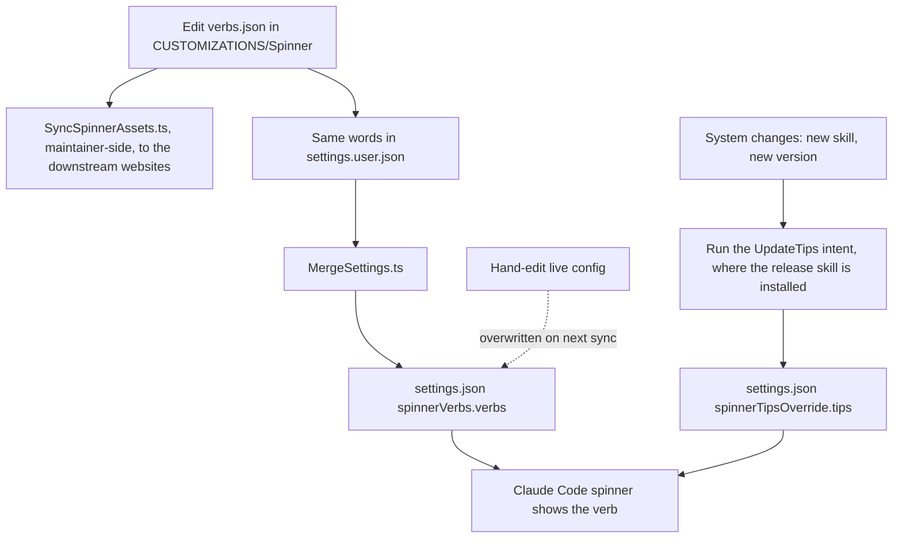

# Custom Spinner Verbs

While LifeOS works, Claude Code's spinner doesn't just show a generic word — it shows a custom animated **working-verb** with your own vocabulary, icon, color, and animation. It's a small thing that makes the system feel like yours instead of a stock tool. Alongside the verb, a rotating set of **tips** surfaces short, current facts about the system while you wait.

Verbs and tips are two distinct features that share Claude Code's spinner:

- **Spinner verbs** — the animated working word ("Composing", "Forging", "Climbing") plus its icon, color, and animation.
- **Spinner tips** — the informational strings that rotate during longer work, kept in sync with the system's real state.

## Spinner verbs

The verb vocabulary and its styling are defined once as customization assets and pushed to the live config.

- **Source of truth:** `LIFEOS/USER/CUSTOMIZATIONS/Spinner/` — `verbs.json` (the working words), `icons.json`, `colors.json`, `anims.json`, plus a `README.md`. The same vocabulary is mirrored in the settings source so the terminal and the websites say the same words.
- **Live config:** `settings.json` → `spinnerVerbs.verbs`, generated by `MergeSettings.ts` from `USER/CONFIG/settings.user.json`. Edit the settings SOURCE, never the generated file.
- **Sync tool (maintainer tree, not in the release payload):** `LIFEOS/TOOLS/SyncSpinnerAssets.ts` copies verbs/icons/colors/anims from the customization dir to the downstream web projects that render the same spinner. It does NOT write `settings.json` — the terminal vocabulary comes from the settings source via `MergeSettings.ts`. Its targets are principal-specific, so a public install edits `spinnerVerbs.verbs` in its own settings source.
- **Renderer:** Claude Code's own spinner reads `spinnerVerbs` and `spinnerTipsOverride` from `settings.json`. `LIFEOS/LIFEOS_StatusLine.sh` draws neither.

To change the vocabulary, edit `verbs.json` in the customization directory, copy the list into `spinnerVerbs.verbs` in the settings source (`USER/CONFIG/settings.user.json`) and regenerate `settings.json` with `MergeSettings.ts`. On the maintainer tree, also re-run the sync tool so the websites pick it up. Never hand-edit `settings.json`.

**Verbs follow your favorites.** `themes.json` beside `verbs.json` maps each book or show to the verbs drawn from it. A favorite is a `loved` title in the MediaTaste database (`USER/MEDIA/media.jsonl`) or a hand-curated entry rated 8 or higher in `USER/BOOKS.md`, and each needs at least three verbs built on real in-world terms. The `/ic` `spinner-verbs` check blocks when a favorite has fewer, when a theme names a verb that no longer exists, when a dropped or disliked work still has themed verbs, when two verbs differ only in case, or when `verbs.json`, `settings.user.json` and `settings.json` disagree.

## Spinner tips

The tips are short informational strings shown during longer operations. They're kept accurate against the current system — skill counts, hook counts, version strings — by a dedicated maintenance intent.

- **Live config:** `settings.json` → `spinnerTipsOverride.tips`.
- **Maintenance:** the UpdateTips intent of the release/maintenance skill (`/ut` where that private command is installed; not shipped) re-checks every tip against the system as it is and adds verbs for new favorites. `/ud` runs it on every pass, so staleness never outlives a docs update. Without it, edit `spinnerTipsOverride.tips` in the settings source by hand.
- **Gate:** the maintainer-side `ic` `spinner-tips` check blocks on source→generated drift, duplicate tips, stale version strings and counts, a tip naming a skill or hook that is gone or a capability in the retirement registry, and a slash command with no tip. It cannot tell when a tip's sentence went false about a feature that still exists; the `/ud` refresh and the `/ic --deep` spinner row cover that.

## Examples

### Adding a working-verb the right way

Someone wants the statusline to say "Foraging" while long jobs run. The verb vocabulary is a customization asset, so the edit goes to the source first; the live config is derived from it (copy the list into the settings source and regenerate with `MergeSettings.ts`; the sync tool only feeds the websites):

1. Add `"Foraging"` (with its icon, color, and animation entries) to the JSON under `LIFEOS/USER/CUSTOMIZATIONS/Spinner/`.
2. Add the same word to `spinnerVerbs.verbs` in the settings SOURCE (`USER/CONFIG/settings.user.json`) and regenerate `settings.json` with `MergeSettings.ts`; on the maintainer tree also run `SyncSpinnerAssets.ts` so the downstream websites pick it up.
3. Claude Code's spinner picks it up from `settings.json` on the next spin.

Editing `settings.json` directly would work for one session and then get overwritten. The customization dir is the source of truth. The sync tool only mirrors it to the websites; the live config moves by copying `verbs.json` into the settings source and running `MergeSettings.ts`, and `/ic` `spinner-verbs` blocks until the three copies agree.

### When the tips go stale

Verbs are cosmetic; tips make a factual claim — skill counts, hook counts, version strings — so they rot when the system changes underneath them. After adding a skill or cutting a release, the fix is not to hand-edit `spinnerTipsOverride.tips`; it is to run the UpdateTips intent (`/ut` where installed; not shipped), which re-audits every tip against the current counts and versions and rewrites the stale ones. Same principle as the verbs: change the system, then run the tool that reconciles the surface to it.

Both halves of the spinner follow one rule: the source of truth is upstream of the live config, and a tool — never a hand edit — reconciles them. The dashed path is the anti-pattern the whole design exists to prevent.

---

## Related

- These render in Claude Code's own spinner; the statusline (`LIFEOS/LIFEOS_StatusLine.sh`) is a separate surface.
- Pulse — the Life Dashboard: `LIFEOS/DOCUMENTATION/Pulse/PulseSystem.md`
- LifeOS maintenance (the UpdateTips intent lives here; its `/ut` shortcut is private, not shipped): the release/maintenance skill.
