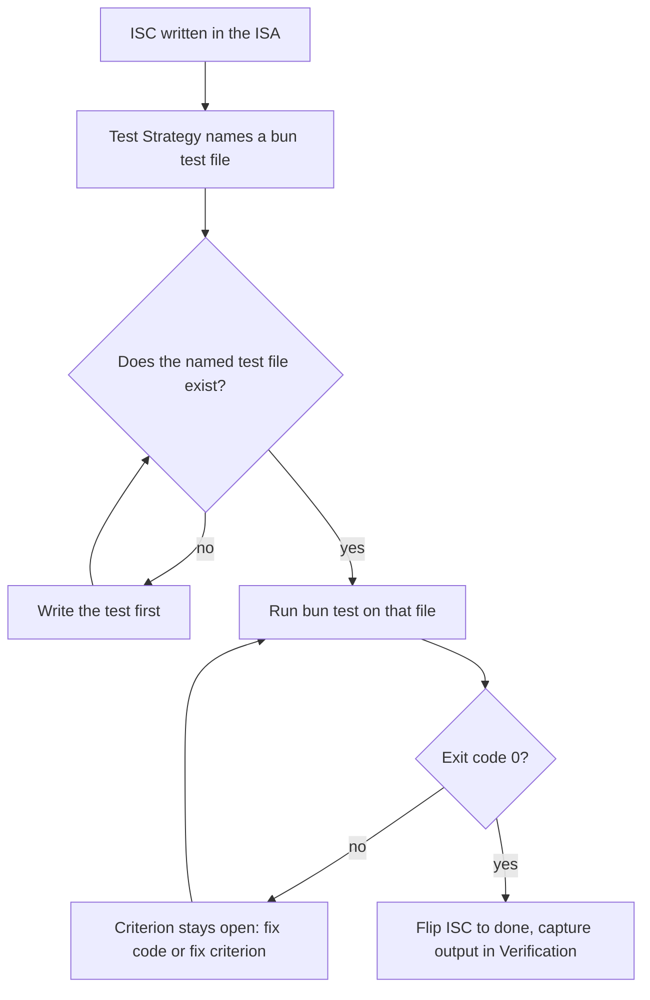

# LifeOS Testing Doctrine

> Testing is how the Life OS knows what it knows (`LIFEOS/DOCUMENTATION/LifeOs/LifeOsThesis.md`): the hill-climb only counts when each step is verified, and `bun test` is the canonical probe behind every ISC. An unverified gap-closure is a guess wearing a checkmark.

> **TL;DR.** Tests for LifeOS run on `bun test`. The shared harness lives at `~/.claude/test/harness.ts` (source tree only; not in the release payload) and exports zero-external-dep helpers (`lifeosTestEnv`, `lifeosBunExe`, `lifeosTempDir`, `paiHomeScope`, `paiCwdScope`, `normalizeOutput`, `captureProc`, platform predicates). Most tests sit beside the code they cover (about 1,100 tracked `*.test.ts` files under `LIFEOS/`, `skills/` and `hooks/`); the `~/.claude/test/` tree (source tree only; not in the release payload) holds the harness and 57 cross-subsystem suites. Coverage is corpus-based: every documented hook, skill intent, and tool surface gets at least one test file. No retries, no hardcoded ports, no time-based waits, no per-test timeouts. Every ISC carries at least one executable assert as a `## Test Strategy` row; Assay resolves each row at the cheapest honest tier, and `bunker test` is the row engine that runs the table when Development Test or the deploy probes call it (deterministic rows execute, `eval` rows dispatch to EvalRunner, `manual` rows report as named exceptions), and `bun test ./path/to/foo.test.ts` is its deterministic engine — the canonical shape of a `bun-test` row.
> The Bunker CLI is maintainer-private and not in the public release; run code rows with `bun test ./<path>` and suite rows with `bun skills/Assay/Tools/EvalRunner.ts`.

> **Status (public installs):** the harness and `test/` tree described here are NOT yet included in the public release payload (public issue #1550) — releases through 7.3.6 shipped them; the 7.4+ single-skill `install/` layout dropped them, and re-inclusion is a pending packaging decision. On a public install, treat this doctrine as the specification the system is converging on: `bun test` remains the canonical probe wherever a test exists, and the harness here is the Phase 1 skeleton (243 lines, 18 exports), not the full Bun-scale harness the table below describes as its inspiration.

**In the quality loop** (concept: `../LifeOs/HillClimbing.md`):

- **Owns:** how code is tested (`bun test`, the shared harness) and how a code probe becomes an ISA row.
- **Never does:** judges output quality, or stands in for Assay. A passing test says the code behaves; it says nothing about the thing one run produced.
- **Reads:** ISA Test Strategy rows, resolved by Assay; Development Test executes them, calling the `bunker test` row engine for registered apps.
- **Writes:** test results. The `bunker test` row engine records them to the run ledger.

This document is the result of a deep analysis of how the Bun project itself (`oven-sh/bun`) achieves its reputation for thorough test coverage and harness discipline, mapped onto LifeOS's TypeScript surface. Citations to Bun source are inline.

---

## Why this doctrine exists

LifeOS ships a lot of TypeScript across hooks, skills, tools, Pulse, Workflows Workers, and the release pipeline. Verification has been ad-hoc — `curl` checks, manual `bun run` invocations, eyeballing diffs. Several recurring failure modes (silent OAuth/API-key billing, identity-grep gates, ISA parsing, Pulse VoiceServer, the TheRouter classifier, retired 2026-07-11) are exactly the class of bugs a real harness catches.

The ISA already declares the test surface (Algorithm v6.3.0 doctrine: *"the ISA IS the test harness because the ISCs are the tests"*). What's been missing is the *invocable probe* behind each ISC. This doctrine closes that gap by making every ISC carry an assert row that Assay resolves (executed through Development Test and the `bunker test` row engine), with `bun test ./path/to/foo.test.ts` as the canonical deterministic engine behind a `bun-test` row — testability implemented as asserts within evals, not left as prose.

---

## What we adopt from Bun

| Pattern | Bun source | LifeOS adoption |
|---------|-----------|--------------|
| **Single shared harness, zero external deps** | `test/harness.ts` (1985 lines, 98 exports, header comment forbids external deps) | `~/.claude/test/harness.ts` (source tree only; not in the release payload) |
| **Parallel `test/` tree mirroring API surface, not co-location** | `src/bun.js/api/spawn.zig` → `test/js/bun/spawn/*.test.ts` | Not the default: a test sits beside the code it covers (rule 2), and `test/` holds the harness and cross-subsystem suites |
| **Subprocess testing for CLI behavior** | 591 of 1526 test files spawn `bun` | `Inference.ts`, hook handlers tested via `Bun.spawn` (the former `TheRouter.hook.ts` suite was removed with the hook, 2026-07-11) |
| **`tempDir` with `DisposableString`** | `test/harness.ts:263-294` | `lifeosTempDir(prefix, fileMap)` returns `using`-disposable |
| **Scrubbed env constant** | `bunEnv` in `test/harness.ts:50-104` | `lifeosTestEnv` scrubs API keys and OAuth tokens and forces UTC, no color and CI=1 |
| **`await using proc` + 3-way `Promise.all`** | `test/cli/heap-prof.test.ts` | Standard subprocess capture pattern |
| **Inline snapshots with normalization** | `test/js/web/console/console-log.test.ts:75-150` | Strip absolute paths, ISO timestamps, ANSI codes before snapshot |
| **Platform predicates** | `isMacOS`, `isLinux`, `isCI`, `isFlaky`, `isMusl`, etc. | `isCI`, `isMacOS`, `isFlaky`, `isLifeosDev` |
| **Custom matchers via module augmentation** | `expect.extend({toRun, toThrowWithCode, …})` with `declare module "bun:test"` | None yet: the harness exports no custom matchers |
| **`test.todoIf` for flake demotion (not retry)** | `isFlaky = isCI; test.todoIf(isFlaky && isMacOS)("…")` | Same — flakes get tagged + tracked, never retried |
| **Regression test convention `test/regression/issue/{N}.test.ts`** | Same path | `test/regression/{slug}.test.ts` keyed by ISA decision IDs |
| **Multiple validation passes (LeakSan, exception-validation, expectations)** | `leaksan.supp`, `no-validate-*.txt`, `expectations.txt` | Phase 2: extend beyond pass/fail correctness |
| **Corpus-based coverage** | Vendor entire upstream Node test corpus (2208 files) | Every hook/skill/tool gets ≥1 test file; no global percentage gate |
| **Anti-flakiness as written-down doctrine** | `test/CLAUDE.md` rules (no hardcoded ports, no time waits, no per-test timeouts) | This document |

---

## What we deliberately don't adopt

- **Vendoring an upstream test corpus.** Bun vendors the Node.js test suite (2,208 files) for compatibility coverage. LifeOS has no upstream corpus to vendor; coverage emerges from the surface inventory (every hook, every skill intent, every TOOLS/*.ts).
- **Buildkite CI matrix.** Bun runs cross-OS / cross-arch matrices on Buildkite. LifeOS's deployment surface is the principal's Mac + cloud Workers. GitHub Actions is sufficient when CI lands; for now tests run locally and on Pulse.
- **`Bun.bench` integration.** Out of scope. Performance regression tests come later if needed.
- **Mocha shim (`runners/mocha.ts`).** Bun aliases `bun:test` globals to Mocha names so upstream Mocha-shaped tests run unchanged. LifeOS has no Mocha-shaped tests to import.
- **`__mocks__` directory and auto-mocking.** Bun explicitly does not support these yet; LifeOS follows.

---

## Doctrine — the rules

These are non-negotiable. Violations get caught at the ISA `## Test Strategy` review or at the VERIFY-phase cross-vendor audit (Astra audit mode).

### 1. The harness is `~/.claude/test/harness.ts` (source tree only; not in the release payload). Zero external deps.

It must be importable before `bun install` runs. It depends only on Bun built-ins (`Bun`, `bun:test`, `node:fs`, `node:path`, `node:os`). Adding a dependency to `package.json` for the harness is a CRITICAL FAILURE.

### 2. A test sits beside the code it covers; the top-level `test/` directory holds the harness and cross-subsystem suites.

`bun run test` runs the tracked `*.test.ts` under `LIFEOS/` and `skills/` (`test:tracked`), then `test/` (`test:suite`), then `hooks/` from its own cwd (`test:hooks`). Map:

| Source | Test |
|--------|------|
| `hooks/<Hook>.hook.ts` | `hooks/<Hook>.hook.test.ts` |
| `skills/<Skill>/Tools/<Tool>.ts` | `skills/<Skill>/Tools/<Tool>.test.ts` |
| `LIFEOS/PULSE/modules/synapse.ts` | `LIFEOS/PULSE/modules/synapse.test.ts` (not in the public release) |
| `LIFEOS/TOOLS/ISAGate.ts` | `LIFEOS/TOOLS/ISAGate.test.ts` (not in the public release) |

Snapshot files sit in a `__snapshots__/` directory beside the test file (Bun's default).

**Subsystem-package clause.** A directory-tool with its own `package.json` (`LIFEOS/TOOLS/<tool>/`) keeps its suite in-package at `<tool>/test/` with a `package.json` `test` script — the suite travels with the deployable package. Single-file tools keep their suite beside the file, and the in-package `test/` directory is the same pattern at package scope. `bun run test` reaches in-package suites through `test:tracked`, so corpus coverage loses nothing. (Public PR #1603, @anikinsasha.)

### 3. Every test file is independently runnable.

`bun test ./hooks/Foo.hook.test.ts` works in isolation. No file depends on another file's globals or setup. If shared setup is needed, it goes in `test/preload.ts` and is loaded via bunfig.

### 4. Every test uses `lifeosTestEnv`, never `process.env`.

```ts
import { lifeosTestEnv, lifeosBunExe } from "../harness";

await using proc = Bun.spawn({
  cmd: [lifeosBunExe(), "LIFEOS/TOOLS/Inference.ts", "--level", "low"],
  env: lifeosTestEnv,  // never process.env
  stdin: "pipe",
  stdout: "pipe",
  stderr: "pipe",
});
```

`lifeosTestEnv` scrubs `ANTHROPIC_API_KEY`, `ANTHROPIC_AUTH_TOKEN`, `CLAUDE_CODE_OAUTH_TOKEN`, `OPENAI_API_KEY`, `ELEVENLABS_API_KEY`, `STRIPE_SECRET_KEY`, `GITHUB_TOKEN`, every `BUN_DEBUG_*` except the quiet-logs flag, every `BUILDKITE*`, and forces `TZ=Etc/UTC`, `CI=1`, `NO_COLOR=1`. It keeps the real `HOME`; use `paiHomeScope` to point a test at a fixture home.

### 5. Subprocess capture uses the 3-way `Promise.all` pattern.

```ts
const [stdout, stderr, exitCode] = await Promise.all([
  proc.stdout.text(),
  proc.stderr.text(),
  proc.exited,
]);
```

Anything else risks deadlock when one pipe fills.

### 6. Disposable scopes for everything mutable.

- `using dir = lifeosTempDir("test-name", { "fixture.txt": "..." });` — auto-cleanup
- `using restore = paiHomeScope("/tmp/fake-home");` — restore env on dispose
- `using restore = paiCwdScope("/tmp/elsewhere");` — restore cwd on dispose
- `await using proc = Bun.spawn(...);` — auto-kill child on dispose

Never a manual `try/finally` for resource cleanup. Use the language's `using`.

### 7. Snapshots are normalized before comparison.

```ts
const normalized = stdout
  .replaceAll("\r\n", "\n")
  .replaceAll(String(dir), "<tempdir>")
  .replaceAll(/\d{4}-\d{2}-\d{2}T\d{2}:\d{2}:\d{2}(\.\d+)?Z/g, "<iso-timestamp>")
  .replaceAll(/\(\d+:\d+\)/g, "(N:NN)")
  .replaceAll(/\x1b\[\d+m/g, "");

expect(normalized).toMatchInlineSnapshot(`...`);
```

Drift in line numbers, timestamps, temp dirs, or ANSI codes must NOT cause a snapshot diff. Drift in actual content MUST cause a diff.

### 8. Mocking the `claude` subprocess.

Tests of `Inference.ts` and anything that calls `claude` MUST NOT actually invoke OAuth-billed Claude. Two options:

```ts
// Option A — mock Bun.spawn at module level
import { mock } from "bun:test";
mock.module("bun", () => ({
  ...await import("bun"),
  spawn: mockClaudeSpawn,
}));
```

```ts
// Option B — point Inference.ts at a fixture-replay subprocess
const proc = Bun.spawn({
  cmd: [lifeosBunExe(), "LIFEOS/TOOLS/fixtures/fake-claude/claude"],
  env: lifeosTestEnv,
});
```

Use Option B (subprocess-replay) when the test needs the real `Inference.ts` argv-parsing behavior; Option A when only the response shape matters.

### 9. No retries. No hardcoded ports. No time waits. No per-test timeouts.

- Retry: banned. A flaky test is `test.todoIf(isFlaky)` with a tracking entry.
- Hardcoded port: banned. Use `port: 0` and capture the assigned port.
- Time wait: banned. `await Bun.sleep(N)` to wait for state is wrong. Wait on the condition (file exists, port responds, process exited).
- Per-test timeout: banned. The 5,000ms default is the contract. If a test needs more, it's structurally wrong — split it.

### 10. Anti-criteria are first-class ISCs.

Every ISA `## Criteria` section MUST include at least one `Anti:` ISC. The corresponding test asserts the regression does NOT happen:

```ts
test("Anti: ANTHROPIC_API_KEY is not present in spawned env", async () => {
  await using proc = Bun.spawn({ ... });
  // ...
  expect(spawnedEnvSnapshot).not.toContain("ANTHROPIC_API_KEY");
});
```

### 11. A state-machine edge test must PRODUCE the edge, never assert from a hand-written state.

If the behavior under test is a transition — open→closed, stale→fresh, first-time→repeat — the test drives the system across it. Writing the precondition directly into the state file, the registry, or the fixture tests the *consequence* of the transition while leaving the code that causes it unexecuted.

```ts
// WRONG — pins the reset, not the thing that arms it.
st.runWasOpen = true; writeFileSync(stateFile, JSON.stringify(st));
expect(call()).toBeNull();

// RIGHT — the edge happens because the system observed it happen.
writeWork("climbing", "2/7");   // an OPEN run
for (let i = 0; i < 40; i++) call();
writeWork("complete", "7/7");   // now CLOSED — the transition is real
expect(call()).toBeNull();
```

The falsifier is mechanical and worth running once per state machine: **delete the single line that sets the flag and re-run the suite.** If it stays green, the test is decoration.

This rule was bought expensively. In one run (2026-07-30) the same displacement landed three times, and every instance read as passing coverage:

- tests exercised an extracted predicate while the call site kept the bug — deleting the guard left 50 tests green;
- the fix for that produced a test that hand-wrote `runWasOpen = true` into the state file, so deleting the one line that sets it left 58 tests green and silently restored a misfire incident from three weeks earlier;
- the telemetry channel added to make silence visible was filled entirely with its own test output — 8 lines, zero production entries.

The shared failure: a guard's own test was the thing that didn't guard. Corollary — **any file a test writes to must be path-overridable by env var**, or the test's evidence contaminates the production signal it exists to protect.

### 12. Property tests use `fast-check` as the single approved primitive.

`fast-check` (MIT, zero runtime deps, native `bun:test` integration) is the one approved property-testing primitive. **No `jsverify`, no `quickcheck-js`, no hand-rolled property runners.** Adding any alternative property-testing dependency to `package.json` is a CRITICAL FAILURE.

Integration form:

```ts
import { test, expect } from "bun:test";
import * as fc from "fast-check";

test("reverse is self-inverse", () => {
  fc.assert(
    fc.property(fc.array(fc.integer()), (xs) => {
      expect(reverse(reverse(xs))).toEqual(xs);
    }),
    { numRuns: 1000 },
  );
});
```

Property tests sit beside the code they cover, next to the example tests (rule 2), with `.property.test.ts` suffix to distinguish. Failing properties emit shrunk counterexamples that auto-promote to permanent regression cases — pin the seed in a comment when you copy the counterexample into an example test (`// fc seed: 0x...`).

**In substantial work**, every pure-function ISC SHOULD have at least one property-form ISC row in `## Test Strategy`. The granularity rule applies: each property is one binary probe (passes when the property holds across all `numRuns` invocations). The new ISC type is `bun-property` — see `LIFEOS/DOCUMENTATION/ISA/ISAFormat.md` § ISC Type Vocabulary for schema, and `skills/Hardening/Intents/PropertyTest.md` for candidate detection and the ten property categories (round-trip, idempotency, commutativity, associativity, identity, conservation, model-based, metamorphic, state-machine, oracle).

**Worked Anti-ISC universal-form example.** The example-shaped Rule #10 anti-ISC catches one named variable. The universal-form version catches the API-key class:

```ts
test("Anti: no API-key-shaped env var leaks into spawned subprocess", () => {
  fc.assert(
    fc.property(
      fc.dictionary(fc.stringMatching(/^[A-Z_]{4,32}$/), fc.string()),
      (envOverrides) => {
        const spawned = spawnWithEnv({ ...lifeosTestEnv, ...envOverrides });
        const apiKeyVars = Object.keys(spawned.env).filter((k) =>
          /API_KEY|AUTH_TOKEN|OAUTH/i.test(k),
        );
        expect(apiKeyVars).toEqual([]);
      },
    ),
    { numRuns: 1000 },
  );
});
```

This is strictly stronger than the example form — it catches `ANTHROPIC_API_KEY`, `OPENAI_API_KEY`, and the next vendor's key the author hasn't bought yet. **In substantial work, this is the default Anti-ISC shape.**

---

## bunfig.toml

LifeOS's test config lives at `~/.claude/bunfig.toml` (source tree only; not in the release payload) `[test]` section:

```toml
[test]
preload = ["./test/preload.ts"]
pathIgnorePatterns = [
  "**/node_modules/**",
  "**/LIFEOS/LIFEOS_RELEASES/**",  # shadow releases — no tests
  "**/LIFEOS/MEMORY/**",         # ephemeral session data
  "**/LIFEOS/USER/MEMORY/**",    # USER is a symlink; bun follows it into MEMORY a second time
  "**/codex-home/**",
  "**/.git/**",
]
coverageSkipTestFiles = true
coverageReporter = ["text", "lcov"]
coverageDir = "coverage"
coveragePathIgnorePatterns = [
  "**/node_modules/**",
  "**/test/**",
  "**/LIFEOS/LIFEOS_RELEASES/**",
  "**/LIFEOS/MEMORY/**",
]
# Per-critical-path thresholds. Set on a tightly-scoped subset, never the whole tree.
# coverageThreshold = { line = 0.8, function = 0.9, statement = 0.85 }
```

`bun run test` from `~/.claude/` is the full suite: `test:tracked` enumerates every git-tracked `*.test.ts` under `LIFEOS/` and `skills/` and passes them as explicit `./` paths (no discovery walk), then `test:suite` (`test/`) and `test:hooks` (`hooks/`, which must run from its own cwd) run as before, then typecheck. A bare `bun test` from the root is never the command here — see the gotcha below.

**Verified gotcha (2026-09-05): `bun test` and `bun test <filter>` discover tests by walking the ENTIRE tree under the cwd, symlinks followed, and the walk exhausts file descriptors once it visits on the order of 10⁵ entries — `EMFILE` / `ProcessFdQuotaExceeded` reading `test/preload.ts` or the test file itself, even with `ulimit -n` at the kernel cap.** Measured: a walk of `skills/` (28k entries) is clean; a walk of the USER tree alone (213k entries, 28k dirs) dies; the repo root is 675k entries with `LIFEOS/LIFEOS_RELEASES/` (not in the public release) (440k, gitignored) and the two USER/MEMORY symlinks (~350k) followed. `pathIgnorePatterns` filters matches and does not stop the walk. Resolved the same night without a migration: a `./`-prefixed argument makes bun treat it as a PATH and skip discovery entirely (`bun test ./LIFEOS/TOOLS/ISAGate.test.ts` from the root: 25 tests in 35 ms), so every `bun-test` row carries the `./` prefix, and `bun run test` enumerates git-tracked test files as explicit paths (233 files, 3018 tests, 34 s from the root). The staged-release tree was also pruned to the newest five cuts (152 removed, 4.0 GB → 152 MB), which brings the root walk to 282k entries — still over the line, so the runner and the prefix are the rule, not the prune. `bun test <bare filter>` from the root remains the one unrunnable shape.

---

## ISA integration

The ISA `## Test Strategy` table's `tool` column gets a new canonical form:

```
| isc | type | check | threshold | tool |
|-----|------|-------|-----------|------|
| ISC-7 | bun-test | ANTHROPIC_API_KEY scrubbed from spawned env | env-snapshot diff | bun test ./test/tools/Inference.test.ts -t "Anti: API key" |
```

When an ISC's `tool` value starts with `bun test`, the named test file MUST exist before `[ ]` → `[x]`. The Algorithm's modality rule (`LIFEOS/ALGORITHM/v8.45.0.md` § A run is complete when, item 8) takes the same row:

| ISC type | Minimum verification tool call |
|----------|-------------------------------|
| `bun-test` | `bun test ./<file>:<-t pattern>` exits 0 (the `./` prefix makes bun treat it as a path and skip discovery); output captured in `## Verification` |

The `bunker test` row engine enforces it row by row: `bun test` is the probe when the `tool` column says so.

### Multi-context-window state (long-horizon runs)

When a single Algorithm run spans multiple context windows — a Workflow written for the task, or any task large enough to compact mid-flight — the ISA `## Test Strategy` is the human-readable spec, but the model also needs a machine-readable state file it can re-read after a context reset. Per Anthropic's Opus 4.8 long-horizon guidance (mirrored in `skills/Prompting/Standards.md` § Multi-Context Window Work):

- **Mirror the probes into a structured `tests.json`** in the work slug dir (`LIFEOS/MEMORY/WORK/{slug}/tests.json`): one row per ISC probe with `{id, name, status: passing|failing|not_started}` plus rollup counts. Opus 4.8 is "extremely effective at discovering state from the local filesystem" — a structured status file beats re-deriving progress from a degraded long context.
- **Write a setup script (`init.sh`)** in the slug dir that starts servers, runs the suite, and restores state, so a fresh window doesn't repeat the standup work.
- **Prefer a fresh window over aggressive compaction** when state lives in files. Start the new window prescriptively: read the ISA, read `tests.json`, run `init.sh`, run one integration probe before resuming feature work.
- **Never edit or delete a test to make a window pass** — that loses functionality across the boundary. The ISA `## Test Strategy` is the contract; `tests.json` is its live status mirror, not a place to relax it.

`tests.json` is optional for single-window runs (the ISA already carries the probes). It earns its place only when the run will cross a context boundary.

### Relationship to the Assay skill

Every judged check, here and anywhere else in LifeOS, runs through Assay; no tool carries its own judge prompt or grading loop (`LIFEOS/DOCUMENTATION/Assay/AssaySystem.md` § One eval system).

`Skill("Assay")` evaluates *outputs*: one produced artifact against the ask it answered (Proof), a skill or prompt against a suite (EvalRunner, pass^k, model-vs-model comparison), and ISA rows of the judged classes (Assay resolves every row at the cheapest honest tier; the `bunker test` row engine executes them for registered apps). It checks what came out, never the path that produced it. `bun test` evaluates *code correctness* — does this function return the right value, does this hook write the right output, does this CLI exit with the right code.

They're complementary, and since 2026-08-31 they meet in one place, the ISA's Test Strategy: **every ISC carries one or more asserts** (deterministic or judged; `manual` rows are the first rung of the attested → judged → deterministic ladder, not a permanent class), and the `bunker test` row engine (called by Development Test) executes both classes — deterministic rows directly, `eval` rows dispatched to EvalRunner via `suite:<name>` in the tool cell, `pairwise` rows to the Assay skill's `Tournament.ts` (a flipped bracket; exit 0 is a stable winner). The assert-coverage gate (`ISAGate` H8, ISAFormat v2.24.0) hard-blocks a new ISA closing with a criterion that has no Test Strategy row. Neither runner replaces the other; the ISA row's `type` column picks the engine.

Since ISAFormat v2.27.0 (2026-09-08) a row also carries a **lane** and a **stage**. The lane (the `tier` cell: `liveness`, `integrity`, `build`; `fast`/`deep` are aliases) says what the row proves and therefore how often it may run: liveness rows run on every tick and in the deploy gate and are deterministic by contract — an `eval` row there is a dropped row, and the runner strips vendor keys and sets `LIFEOS_INFERENCE_DISABLED` so a script that reaches inference fails; integrity rows run on Bunker's clock and may dispatch a judge; build rows run only under `bunker test --deep`. The stage (ninth column, default 1 for asserts and 2 for the judged types `eval` and `pairwise`) orders a criterion's rows so the cheap assert runs first and a failing one marks the judge row `gated` — never executed, never a pass. A `bun test` row and an `eval` row on the same criterion is the normal shape: the assert proves the artifact exists and has the right bones, the judge grades what the assert cannot, and only after the assert passes.

Tournament evidence establishes relative selection, while an absolute quality criterion needs its own asserts, rubric, or explicit attestation. The shared contract is ISAFormat § Verifier classes, lanes, and stages and `skills/Assay/SKILL.md` § Selection, acceptance, and unavailable evidence. No evaluator outage or malformed verdict may count as an adversarial catch. Missing trials remain incomplete verification, never reliability measured over the requested full trial count.

**Proof checks outputs, not code (2026-09-29).** `bun test` and the ISA rows prove a skill or system behaves. They say nothing about whether the film, image, page or document one run produced is what was asked. Assay's Proof layer (`skills/Assay/Intents/Proof.md`) covers that. It compiles the brief into checks that quote their source, reports a plan that dropped a brief fact before anything is built, and proofs the first draft in seconds (code from OCR and geometry, judgment-layer flags over artifact-derived state). It writes a byte-bound receipt that `ProofGate` (maintainer-side; not in the public release) and `Deliver.ts` require before an artifact is opened or handed over. An ISA criterion about an output can close on that receipt with a `bash` row running `Proof.ts receipt --artifact <file>`.

### Relationship to Interceptor

`Skill("Interceptor")` is for browser-based UI verification — real Chrome, real screenshots, real DOM. `bun test` is for everything else (CLIs, hooks, library code, ISA intents, classifier outputs).

If a test needs to render a webpage and inspect the DOM → Interceptor. Otherwise → `bun test`.

---

## Adoption sequence

1. **Phase 1 (this work).** Doctrine doc, `bunfig.toml`, `test/harness.ts` skeleton, one reference test (`test/tools/Inference.test.ts`) proving the path. → THIS DELIVERABLE.
2. **Phase 2.** Cover the load-bearing critical paths: `Inference.ts`, `ISASync.hook.ts`, `RemoveTrailingNewline.hook.ts`, `Pulse VoiceServer`, every release-gate handler, the ISA Append intent's C/R/L parser. Per-path coverage threshold at 80% line. (`TheRouter.hook.ts` was on this list until it was retired 2026-07-11.)
3. **Phase 3.** Cover every active skill intent (Scaffold, Append, Seed, CheckCompleteness for ISA; equivalent core paths for other skills).
4. **Phase 4.** Add the validation-pass layers: a `lifeos-doctrine.test.ts` that asserts `CLAUDE.md` and `LIFEOS_SYSTEM_PROMPT.md` cross-references resolve; a `lifeos-secrets.test.ts` that asserts no API keys leak into the public release staging dir.
5. **Phase 5.** Wire `bun test` into the VERIFY-phase tool-table rule of the next Algorithm minor version.

Phases 2–5 are tracked separately as PROJECTS.md entries; they're not part of this ISA's deliverable.

---

## Anti-patterns (do not do)

- ❌ Bare `bun test` or `bun test <filter>` from the repo root. It walks the whole tree and runs out of file descriptors (see the bunfig gotcha); use `bun run test`, or `bun test ./<path>`.
- ❌ Adding Jest, Vitest, Mocha, AVA, ts-node, ts-jest, sinon, jest-mock to LifeOS's `package.json`. CONSTITUTIONAL FAILURE.
- ❌ Setting a global `coverageThreshold = 1.0`. Gamification trap; incentivizes shallow tests.
- ❌ Adding a `--retry 3` flag to any test invocation in CI. Banned.
- ❌ Hardcoding port `31337` in a Pulse test. Use `port: 0` and capture.
- ❌ `await Bun.sleep(2000)` to "let the hook finish." Wait on the actual signal.
- ❌ Reading real `~/.claude/LIFEOS/USER/PRINCIPAL/PRINCIPAL_IDENTITY.md` from a test. Use a fixture.
- ❌ Spawning real `claude` subprocess in a test. Use a fixture-replay subprocess.
- ❌ Inventing an `acceptance.yaml` or `acceptance.ts` parallel to the ISA. The ISA IS the test harness.
- ❌ Closing a criterion on a log field, error string, or exit-code message without first checking that the field can vary. A capture path that records the same text on every failure is not evidence. See § The instrument must be able to report failure.
- ❌ Resolving an env-derived data dir at module import time (`const DIR = process.env.X_DIR ?? default`). `bun test` runs every file in ONE process, so the first importer pins the dir for every later suite — and a later suite's writes can land in the real USER tree. Resolve per call (`const dir = () => process.env.X_DIR ?? default`). Found 2026-09-05 by bisecting a polluted run: State.ts and VERA/Store.ts.
- ❌ A test that assumes `process.cwd()` is the repo root, or that sets a fake `HOME` without also owning the cwd. Suites run from the root by explicit `./` paths (`bun run test`); `hooks/` is the one cwd-bound tree and runs from its own dir.

---

## Examples

### One criterion, closed by one probe

Here's the doctrine at its smallest — a tiny utility, `slugify(title)`, that turns a post title into a URL slug. The ISA states done as a criterion and names the probe that closes it:

```
## Criteria
- [ ] ISC-3: slugify lowercases, hyphenates, and is idempotent — slugify(x) equals slugify(slugify(x)).

## Test Strategy
| isc   | type     | check                             | tool                                 |
| ISC-3 | bun-test | idempotent + lowercase-hyphenated | bun test ./test/tools/slugify.test.ts  |
```

The rule is mechanical: the `tool` column starts with `bun test`, so `[ ]` → `[x]` is not allowed until `test/tools/slugify.test.ts` exists and exits 0. "I ran it in my head" doesn't flip the box. A green run does. That's the whole bridge from a written criterion to a verified one.

### The probe that fits the criterion

`bun test` is the default probe, but it isn't the only one — the criterion's modality decides which instrument is honest:

- **A pure function** ("slugify is idempotent") → `bun test`. It's code correctness, checked in-process.
- **A rendered page** ("the toggle flips the theme on a phone viewport") → Interceptor. `bun test` can't see a DOM.
- **An agent's answer quality** ("the summary keeps every key fact") → `Skill("Assay")`. That's judging an output, not asserting a return value.

Reaching for `bun test` on a DOM criterion, or Interceptor on a pure function, is the wrong instrument — the criterion would close on evidence that doesn't actually test it.

### The instrument must be able to report failure

Choosing the right probe is not enough. The probe has to be able to carry the answer back. A capture path that records the same text no matter what happened reports silence, and silence reads as pass.

The common shape is a truncated subprocess `stderr`. When a child process throws, its stderr opens with the runtime's source preamble, so the head of the buffer is the same on every failure and the cause sits at the tail:

```ts
// The child threw, so its stderr begins with Bun's own source preamble:
//   12 |   return JSON.parse(raw);
//                   ^ SyntaxError: Unexpected end of JSON input
// WRONG — slice(0, 200) keeps the head, which is the preamble, never the cause.
state.last_error = res.stderr.slice(0, 200);

// RIGHT — drop the "NN | source" lines, keep the tail, which is the diagnosis.
state.last_error = res.stderr
  .split(/\r?\n/)
  .filter((l) => l.trim() && !/^\s*\d+\s*\|/.test(l))
  .slice(-3)
  .join(" / ");
```

The check is one question: would this field differ if the cause were different? Run the probe against a second, known-different failure and compare the stored text. If both failures produce the same record, the field is an artifact, and any criterion resting on it is unclosed whatever its checkbox says.

Mutation testing (`skills/Hardening`) asks whether a test would fail if the code were wrong. This asks whether the record would differ if the cause were different. They are separate questions, and a suite can pass the first while failing the second. (Ported from public PR #2269, @garthsch.)

### A criterion becoming verified



The checkbox is downstream of a real exit code, never upstream of it. A failing probe forces the same question the Algorithm always asks — is the code wrong or is the criterion wrong? — and only a passing run, captured in `## Verification`, earns the checkmark.

---

## Cross-references

Progressive verification follows ISAFormat's lanes and stages and `skills/Assay/References/Progressive.md`. Frequent checks stay deterministic and token-free; `bunker test --deep --asserts` includes slower deterministic checks. Integrity judges use existing cadence; build judgments and tournaments run explicitly. Failed prerequisites prevent downstream spend. A partial pass proves only selected scope. Judge depth follows measured calibration, never a fixed cascade through agents.

- Algorithm doctrine on ISA-as-test-harness: `~/.claude/LIFEOS/ALGORITHM/v8.45.0.md` § The Loop (the ISA as hill and instrument, each criterion carrying an executable assert) and § A run is complete when
- ISA format spec: `~/.claude/LIFEOS/DOCUMENTATION/ISA/ISAFormat.md`
- Bun test docs: <https://bun.sh/docs/cli/test>, <https://bun.sh/docs/test/writing>, <https://bun.sh/docs/test/lifecycle>, <https://bun.sh/docs/test/snapshots>, <https://bun.sh/docs/test/coverage>, <https://bun.sh/docs/test/mocks>
- Bun's own test doctrine: <https://github.com/oven-sh/bun/blob/main/test/CLAUDE.md>
- Bun harness source: <https://github.com/oven-sh/bun/blob/main/test/harness.ts>
- Working scaffold (this ISA's deliverable): `~/.claude/test/harness.ts`, `~/.claude/test/tools/Inference.test.ts`, `~/.claude/bunfig.toml`

## Related

- **Concept:** `../LifeOs/HillClimbing.md` § 3 (Assay checks outputs; `bun test` checks code).
- **Feeds me:** `../ISA/ISAFormat.md` (each criterion's Test Strategy rows); `../Bunker/BunkerSystem.md` (`bunker test`, the row engine Development Test and the deploy probes call).
- **I feed:** `../Assay/AssaySystem.md` (deterministic asserts reuse the same test engine); `../ISA/ISASystem.md` (proof that a criterion holds).
- **ISA:** this doc's own `## Criteria` and `## Test Strategy` above; the loop's criteria are in the Assay-everywhere ISA (maintainer-side; does not ship).
