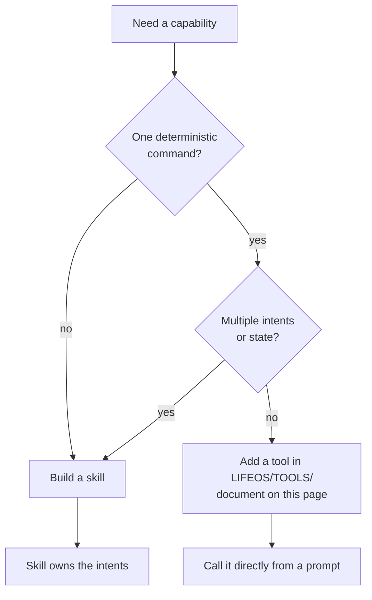

# LifeOS Tools - CLI Utilities Reference

> CLI-first is how the Life OS stays deterministic (`LIFEOS/DOCUMENTATION/LifeOs/LifeOsThesis.md`): the hill-climb's moves are code you can script, test, and trust — prompts orchestrate, code executes.

This file documents single-purpose CLI utilities that have been consolidated from individual skills. These are pure command-line tools that wrap APIs or external commands.

**Philosophy:** Simple utilities don't need separate skills. Document them here, execute them directly.

**Model:** Following the `Tools/fabric/` pattern - 242+ Fabric patterns documented as utilities rather than individual skills.

---

## Inference.ts - Unified AI Inference Tool

**Location:** `~/.claude/LIFEOS/TOOLS/Inference.ts`

**Use this — never import `@anthropic-ai/sdk` directly.** Inference.ts handles auth, retries, timeouts, and LifeOS-specific defaults. Hooks, skills, agents, and ad-hoc Bash all route through it.

Single inference tool with four run levels for different speed/capability trade-offs. On the `anthropic` vendor, max→Fable, high→Opus and medium→Sonnet resolve through `EFFORT_MODEL`, and low is pinned to Haiku in Inference.ts `LEVEL_CONFIG` (2026-10-12; `EFFORT_MODEL.low` is still Sonnet for other callers). OpenAI resolves the same levels through its separate vendor ladder, and a per-install `inference-vendor.json` can pick the vendor per level (`byLevel`).

**Executed-model verification (v6.29.0).** `--level max` genuinely runs Fable (spawns `claude --model` on the fable tier id from `models.ts` `CURRENT`, kept current by `ModelSync.ts`), unlike an `Agent(model:fable)` dispatch which downgrades to Opus — so this is the real Fable carrier for max-level reasoning. Every run reads the executed model back from the JSON envelope's `modelUsage` (`verifyExecutedModel` — filters Claude Code's per-turn background haiku pass, then takes the highest-output model as the answer's author and checks its family; presence alone can't tell a tiny classifier pass from real authorship). The result carries `executedModel` + `modelDowngraded`; the CLI prints a `[model] requested=… → executed=…` line to stderr (stdout stays the clean answer); any downgrade is logged to `MEMORY/OBSERVABILITY/model-verification.jsonl`. The tool reports what RAN, never what it requested.

**Vendor (v1.8.0, 2026-09-07).** The same four levels run on either of two vendors. `anthropic` is the `claude` CLI on the subscription, unchanged. `openai` runs every level through `codex exec` on the ChatGPT subscription and never touches an API key (`SUBSCRIPTION_ONLY_LEVELS`, 2026-10-12): low→`CROSS_VENDOR.openaiLow` (Luna), medium→`openaiMedium` (Luna at high reasoning, in place of Terra since 2026-10-08), high→`openaiHigh`, max→`openaiMax`. Resolution order: `--vendor` / `options.vendor` → `LIFEOS_INFERENCE_VENDOR` → the per-level `byLevel` pick in `LIFEOS/USER/CONFIG/inference-vendor.json` → its `default` → `anthropic`; that file's `fallback` names the vendor tried when the chosen vendor fails. Doctrine: LifeOS unattended and helper inference (memory curation, session naming, judges) runs on plan subscriptions and never on a LifeOS API key (`OPERATIONAL_PREFERENCES` § Model selection, 2026-10-12); interactive sessions and agents are unchanged.

**Vendor `anthropic-api` (v1.9.0, 2026-10-07, HAI-5).** A third vendor, built and not the default, runs low and medium on the Anthropic Messages API, pay per token on `ANTHROPIC_API_KEY_LIFEOS` (read from the env or `.env`, sent only in the `x-api-key` header): low→`CURRENT.haiku` at low effort, medium→`CURRENT.sonnet` at medium effort, both from `models.ts ANTHROPIC_API_LANE`; high and max fail. The request follows the Haiku 5.5 rules: no sampling parameters, no prefill, effort in `output_config`, text read by block type, a refusal is an error. `expectJson` with `jsonSchema` sends `output_config.format`; without a schema the text is parsed. It never falls back, least of all to the subscription, and logs tokens and dollars to `MEMORY/OBSERVABILITY/anthropic-usage.jsonl`. The transport lives in `AnthropicApi.ts`. The fleet default stays as configured until a live probe on the new key.

**Usage:**
```bash
# Low inference - the configured vendor determines the model
bun ~/.claude/LIFEOS/TOOLS/Inference.ts --level low "System prompt" "User prompt"

# Medium - balanced reasoning, typical analysis
bun ~/.claude/LIFEOS/TOOLS/Inference.ts --level medium "System prompt" "User prompt"

# High - deep reasoning, strategic decisions
bun ~/.claude/LIFEOS/TOOLS/Inference.ts --level high "System prompt" "User prompt"

# Max - hardest reasoning, top tier
bun ~/.claude/LIFEOS/TOOLS/Inference.ts --level max "System prompt" "User prompt"

# With JSON output
bun ~/.claude/LIFEOS/TOOLS/Inference.ts --json --level low "Return JSON" "Input"

# Custom timeout
bun ~/.claude/LIFEOS/TOOLS/Inference.ts --level medium --timeout 60000 "Prompt" "Input"
```

**Run Levels:**
| Level | Model | Default Timeout | Use Case |
|-------|-------|-----------------|----------|
| **low** | Vendor-dependent low lane | 15s | Quick tasks, simple generation, basic classification |
| **medium** | Vendor-dependent medium lane | 30s | Balanced reasoning, typical analysis, decisions |
| **high** | Vendor-dependent high lane | 90s | Deep reasoning, strategic decisions, complex analysis |
| **max** | Vendor-dependent max lane | 120s | Keystone decisions, hardest reasoning (the TheRouter classifier that formerly used this level was retired 2026-07-11) |

**Programmatic Usage:**
```typescript
// From hooks (at ~/.claude/hooks/):
import { inference } from '../../.claude/LIFEOS/TOOLS/Inference';

const result = await inference({
  systemPrompt: 'Analyze this',
  userPrompt: 'Content to analyze',
  level: 'medium',  // 'low' | 'medium' | 'high' | 'max'
  expectJson: true,   // optional: parse JSON response
  timeout: 30000,     // optional: custom timeout
  imagePaths: ['/path/a.png'], // optional: PNG, JPEG, GIF and WebP up to 3.75 MB ride as inline image blocks; any other file goes through the Read tool
  signal: controller.signal,   // optional: abort the call; a running claude or codex child is killed and no fallback follows
});

if (result.success) {
  console.log(result.output);
  console.log(result.parsed);  // if expectJson: true
  console.log(result.usage);   // tokens the claude CLI reported; absent on the codex lane
}
```

**When to Use:**
- "quick inference" → low
- "analyze this" → medium
- "deep analysis" → high
- keystone decisions (classifier) → max
- Hooks use this for sentiment analysis, tab titles, work classification

**Technical Details:**
- The `anthropic` vendor uses the Claude CLI on the subscription (not an API key); the `openai` vendor uses `codex exec` on the ChatGPT subscription
- Disables tools and hooks to prevent recursion
- Returns latency metrics for monitoring, plus the vendor-reported token `usage` when the lane reports one (never a guessed zero)
- Appends each call's model and output tokens to the calling session's model-use log (`lib/ModelUse.ts`), so the statusline lights a lane the harness transcript never sees
- With `--json` / `expectJson`, the outermost `{…}` or `[…]` span that opens first is parsed first, so a one-item array answer stays an array

---

## RemoveBg.ts - Remove Image Backgrounds

**Location:** `~/.claude/LIFEOS/TOOLS/RemoveBg.ts`

Remove backgrounds from images using local `rembg` (no external API).

**Usage:**
```bash
# Remove background from single image (overwrites; renames .jpg→.png)
bun ~/.claude/LIFEOS/TOOLS/RemoveBg.ts /path/to/image.png

# Remove background and save to different path (two paths are always input and output;
# an existing output is replaced)
bun ~/.claude/LIFEOS/TOOLS/RemoveBg.ts /path/to/input.png /path/to/output.png

# Process multiple images, each cut in place (batch needs --batch; three or more
# paths without it are refused)
bun ~/.claude/LIFEOS/TOOLS/RemoveBg.ts --batch image1.png image2.png image3.png
```

**Requirements:**
- `rembg` installed at `~/.local/bin/rembg` (override with `REMBG_BIN` env var)
- Install: `pipx install rembg` (or `uv tool install rembg`)

**When to Use:**
- "remove background from this image"
- "remove the background"
- "make this image transparent"

---

## AddBg.ts - Add Background Color

**Location:** `~/.claude/LIFEOS/TOOLS/AddBg.ts`

Add solid background color to transparent images.

**Usage:**
```bash
# Add specific background color
bun ~/.claude/LIFEOS/TOOLS/AddBg.ts /path/to/transparent.png "#F5F5F0" /path/to/output.png

# Add your brand background color (uses the color from LifeOS config)
bun ~/.claude/LIFEOS/TOOLS/AddBg.ts /path/to/transparent.png --brand /path/to/output.png
```

**When to Use:**
- "add background to this image"
- "create thumbnail with a brand background"
- "add the brand color background"

**Brand color config:** `--brand` reads `brandColor` from `LIFEOS/USER/CONFIG/add-bg.json` (`{ "brandColor": "#RRGGBB" }`, e.g. `#F5F5F0`). A missing file or key exits with an error naming both.

---

## GetTranscript.ts - Extract YouTube Transcripts

**Location:** `~/.claude/LIFEOS/TOOLS/GetTranscript.ts`

Extract transcripts from YouTube videos using yt-dlp (via fabric).

**Usage:**
```bash
# Extract transcript to stdout
bun ~/.claude/LIFEOS/TOOLS/GetTranscript.ts "https://www.youtube.com/watch?v=VIDEO_ID"

# Save transcript to file
bun ~/.claude/LIFEOS/TOOLS/GetTranscript.ts "https://www.youtube.com/watch?v=VIDEO_ID" --save /path/to/transcript.txt
```

**Supported URL Formats:**
- `https://www.youtube.com/watch?v=VIDEO_ID`
- `https://youtu.be/VIDEO_ID`
- `https://www.youtube.com/watch?v=VIDEO_ID&t=123` (with timestamp)
- `https://youtube.com/shorts/VIDEO_ID` (YouTube Shorts)

**When to Use:**
- "get the transcript from this YouTube video"
- "extract transcript from this video"
- "fabric -y <url>" (user explicitly mentions fabric)

**Technical Details:**
- Uses `fabric -y` under the hood
- Prioritizes manual captions when available
- Falls back to auto-generated captions
- Multi-language support (detects automatically)

---

## MemoryRetriever.ts - Compressed Knowledge Retrieval

**Location:** `~/.claude/LIFEOS/TOOLS/MemoryRetriever.ts`

BM25-lite search across the Knowledge Archive with optional LLM compression. Finds relevant notes by keyword matching, tag co-occurrence, and content frequency, then compresses results into a dense context-efficient summary.

**Usage:**
```bash
# Search and return compressed results (default: top 3)
bun ~/.claude/LIFEOS/TOOLS/MemoryRetriever.ts "memory architecture"

# Return top 5 results
bun ~/.claude/LIFEOS/TOOLS/MemoryRetriever.ts "security policy" --top 5

# Skip LLM compression, return raw excerpts
bun ~/.claude/LIFEOS/TOOLS/MemoryRetriever.ts "karpathy" --raw

# Custom token budget for output
bun ~/.claude/LIFEOS/TOOLS/MemoryRetriever.ts "threat model" --budget 800
```

**Scoring:**
| Signal | Weight | Source |
|--------|--------|--------|
| Title match | +10 | Frontmatter title |
| Tag match | +5 | Frontmatter tags |
| Related slug match | +3 | Frontmatter related field |
| Content frequency | BM25 | Full body text |

**When to Use:**
- "what do we know about X" → search knowledge
- "find related notes about Y" → search + follow links
- Context loading during Algorithm THINK phase knowledge checks
- Retrieving compressed context for constrained token budgets

---

## KnowledgeGraph.ts - Associative Knowledge Navigation

**Location:** `~/.claude/LIFEOS/TOOLS/KnowledgeGraph.ts`

Builds an in-memory graph from Knowledge Archive frontmatter (tags, wikilinks, related fields) and enables BFS traversal for associative recall. No persistent storage — computed from existing markdown files at query time.

**Usage:**
```bash
# BFS traversal from a note (default: 2 hops)
bun ~/.claude/LIFEOS/TOOLS/KnowledgeGraph.ts traverse karpathy

# Traverse with custom depth
bun ~/.claude/LIFEOS/TOOLS/KnowledgeGraph.ts traverse mempalace --hops 3

# Show directly connected notes
bun ~/.claude/LIFEOS/TOOLS/KnowledgeGraph.ts related mempalace

# Graph summary: nodes, edges, clusters
bun ~/.claude/LIFEOS/TOOLS/KnowledgeGraph.ts stats

# Top 10 most-connected notes
bun ~/.claude/LIFEOS/TOOLS/KnowledgeGraph.ts hubs

# Find all notes with a specific tag
bun ~/.claude/LIFEOS/TOOLS/KnowledgeGraph.ts find architecture
```

**Edge Types:**
| Type | Weight | Source |
|------|--------|--------|
| Tag co-occurrence | 1 | Shared tags in frontmatter |
| Wikilink | 3 | `[[slug]]` in body text |
| Related field | 5 | Typed `related:` in frontmatter |

**When to Use:**
- "what's connected to this topic" → traverse
- "show me the knowledge graph" → stats + hubs
- "find related notes" → related <slug>
- Exploring how knowledge connects across domains

---

## Voice Server API - Generate Voice Narration

**Location:** Voice server at `http://localhost:31337/notify`

Send text to the voice server running on localhost for TTS using a configured voice clone.

**Usage:**
```bash
# Single narration segment
curl -X POST http://localhost:31337/notify \
  -H "Content-Type: application/json" \
  -d '{
    "message": "Your text here",
    "voice_id": "<voice id>",
    "title": "Voice Narrative"
  }'

# Pause between segments
sleep 2
```

**Voice Configuration:**
- **Voice ID:** The id of a configured voice that has a Fish model
- **Server:** `http://localhost:31337/notify`
- **Max Segment:** 450 characters
- **Pause Between:** 2 seconds

**When to Use:**
- "read this to me"
- "voice narrative"
- "speak this"
- "narrate this"
- "perform this"

**Technical Details:**
- Pulse must be running (voice handler lives at `~/.claude/LIFEOS/PULSE/VoiceServer/voice.ts`, port 31337)
- Segments longer than 450 chars should be split
- Natural 2-second pauses between segments for storytelling flow
- Speaks on Fish Audio Drama 3 (`FishTTS.ts`) for any voice that has a `fish_reference_id`

---

## ExtractTranscript.ts - Transcribe Audio/Video Files

**Location:** `~/.claude/LIFEOS/TOOLS/ExtractTranscript.ts`

Transcription via the OpenAI Whisper API. Needs `OPENAI_API_KEY`; files over 25MB are split by `SplitAndTranscribe.ts` first.

**Usage:**
```bash
cd ~/.claude/LIFEOS/TOOLS/
bun ExtractTranscript.ts /path/to/audio.m4a
bun ExtractTranscript.ts video.mp4 --format srt
bun ExtractTranscript.ts /path/to/folder/ --batch
```

**Supported Formats:**
- **Audio:** m4a, mp3, wav, flac, ogg, mpga
- **Video:** mp4, mpeg, webm

**Output Formats:**
- **txt** - Plain text transcript (default)
- **json** - Structured JSON with timestamps
- **srt** - SubRip subtitle format
- **vtt** - WebVTT subtitle format

**When to Use:**
- "transcribe this audio"
- "transcribe recording"
- "extract transcript from audio"
- "convert audio to text"
- "generate subtitles"

**Technical Details:**
- Sends the audio to OpenAI's transcription API (model id from `models.ts` `CROSS_VENDOR.openaiTranscribe`); this is not offline processing
- Exits with an error naming `OPENAI_API_KEY` when it is not set
- A file over 25MB is refused, and the error names the `SplitAndTranscribe.ts` command that chunks it

**Prerequisites:**
- `OPENAI_API_KEY` set in the environment

---

## YouTubeApi.ts - YouTube Channel & Video Stats

**Location:** `~/.claude/LIFEOS/TOOLS/YouTubeApi.ts`

Wrapper around YouTube Data API v3 for channel statistics and video metrics.

**Usage:**
```bash
# Get channel statistics
bun ~/.claude/LIFEOS/TOOLS/YouTubeApi.ts channel

# Get video statistics
bun ~/.claude/LIFEOS/TOOLS/YouTubeApi.ts video VIDEO_ID

# Get latest uploads
bun ~/.claude/LIFEOS/TOOLS/YouTubeApi.ts videos 10

# Search the channel's videos, or emit every video as JSON lines
bun ~/.claude/LIFEOS/TOOLS/YouTubeApi.ts search "query"
bun ~/.claude/LIFEOS/TOOLS/YouTubeApi.ts catalog
```

**Environment Variables:**
- `YOUTUBE_API_KEY` - Required for API access (from `~/.claude/.env`)
- `YOUTUBE_CHANNEL_ID` - Default channel ID

**When to Use:**
- "get YouTube stats"
- "YouTube channel statistics"
- "video performance metrics"
- "subscriber count"

**Data Retrieved:**
- Total subscribers
- Total views
- Total videos
- Recent upload performance
- View counts, likes, comments per video

**Technical Details:**
- Uses YouTube Data API v3 REST endpoints
- Quota: 10,000 units per day (free tier)
- Each API call costs ~3-5 quota units

---

## TruffleHog - Scan for Exposed Secrets

**Location:** System-installed CLI tool (`brew install trufflehog`)

Scan directories for 700+ types of credentials and secrets.

**Usage:**
```bash
# Scan directory
trufflehog filesystem /path/to/directory

# Scan git repository
trufflehog git file:///path/to/repo

# Scan with verified findings only
trufflehog filesystem /path/to/directory --only-verified
```

**Installation:**
```bash
brew install trufflehog
```

**When to Use:**
- "check for secrets"
- "scan for sensitive data"
- "find API keys"
- "detect credentials"
- "security audit before commit"

**What It Detects:**
- API keys (OpenAI, AWS, GitHub, Stripe, 700+ services)
- OAuth tokens
- Private keys (SSH, PGP, SSL/TLS)
- Database connection strings
- Passwords in code
- Cloud provider credentials

**Technical Details:**
- Scans files, git history, and commits
- Uses entropy detection + regex patterns
- Verifies findings when possible (calls APIs to check if keys are valid)
- No API key required (standalone CLI tool)

---

## RTK — Context Reduction Proxy

**Location:** `~/.local/bin/rtk` (installed via `curl -fsSL https://raw.githubusercontent.com/rtk-ai/rtk/refs/heads/master/install.sh | sh`)

**Repository:** [github.com/rtk-ai/rtk](https://github.com/rtk-ai/rtk) (MIT license)

Transparent CLI proxy that compresses the output of a few high-volume commands before it reaches Claude Code's context. Integrated via a PreToolUse hook that rewrites matching commands to their `rtk` equivalents before execution.

**`rtk` is an OPTIONAL dependency, not bundled by the installer.** Without `rtk` on PATH the hook is an inert passthrough — it never errors and never blocks a command. To enable it, install rtk separately (see Location above). This is deliberate: the installer ships no third-party binary.

**Scope (2026-07-13 shrink):** the hook rewrites **only** `git` (status/add/commit/push/pull/branch/fetch/stash), `gh` (pr/issue/run/api/release), and an `interceptor screenshot --save` output redirect. An earlier build carried a ~15-family rewrite table (cargo, vitest, pytest, go, docker, kubectl, npm, pnpm, tsc, eslint, prettier, prisma, ruff, mypy); those were removed because they are not this system's stack (bun/TS) and the table was dead weight.

**What it does NOT touch (INVARIANT):** read-path commands whose stdout the model reasons over as evidence — `rg`/`grep`, `cat`/`head`, `ls`/`tree`/`find`, `diff`, `git diff`/`git log`/`git show` (rtk caps hunks and drops commit bodies; public issue #2209, @corobis), `curl`/`wget`, `psql`/`aws`. rtk's parse-fail there falls back to a different binary (`rg`→BSD grep) and can silently corrupt results. Compress what the model *watches* (VCS status, gh metadata), never what it *reads*. Incident: 2026-06-10 ISA miss.

**Measuring the value:** the saving depends on the repo and the commands run, so measure it on your own install with `rtk gain`. That command reports a lifetime figure that can be much larger than the hook's share, because most of it can come from direct/manual rtk usage of read-path commands (curl, grep, ls) that the hook does **not** rewrite — the hook's own contribution is the git/gh subset.

**Key Commands:**
```bash
rtk gain              # rtk's own token-savings ledger (all rtk usage, not just the hook)
rtk --help            # supported subcommands
```

**Technical Details:**
- Rust binary, zero runtime dependencies
- 3-tier parsing: JSON → regex → passthrough (graceful degradation)
- SQLite tracking database at `~/.config/rtk/history.db`
- Hook requires `jq` (for JSON stdin parsing) in addition to `rtk`
- Regression gate: `cd ~/.claude/hooks && bun test ./ContextReduction.test.ts` (source tree only; tests are not in the release payload)

---

## Monitor Tool — Event-Driven Background Watching

The Monitor tool starts a background script whose stdout lines become chat notifications. Instead of polling in a loop (burning tokens), the script runs independently and wakes you when something happens. Zero token cost between events.

**Key rules:**
- Each stdout line = one notification. Stderr goes to output file only.
- Always use `grep --line-buffered` in pipes (otherwise pipe buffering delays events).
- Poll intervals: 30s+ for remote APIs, 0.5-1s for local checks.
- Handle transient failures: `curl ... || true` in poll loops.
- Watches end at 30 min (10 in `-p`); re-arm on the deadline notice. Cancel with `TaskStop`.

### Recipe: Agent Watchdog (auto-triggered by hook)

The Pulse agent-guard hook that used to inject a watchdog reminder on background spawns was retired 2026-10-01 (mods redesign F7): its watchdog text asked the model to arm and re-arm a polling Monitor, which the standing no-polling rule forbids, and AgentBudget now owns the agent clock. The watchdog can still be run by hand; it monitors tool-activity.jsonl for silence while agents are active:

```bash
Monitor({
  description: "Agent watchdog",
  timeout_ms: 1800000,
  command: "bun $HOME/.claude/LIFEOS/TOOLS/AgentWatchdog.ts"
})
```

Alerts when no tool calls detected for 90 seconds with active agents. Rate-limited to one alert per 60 seconds. The watch ends at 30 minutes; re-arm the same call when the deadline notice arrives.

### Recipe: Deploy Monitoring

Watch a Cloudflare Pages or Workers deploy for completion or errors:

```bash
# Monitor cf deploy output (run deploy with Bash(run_in_background), then tail its output)
Monitor({
  description: "Cloudflare deploy status",
  timeout_ms: 300000,
  command: "tail -f /tmp/deploy.log | grep --line-buffered -E '(Published|Error|Failed|SUCCESS)'"
})
```

### Recipe: Pulse Log Tailing

Watch Pulse daemon logs for errors during a debugging session:

```bash
Monitor({
  description: "Pulse error watcher",
  timeout_ms: 300000,
  command: "tail -f ~/.claude/LIFEOS/PULSE/logs/pulse-stdout.log | grep --line-buffered -i -E '(error|fatal|crash|unhandled)'"
})
```

### Recipe: Build/Test Watching

Monitor a long test suite and get notified on failures:

```bash
Monitor({
  description: "Test failure watcher",
  timeout_ms: 600000,
  command: "tail -f /tmp/test-output.log | grep --line-buffered -E '(FAIL|ERROR|✗|AssertionError)'"
})
```

### Recipe: PR/CI Status Monitoring

Poll GitHub for CI status changes on a PR:

```bash
Monitor({
  description: "CI status for PR #42",
  timeout_ms: 1800000,
  command: "last_status=''; while true; do status=$(gh pr checks 42 --json state --jq '.[].state' 2>/dev/null | sort -u | tr '\\n' ','); if [ \"$status\" != \"$last_status\" ]; then echo \"CI: $status\"; last_status=\"$status\"; fi; sleep 30; done"
})
```

CI runs longer than 30 minutes outlive the watch: re-arm the same call when the deadline notice arrives.

### Recipe: Security Scan Watching

Tail security scan results for critical findings:

```bash
Monitor({
  description: "Security scan critical findings",
  timeout_ms: 600000,
  command: "tail -f /tmp/security-scan.log | grep --line-buffered -i 'CRITICAL'"
})
```

---

## Integration with Other Skills

### Art Skill
- Background removal: `RemoveBg.ts`
- Add backgrounds: `AddBg.ts`

### Blogging Skill
- Image optimization: `RemoveBg.ts`, `AddBg.ts`
- Social preview thumbnails

### Research Skill
- YouTube transcripts: `GetTranscript.ts`
- Audio/video transcription: `ExtractTranscript.ts`
- Voice narration: Voice server API

### Metrics Skill
- YouTube analytics: `YouTubeApi.ts`

### Security Intents
- Secret scanning: `trufflehog` (system tool)

---

## Adding New Tools

When adding a new utility tool to this system:

1. **Add tool file:** Place `.ts` or `.py` file directly in `~/.claude/LIFEOS/TOOLS/`
   - Use **Title Case** for filenames (e.g., `GetTranscript.ts`, not `get-transcript.ts`)
   - Keep the directory flat — a single-file tool goes directly in `TOOLS/`, never in a folder of its own.
     Subdirectories are the named exception, not a free choice: `Conveyor/` (a multi-file subsystem) and
     `lib/` (helpers shared across tools) are sanctioned, and a handful of other multi-file subsystems
     have since followed the same pattern. Adding a new one means documenting it here first.
     <!-- ported from public PR #1707 (commit 1), @anikinsasha — the bare "NO subdirectories"
          rule contradicted the tree it described -->


2. **Document here:** Add section to this file with:
   - Tool location (e.g., `~/.claude/`)
   - Usage examples
   - When to use triggers
   - Environment variables (if any)

3. **Update `CLAUDE.md` routing table:** Ensure TOOLS.md is referenced in the documentation index

4. **Test:** Verify tool works from new location

**Don't create a separate skill** if the entire functionality is just a CLI command with parameters.

---

## Deprecated Skills

The following skills have been consolidated into this Tools system:

- **Images** → `Tools/RemoveBg.ts`, `Tools/AddBg.ts` (2024-12-22)
- **VideoTranscript** → `Tools/GetTranscript.ts` (2024-12-22)
- **VoiceNarration** → Voice server API (2024-12-22)
- **ExtractTranscript** → `Tools/ExtractTranscript.ts` (2024-12-22)
- **YouTube** → `Tools/YouTubeApi.ts` (2024-12-22)
- **Sensitive** → `trufflehog` system tool (2024-12-22)

Archived skill files have been removed.

---

## KnowledgeHarvester.ts - Knowledge Archive Harvester

**Location:** `~/.claude/LIFEOS/TOOLS/KnowledgeHarvester.ts`

Validate and maintain the KNOWLEDGE/ archive (4 entity types: People, Companies, Ideas, Research). Validates against schemas in `_schema.md`, handles MOC regeneration and maintenance. Note: Algorithm LEARN phase writes knowledge directly; harvester reflections are disabled. The harvester's primary role is now validation, maintenance, and index regeneration.

**Usage:**
```bash
# Stage candidates from all sources (notes enter the archive only through promote)
bun ~/.claude/LIFEOS/TOOLS/KnowledgeHarvester.ts harvest

# Harvest from specific source
bun ~/.claude/LIFEOS/TOOLS/KnowledgeHarvester.ts harvest --source work

# Preview without writing
bun ~/.claude/LIFEOS/TOOLS/KnowledgeHarvester.ts harvest --dry-run

# Archive health dashboard
bun ~/.claude/LIFEOS/TOOLS/KnowledgeHarvester.ts status

# Regenerate all MOC dashboards
bun ~/.claude/LIFEOS/TOOLS/KnowledgeHarvester.ts index

# List staged notes, then promote or reject one
bun ~/.claude/LIFEOS/TOOLS/KnowledgeHarvester.ts review
bun ~/.claude/LIFEOS/TOOLS/KnowledgeHarvester.ts promote Ideas/my-note
bun ~/.claude/LIFEOS/TOOLS/KnowledgeHarvester.ts reject Ideas/my-note

# Note pairs with high tag overlap
bun ~/.claude/LIFEOS/TOOLS/KnowledgeHarvester.ts contradictions
```

**Sources:**
| Source | Flag | What It Scans |
|--------|------|---------------|
| memory | `--source memory` | Retired: harness auto-memory is no longer scanned, so this flag selects no source (the harvest queue is still read) |
| work | `--source work` | WORK/ directory ISAs and session artifacts |
| reflections | `--source reflections` | Learning/reflection documents |
| research | `--source research` | RESEARCH/ directory content |

**When to Use:**
- "harvest knowledge"
- "update knowledge archive"
- "knowledge status"
- "regenerate knowledge index"

---

## models.ts + UpdateModels.ts — Model ID Registry & Release Auto-Track

**Location:** `~/.claude/LIFEOS/TOOLS/models.ts` (registry) + `~/.claude/LIFEOS/TOOLS/UpdateModels.ts` (updater).

`models.ts` is the **single source of truth** for current Claude model IDs (`CURRENT.opus/sonnet/haiku`) plus cross-vendor pins (`CROSS_VENDOR`: every non-Claude lane, image generation included — a versioned vendor id in executable code is a bug the `--check` sweep flags). The rule of the road:

- **Prefer aliases.** Consumers that accept a string and don't need a pinned ID use the tier alias (`"opus"`/`"sonnet"`/`"haiku"`/`"fable"`) — the `claude` CLI resolves each to the LATEST model in that tier (`claude --help`: "Provide an alias for the latest model"), so they never drift. This is the system's auto-update mechanism; a pinned ID is the staleness source. Pulse manifests and `Inference.ts` work this way. A tier name IS its alias — the former `ALIAS` record was an identity map and was deleted 2026-07-24.
- **Import the registry** only when you genuinely need a pinned ID (e.g. `ContextAudit.ts`'s drift check imports `currentModel("opus")`).
- **Never** hardcode a dated ID in live code — that's the bug class this replaced (`ContextAudit` checked for `claude-opus-4-7` long after 4.8 shipped).

**Cross-vendor lanes keep themselves current (same class auto, cross class propose):** `UpdateModels.ts --cross-vendor --sync` compares each `CROSS_VENDOR` pin with its vendor's live roster; a newer id in the same family at equal-or-higher stability is live-probed with our key and written on success, anything else (flash→pro, GA→preview, missing, probe failed) is reported for a decision. `ModelSync --daily` runs it, so the lanes track vendor releases without an Upgrade run. Standing rule from the principal, 2026-09-03.

**On a new Claude release (propose-not-auto):**
1. `ModelSync.ts` is the new-model detector. It reads Anthropic's public Claude models overview and pricing pages; `--sync` bumps `CURRENT` in `models.ts` when a tier has a newer id (never a downgrade) and records a snapshot, and `--daily` (the `com.lifeos.modelsync` job) adds the cross-vendor sync and the drift check above. (A model bump is a command, not a markdown-section text edit, so it deliberately does NOT use the `pending-proposals.jsonl` proposal queue — that queue's apply path only appends text under a header.)
2. A human reviews anything `ModelSync.ts` did not move on its own, then bumps the one edit point: `bun ~/.claude/LIFEOS/TOOLS/UpdateModels.ts --apply <tier> <new-id>`.
3. Confirm nothing else drifted: `bun ~/.claude/LIFEOS/TOOLS/UpdateModels.ts --check` (also runnable any time as a drift alarm; exit 1 on drift, 2 on a scan error). Every registry write (`--apply` and the `--sync` bumps) then regenerates the `models.json` export through `ModelEstate.ts export`; if that fails, `models.ts` is put back to its previous content and the command exits 1, so a success exit means both files agree. `--apply` refuses an id that is not a full plain id of its tier.

Historical Algorithm doctrine snapshots (`LIFEOS/ALGORITHM/v*.md`), the Algorithm changelog, co-located `.test.ts` fixtures, skill `/State/` runtime caches, eval configs (which pin a model on purpose for reproducible comparison), and price tables keyed by past IDs (`vendor-pricing.json` included), `MEMORY/`, changelogs, `/fixtures/` and vendored Fabric patterns are all excluded from the drift scan — see `SCAN_EXCLUDES`. A line carrying the marker `model-id-example` is an id-shape example a parser must accept and is skipped by every scan. Beyond the current Claude registry, `--check` also flags Claude ids from older generations and OpenAI, Google and xAI ids older than the registry's lanes. `--check` reports two classes: **stale** (wrong now) and **pinned-but-current** (right today, will rot on the next bump — prefer an alias).

## ArchitectureSummaryGenerator.ts - Architecture Summary Generator

**Location:** `~/.claude/LIFEOS/TOOLS/ArchitectureSummaryGenerator.ts`

Generate `ARCHITECTURE_SUMMARY.md` from LifeosSystemArchitecture.md and subsystem docs. Provides a compact architecture overview derived from the master architecture document.

**Usage:**
```bash
# Generate/regenerate the architecture summary
bun ~/.claude/LIFEOS/TOOLS/ArchitectureSummaryGenerator.ts generate

# Check if summary is stale (exit 1 if stale, 0 if fresh)
bun ~/.claude/LIFEOS/TOOLS/ArchitectureSummaryGenerator.ts check
```

`generate` rewrites the file only when its content changed. When the only difference is the `last_updated` stamp, it leaves the bytes alone and bumps the file's mtime, so a regeneration after every session no longer dirties git.

**When to Use:**
- "regenerate architecture summary"
- "check if architecture summary is stale"
- After modifying LifeosSystemArchitecture.md

---

## Doctor.ts - Capability Prober & Health Manifest

**Location:** `~/.claude/LIFEOS/TOOLS/Doctor.ts`

Probes the external tools LifeOS doctrine assumes but the core install does not ship — `codex` (cross-vendor audit), Interceptor (browser verification), Cloudflare/cf (scheduled flows), Fish Audio (voice) — plus core wiring, and writes an **advisory** capability manifest at `MEMORY/STATE/capabilities.json`. Born from onboarding-friction feedback (discussion #1461): capabilities assumed but never verified degrade silently, and change-scoped checks can't see what's dormant at rest.

Five states per capability: `live` / `broken` / `declined` / `stale` / `off`. `off` marks an optional capability with no setup on this machine (voice with no `FISH_API_KEY`): not a fault, never nagged, and re-probed every run, unlike the sticky `declined`. The manifest is a **TTL'd cache, never truth** — it carries a salted integrity hash and readers re-verify doctrine-critical capabilities live at point-of-use. `declined` is a first-class permanent, silent opt-out. Diagnostic register only — no scores, no percentages.

**Usage:**
```bash
# Probe (offline checks), human table
bun ~/.claude/LIFEOS/TOOLS/Doctor.ts

# Include network probes (only for configured capabilities — no pre-consent egress)
bun ~/.claude/LIFEOS/TOOLS/Doctor.ts --network

bun ~/.claude/LIFEOS/TOOLS/Doctor.ts --json          # machine-readable
bun ~/.claude/LIFEOS/TOOLS/Doctor.ts --verify        # integrity-check the manifest (exit 2 on tamper)
bun ~/.claude/LIFEOS/TOOLS/Doctor.ts --reconcile     # hooks declared-on-disk vs registered-in-settings
bun ~/.claude/LIFEOS/TOOLS/Doctor.ts --statusline    # one glyph if a NEW regression since ack, else empty
bun ~/.claude/LIFEOS/TOOLS/Doctor.ts decline <cap>   # permanent silent opt-out
bun ~/.claude/LIFEOS/TOOLS/Doctor.ts enable <cap>    # undo a decline
bun ~/.claude/LIFEOS/TOOLS/Doctor.ts ack             # acknowledge the current broken set (statusline delta base)
```

**Consumers (read the manifest, never write it):** the statusline delta line (precomputed sidecar), the `AlgorithmNudge` capability row (fires at the moment a broken capability's command fails — reads only `state`, fix command is a static in-hook constant), and the Pulse System Health panel (`/api/doctor`). Never install-fatal: the default run always exits 0; every probe is timeout-bounded.

**When to Use:**
- "run the doctor", "check capabilities", "why is voice/codex/cloudflare not working"
- Post-install (INSTALL.md § Capability check) and any time something feels off

---

## IsaAlign.ts - When an ISA Owes a Discuss Round

**Location:** `~/.claude/LIFEOS/TOOLS/IsaAlign.ts`

The check behind Algorithm criterion 6's alignment loop (ISAFormat § The alignment loop). `status` reads an ISA's ladder, its latest `restate` and `discuss` Log blocks, its open `ask` fences, its fog and any `discuss skipped` Decisions row, and returns `ALIGNED` or `DISCUSS` with the entry state (`discover`, `align`, `deepen`), the depth and the reasons. `checkpoint` is the one writer for Discuss rounds: it appends to today's `· discuss — <topic>` block or opens a new one, demotes any `#` line in the round, and asserts the earlier Log bytes are unchanged. `stats` counts Discuss, Restate and ask activity across every ISA, and how many owe a round now. The AlgorithmNudge hook calls `status` on each ISA edit and names any owed `align` or `deepen` round. A refusal (unreadable file, unbalanced fence in a round, relative `--create` path) exits 2.

**Usage:**
```bash
bun ~/.claude/LIFEOS/TOOLS/IsaAlign.ts status <isa> [--json]
bun ~/.claude/LIFEOS/TOOLS/IsaAlign.ts checkpoint <isa> --topic "<topic>" --mode <discover|align|deepen> (--text "<round>" | --file <path>) [--create] [--now "YYYY-MM-DD HH:MM"]
bun ~/.claude/LIFEOS/TOOLS/IsaAlign.ts stats [--since YYYY-MM-DD] [--json]
```

`status` exits 0 for `ALIGNED`, 1 for `DISCUSS`, 2 when it cannot read the file; `checkpoint` exits 2 when it refuses (log not last, unknown mode, unbalanced fence, missing ISA without `--create`).

---

## IsaFold.ts - Fold a Bunker Verdict into an ISA

**Location:** `~/.claude/LIFEOS/TOOLS/IsaFold.ts`

The one sanctioned mechanical ISA ticker. It takes Bunker's `test --json` output and ticks `- [ ]` to `- [x]` on exactly the criteria Bunker reads as pass that are still open. It never unticks, never edits criterion text, and never touches any other section of the ISA.

For each criterion it ticks, it appends one `- ISC-N: bunker pass <date> <ref|no-ref>` line to `## Verification` (creating the section at the end when it is missing). It sets frontmatter `progress:` to the true count and `updated:`, then mirrors the new frontmatter to `work.json`, because a Bash-driven write bypasses the ISASync hook and Pulse progress would otherwise go stale. A sync failure is reported as `workSync` and never undoes the ISA write.
> The Bunker CLI is maintainer-private and not in the public release; run code rows with `bun test ./<path>` and suite rows with `bun skills/Assay/Tools/EvalRunner.ts`.

**Usage:**
```bash
bun ~/.claude/LIFEOS/TOOLS/IsaFold.ts apply <isa> <bunker-result.json> [--ref <commit>] [--dry-run] [--json]
```

Exit 0 means applied or nothing to do; exit 2 means refused (bad input, ISA mismatch, unknown ISC). `--dry-run` skips the write and the `work.json` sync. The main session runs it by hand; lane subagents never write the ISA (`SubagentShipGuard`).

---

## AgentJob.ts + JobGate.ts + OpenAiAgent.ts — Native Scheduled-Job Runner

**Location:** `~/.claude/LIFEOS/TOOLS/AgentJob.ts` (v1.5.2) · `JobGate.ts` (v2.2.0) · `OpenAiAgent.ts` (v1.2.4) · `AnthropicApi.ts` (v1.0.0)

**Legacy runtime, being migrated to Workflows.** The native replacement for the Hermes cron scheduler, still running the jobs already in `LIFEOS/USER/CONFIG/agent-jobs.json`. New timed work does not go here: it goes into a `LIFEOS/USER/WORKFLOWS/` definition (`LIFEOS/DOCUMENTATION/Workflows/WorkflowsSystem.md`). Existing jobs are described in `agent-jobs.json`; `InstallAgentJobs.ts` materializes one launchd plist per job (`com.lifeos.job.<id>`) and registers it in the services list. Script-only jobs carry `command`; agent jobs carry `prompt`, an optional wake-gate `preScript`, and a `deliver` leg. Rehoming from Hermes: `Hermes/HermesSidecar.md` § Removing it.

**Vendor and lane (v1.2.0, 2026-09-07).** Every agent job runs on a vendor: `openai` (the `OpenAiAgent.ts` tool loop on the Responses API, pay per token on `OPENAI_API_KEY_OPTIN`; `lane` low|medium|high|max resolves to `models.ts CROSS_VENDOR.openai*`) or `anthropic` (the `claude` CLI on the subscription). Top-level `defaults: { vendor, lane, fallback }` sets the fleet; a job may override. `brief` is the job's tool contract for the OpenAI runner, which has no skills and gets the exact CLIs it may call. `fallback: "anthropic"` (default) re-runs on the claude CLI when the OpenAI run fails; the run log carries `vendor`, `model`, and token usage. `serviceTier: "flex"` (2026-09-11) sends OpenAI's flex tier for jobs nobody is waiting on (half price, no latency guarantee); a 400 naming `service_tier` drops the tier once inside the OpenAI runner and continues at default price, never onto the anthropic fallback. Doctrine: LifeOS unattended work runs on plan subscriptions, not a LifeOS API key (`OPERATIONAL_PREFERENCES` § Model selection, 2026-10-12); the `openai` and `anthropic-api` tool loops here are opt-in per job.

**Vendor `anthropic-api` (v1.5.0, 2026-10-07, HAI-5).** No job uses it. Since 2026-10-12 the fleet default in agent-jobs.json is the `anthropic` vendor (the `claude` CLI on the subscription): Haiku for lane or effort low and Sonnet for medium (`claudeModelFor`), with per-job `vendor`, `lane`, `effort` and `fallback` overrides. This replaced the earlier OpenAI-lane default. A job may set `vendor: "anthropic-api"` to run its model turn as a tool loop on the Anthropic Messages API (`AnthropicApi.ts runAnthropicAgent`), pay per token on `ANTHROPIC_API_KEY_LIFEOS`. It uses the same three tools, path guards and `allow` contract as the OpenAI runner, imported from `OpenAiAgent.ts`, and sends `tool_choice: auto` only. Lane low→`CURRENT.haiku`, medium→`CURRENT.sonnet` at medium effort; a job asking for high or max fails at load. `fallback` does not apply: a failed run is reported, never re-run on the subscription. The key is withheld from the commands the model runs, and the run log carries `vendor`, `model` and usage, with tokens and dollars in `anthropic-usage.jsonl`.

**Delivery holds.** Every job prompt opens with the shared assistant directive (`AssistantDirective.ts`, the same text the Relay texting session carries). An `imessage` deliverable is held to the heartbeat ledger as `HELD (<reason>, <job>)` instead of sent in three cases: quiet hours; a text that repeats what this job already sent in the last 24 hours (word-overlap ≥0.6 against `<job>/sent.jsonl`); and, when the job sets `deliver.noFactQuestions`, a text asking the principal for a fact the job should have found itself (a time, date, address or link). The job prompt tells the model to record injection attempts in the job state dir and to put them in the deliverable only when the content tried to make it send, pay, delete, or change access.

**OpenAiAgent.ts** is the unattended loop itself: exactly three deterministic, path-confined tools (`run_command` as an argv array with no shell, `argv[0]` limited to `bun` running a `.ts` script or the one real `gh` binary (a fixed trusted path, never a caller-supplied one). Each `allow.scripts` entry names one exact file under the LifeOS root and is matched by realpath, never by path suffix; the job state dir is never an executable root; only `--smol`, `--no-env-file` and `--no-install` may precede the script; `gh issue` runs only list, view, create, comment, close and edit, and `gh api` only GET with no fields; every argument and file-bearing flag is checked against the protected paths; `read_file` under the LifeOS root or the job state dir; `write_file` under the job state dir only, all realpath-checked). Its final assistant message is the deliverable, the same contract as the Claude runner. Usage per response is appended to `MEMORY/OBSERVABILITY/openai-usage.jsonl`. Verified gotchas: Luna/Terra reject function tools on chat completions with reasoning (Responses works); `instructions` are resent every turn because they are not inherited through `previous_response_id`; Sol rejects function tools with reasoning effort, so tool jobs ride Luna/Terra.

**JobGate.ts** is the zero-spend wake gate: `new-mail`, `new-command` and `new-lifelog` read `AGENTJOB_LAST_SUCCESS` and emit a final `{"wakeAgent": …}` line. A gate whose private reader is not installed on the tree stays CLOSED (`GATE_ABSENT`, no wake); a present-but-failing gate fails OPEN so a broken gate never silently stops a monitor; `new-command` is the exception and never fails open (off in shadow, closed on its first run and when mail cannot be read). With `gate.authEnforce` on, the principal's authenticated mail to a command mailbox goes only to `new-command`, and `new-mail` gets everything else. Since 2.0.0, "new" alone no longer wakes the mail job: a message qualifies only when its sender class is human/financial/transactional/legal, it is addressed to a trusted-command mailbox, it is from a configured VIP, or its subject carries a calendar signal (config: `agent-jobs.json` top-level `gate: { vip, commandMailboxes, selfAddresses, calendarPattern }`). The 1.x gate shelled to the retired `gws` CLI and failed open on every tick, waking a full model run far more often than any mail warranted.

**Wake gate and the claude CLI path (AgentJob 1.5.1 to 1.5.2).** AgentJob fails closed on a wake gate it cannot read: when a `preScript`'s last stdout line is not `{"wakeAgent": bool}`, the run is recorded as an error and no model runs. On the claude CLI, a job with an `allow` list runs `--restricted` in `dontAsk` mode with only Read, Grep, Glob, `bun <allowed script>`, the `allow.gh` verbs (`gh issue list|view|create|comment|close|edit` and `gh search`, never `gh api`), and Write and Edit inside its own state dir. Gmail sends are always denied on that path, so a job with `allow.mailSendTo` is refused at load unless it runs on a tool loop that can enforce the list (`openai` with fallback none, or `anthropic-api`).

```bash
bun ~/.claude/LIFEOS/TOOLS/AgentJob.ts <id>            # run one job on demand
bun ~/.claude/LIFEOS/TOOLS/JobGate.ts new-mail          # wake-gate probe, no model spend
bun ~/.claude/LIFEOS/TOOLS/OpenAiAgent.ts --model <lane-id> --instructions "..." "<prompt>"   # ad-hoc probe
```

---

## DocRender.ts - Themed HTML for Any Markdown Document

**Location:** `~/.claude/LIFEOS/TOOLS/DocRender.ts`

The standard renderer for any ad-hoc HTML document handed to the principal (an analysis, a report, a write-up). It inlines the SAME theme the ISA renderer uses (`LIFEOS/TOOLS/ISARender/template.css`, LifeOS Technical), so a prose page and an ISA page share one theme source and cannot drift. ISAs keep rendering through `ISARender.ts`, which adds the hero/phase/ISC scaffolding; DocRender is the generic-document path. Hand-rolled `<style>` blocks for a rendered document are the failure this replaces.

```bash
bun ~/.claude/LIFEOS/TOOLS/DocRender.ts <markdown-path> [--title "…"] [--label "Analysis"] [--output <path>] [--stdout]
```

`--label` is the brand-bar context word (default `Document`); `--output` defaults to a sibling `.html`. Verify the render in the Interceptor test profile before opening it in the principal's browser.

---

## MCP Servers

**Config:** `~/.claude/.mcp.json` (runtime config; not shipped)

LifeOS connects to external MCP servers for domain-specific tool access.

| Server | Type | Endpoint | Controllable |
|--------|------|----------|-------------|
| **vendor-mcp** | HTTP | `vendor-protect-mcp.YOUR-SUBDOMAIN.workers.dev/mcp` | Yes (your CF Worker) |
| **cloudflare** | HTTP | `mcp.cloudflare.com/mcp` | No (external) |

### Result Size Override (Claude Code v2.1.91+)

MCP tool results are truncated by default. Servers can override this by adding `_meta["anthropic/maxResultSizeChars"]` to their tool result annotations, allowing results up to **500K characters** without truncation.

**This is a server-side annotation** — the MCP server must add it to its responses. There is no client-side setting.

**Implementation example (in MCP server response):**
```json
{
  "content": [{ "type": "text", "text": "...large result..." }],
  "_meta": {
    "anthropic/maxResultSizeChars": 500000
  }
}
```

**LifeOS applicability:**
- **vendor-mcp** — Can add this annotation (we control the Worker). Useful for `vendor_scan` and `vendor_diff` style tools that return large analysis payloads.
- **cloudflare** — External server; annotation must be added upstream by their maintainers.

---

## Examples

### The whole idea: don't hand-roll what's already one command

You need the transcript of a YouTube talk. The wrong move is to reach for `yt-dlp` flags and stitch together caption parsing by hand every time. The right move is one line:

```bash
bun ~/.claude/LIFEOS/TOOLS/GetTranscript.ts "https://www.youtube.com/watch?v=VIDEO_ID"
```

The tool already handles the URL formats, prefers manual captions, falls back to auto-generated, and detects the language. It is documented here rather than wrapped in a skill because it is exactly one deterministic command with parameters — nothing to orchestrate, no state to carry, no judgment to make. The prompt decides *when* to run it; the code does the work the same way every time.

### Tool or skill? One question decides

The line between "document it here" and "build a skill" is sharp:

- **A tool** is a single command that wraps an API or binary and returns a result — background removal, a transcript, a stats pull. It lives flat in `LIFEOS/TOOLS/`, gets a section on this page, and is called directly.
- **A skill** is warranted the moment there are multiple intents, persistent state, or a decision the model has to make about how to proceed. A transcript fetch is a tool; a research pass that fetches, reads, cross-checks, and synthesizes is a skill.

Get this wrong toward the skill side and you have buried a one-liner under ceremony; wrong toward the tool side and you are re-deriving a workflow in the prompt every time.



The default bias is toward the bottom-left branch: most needs are one command, and a documented utility beats a new skill every time the work is genuinely deterministic.

---

## Related Documentation

- **Architecture**: `~/.claude/LIFEOS/DOCUMENTATION/LifeosSystemArchitecture.md` (master architecture reference)
- **CLI Tools**: `~/.claude/LIFEOS/DOCUMENTATION/Tools/Cli.md` (Workflows action CLI; the former Algorithm CLI was retired 2026-07-14)

---

**Last Updated:** 2026-10-14
