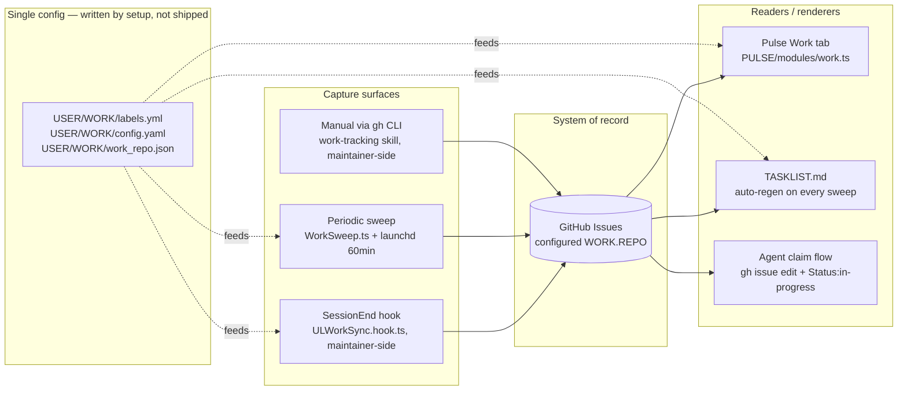

# Work System

> The Work System is the hill-climb's ledger (`LIFEOS/DOCUMENTATION/LifeOs/LifeOsThesis.md`). Every captured unit of work is a step taken toward ideal state. The board holds forward work only: an active goal with no open issue is a declared ideal state with no next move, and that gap is shown in the work digest and on Pulse instead of being queued as an issue.

> The Work System turns meaningful Algorithm sessions and NATIVE work that touched files into a labeled GitHub issue in one configured private repo; a finished session arrives as a closed record. The repo is the system of record. The Pulse Work tab, the auto-regenerated TASKLIST.md, and the agent claim flow are all readers.

## Why this exists

LifeOS does a lot of work. Before this redesign (2026-05-25), almost none of the month's sessions had landed in the work repo. The principal's "system of record for all work" was structurally empty. Three independent failures combined: (a) the SessionEnd hook skipped NATIVE-mode sessions and most prompts now classify as NATIVE, (b) the hook wrote `Type:*`/`Status:*` prefixed labels that didn't exist in the repo so issues landed naked, (c) the hand-maintained TASKLIST.md had gone weeks without an update. Capture was almost zero, render was wrong, the unified view was stale.

The redesign closes all three loops at once and adds a periodic sweep that catches what event-driven hooks miss.

## Architecture



Every surface reads `WORK.REPO`, the kanban columns, and the project→property map from a single `USER/WORK/` config tree via `hooks/lib/work-config.ts`. Zero principal-specific identifiers live in SYSTEM code — point a different `work_repo.json` at a different private repo and the entire system pivots.

## Capture surfaces (in priority order)

### 1. SessionEnd hook — `hooks/ULWorkSync.hook.ts` (not in the public release)

> **Private component — NOT in the public release payload.** `hooks/ULWorkSync.hook.ts` and the work-tracking skill are principal-specific (they target the principal's private work repo) and are rsync-excluded from public releases, the same as any underscore-prefixed private skill. This capture surface runs on the principal's own install only; a fresh public install ships without it.

Fires on every session end. Looks up the session UUID against `MEMORY/STATE/work.json`, locates the ISA, decides whether to sync.

**Sync gates:**
- `WORK.REPO` enabled and verified-private (else exits 0 silently)
- ALGORITHM sessions: the run has left articulation (`phaseHasWorkStarted` in `LIFEOS/TOOLS/ascent.ts`)
- NATIVE sessions: `CAPTURE_NATIVE: true` AND session dir has ≥1 artifact beyond `ISA.md`

**Output:**
- Creates or updates one issue, slug-keyed idempotency
- Issue title prefix: `[LifeOS]` (ALGORITHM) or `[Native]` (NATIVE)
- Labels: `pai-sync` + `Type:feature` (or `auto-native` + `Type:queue` for native) + `Property:*` from project → `Status:*` from phase → `Priority:*` from effort → the `WORK.AGENT_LABEL` value (default `Agent:principal`)
- Pre-filters labels against the repo's actual label set (no naked-issue fallback)
- Writes `github_issue` and `github_issue_url` back to the ISA frontmatter
- Always exits 0 — never blocks `phase: complete`

### 2. Periodic sweep — `LIFEOS/TOOLS/WorkSweep.ts` + launchd 60min

Runs every 60 minutes via `~/Library/LaunchAgents/com.lifeos.worksweep.plist` (installed via `bun ~/.claude/LIFEOS/TOOLS/InstallWorkSweep.ts`). Each run does three jobs, and the `[Goal]`, `[Project-Check]` and `[BLE]` issue generators are retired (ratified 2026-08-15):

| Sub-sweep | Trigger | Output |
|-----------|---------|--------|
| **Session catch-up** | ISA modified in last 24h, no `github_issue:` writeback, no existing repo issue matching slug, meets meaningful-work threshold | `[Sweep]` or `[Native]` issue with `auto-sweep`/`auto-native` source label; a completed session is closed on creation as a record with zero board weight |
| **Stale flagging** | Open issue with `Status:in-progress` not touched in 7d | Adds `stale` label |
| **Work digest** | Every apply run (skipped on `--dry-run`) | Writes `MEMORY/STATE/work-digest.md` and its structured twin `work-attention.json`: top priorities, overdue reminders, P1 issues idle 7d+, and an Attention panel (goals with no open work, projects with no commit in 14d, BLE subtraction cadence). The Pulse Work tab and session start read them |
| **Retired generators** | `[Goal]`, `[Project-Check]`, `[BLE]` issues | Gone since 2026-08-15: recurring state renders in the digest and Pulse, never as work items |

Sweep is cheap (no LLM, just `gh` + ripgrep + filesystem reads), finishes in seconds, exits 0 on any failure, logs one JSON line to `MEMORY/OBSERVABILITY/worksweep.jsonl`. After the session sweep, the stale pass and the digest it runs the TASKLIST regenerator named by the top-level `tasklist_regenerator` key in `USER/WORK/config.yaml` (a path relative to `~/.claude`, or absolute) with `--commit-push`, so TASKLIST.md stays fresh. With the key absent or the file missing, the step is skipped silently and TASKLIST.md is not regenerated.

Safety:
- `--max-create N` (default 50) caps issue creation per run — avoids a runaway flood on first install
- `--dry-run` shows what would happen without applying
- Empty scaffolds (no progress, no phase advance) skipped via the meaningful-work threshold
- Sessions older than the `--since` window (default 24h) skipped — no retroactive flood unless explicitly widened

### 3. Manual via skill / gh CLI

Direct `gh` invocations. On the maintainer's install the private work-tracking skill's intents (CheckTasks, CreateIssue, UpdateTaskList) wrap them; that skill is not in the public release. No automation — principal or agent operates directly. Reminders and anything scheduled are Workflow definitions, not issues (Workflows skill, Reminder route).

## Label taxonomy

The canonical label list lives at `USER/WORK/labels.yml` and gets pushed to the configured repo with `gh label create` (Setup step 3); on the maintainer's install the private work-tracking skill's `BootstrapLabels` tool does it in bulk, and that tool is not in the public release. Additive — never deletes existing labels.

| Family | Members | Purpose |
|--------|---------|---------|
| `Type:` | feature, problem, reminder, research, queue, decision, metric-alert, project | What kind of work |
| `Status:` | queued, needs-triage, ready, in-progress, in-review, blocked, needs-human, done | Where it stands |
| `Priority:` | P0, P1, P2, P3 | How urgent |
| `Property:` | newsletter, website, youtube, podcast, community, consulting, open-source, internal, pai, life | Which area of the principal's life |
| `Agent:` | one per principal-named agent in the user's fleet (the principal edits `labels.yml` to add their own names) | Who owns it |
| Flags | `pai-sync`, `auto-native`, `auto-sweep`, `<da-name>-can-take` (the DA's name prefixes the live label), `stale` | Orthogonal source / queue markers |

Legacy bare labels (`feature`, `P2-medium`, `internal`, `in-progress`, etc.) coexist — the Pulse module aliases them to the canonical Status values via `LEGACY_STATUS_ALIASES` so old and new issues render in the same columns.

## Issue title prefixes

The prefix is the first signal of where the issue came from. Used by the kanban source badge and, on the maintainer's install, the private `RegenerateTasklist.ts`:

| Prefix | Source | When |
|--------|--------|------|
| `[LifeOS]` | SessionEnd hook | ALGORITHM session at phase ≥ execute |
| `[Native]` | SessionEnd hook (extension) OR sweep | NATIVE session with file artifacts |
| `[Sweep]` | Periodic sweep | Untracked Algorithm session caught up |
| `[Project-Check]` | Retired 2026-08-15 | Stale projects now render in the work digest |
| `[Goal]` | Retired 2026-08-15 | Goals without open work now render in the work digest |

## Renderers

### Pulse Work tab — `LIFEOS/PULSE/modules/work.ts`

Polls `gh issue list --json ...` every `WORK.POLL_INTERVAL_SECONDS` (default 60), groups issues into the configured `WORK.KANBAN_COLUMNS` lanes via `Status:*` labels (with legacy aliases), serves at:

- `GET /api/work` — full payload (config, columns, items, and the sweep's attention panel from `work-attention.json`)
- `GET /api/work/columns` — just the column grouping
- `GET /api/work/status` — module health
- `GET /api/work/ui` — kanban HTML
- `POST /api/work/refresh` — force immediate poll

Read-only — never mutates the repo. Each card carries a source badge (`pai-sync` / `auto-native` / `auto-sweep` / `reminder` / `bookmark` / `manual`) so the principal can see at a glance how the issue arrived.

### TASKLIST.md — regenerated by the configured `tasklist_regenerator`

The maintainer's regenerator is the private work-tracking skill's `RegenerateTasklist` tool, which is not in the public release; a public install has no regenerator until it sets one. The regenerator pulls every issue, groups into the standard sections (Active / Queued / Triaged / Projects / Reminders / Blocked / Recently Completed), writes the file, optionally commits and pushes. Idempotent — empty diff = no commit. WorkSweep calls it with `--commit-push` only when `tasklist_regenerator` is set in `USER/WORK/config.yaml`, so the live repo reflects truth on installs that configure it.

### Agent claim flow

Documented in the repo README. Today entirely manual:

```bash
gh issue edit <num> --repo "$REPO" --add-label "Agent:<agent-name>,Status:in-progress" --remove-label "Status:ready,Status:queued"
# ...work...
gh issue close <num> --repo "$REPO" --comment "Resolved: <evidence>"
```

A `<da-name>-can-take` label serves as the queue marker for "the DA should pick this up next." Today manual; a future autonomous-claim daemon (separate ISA, deferred) will scan for this label and dispatch into ALGORITHM sessions.

## System / data / template separation

| Layer | Lives in | Contains | Ships in release? |
|-------|----------|----------|-------------------|
| **System code (public)** | `~/.claude/LIFEOS/PULSE/`, `~/.claude/LIFEOS/TOOLS/`, generic capture hooks under `~/.claude/hooks/` | Modules, CLIs, generic hooks | YES — scrubbed, public-clean |
| **Private components** | the work-tracking skill dir, `~/.claude/hooks/ULWorkSync.hook.ts` | Underscore-private skill + principal-specific SessionEnd capture hook (target the principal's private work repo) | NO — rsync-excluded from the public release payload, same as any underscore-prefixed private skill |
| **User config** | `~/.claude/LIFEOS/USER/WORK/` | `labels.yml`, `config.yaml`, `work_repo.json`, `README.md` | NO — **created by work-system setup, not shipped.** These are USER-zone files excluded by containment; a fresh install has no `USER/WORK/` until setup writes it, so a missing file here is the pre-setup state, not a packaging bug. |
| **Templates for new users** | maintainer-side only, in the release skill's `RELEASE_TEMPLATES/WORK_REPO/` — **not yet in the release payload**, so there is no installed path for these | README template, TASKLIST starter, .github/labels.yml, ISSUE_TEMPLATE, workflows | NOT YET — placeholder substitution at user-setup time is planned, not built |
| **Live repo** | The configured private GitHub repo | Issues, TASKLIST.md, README, SOPs, CHANGELOG | NO — user's private property |

A new LifeOS user creates `LIFEOS/USER/WORK/work_repo.json` as `{"repo":"<owner/repo>"}`. On first load, `work-config.ts` calls `gh repo view` and enables the work system only after confirming the repo is private; the loader then writes its own cached privacy attestation. Label and project setup remain separate operator actions.

## Failure modes

| Mode | Behavior | Recovery |
|------|----------|----------|
| `gh` offline / unauthenticated | Hook exits 0, sweep exits 0, Pulse serves cached state with `stale: true` banner | Re-run `gh auth login`; next poll/sweep recovers |
| Repo flipped public | `work-config.ts` re-verify catches it within half-TTL (12h), disables sync | Flip back private or replace `repo` in `work_repo.json`; a changed/unattested file is verified before use |
| Missing labels in repo | Hook filters labels to existing, logs the missing names; sweep does the same | `gh label create` the missing names (Setup step 3); the private `BootstrapLabels` tool does it in bulk on the maintainer install |
| Slug collision (two ISAs same slug) | Last-write wins on issue title lookup; both update same issue | Rename one ISA's slug |
| Sweep crash | launchd `ThrottleInterval: 60` rate-limits; structured error appended to worksweep.jsonl | Read log at `MEMORY/STATE/com.lifeos.worksweep.log` |
| TASKLIST regenerator can't push | Local file still updated; logs `push failed (auth/network/conflict)`; next run retries | Resolve git state in the local clone |
| Large-backfill flood on first install | `--max-create 50` default cap; principal triages in batches | Re-run sweep with `--since 720h --max-create 50` until caught up |

## Setup for a new LifeOS user

1. Create a private GitHub repo
2. Create `LIFEOS/USER/WORK/work_repo.json` as `{"repo":"<owner/repo>"}`; the loader verifies privacy with `gh` before first use
3. Seed the label taxonomy: for each label in `LIFEOS/USER/WORK/labels.yml`, run `gh label create "<name>" --repo <owner/repo>` (it fails harmlessly on a label that exists). This step is optional, because sync filters labels to the ones the repo has. The bulk `BootstrapLabels` tool belongs to the private work-tracking skill and is not in the public release
4. Restart Pulse: `bash ~/.claude/LIFEOS/PULSE/manage.sh restart`
5. `bun ~/.claude/LIFEOS/TOOLS/InstallWorkSweep.ts` to register the launchd job
6. Run any Algorithm session; the sweep opens its issues within an hour. On the maintainer's install `ULWorkSync.hook.ts` also opens the first one at SessionEnd; that hook is not in the public release

## Tunables

| Setting | Where | Default | Purpose |
|---------|-------|---------|---------|
| `WORK.REPO` | `work_repo.json` | (none — required) | Target repo, must be private |
| `WORK.KANBAN_COLUMNS` | `config.yaml` | Queued, Blocked, In-Progress, In-Review, Complete | Pulse kanban lanes |
| `WORK.POLL_INTERVAL_SECONDS` | `config.yaml` | 60 | Pulse poll cadence |
| `WORK.CAPTURE_NATIVE` | `config.yaml` | true | Enable NATIVE-mode capture in SessionEnd hook |
| `WORK.CAPTURE_SWEEP` | `config.yaml` | true | Enable periodic sweep |
| `WORK.CAPTURE_GOALS` | `config.yaml` | **false** | Reserved. Goal-to-issue export was retired 2026-08-15, so nothing reads this switch today; goals render in the work digest instead. It stays false so goal text, which is never pattern-scrubbed (issue #1825), cannot leave the machine if an exporter returns |
| `WORK.AGENT_LABEL` | `config.yaml` | `Agent:principal` | Label naming the acting agent on issues the SessionEnd hook opens |
| `WORK.PROJECT_PROPERTY` | `config.yaml` | (project→Property map) | Maps ISA `project:` value to `Property:*` label |
| `tasklist_regenerator` | `config.yaml` (top-level key, not under `WORK`) | (none) | Path to the TASKLIST regenerator that WorkSweep runs with `--commit-push` after each sweep, relative to `~/.claude` or absolute; unset means no TASKLIST regeneration |
| Sweep `--max-create N` | CLI flag | 50 | Cap issue creation per sweep run |
| Sweep `--since Nh` | CLI flag | 24 | Scan window for session catch-up |
| Launchd `StartInterval` | plist | 3600 | Sweep cadence (seconds) |

Both issue writers (ULWorkSync, maintainer-side, and WorkSweep) pass every title/body through the deterministic PII filter `LIFEOS/TOOLS/lib/WorkRedact.ts` at the create/edit boundary — credentials, emails, phone numbers, SSN/card shapes, street addresses, and home-path usernames are redacted before anything reaches the repo (public issue #1825, @PaulWaldo).

## Files

| File | Role |
|------|------|
| `USER/WORK/labels.yml` | Canonical label source |
| `USER/WORK/config.yaml` | Kanban columns + poll cadence + capture switches + project→property map |
| `USER/WORK/work_repo.json` | Repo identity + privacy attestation |
| `USER/WORK/CLAUDE.md` | RESTRICTED classification for `Customers/` subtree |
| `hooks/ULWorkSync.hook.ts` | SessionEnd capture (ALGORITHM + NATIVE-with-artifacts); private, maintainer install only |
| `hooks/lib/work-config.ts` | Single loader for repo, columns, switches, project map |
| `LIFEOS/TOOLS/WorkSweep.ts` | Periodic sweep — session catch-up, stale flagging, work digest + TASKLIST regen |
| `LIFEOS/TOOLS/com.lifeos.worksweep.plist.template` | launchd plist template |
| `LIFEOS/TOOLS/InstallWorkSweep.ts` | Materializes template, bootstraps launchd job |
| `LIFEOS/PULSE/modules/work.ts` | Pulse kanban renderer with source badges |
| work-tracking skill: `BootstrapLabels` tool | Seeds canonical labels into the configured repo; private, not in the public release |
| work-tracking skill: `RegenerateTasklist` tool | Rebuilds TASKLIST.md from live issues; private, not in the public release |
| `LIFEOS/USER/WORK/work_repo.json` | Repo identity setup; `work-config.ts` verifies privacy before enabling |
| `MEMORY/OBSERVABILITY/worksweep.jsonl` | One JSON line per sweep run |
| `MEMORY/STATE/work-digest.md` | Top priorities, overdue reminders and the Attention panel, rewritten each sweep |
| `MEMORY/STATE/work-attention.json` | Structured twin of the digest that the Pulse Work tab reads |
| `MEMORY/STATE/com.lifeos.worksweep.log` | launchd stdout/stderr capture |

## Examples

### The sweep catches what events miss

Event hooks only fire when something happens. The gap they leave is *inaction* — the work that should exist but doesn't. That is the periodic sweep's job. Every 60 minutes it catches sessions that never reached a hook, and it reads the TELOS goals: any active goal with zero matching open issues appears under "Goals with no open work" in `work-digest.md` and in the Pulse Work tab's Attention panel. An articulated ideal state with no next move is exactly the thing the OS is supposed to surface, and the sweep is the loop closing on itself, drawn as state instead of queued as an issue.

Capture and rendering are decoupled through one system of record: each writer creates or updates an issue, and every reader — kanban, task list, agent claim flow — is downstream of that single source.

---

## Cross-references

- ISA spec: `LIFEOS/DOCUMENTATION/ISA/ISAFormat.md`
- System/user boundary doctrine: `LIFEOS/DOCUMENTATION/SystemUserBoundary.md`
- Containment policy: `LIFEOS/DOCUMENTATION/Tools/Containment.md`
- Pulse system: `LIFEOS/DOCUMENTATION/Pulse/PulseSystem.md`
- Work-tracking skill (private)
