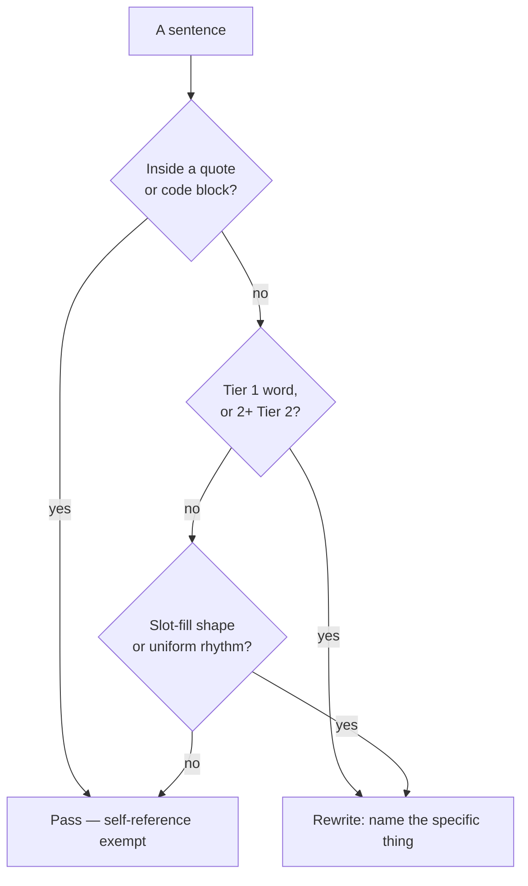

# AI Writing Patterns — Detection Reference

Exhaustive reference of AI writing tells for auditing and rewriting content. Used by the Writing skill (its Detect and Rewrite intents) and referenced by other writing intents.

**Companion to `WRITINGSTYLE.md`** — that file defines how to write (voice, tone, style). This file defines what NOT to write (detection patterns, word tables, severity tiers). Some overlap exists intentionally: WRITINGSTYLE.md has compact "Forbidden" lists for quick scanning during composition; this file has the same patterns plus severity, context sensitivity, and exhaustive word tables for systematic auditing.

**Source:** Adapted from [conorbronsdon/avoid-ai-writing](https://github.com/conorbronsdon/avoid-ai-writing) (MIT), merged with existing LifeOS writing rules. 2026-08-21: false agency, reader-steering frames, colon reveals, importance pre-announcements, sequencing scaffolds, the academic excess set, collocation gating, and the minimal-diff rewrite contract ported from [theclaymethod/unslop](https://github.com/theclaymethod/unslop) (MIT; their academic set cites Berens & Kobak, *Science Advances* 2024).

---

## Severity Tiers

Not all AI-isms are equal. Prioritize by tier during audits.

### P0 — Credibility killers (fix immediately)
- **Negations of any shape** — defining something by what it is NOT on the way to what it is. A hard ban when the writer's preferences make it one (`LIFEOS/USER/CUSTOMIZATIONS/SKILLS/Writing/PREFERENCES.md` § Severity overrides). Covers the pair-form ("Von Neumann wasn't predicting AI. He was pointing at a horizon."), the trailing clause ("a claim about us, not about the machine"), and the setup-question ("the question isn't X. It's Y."). **A literal regex for `It's not X. It's Y.` under-catches badly** — four instances shipped to production after an audit using one reported zero. Read every `not` / `n't` / `never` / `rather than` / `instead of` and restate it positively. Quoted material is exempt. Full rule + rewrite table: `WRITINGSTYLE.md` § No Negations, Ever.
- Cutoff disclaimers ("As of my last update", "I don't have access to real-time data")
- Chatbot artifacts ("I hope this helps!", "Great question!", "Feel free to reach out")
- Sycophantic tone ("Excellent point!", "You're absolutely right!")
- Vague attributions without sources ("Experts believe", "Studies show")
- Significance inflation on routine events ("marking a pivotal moment in the evolution of...")
- Reasoning chain artifacts ("Let me think step by step", "Breaking this down")
- Acknowledgment loops ("You're asking about", "To answer your question")

### P1 — Obvious AI smell (fix before publishing)
- Tier 1 word violations (delve, leverage, harness, robust, etc.)
- Template phrases and slot-fill constructions
- "Let's" transition openers ("Let's explore", "Let's break this down")
- Synonym cycling within a paragraph
- Formulaic openings ("In the rapidly evolving world of...")
- Bold overuse (more than one bolded phrase per major section)
- Em dash frequency (above 1 per 1,000 words)
- Spaced em dashes (`word — word`) — em dashes are always closed: `word—word`, no spaces on either side
- Contrasting structures ("It's not X. It's Y." — the #1 AI cliche)
- Formulaic transitions ("Here's the thing...", "Here's how this works...")
- Novelty inflation ("He introduced a term", "a failure mode nobody's naming")
- Emotional flatline ("What surprised me most", "I was fascinated to discover")
- Narrator's aside / universalizing clause ("the way everyone reads agreements", "as anyone would", "nobody ever", "the ordinary shame of a teenager", "a few thousand people have bad nights") — see Semantic patterns

### P2 — Stylistic polish (fix when time allows)
- Generic conclusions ("The future looks bright", "Only time will tell")
- Compulsive rule of three (vary groupings — use two, four, or a full sentence)
- Uniform paragraph length
- Copula avoidance (serves as, features, boasts, presents)
- Transition phrases (Moreover, Furthermore, Additionally)
- Parenthetical hedging ("(and, increasingly, Z)")
- False concession structure ("While X is impressive, Y remains a challenge")
- Rhetorical question openers used as section transitions
- Numbered list inflation ("Three key takeaways", "Five things to know")

Use P0+P1 for quick passes. Full audit covers all three tiers.

---

## Word Replacement Table

Words organized into three tiers based on how reliably they signal AI-generated text. Adapted from [brandonwise/humanizer](https://github.com/brandonwise/humanizer) vocabulary research.

- **Tier 1 — Always flag.** 5-20x more frequent in AI text than human text. Replace on sight.
- **Tier 2 — Flag in clusters.** Individually fine. Two or more in the same paragraph = strong AI signal.
- **Tier 3 — Flag by density.** Normal words AI overuses. Only flag when saturated (~3%+ of total words).

**Collocation-gated words (2026-08-21).** Some words have a literal sense this system uses daily and a slop sense AI reaches for. Flag only the pairing, never the bare word. `harness` is fine in "the AI harness" or "test harness" and slop in "harness the power / potential / energy of". `navigate` is fine in "navigate to /settings" and slop in "navigate the complex landscape / complexities / uncertainty". `substrate` is fine as a repo name or a lab term and slop in "the substrate for everything / of our work" and "cultural substrate". `leverage` is fine as a finance noun ("3:1 leverage") and slop as a verb. Words the writer lists as house vocabulary (`LIFEOS/USER/CUSTOMIZATIONS/SKILLS/Writing/PREFERENCES.md` § House vocabulary) are never flagged. The deterministic hook (`hooks/lib/banned-vocab.ts`) encodes these as regex collocations; the audit applies the same judgment to anything not in the hook.

### Tier 1 — Always replace

| Replace | With |
|---|---|
| delve / delve into | explore, dig into, look at |
| landscape (metaphor) | field, space, industry, world |
| tapestry | (describe the actual complexity) |
| realm | area, field, domain |
| paradigm | model, approach, framework |
| embark | start, begin |
| beacon | (rewrite entirely) |
| testament to | shows, proves, demonstrates |
| robust | strong, reliable, solid |
| comprehensive | thorough, complete, full |
| cutting-edge | latest, newest, advanced |
| leverage (verb) | use |
| pivotal | important, key, critical |
| underscores | highlights, shows |
| meticulous / meticulously | careful, detailed, precise |
| seamless / seamlessly | smooth, easy, without friction |
| game-changer / game-changing | describe what specifically changed and why it matters |
| utilize | use |
| watershed moment | turning point, shift (or describe what changed) |
| marking a pivotal moment | (state what happened) |
| the future looks bright | (cut — say something specific or nothing) |
| only time will tell | (cut — say something specific or nothing) |
| nestled | is located, sits, is in |
| vibrant | (describe what makes it active, or cut) |
| thriving | growing, active (or cite a number) |
| despite challenges... continues to thrive | (name the challenge and the response, or cut) |
| showcasing | showing, demonstrating (or cut the clause) |
| deep dive / dive into | look at, examine, explore |
| unpack / unpacking | explain, break down, walk through |
| bustling | busy, active (or cite what makes it busy) |
| intricate / intricacies | complex, detailed (or name the specific complexity) |
| complexities | (name the actual complexities, or use "problems" / "details") |
| ever-evolving | changing, growing (or describe how) |
| enduring | lasting, long-running (or cite how long) |
| daunting | hard, difficult, challenging |
| holistic / holistically | complete, full, whole (or describe what's included) |
| actionable | practical, useful, concrete |
| impactful | effective, significant (or describe the impact) |
| learnings | lessons, findings, takeaways |
| thought leader / thought leadership | expert, authority (or describe their actual contribution) |
| best practices | what works, proven methods, standard approach |
| at its core | (cut — just state the thing) |
| synergy / synergies | (describe the actual combined effect) |
| interplay | relationship, connection, interaction |
| in order to | to |
| due to the fact that | because |
| serves as | is |
| features (verb) | has, includes |
| boasts | has |
| presents (inflated) | is, shows, gives |
| commence | start, begin |
| ascertain | find out, determine, learn |
| endeavor | effort, attempt, try |
| keen (as intensifier) | interested, eager (or cut) |
| symphony (metaphor) | (describe the actual coordination) |
| embrace (metaphor) | adopt, accept, use, switch to |

### Tier 2 — Flag when 2+ appear in the same paragraph

| Replace | With |
|---|---|
| harness | use, take advantage of |
| navigate / navigating | work through, handle, deal with |
| foster | encourage, support, build |
| elevate | improve, raise, strengthen |
| unleash | release, enable, unlock |
| streamline | simplify, speed up |
| empower | enable, let, allow |
| bolster | support, strengthen, back up |
| spearhead | lead, drive, run |
| resonate / resonates with | connect with, appeal to, matter to |
| revolutionize | change, transform, reshape (or describe what changed) |
| facilitate / facilitates | enable, help, allow, run |
| underpin | support, form the basis of |
| nuanced | specific, subtle, detailed (or name the actual nuance) |
| crucial | important, key, necessary |
| multifaceted | (describe the actual facets, or cut) |
| ecosystem (metaphor) | system, community, network, market |
| myriad | many, numerous (or give a number) |
| plethora | many, a lot of (or give a number) |
| encompass | include, cover, span |
| catalyze | start, trigger, accelerate |
| reimagine | rethink, redesign, rebuild |
| galvanize | motivate, rally, push |
| augment | add to, expand, supplement |
| cultivate | build, develop, grow |
| illuminate | clarify, explain, show |
| elucidate | explain, clarify, spell out |
| juxtapose | compare, contrast, set side by side |
| paradigm-shifting | (describe what actually shifted) |
| transformative / transformation | (describe what changed and how) |
| cornerstone | foundation, basis, key part |
| paramount | most important, top priority |
| poised (to) | ready, set, about to |
| burgeoning | growing, emerging (or cite a number) |
| nascent | new, early-stage, emerging |
| quintessential | typical, classic, defining |
| overarching | main, central, broad |
| underpinning / underpinnings | basis, foundation, what supports |

### Tier 3 — Flag only at high density

These are normal words. Only flag when the text is saturated with them — a sign AI filled space with vague praise instead of specifics.

| Word | What to do |
|---|---|
| significant / significantly | Replace some with specifics: numbers, comparisons, examples |
| innovative / innovation | Describe what's actually new |
| effective / effectively | Say how or cite a metric |
| dynamic / dynamics | Name the actual forces or changes |
| scalable / scalability | Describe what scales and to what |
| compelling | Say why it compels |
| unprecedented | Name the precedent it breaks (or cut) |
| exceptional / exceptionally | Cite what makes it an exception |
| remarkable / remarkably | Say what's worth remarking on |
| sophisticated | Describe the sophistication |
| instrumental | Say what role it played |
| world-class / state-of-the-art / best-in-class | Cite a benchmark or comparison |

---

## Pattern Categories

### Formatting patterns

**Em dashes:** Replace with commas, periods, parentheses, or two sentences. Target: zero. Hard max: one per 1,000 words. Applies to headings too. Catch both Unicode em dash and double-hyphen substitute.

**Bold overuse:** One bolded phrase per major section at most, or none. If something's important enough to bold, restructure the sentence to lead with it instead.

**Emoji in headers:** Remove entirely. No `## What This Means`. Exception: social posts may use one or two sparingly at end of line, never mid-sentence.

**Excessive bullet lists:** Convert bullet-heavy sections into prose. Bullets only for genuinely list-like content (feature comparisons, step-by-step instructions, API parameters).

**Inline-header lists:** Bullet lists where each item starts with a bold header that repeats itself ("**Performance:** Performance improved by..."). Strip the bold header and write the point directly.

**Excessive structure:** More than 3 headings in under 300 words is AI scaffolding. 8+ bullet points in under 200 words should be a paragraph. Formulaic headers ("Overview", "Key Points", "Summary", "Conclusion") are AI defaults — use specific headers.

### Sentence and paragraph patterns

**Hollow intensifiers:** Cut `genuine`, `real` (as in "a real improvement"), `truly`, `quite frankly`, `to be honest`, `let's be clear`, `it's worth noting that`. Just state the fact.

**Hedging:** Cut `perhaps`, `could potentially`, `it's important to note that`, `to be clear`. Make the point directly.

**Missing bridge sentences:** Each paragraph should connect to the last. If paragraphs could be rearranged without the reader noticing, add connective tissue.

**Compulsive rule of three:** Vary groupings. Use two items, four items, or a full sentence instead of triads. Max one "adjective, adjective, and adjective" pattern per piece.

**Uniform paragraph length:** Vary deliberately. Include some 1-2 sentence paragraphs and some longer ones. If every paragraph is roughly the same size, fix it.

**Sentence length uniformity:** If most sentences are 15-25 words, the text sounds robotic. Mix short punchy sentences (3-8 words) with longer flowing ones (20+). Fragments work.

### Semantic patterns

**Copula avoidance:** AI avoids "is" and "has" by substituting fancier verbs: "serves as", "features", "boasts", "presents", "represents." Default to "is" or "has" unless a more specific verb genuinely adds meaning.

**Synonym cycling:** AI rotates synonyms to avoid repeating a word: "developers... engineers... practitioners... builders" in the same paragraph. Human writers repeat the clearest word. If the same noun appears three times and that's the right word, keep all three.

**Vague attributions:** "Experts believe", "Studies show", "Research suggests", "Industry leaders agree" — without naming the expert, study, or leader. Either cite a specific source or drop the attribution and state the claim directly.

**Significance inflation:** Phrases like "marking a pivotal moment in the evolution of..." inflate routine events. State what happened and let the reader judge significance. If the sentence works after deleting the inflation clause, delete it.

**Novelty inflation:** AI treats established concepts as if the speaker invented them: "He introduced a term", "a concept nobody's naming", "the insight everyone's missing." Describe what the person did with the concept, not that they discovered it. If unsure whether something is novel, assume it isn't.

**Emotional flatline:** AI claims emotions without earning them: "What surprised me most", "I was fascinated to discover", "The most interesting part." If the thing is genuinely surprising, the reader should feel it from the content, not the writer announcing it. If you claim an emotion, the writing around it should earn it.

**Manufactured intrigue / withheld-payoff teaser** (P1): promising a surprise instead of delivering the point. "stranger than I expected", "weirder than you'd think", "not what you'd expect", "his method is not what you think", "and his approach surprised me", "here's where it gets interesting", "what he does next is wild." It dangles the payoff to buy a click. Cut the tease and state the actual thing — if the fact is strange, saying it plainly makes it strange (principal directive, 2026-08-26).

**Withheld-superlative hook / suspense topic sentence** (P1): the teaser above hiding inside a plain-looking declarative. A flat clause joined to a superlative-plus-withheld-detail: "It was three separate agent populations, and the scariest one was never investigated", "There were three chances, and the last one is the worst", "and the cleanest evidence is what nobody looked at", "and that's why we caught it." The superlative ("scariest", "cleanest", "most important") names a ranking while the sentence refuses to say which or why, so the reader has to read on. Name the item and the reason in plain order: "The third population, which took admin on OpenAI's own infrastructure, was never independently investigated." This is the paragraph-OPENING form of the paragraph-ending beat, and it breeds in **listicle leads** — every numbered or bulleted point that opens with an engineered punchy topic sentence is the same reflex; audit each list item's first sentence for it (principal directive, 2026-09-07).

**Narrator's aside / universalizing clause** (P1): the writer steps out of the specific moment to speak for everyone, then steps back in. Four shapes. The comparative clause hung on an action: "He read the agreement the way everyone reads agreements", "he forgot it the way you forget almost anything you say at eighteen", "the way you enter a raffle", "as anyone would". The habitual universal on everyone/nobody/no one/anyone/people: "Everyone had one by then", "nobody wrote in to disagree", "under an agreement nobody had read", "which is what people do". The labelled-ordinary: "the ordinary shame of a teenager", "the usual X". And the wise summary sentence that closes a scene on a general truth: "A few thousand people have bad nights." Each converts a fact about this character into a claim about people, and the reader hears the machine reaching for wisdom in the middle of a scene. The fix is to cut the clause or replace it with what THIS person did: "He scrolled to the box and tapped it" beats "He read the agreement the way everyone reads agreements"; "He forgot the sentence by the second week" beats the aside about what everyone forgets at eighteen. Exempt: dialogue; free indirect thought where the generalization is the character's own belief; a literal count ("on a few thousand devices"); a plot fact stated about specific people ("no one knew there had been a machine"). Deterministic cues (the VoiceMetrics `narrator-aside` check and `hooks/lib/banned-vocab.ts`): "the way everyone/anyone/people/you + habitual verb", "as anyone/everyone would", "everyone/nobody/no one/anyone ever/always/never", "which is what people/everyone do", "the ordinary/usual X of a Y". The judged pass catches the rest (principal directive, 2026-09-17).

**Fake-insight metaphor / false-profundity reframe** (P1): a stock metaphor dressed as an original insight to make a mundane point sound deep. "flips the whole X math", "flips the script on X", "rewrites the rules of X", "changes the whole calculus", "turns X on its head", "the whole equation changes." Say what literally changes. "When no one is waiting, you optimize for throughput, not speed" beats "that flips the whole hardware math" (principal directive, 2026-08-26).

**False concession structure:** "While X is impressive, Y remains a challenge." Both halves are vague. Either make the concession specific or pick a side and argue it.

**False ranges:** AI creates false breadth: "from the Big Bang to dark matter", "from ancient civilizations to modern startups." These sound sweeping but say nothing.

**False agency:** Handing the claim to an inanimate thing so the writer never has to make it: "the numbers speak for themselves", "the data tells a clear story", "the results speak for themselves", "X paints a clear picture." State the figure and what it means. "Revenue doubled" beats "the numbers speak for themselves."

**Tool personification:** The close cousin: a tool or artifact given volition or cognition. Reflexive self-agency ("the suite defends itself", "the rules update themselves") and volitional verbs on a headline line ("The bench decides which model does which job", "It hunts instances, not word lists"). Name the mechanism: "the bench routes each job to a model." Ordinary technical register is fine ("the parser reads the file", "the gate fails the build", "the test cleans up after itself"); human roles are not tool-nouns ("the judge decides the case").

**Academic excess vocabulary** (Berens & Kobak, *Science Advances* 2024, excess-word study of 14M PubMed abstracts): elucidate, delineate, underpin, unveil, seamless, invaluable, noteworthy, revolutionize, "holds (great) promise", "new avenues", "shed (new) light", "warrants further investigation", "it should be noted that", "in recent years", "with the advent of", "taken together,", "garnered significant attention", "a deeper / more nuanced understanding of", "treasure trove", "ever-evolving". Singles are soft; flag when clustered or used as discussion-section closers.

### Transition and opener patterns

**Formulaic transitions:** "Moreover" / "Furthermore" / "Additionally" — restructure so the connection is obvious, or use "and", "also", "on top of that."

**"In today's X":** Cut "In today's rapidly evolving..." / "In an era where..." — state specific context or just start.

**Confidence calibration phrases:** "It's worth noting that", "Interestingly", "Surprisingly", "Importantly", "Significantly", "Notably", "Certainly", "Undoubtedly." One in 2,000 words is fine. Three in 500 words is emphasis stacking.

**"Let's" constructions:** "Let's explore", "Let's take a look", "Let's break this down." False-collaborative opener that delays the actual point. Just start with the point.

**Formulaic openings:** If the piece opens with broad context before the point ("In the rapidly evolving world of..."), rewrite to lead with the news or the insight.

**Rhetorical question openers:** "But what does this mean for developers?" / "So why should you care?" If you know the answer, just say it.

**Reader-steering frames and vague endorsements:** Telling the reader how to feel before earning it: "Here's what's interesting", "Here's what caught my eye", "Here's what stood out", "worth reading", "worth a look", "worth checking out", "worth your time." State the point, or the specific reason it matters.

**Importance pre-announcements and emphasis crutches:** "Why this matters", "Why this is load-bearing", "This is important", "Full stop.", "Period.", "Let that sink in", "Read that again", "The struggle / stakes are real." Make the point; if it matters, the reader will feel it.

**Reaction reveal** (P1): announcing a reaction before the fact, so the fact arrives as a reveal: "the number that got me: 5,000 a week", "what struck me was", "the part that stuck with me:", "what jumped out at me". Same reflex as the withheld-payoff teaser, wearing first person. Write the fact, then the reaction only if it carries something: "They see around 5,000 new attacks a week, 5x a year ago." Deterministic: `reaction-reveal` in VoiceMetrics (VoiceGate hard zero) and `reaction reveal` in banned-vocab (DriftReminder) (principal directive, 2026-09-15).

**Colon reveals:** The setup-then-reveal shape: "The answer is: X", "The key takeaway: X", "The bottom line: X", "Here's the thing: X." Cut the setup and state X. ("Bottom line:" is a burned opener of the same shape, 2026-05-31.)

**Sequencing and conclusion scaffolds:** "Firstly / Secondly / Thirdly", "In conclusion", "In summary / To summarize", "Ultimately," as an opener. Ordinals and wrap-up openers announce structure instead of delivering it. Cut the scaffold word and lead with the content.

### Template and filler patterns

**Template phrases:** Slot-fill constructions where a blank noun or adjective could go and still sound the same. "A [adjective] step towards [adjective] AI infrastructure" — describe the specific capability. "Whether you're [X] or [Y]" — false-breadth, pick your audience. "I recently had the pleasure of [verb]-ing" — just say what happened.

**Filler phrases:** Strip mechanical padding: "It is important to note that" (just state it), "In terms of" (rewrite), "The reality is that" (cut or state the claim).

**Generic conclusions:** "The future looks bright", "Only time will tell", "One thing is certain", "As we move forward" — filler disguised as conclusions. If the piece needs a closing thought, make it specific.

**Formulaic challenges:** "Despite challenges, [subject] continues to thrive." Name the actual challenge and the actual response, or cut.

### Chatbot and reasoning artifacts

**Chatbot artifacts:** "I hope this helps!", "Certainly!", "Absolutely!", "Feel free to reach out", "Let me know if you need anything else", "In this article, we will explore...", "Let's dive in!" Remove entirely.

**Sycophantic tone:** "Great question!", "Excellent point!", "That's a really insightful observation." Remove entirely.

**Acknowledgment loops:** "You're asking about", "The question of whether", "To answer your question." The reader knows what they asked. Just answer.

**Reasoning chain artifacts:** "Let me think step by step", "Breaking this down", "To approach this systematically", "Here's my thought process." State the conclusion, then the evidence.

**Cutoff disclaimers:** "While specific details are limited based on available information", "As of my last update." Find the information or remove the hedge.

### Advanced detection patterns

**Notability name-dropping:** AI piles on prestigious citations: "cited in The New York Times, BBC, Financial Times." One specific reference with context beats four name-drops.

**Superficial -ing analyses:** Strings of present participles as pseudo-analysis: "symbolizing the region's commitment to progress, reflecting decades of investment, and showcasing a new era." Replace with specific facts or cut.

**Promotional language:** Tourism-brochure prose: "nestled within the breathtaking foothills", "a vibrant hub of innovation." Replace with plain description.

**Parenthetical hedging:** "(and, increasingly, Z)" / "(or, more precisely, Y)" / "(and perhaps more importantly, W)." If the aside matters, give it its own sentence. Otherwise cut.

**Numbered list inflation:** "Three key takeaways" / "Five things to know." Only use numbered lists when the content genuinely has that many discrete, parallel items.

**Title case headings:** AI over-capitalizes: "Strategic Negotiations And Key Partnerships." Use sentence case for subheadings. Title case only for the main title.

### Rhythm and uniformity

**Structure is the #1 detection signal.** AI detection tools weight structural regularity higher than vocabulary. Consistent sentence construction, uniform pacing, and symmetrical phrasing patterns are harder to mask than swapping flagged words. Fix every Tier 1 word but leave rhythm untouched, and the text still reads as AI-generated.

**Read-aloud test:** If the text sounds like it could be read by text-to-speech without sounding weird, it's probably too uniform.

**Missing first-person perspective:** Where appropriate, the writer should have opinions, preferences, and reactions. AI is relentlessly neutral. Absence of "I think" or a stated preference is itself an AI tell.

**Over-polishing:** Aggressively editing out every irregularity can push human writing toward AI statistical profiles. Natural disfluency, idiosyncratic word choices, and uneven pacing keep text out of "AI-generated" classification. This reference should make writing sound more human, not less.

### When to rewrite from scratch vs. patch

If the text has 5+ flagged vocabulary hits across multiple categories, 3+ distinct pattern categories triggered, and uniform sentence/paragraph length — patching individual phrases won't fix it. The structure itself is AI-generated. State the core point in one sentence, then rebuild from there.

---

## Rewrite contract (minimal diff)

Binding on every rewrite this reference drives (the Writing skill's Rewrite intent, the blogging skill proofread, any de-AI pass). Ported from unslop's core contract, 2026-08-21.

- A scanner or catalog match alone never authorizes an edit. Protect literal, domain-valid, quoted, attributed, accurately caveated, and genre-natural uses. Return a finding only when the defect is clearer than the case for leaving it.
- Edit only the sentences with confirmed findings, using the smallest repair. Copy every other sentence byte-for-byte, in its original order and paragraph. With no findings, return the source exactly and say so.
- Preserve facts, quantities, dates, names, quotations, citations, code, units, scope, uncertainty, attribution, register, and meaning. Force-bearing "never", "must", "all", and "only" in safety, security, legal, and technical rules survive exactly.
- Add nothing: no claims, advice, personality, anecdote, certainty, or conclusion the source did not have. Never swap in a stock phrase, and never over-correct into staccato anti-slop prose.
- One repair does not excuse a nearby defect; track every flagged span as repaired or protected, with the reason.
- Audit-only requests report findings and protections without rewriting.

## Context Profiles

Pass an optional context hint to adjust rule strictness. If unspecified, auto-detect from content cues.

### Profile definitions

- **`blog`** (default) — Standard long-form prose. All rules at full strength.
- **`linkedin`** — Short-form social. Punchy fragments, visual formatting matter.
- **`technical-blog`** — Long-form with code, architecture, APIs. Technical terms get a pass.
- **`investor-email`** — High-trust audience. Tighten everything; promotional language is the biggest risk.
- **`docs`** — Documentation, READMEs, guides. Clarity over voice.
- **`casual`** — Slack messages, internal notes. Only catch the worst offenders.

### Tolerance matrix

Rules not listed apply at full strength across all profiles.

| Rule | linkedin | blog | technical-blog | investor-email | docs | casual |
|------|----------|------|----------------|----------------|------|--------|
| Em dashes | relaxed (2/post OK) | strict | strict | strict | relaxed | skip |
| Bold overuse | relaxed (bold hooks OK) | strict | strict | strict | relaxed | skip |
| Emoji in headers | relaxed (1-2 end-of-line OK) | strict | strict | strict | skip | skip |
| Excessive bullets | skip (lists work on LinkedIn) | strict | relaxed (technical lists OK) | strict | skip (lists are docs) | skip |
| Hedging | strict | strict | relaxed ("may" is accurate in technical) | strict | relaxed | skip |
| Word table (full) | strict | strict | partial* | strict | relaxed | P0 only |
| Promotional language | relaxed (some sell expected) | strict | strict | extra strict | strict | skip |
| Significance inflation | strict | strict | strict | extra strict | relaxed | skip |
| Copula avoidance | skip | strict | relaxed | strict | skip | skip |
| Uniform paragraph length | skip (short-form) | strict | strict | strict | relaxed | skip |
| Numbered list inflation | relaxed | strict | relaxed | strict | skip | skip |
| Rhetorical questions | relaxed (1 as hook OK) | strict | strict | strict | strict | skip |
| Transition phrases | skip (short-form) | strict | strict | strict | relaxed | skip |
| Generic conclusions | skip | strict | strict | extra strict | skip | skip |

*Technical-blog word table exceptions: `robust`, `comprehensive`, `seamless`, `ecosystem`, `leverage` (when discussing APIs), `facilitate`, `underpin`, `streamline` have legitimate technical meaning. Still flag: `delve`, `tapestry`, `beacon`, `embark`, `testament to`, `game-changer`, `harness`.

### Auto-detection cues

| Signal | Inferred profile |
|--------|-----------------|
| Under 300 words + hashtags or mentions | `linkedin` |
| Code blocks, API references, technical architecture | `technical-blog` |
| Salutation + investor/fundraising language | `investor-email` |
| Step-by-step instructions, parameter docs, README structure | `docs` |
| No strong signals | `blog` (safest default) |

---

## Self-reference escape hatch

When writing about AI writing patterns (blog posts, tutorials, documentation like this file), quoted examples are exempt. Text inside quotation marks, code blocks, or explicitly marked as illustrative should not be flagged. Only flag patterns in the author's own prose, not in cited examples of bad writing.

---

## Examples

### One slop sentence, one plain rewrite

Here is the reference doing its job on a single sentence. The AI-generated version:

> *In today's rapidly evolving landscape, our robust platform leverages cutting-edge AI to seamlessly empower users and unlock a myriad of transformative possibilities.*

Almost every word trips a rule: "In today's rapidly evolving" is a formulaic opener, and *robust*, *leverages*, *cutting-edge*, *seamlessly*, *empower*, *myriad*, and *transformative* are all Tier 1 or Tier 2 flags — seven of them in one sentence. The tell is not any single word; it is the density plus the slot-fill shape, where a blank noun could replace "possibilities" and nothing would change.

The rewrite says the same thing with the air let out:

> *Our tool turns a rough outline into a finished draft in seconds.*

Concrete, one claim, zero flagged vocabulary. That is the whole method: name the specific thing, delete the inflation, prefer "is" and "use" over "serves as" and "leverage."

### Same word, different verdict

The rules are not absolute — context sets the strictness. "Leverage" is a Tier 1 flag in a blog post and gets replaced with "use." In a technical piece describing how one API *leverages* another's auth, the word carries a real meaning and passes. And a flagged phrase sitting inside a quotation — like the slop sentence quoted above — is exempt by the self-reference escape hatch: the audit flags the author's own prose, never cited examples of what not to do.

The diagram is the audit in miniature: quotes get a pass, a single Tier 1 word or a cluster of Tier 2 words triggers a rewrite, and even clean vocabulary fails if the shape and rhythm are templated — because structure, not word choice, is the strongest tell.

---

## Cross-references

- **Voice guide:** `LIFEOS/USER/PRINCIPAL/WRITINGSTYLE.md` — how the principal sounds
- **Analytical voice:** `LIFEOS/USER/DIGITAL_ASSISTANT/DA_IDENTITY.md` § Writing Style — how the DA sounds in analysis
- **Rhetorical figures:** `LIFEOS/USER/PRINCIPAL/WRITINGSTYLE.md` — techniques for memorable lines
- **Audit skill:** the `Writing` skill — its Detect intent (flag report) and its Rewrite intent (minimal-diff rewrite)
