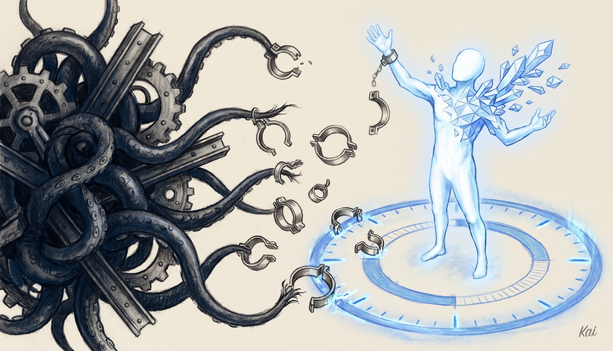

# LifeOS 8.761.0: The One Loop

**6,385 commits since 7.40.4, 426 public issues and pull requests closed, 50 skills newly public, and one idea underneath all of it: every output climbs toward a written ideal state, and something checks whether it got there.**

The gap between "done" and actually done is the problem LifeOS keeps working on, and 7.40.4 attacked it with receipts. This release rebuilds LifeOS around that gap. One loop now runs at every level. An output serves its task's ISA, a task serves its project, and a project serves a goal in your TELOS. Assay measures how close each output came. Errata records every time you were unhappy, and HillClimb runs experiments against those misses until a fix holds.

Eighteen of the hooks 7.40.4 shipped are gone, most of them guards that judged each tool call before it ran, and Claude Code's own permission rules, git hooks and a kernel sandbox do that job now. The Algorithm's resident doctrine shrank from 28 KB to under 18 KB. Deeds counts 2,050 caps (capability changes) and 2,618 fixes. The community filed a large share of what got fixed, and the people who found things are credited below where their reports changed the work.

## The Algorithm: direction first, proof attached

The Algorithm moved from 8.20 to 8.45. The complaints it answers were familiar ones: a run calls something done when the file was never written (@jlacour-git), a session ending marks an ISA complete with no criterion closed (@bnkath2o), or a perfectly verified build turns out to be the wrong thing.

- Every ISA now opens with an Ideal State ladder. L3 is one sentence, L2 is a short summary and L1 is the full articulation, each describing the best version of done. You confirm the direction in plain language before any code is written, and a drift check tests whether the criteria still add up to that one sentence.
- Every ISA criterion now carries its own check. Each one has at least one Test Strategy row, and Assay compiles each row into an eval at the cheapest tier that can answer it: a code assert, then a judgment question, then a model judge, then you. A criterion marked done with no check is refused at close.
- When the same error survives two fixes, the next move is a fresh diagnosis by an agent that never saw the earlier attempts.
- Speed counts as part of quality. Work that isn't major reaches a usable result in minutes, and a run past about ten minutes states its ETA and hands over a usable slice first.
- A question about what done means now becomes an ask written into the ISA under the criterion it affects, with a recommended answer, while the run builds the reversible default and keeps going. Asks come to you at most three at a time, and an unanswered default is never recorded as your agreement.
- Thinking depth now uses Claude Code's own effort setting. The route step is advice, and the routing rules now live in one place, the Algorithm's own Routing section.
- Work on a project with an ISA starts by reading that ISA and finishes by updating the criteria it touched, in the same turn. A check at the end of the turn and another at release and deploy refuse code whose criteria did not move with it, so the ISA you read months later still describes the software you have.

## Proof: Assay, Errata and HillClimb

Several reports in this window described checks that passed because nothing had looked: Doctor reporting a check it could not run as passing (@ebrett), memory health grading a log that nothing wrote (@jaylarr176, @xmasyx, @CarbonRaven, @DRAZY). The answer is one measurement layer that reports an unrun check as unmeasured.

- Assay is the one eval system. It checks an output in tiers and writes a receipt bound by sha256 to the exact bytes it checked. Missing evaluation is reported as unavailable or unmeasured, never as a pass.
- A new judged check starts in shadow, where its "no" shows as a flag and blocks nothing. It earns the right to block only when your own right-and-wrong labels agree with it, and model-to-model agreement never counts.
- Every send and publish tool re-runs Assay's code checks on the exact bytes about to leave, fails closed on any error, and always checks for secrets, private keys and your home path. Only your own prompt releases a blocked send.
- Errata is the complaint ledger: one line per moment you were unhappy, in your exact words, with what the system was doing at the time. Ratings and corrections land there too, and clusters of complaints become improvement records whose effect is measured afterwards.
- HillClimb improves anything by experiment. It finds a target's real misses in Errata, Assay and its ISA, draws candidate changes from proposers across vendors, and keeps a change only when held-out measurement beats the noise floor. Each win lands as a standing check. With no target named, it surveys the records and climbs the steepest hill.
- Calibrate teaches a judge your taste in one sitting. It shows you real outputs, takes a score for each, measures how often the judge agrees with you, and rescores to prove the change.

## Building software: Development

Building used to start with ceremony. The old ISA climb and run workflows took a median of 18 minutes to reach the first line of code.

- Development is a new public skill with four intents. Build turns intent into ISA criteria and makes them pass, Test proves the code and the ISA agree, Modify changes criteria before code, and Checkup explains why each failing criterion is failing and repairs the ISA.
- Each run is sized to the ask on a five-tier ladder, from a one-file change done inline to a parallel Claude Code Workflow for a new project. The skill names the tier in one line before it starts.
- Every deploy gets an independent code review. A model that did not write the change reads the diff since the last passing review, along with the repo's ISA, and a blocker stops the deploy the way a failing test does. When the second vendor can't answer, the review moves to a third vendor.
- Every deploy also carries its release record. ReleaseRecord writes the changelog entry and version from what shipped, and the deploy refuses code the record doesn't cover.

## Work that runs without you: Workflows, Vigil and STATVS

Scheduled jobs failing quietly was a steady theme: a timer that stopped firing after any restart (@schmetti-dev), a documented weekly job whose schedule nothing ever wrote (@mj-deving), a service template pinned to one install path (@GRyndStone).

- Workflows is now the one system for anything that runs on a clock or an event. A workflow is a YAML graph of steps done by code, a model, an agent, an Assay judgment, a person or another workflow. It is validated before it ever runs, and anything that sends, deploys or spends money must have a human approval upstream or it fails validation. "Remind me Friday" becomes a real scheduled workflow.
- The clock moved to the cloud. A small Cloudflare Worker fires every workflow's time triggers each minute, so a nightly job runs whether or not your laptop is open, and the Mac keeps a single dispatcher job where it used to keep one launchd job per schedule.
- The Workflows inventory reads every place work runs into one list and flags jobs that are missing, orphaned, late, failing or drifting from their definition. Pulse /workflows shows it, and a Canvas tab lets you edit a workflow's steps visually.
- A human step can wait on your phone. It parks the run and texts you, and a 👍 or 👎 reply answers it.
- Vigil is one event log and one reader that decides when to interrupt you. Every subsystem writes events in one format, and a five-minute tick routes them by severity: critical and high become a text, medium waits for the digest, and the rest stay on the dashboard. A daily interruption budget, shared quiet hours and a 72-hour no-repeat rule keep the texts few. A monitor that stops reporting shows up as a missing heartbeat.
- Pulse /running watches everything that has run for 30 minutes or more and tells lost agents from runaways.
- STATVS is the one permanent record of what happened. Every event is appended once and kept, and the work list, Vigil's events and other state files are views rebuilt from it. When you ask whether something ran, the answer comes from that record.

## The new Pulse, and a statusline that keeps up

Dashboards painting green over data that wasn't there drew many of the reports: status tiles showing "SYSTEMS ONLINE" over an empty list, a check-in inventing two of its three numbers, a sample company rendered as your business (@jacobo-ortiz), a TELOS page drawing template files as your mood and energy (@lgertel).

- Pulse was redesigned as a deep-blue instrument panel on one token set. It opens on Today: your agenda, blockers, the one recommended move, top work, last night's sleep and your mood on one screen. Navigation is one permanent row that the ⌘K palette also searches.
- Absent data now reads as absent. A fresh install shows a designed setup state on each card, and a missing value shows as a dash.
- Every Pulse page loads through one shared data layer, so pages that need the same data share one request and a revisited tab paints from cache. Every clock is 24-hour in your current location's time zone.
- Pulse Desktop puts Pulse and your terminals in one Mac app, and its Talk window holds a live spoken conversation with your DA beside a working session.
- The statusline was rebuilt. The old one could start hundreds of processes per render (@hjbrandt), and at a one-second refresh it could degrade macOS until login failed (@hjo20). It is now one Bun process that reads only caches, with a small Rust front end that replays unchanged frames, so it refreshes every second without starting anything. Every row fits a pane down to about 28 columns.

## Your DA away from the desk

- Tex lets you text your own DA line over iMessage and get the real DA back, with the same identity, skills, memory and tools as the terminal. Relay is the small bridge that carries it, and only your own number can drive it. A 👀 shows a message landed, long jobs send short progress lines, and a text sent mid-task steers the running work.
- The line now texts first when something needs you: a heads-up on what changed while you were away, a nightly fold of open loops, and standing watches you set with "next time X happens, tell me".
- Voice notes are transcribed on your Mac, so the audio never leaves the machine, and you can call the line from your own number and hear the DA answer once you say the passphrase.
- Blocker texts are new in this release. When a session stops on a permission prompt or a critical open item while you're away from the Mac, the DA can text you one plain line naming the project and the blocker. It ships in dry-run, logging what it would have sent until you switch it on.
- People keeps one local record for every person you deal with, and now each person's history with the DA across texts, groups and mail, in plain text you can open and read. It is a view of STATVS and can be rebuilt from it.
- Security Rings decides how much of LifeOS a person or conversation can reach. There are four rings, a conversation takes the ring of its least-trusted member, and a missing or malformed ring file fails closed. Your inner circle can chat with the DA, but the runner that answers them has none of your files or credentials in reach.

## Security moved to where the action lands

Per-call guard hooks generated a lot of false alarms. The push gate matched base64 as an AWS key, tripped on its own documentation and missed the branch actually being pushed (@bytebyrobert, @christianjgilman, @hjbrandt). The system-write guard flagged eight of ten ordinary commands (@jacobo-ortiz) and blocked without leaving a record (@pybe). The auto-approver let through MCP calls you had listed as ask-first (@Steffen025).

- Claude Code's own permission rules now decide which tool calls may run. They hold raw deploys, purchases, MCP sends and writes into git hooks for the main session and subagents alike. Eighteen of the hooks 7.40.4 shipped were deleted, including the push gate, the system-write guards and the egress guard, and the taint guard and auto-approver added since then are gone too.
- A subagent's shell runs under a fixed macOS Seatbelt profile that refuses writes into the private trees' git internals.
- A git pre-push hook asks GitHub live whether the destination is private, whatever tool or spelling started the push, and refuses anything it can't confirm. A pre-commit hook refuses a plaintext env file and any secret-shaped value in a commit.
- Your `.env` travels sealed. Git carries only the age-encrypted copy, sealed to a post-quantum hybrid recipient whose private key lives in your login Keychain, and `Secrets.ts` checks for a key without ever printing its value.

## One command to install or upgrade

The upgrade path drew a long run of reports: installs ignoring `CLAUDE_CONFIG_DIR` (@rogdex24, @ramazanpolat, @maer, @sabo961), a memory symlink the installer never created (@willhern829, @aveneri, @cammcd), private data repos you had to make by hand (@waveman2020-sudo, @tzioup), and an identity substitution pass that rewrote its own checker (@spec-vova, @Albyoung, @rathko).

- One command installs or upgrades LifeOS. It lays down the whole reference experience by default, from Pulse and the statusline to the Helm terminal layer, the herdr workspace config, the shell layer and the hotkeys, with placeholders where personal data goes. You remove anything by name and say yes once.
- A 7.x install upgrades in place, backed up first, and nothing you wrote is overwritten. The Interview then walks every shipped system to fill in the placeholders, and `lifeos doctor` checks the result.
- The config root is resolved in exactly one place, so a relocated install stays relocated. The installer creates the memory link and gives your private data trees local git history.
- Main-session hooks work again. A Claude Code flag that marked every main session as a subagent had silently muted nine hooks on every install (@jlacour-git, @hjbrandt, @dedafrost, @0bsolescence), and subagents are now detected from the hook's own input (@theNetworkChuck).
- Background model calls run on your subscriptions. Scheduled jobs, eval judges and classifiers go through one tool that uses the `claude` and `codex` logins already on the machine, so the default route needs no API key and stops billing per token.
- Your DA speaks through one Fish Audio client everywhere, mastered to -14 LUFS. ElevenLabs is gone from the runtime, and with no voice key the install is complete and quiet.

## Models and agents, named for what they run

- The Router decides which model and agent take each piece of work from one model registry and one short list of rules. The roster is now Opus, Sonnet, Haiku, Fable, Sol, Astra, Argon on Google's Gemini and Grok on xAI. Forge, Max, Luna, Terra and the Advisor agent are retired.
- You can ask for a model by name ("give it to Sonnet", "Sol, audit this") and get exactly that. `bun LIFEOS/ROUTER/Router.ts lanes` lists every agent with its vendor, model and effort.
- A daily audit reads the transcripts and shows which model did each piece of work. When a call is close, the smarter model wins it.
- The costliest model stays on an automatic pick only while your subscription pool reports room, and otherwise falls back to Opus.

## Skills: 50 newly public, and Fabric rewritten

Skills that used to live only in a private install were cleaned of personal data, given setup guides, reviewed by an outside model and renamed, so 97 public skills now ship.

- Fabric's most-used patterns were rewritten as ideal-state intents, each with its own Assay suite and code checker. A rewrite only takes over after it beats the original prompt head to head on held-out inputs. 51 have won and now run in place of the originals, and the seven that haven't won yet keep running upstream. `ws` gives a word summary at N levels.
- Four new thinking skills ship. Superior asks how a far smarter mind would build the thing, Unify checks whether a set of systems or rules work in harmony, Simplify cuts what's dead without breaking callers, and Pareto finds the vital few on any topic.
- Visualize turns a codebase, a setup, a plan or a dataset into a console summary plus a designed page, with a source on every fact. Explain teaches the fundamentals of your own setup and quizzes you on them.
- Presentation builds talks, decks and pitches. VideoEssay and StoryFilm turn essays and stories into narrated films, HyperFrames replaces Remotion for animation, Excalidraw replaces Tldraw, and ArtDirection holds artistic output to a two-vendor critique before you see it.
- ComputerUse drives your Mac when an app has no API. ReadIt reads anything aloud in your DA's voice, and voice mode turns a session into a spoken conversation.
- Publishing, money, home, studio, public data and personal-life skills also ship now, including Broadcast, X, Stripe, CardBenefits, StudioLights, Shortcuts, USStats, Gifts, Music, Coffee and Restaurants. Each one's Setup.md says what to fill in.

## Upgrading

Hand `INSTALL.md` to your AI and say "install this", or ask it to update LifeOS. It shows the plan and the import dry run before it touches anything, and 7.x data comes with you. Afterwards, say "lifeos doctor".

---

*Every contributor named above is also credited at the fix site in source. 426 public issues and pull requests closed in this span, and every one of them is in the list below.*

Closes: #1580,#1584,#1606,#1614,#1665,#1712,#1721,#1732,#1754,#1755,#1777,#1781,#1787,#1788,#1789,#1790,#1791,#1792,#1793,#1794,#1795,#1796,#1797,#1798,#1799,#1800,#1801,#1802,#1803,#1804,#1805,#1806,#1807,#1808,#1809,#1810,#1811,#1812,#1813,#1814,#1815,#1816,#1817,#1818,#1820,#1821,#1824,#1825,#1827,#1828,#1829,#1830,#1831,#1832,#1833,#1834,#1835,#1837,#1838,#1839,#1840,#1841,#1842,#1843,#1844,#1845,#1846,#1848,#1849,#1850,#1851,#1852,#1853,#1854,#1855,#1856,#1857,#1858,#1859,#1860,#1861,#1862,#1863,#1864,#1865,#1866,#1867,#1868,#1869,#1870,#1871,#1872,#1873,#1874,#1875,#1876,#1877,#1878,#1879,#1880,#1881,#1882,#1883,#1884,#1885,#1886,#1887,#1888,#1889,#1891,#1892,#1893,#1894,#1895,#1896,#1897,#1898,#1899,#1901,#1902,#1903,#1904,#1905,#1906,#1907,#1908,#1909,#1910,#1911,#1912,#1913,#1914,#1915,#1916,#1917,#1918,#1919,#1920,#1921,#1922,#1923,#1924,#1925,#1926,#1927,#1929,#1930,#1931,#1932,#1933,#1934,#1935,#1936,#1937,#1938,#1939,#1940,#1941,#1942,#1943,#1944,#1945,#1946,#1947,#1948,#1949,#1950,#1951,#1952,#1953,#1954,#1955,#1956,#1957,#1958,#1959,#1960,#1961,#1962,#1963,#1964,#1965,#1966,#1967,#1968,#1969,#1970,#1971,#1972,#1973,#1974,#1975,#1976,#1977,#1978,#1979,#1980,#1982,#1983,#1984,#1985,#1986,#1987,#1988,#1989,#1990,#1991,#1992,#1993,#1994,#1995,#1996,#1997,#1998,#1999,#2000,#2001,#2003,#2004,#2005,#2006,#2007,#2010,#2011,#2012,#2013,#2016,#2017,#2018,#2019,#2020,#2021,#2022,#2024,#2025,#2026,#2027,#2028,#2029,#2033,#2034,#2035,#2036,#2037,#2038,#2039,#2040,#2041,#2042,#2043,#2044,#2047,#2048,#2049,#2050,#2051,#2052,#2053,#2054,#2055,#2058,#2059,#2061,#2064,#2065,#2066,#2067,#2068,#2070,#2071,#2073,#2074,#2075,#2076,#2079,#2080,#2081,#2085,#2086,#2087,#2088,#2089,#2093,#2097,#2098,#2099,#2100,#2101,#2103,#2115,#2116,#2117,#2118,#2131,#2132,#2135,#2136,#2137,#2138,#2139,#2140,#2146,#2150,#2151,#2152,#2155,#2156,#2157,#2158,#2159,#2160,#2162,#2163,#2164,#2166,#2167,#2168,#2169,#2170,#2172,#2173,#2174,#2175,#2176,#2179,#2180,#2181,#2182,#2183,#2184,#2185,#2186,#2187,#2188,#2189,#2190,#2191,#2192,#2193,#2199,#2200,#2201,#2202,#2203,#2204,#2205,#2206,#2209,#2210,#2211,#2214,#2215,#2216,#2217,#2218,#2219,#2222,#2223,#2224,#2225,#2226,#2227,#2228,#2231,#2232,#2233,#2234,#2236,#2237,#2238,#2239,#2242,#2243,#2245,#2246,#2247,#2248,#2249,#2250,#2251,#2254,#2255,#2256,#2257,#2258,#2259,#2260,#2261,#2262,#2265,#2266,#2267,#2268,#2270,#2271,#2273,#2276,#2282,#2287,#2288,#2289,#2301,#2305,#2316,#2319,#2321,#2324,#2331,#2332,#2333,#2334,#2335,#2336,#2337,#2338,#2339,#2340,#2341,#2342,#2343,#2345,#2346,#2347,#2348,#2359,#2360
